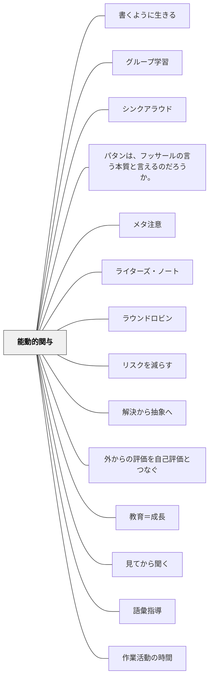

# 能動的関与

**一文でいうと**：子どもが考える・選ぶ・作る・説明する機会を授業に組み込み、聞いているだけの時間を減らす。

## 使いどころ・使いすぎ注意

| 観点 | 内容 |
| --- | --- |
| 使いどころ | 教師の説明が続き、子どもが聞いているだけの時間が長いとき。 |
| 使いすぎ注意 | 活動量で理解を判定しない。動いていることと、新しい理由や関係を生み出していることは同じではない（解決の ICAP の注記）。 |

> 学習者が受け身でなく、自ら考え・問い・動くことで学習に能動的に関わる機会を意図的につくれ。

## 背景（Context）

受け身の情報受容（聞くだけ・見るだけ）より、能動的な処理（考える・答える・作る・教える）の方が記憶への定着と理解の深さが異なることは認知科学の知見として蓄積されている。能動的関与（Active Engagement）は、学習者が学習プロセスに主体的に参加することを指す。

## 問題（Problem）

教師が説明し続け、子どもたちはただ聴いているだけの授業では表面的な学習にとどまる。「分かりましたか？」に「はい」と答えても、実際に使えるとは限らない。

## 力のかたち（Forces）

- 人は自分が考えたこと・選択したこと・作ったことを記憶に残しやすい
- 受動的な姿勢は習慣化すると主体性の低下につながる
- 能動的関与は心理的安全性が確保されていないと起きにくい

## 解決（Solution）

> **原典による補足：動いているかより何を生成したか**：ChiとWylie（2014, pp. 221–225）のICAPは、受容・操作・生成・共同生成を区別する。「選ぶ・動く」と「新しい理由や関係を生み出す」は同じではない。静かに聞きながら深く考える場合もあるため、活動量で理解を判定しない。Wiki側の適用案として、説明の後に「本文にない理由や関係を一つ説明する」機会を設け、成果物から実際の関与を確かめる。出典：[[文献/認知的関与を捉えるICAP（ChiとWylie2014）]]。

**学習者が「考える・選ぶ・作る・伝える・試す」機会を授業に意図的に組み込む。**

**近いパタンとの見分け**：協働・対話の表では、本パタンの見分けの問いは「考える・選ぶ・作る・伝える・試す機会を、授業に組み込んでいるか」。全体の表は [[パタン/ソーシャル#近いパタンとの見分け|ソーシャル]] にある。

- 問いかけ→個人思考→ペア共有→全体共有の流れを設計する
- 選択肢を与えて子どもが選ぶ機会をつくる（[[パタン/自己選択自己決定]]）
- 作る活動・説明する活動・教え合う活動を組み込む（[[パタン/作ることで学ぶ]]）
- 沈黙の間を設けて、考える時間を保証する（[[パタン/沈黙の間の設計]]）

### 研究の裏づけ

> **研究の裏づけ**：大学の理系の授業の225研究のメタ分析（Freeman ほか 2014）では、授業中に活動や話し合いを入れた授業は、教師が続けて説明するだけの授業より、試験の成績が標準偏差で 0.47 高く（158研究）、不合格の割合は 21.8% 対 33.8% だった（67研究）（pp. 8410–8411）。効果は分野・授業の規模・入門か上級かを問わず見られ、50人以下の授業で最も大きかった（p. 8411）。ただし対象は大学で、能動的な学びを行った教員は自ら手を挙げた人たちであり、活動の種類や量と効果の関係はデータ不足で調べられていない（pp. 8412–8413）。出典：[[文献/講義だけの授業と能動的な学びを比べる（Freemanほか2014）]]。

> **研究の裏づけ**：関与は一つではない。Fredricks ほか（2004）は、行動的関与（参加・取り組み）、感情的関与（興味・帰属）、認知的関与（理解への投資・方略の使用）を区別し、課題に取り組んでいるように見えることだけでは深い認知的関与を判断できないとする（pp. 59–66）。上の ICAP の注記と同じ向きである。出典：[[文献/学習への関与を行動と感情と思考から捉える（Fredricksほか2004）]]。

> **研究の裏づけ**：米国の大学の理系の授業41研究の学生一人ひとりのデータを集め直したメタ分析（Theobald ほか 2020）では、能動的な学びは、人種的少数派か低所得の学生とそれ以外の学生との差を、試験の点で33%、合格率で45%縮めた。ただし差を縮めたのは、授業時間のうち学生が活動する割合の高い授業だけで、割合の低い授業では合格率の差はむしろ広がった。同じ能動的な学びでも、試験の15研究のうち5研究では、それ以外の学生のほうに大きく効いた。著者は、足場のある練習とすぐのフィードバック（熟慮的練習）と、どの学生も届くと信じて尊重する包摂の文化の両方が要るという仮説を出している（未検証）。出典：[[文献/能動的な学びが、少数派と低所得の学生との差を縮めるかを確かめる（Theobaldほか2020）]]。

> **研究の裏づけ**：講義を減らしても、試験の準備はできる。高校の AP の授業をプロジェクト型に変えた無作為化比較では、教師は講義と試験対策を減らし、生徒中心の教え方を多く使ったが、生徒は試験の準備ができたと感じ、合格の点をとる生徒も増えた（pp. 20–21, 32）。一方で、生徒は続けて来るプロジェクトに「プロジェクト疲れ」を感じ、間に講義を聞いて休みたがった。「講義とプロジェクトは半々くらいがいい」と話す生徒もいた（p. 32）。関与の機会を増やすことと、聞く時間を残すことの釣り合いが要る。出典：[[文献/高校のAPの授業をプロジェクト型に変えると、試験の成績は上がるかを、学校を無作為に分けて確かめる（Saavedraほか2021）]]。

> **研究の裏づけ**：能動的に学んでいる学習者は、学んだ実感が小さいことがある。米国の大学の入門物理で、149人を一人ずつ無作為に分け、同じプリント・同じ解答で、講義と、解答の前に小グループで例題を解いてみる授業とを、2回の授業で入れ替えて受けた。能動的な授業のほうが授業直後のテストは0.46 SD 高かったが、「たくさん学んだと感じる」は0.56 SD 低かった（表3）。学んだ実感は、講義の流れのよさで高くなり、初学者ほど実感と実際の得点がずれた。頭を使う苦労を「学べていないしるし」と受け取るためだと著者らは考え、学期の初めに苦労の価値をはっきり伝え、早めにテストで実際の学びを見えるようにすることを勧める。ただし90分の授業2回の直後の測定だけで、実感を変える20分の説明の効果は比べる組のない自己報告である。子どもでは確かめていない。出典：[[文献/能動的な授業では、学生は多く学んでいるのに、学んだ実感は小さくなるかを、同じ教材で無作為に分けて確かめる（Deslauriersほか2019）]]。

## 結果（Consequences）

- 理解が深まり、知識が定着しやすくなる
- 学習への主体性・意欲が高まる
- 自己調整学習の素地が育まれる

## [Pattern Connection]

**研究からの補足：教師との関係と学習への参加を分けて捉える（Roordaほか2017）**

原典は関与の行動・感情・認知の側面を十分に分離できていない（p. 253）。Wiki側の適用案として、活動量の観察と本人による内容の説明を併用する。ここでの関与をICAPの認知的関与の分類と同一視しない。 出典：[[文献/教師との関係と学習への参加を分けて捉える（Roordaほか2017）]]。

**原典の接続**：認知的関与を捉えるICAP（ChiとWylie2014）を参照し、活動量と認知的な生成を区別するための補足を本ページに加えた。

### Dewey（1916）

**補強された点**：Dewey（1916）は能動的関与を「本物の知識の条件」として哲学的に根拠づける。「すること（doing）」なしに本物の知識はないという命題は、能動的関与を「効果的な学習戦略」としてではなく「知識の本質的条件」として捉え直す。

> "There is no such thing as genuine knowledge and fruitful understanding except as the offspring of doing."（Dewey, 1916, Ch.20）

**教師と学習者の教科内容の違い（Ch.14）**：能動的関与が重要な理由のひとつは、学習者にとっての知識が「①やり方の知識→②情報→③科学的知識」という段階を経るからだ。①は身体的・実践的な「すること」からしか始まらない。教師がすでに③の段階にいる概念を、①のない学習者に③のまま渡すことが「能動的関与のない授業の根本的問題」。

**身体を排除した授業への批判**：

> "The chief source of the 'problem of discipline' in schools is that the teacher has often to spend the larger part of the time in suppressing the bodily activities which take the mind away from its material."（Dewey, 1916, Ch.11）

Deweyによれば、身体活動を排除することで「心が逃げていく問題」が起きている——つまり「じっと座って集中させる」ことが能動的関与を生んでいない。身体を通じた「すること」が、心を素材に留める最も根本的な方法。

**社会的活動の意義**：能動的関与は孤立した活動でなく「社会的な起源と用途をもつ活動（active occupations having a social origin and use）」のときに最も豊かになる。共同調理・ガーデニング・木工・地域探索などは、単なる体験活動ではなく科学・社会・歴史への本物の入口として機能する（Dewey, 1916, Ch.14 Summary）。

**他のパタンへの波及**：[[メタパタン/経験から出発する]] の「doing+undergoing の結合」が能動的関与の条件を説明する。[[パタン/反省的思考の5段階]] は能動的関与を通じて起きる思考プロセスを示す。

---

### Bergin et al.（2012）

Bergin et al.（2012）*Pedagogical Patterns* は、能動的関与を実現するための具体的なパタン群（Active Learning category）として構造化されている。

- **補強点**：PPのActive Learningカテゴリの中核にある問いは「どうすれば学習者を能動的に関与させられるか」——[[パタン/見てから聞く]]（体験→講義）、[[パタン/グループ学習]]（グループが相互フィードバックの場）、[[パタン/自分で探求する]]（自律的探求）、[[パタン/省察]]（内省による自己主導）がその実装パタン群
- **拡張点**：PPでは「能動的関与」を引き出す最も強力な構造として [[パタン/非可視の教師]] を挙げる——教師が問題解決の窓口でなく「ピアへ向かわせる者」になると、クラス全体が相互作用する能動的学習環境になる
- **他のパタンへの波及**：[[パタン/問いを大切にする]] — 問いを歓迎する文化が能動的関与の心理的土台。[[パタン/チャレンジ理解]] — 理解を試す活動が能動的関与を生む。[[パタン/自分の言葉で]] — 説明する活動は能動的関与の典型的な形

---

### フロイト（1932）——エロス欲動としての能動的関与

フロイト「人はなぜ戦争をするのか」（1932年、アインシュタインへの返書）のエロスとタナトスの二元論は、能動的関与の**欲動経済的な基盤**を明らかにする。

エロス（Eros）は「結びつけ・拡張し・統一しようとする欲動」であり、人間が他者・素材・問いに**能動的に向かう力の根源**として読める。学習者がある課題に「引き寄せられ」「没入する」状態は、エロス的欲動が素材・問いに向かっている状態だ。逆に「やらされる」受動的学習はエロスが不在の状態——興味・愛着・つながりの感覚がなければ、能動的関与は持続しない。

**タナトスの昇華（Sublimation）としての能動的関与：**
フロイトが記述する「昇華」——攻撃・破壊欲動（タナトス）を文化的・知的活動に向け直すこと——は、能動的関与の設計に直接関わる。「解体・批判・分析」「打ち破る問い」「激しい議論」は、タナトス的エネルギーの健全な知的昇華であり、能動的関与の強力な形式でもある。

**教師のエロスが学習者のエロスを誘発する：**
子どもは教師との同一化（Identifizierung）を通じて、教師の姿勢・情熱・愛着を自分のものにする（フロイト、集団心理学、1921年）。教師が素材・学問・子どもに向ける「エロス的姿勢」（愛・没入・情熱）は、学習者のエロス的関与を誘発する最も根本的な力だ。

- **補強された点**：Deweyの「すること（doing）が知識の条件」という命題を、フロイトのエロス理論が欲動経済的に支える——「したい（エロス的引力）」がなければ「すること」は持続しない。能動的関与の設計とは、エロスが向かえる素材・問い・関係の場を作ること
- **他のパタンへの波及**：[[概念/エロスとタナトス]]（能動的関与の欲動的基盤）；[[パタン/欲動の昇華]]（タナトスを知的・創造的活動へ転換する設計）；[[パタン/民主的教育]]（エロスによる学習共同体の形成）；[[文献/人はなぜ戦争をするのか（フロイト、中山元訳）]]

## 関連パタン

- [[文献/認知的関与を捉えるICAP（ChiとWylie2014）]] — 活動量と認知的な生成を区別する。
- [[パタン/書くように生きる]]
- [[特別支援/身体と学習]]
- [[教科/LowFloorHighCeilingタスク集]]
- [[教科/算数・数学で使うパタン]]
- [[特別支援/特別支援級の算数指導]]
- [[パタン/グループ学習]]
- [[パタン/シンクアラウド]]
- [[パタン/パタンは、フッサールの言う本質と言えるのだろうか。]]
- [[パタン/メタ注意]]
- [[パタン/ライターズ・ノート]]
- [[パタン/ラウンドロビン]]
- [[パタン/リスクを減らす]]
- [[パタン/解決から抽象へ]]
- [[パタン/外からの評価を自己評価とつなぐ]]
- [[パタン/教育＝成長]]
- [[パタン/見てから聞く]]
- [[パタン/語彙指導]]
- [[パタン/作業活動の時間]]
- [[パタン/算数シンキング・タスク]]
- [[パタン/失敗を組み込む]]
- [[パタン/主体的行為者としての感覚]]
- [[パタン/重要性の見極め]]
- [[パタン/省察]]
- [[パタン/非可視の教師]]
- [[パタン/複雑指導（Complex Instruction）]]
- [[パタン/豊かな課題]]
- [[パタン/欲動の昇華]] — 攻撃欲動（タナトス）の知的昇華が能動的関与を生む
- [[パタン/問いを大切にする]]
- [[パタン/問題解決的教材研究]]
- [[文献/講義だけの授業と能動的な学びを比べる（Freemanほか2014）]] — 講義だけの授業より成績が高く不合格が少ない（大学の理系、225研究）

- [[パタン/自己選択自己決定]] — 選択が能動的関与を生む
- [[パタン/作ることで学ぶ]] — 作ること自体が能動的関与
- [[パタン/自己調整]] — 能動的関与と自己調整は相互に支え合う
- [[パタン/沈黙の間の設計]] — 考える時間を保証する
- [[パタン/アドベンチャー]] — リスクと挑戦が能動性を引き出す
- [[パタン/反省的思考の5段階]] — 能動的関与を通じて起きる思考プロセス（Dewey）
- [[文献/教師との関係と学習への参加を分けて捉える（Roordaほか2017）]] — 参加の様子と学業の成果を別々に確かめる。
- [[文献/学習への関与を行動と感情と思考から捉える（Fredricksほか2004）]] — 行動・感情・認知の三つの関与
- [[文献/能動的な学びが、少数派と低所得の学生との差を縮めるかを確かめる（Theobaldほか2020）]] — 能動的な学びが、少数派と低所得の学生との差を縮める条件（強度）
- [[文献/高校のAPの授業をプロジェクト型に変えると、試験の成績は上がるかを、学校を無作為に分けて確かめる（Saavedraほか2021）]] — 講義を減らしても試験の準備はできた。ただし「プロジェクト疲れ」
- [[文献/能動的な授業では、学生は多く学んでいるのに、学んだ実感は小さくなるかを、同じ教材で無作為に分けて確かめる（Deslauriersほか2019）]] — 能動的な授業では、多く学んでいるのに、学んだ実感は小さくなる

## このパタンが働く実践
- [[実践/テキストコーディング]]
- [[実践/思考の記録サイクル]]
- [[実践/2列メモ（シンクシート）]]
- [[実践/カンファリング（読書会議）]]

| 実践パタン | どのように能動的関与をつくるか |
|------------|--------------------------------|
| [[パタン/ナンバートーク]] | 全員が暗算し、自分の解法を持ってから共有に参加する |
| [[パタン/数学ワークショップ]] | ウォームアップ、個人思考、学習チーム、ジャーナルによって、聞くだけでなく考え・選び・説明する時間をつくる |
| [[パタン/作ることで学ぶ]] | 制作・表現を通して、学習者が知識を自分で構成する |
| [[パタン/アドベンチャー]] | 挑戦や遊びの要素で、自分から動きたくなる状況をつくる |

- [[メタパタン/経験から出発する]] — doing+undergoingの結合が能動的関与の条件（Dewey）

## クラスター図

## Actionable Insight

- 「問いかけ→1分個人思考→ペア共有→全体共有」の流れを1つの授業に1回入れる——受動的な聴講に能動的な処理を挟むだけで定着が変わる
- 学習者が「選ぶ」機会を授業に1カ所作る（どちらのトピックで書くか、どの問題から解くか）——選択が能動的関与の最もシンプルな入り口
- 説明後に「教師に教えるとしたらどう説明するか」を2人で話す時間をとる——説明することが最も深い能動的関与の一形態

## 出典

- [[文献/Democracy and Education（Dewey）]] — 「すること」と本物の知識（Ch.11, 14, 20）
- [[文献/認知的関与を捉えるICAP（ChiとWylie2014）]]
- [[文献/講義だけの授業と能動的な学びを比べる（Freemanほか2014）]]
- [[文献/教師との関係と学習への参加を分けて捉える（Roordaほか2017）]]
- [[文献/人はなぜ戦争をするのか（フロイト、中山元訳）]]
[[文献/Pedagogical Patterns Advice For Educators（Berginほか）]]
