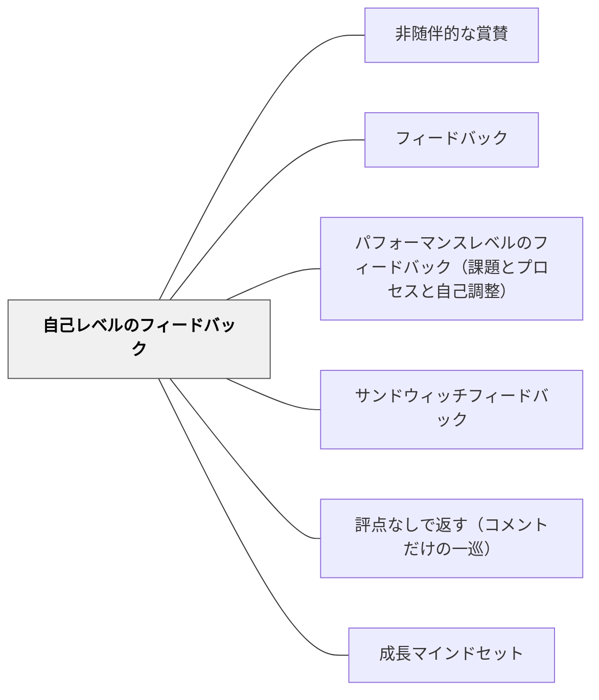

# 自己レベルのフィードバック

**このパタンが完成を助ける大きなパタン**：[[パタン/フィードバック]]

> 「すごいね！」は気持ちを高めるが、学習を改善しない。— ハッティ
>
> 「すごいね、でもここが…」と混ぜると、どちらの効果も薄まる。

## [Pattern Connection]

**研究からの補足（2026-10-18）：フィードバックの効果を注意の向きから捉える（KlugerとDeNisi1996）**

FITは注意が自己へ向くことを説明に用いるが、自己への注意を直接測定したわけではない（p. 276）。Wiki側の適用案として、本人の内面を決めつけず、応答後に課題のどこを見直したかを聞く。原典は人格に向けた言葉すべての効果を一律に確定していない。 出典：[[文献/フィードバックの効果を注意の向きから捉える（KlugerとDeNisi1996）]]。

**研究からの補足（2026-10-22）：評点とコメントが向ける注意を確かめる（Butler1988）**

原典は相対的な評点と課題に関するコメントを比較する（pp. 4–5, 11）。Wiki側の適用案として、返却後に覚えている助言を一つ聞く。ただし本研究は人格への称賛を直接操作しておらず、「人格評価と課題評価の混合」と完全に同一の実験ではない。 出典：[[文献/評点とコメントが向ける注意を確かめる（Butler1988）]]。

## 背景（Context）

※旧パタン「自己レベルのフィードバックとパフォーマンスレベルのフィードバックを混ぜない」を本ページに統合した（2026-11-11）。「自己レベルを学習のフィードバックに使わない」と「混ぜない」は同じ解決の二つの言い方だったため。

ハッティはフィードバックを4つのレベルに分類した。「自己レベル」は学習者の人格・自己そのものへの評価（「頭がいいね」「すごい子だ」「才能があるね」）であり、最も効果が低いとされている。

> **原文との照合（2026-10-11）**：一致。[[文献/The Power of Feedback（Hattie & Timperley, 2007）]] によれば、教師のほめ言葉の効果は0.12（Wilkinson, 1981）、Kluger & DeNisi のデータではほめ言葉のある場合0.09に対し、ない場合0.34（p. 96）。ただし原文は、注意を課題から自己へそらすほめ言葉と、**努力・自己調整・取り組み・過程に向けたほめ言葉**を区別し、後者は自己効力感を通じて課題に戻りうるとしている（p. 96–97）。

## 問題（Problem）

人格への賞賛は短期的には気持ちを高めるが、「次にどうするか」という学習改善の情報を含まない。また固定マインドセットを強化する可能性がある（ドゥエック研究）。

人格への賞賛と改善の情報を同じメッセージに混ぜると、学習者の注意が人格の評価に向き、改善の情報が届きにくくなる。「サンドウィッチフィードバック」（良い点→改善点→良い点）の形でも、人格への賞賛が改善の情報を包んでいると、改善の情報が印象に残りにくい。

## 力のかたち（Forces）

- 人格への賞賛は親しみを生み、関係構築に一定の役割がある
- ただし、学習フィードバックとしての効果は低い
- パフォーマンスへのフィードバックと混ぜると、学習情報が薄まる
- 人格の評価は感情に強く働き、学習の情報を上書きしやすい
- 学習者は「自分は良い子だ」という承認を求めがちである。承認そのものは取りあげず、伝える場面を分ける

## 解決（Solution）

**近いパタンとの見分け**：フィードバックの表では、本パタンの見分けの問いは「「すごいね」「頭がいいね」と人に向けた言葉か。関係づくりには使い、学習の返しとは場面を分ける」。全体の表は [[パタン/フィードバック#近いパタンとの見分け|フィードバック]] にある。

**「あなたはすごい」という自己レベルの評価は関係構築の文脈で用い、学習改善のためのフィードバックとは明確に区別する。学習フィードバックはパフォーマンスレベルで行う。**

自己レベルの例（学習フィードバックとしては不適）：
- 「天才だね」「才能があるね」「頭がいいね」

→ 代わりに「よく考えたね（プロセス）」「この戦略がうまく機能したね（自己調整）」を使う

**混ぜない（場面とタイミングを分ける）**：
- 学習のフィードバックの場では「この作品で、ここが良かった理由は…」と作品に焦点を当てる
- 「今日よく頑張ったね」のような承認は、関係づくりの場面（授業の終わりに全体へ など）で伝える
- 「あなたは頭がいいね、だからこの部分を直して」と混ぜない

> **研究の裏づけ（2026-10-31）**：英国の Education Endowment Foundation のフィードバックの指針（2021）は、子どもの人柄や特性に焦点を当てたフィードバックは効きにくいとし、「生まれつきの数学者だね」は改善に使える情報がなく、学びから注意をそらしうると書く（p. 21）。ほめるなら何がよかったかを具体的に言い、努力について言うなら何をすればよくなるかにつなげるよう勧める（p. 24）。出典：[[文献/学びを前に進める教師のフィードバックを整える（英国EEF2021）]]。

## 結果（Consequences）

- フィードバックが具体的な改善情報として機能するようになる
- 成長マインドセットが育ちやすくなる
- 学習者が、作品・パフォーマンスと自分自身を切り離して評価を受け取れるようになる

## 関連パタン
- [[パタン/非随伴的な賞賛]]
- [[文献/学びを前に進める教師のフィードバックを整える（英国EEF2021）]] — 人柄へのフィードバックは効きにくい。ほめるなら具体的に

- [[パタン/フィードバック]] — 親パタン
- [[パタン/パフォーマンスレベルのフィードバック（課題とプロセスと自己調整）]] — 効果的な代替
- [[パタン/サンドウィッチフィードバック]] — 賞賛で改善点を包む形。混ぜることの典型例
- [[概念/自我関与と課題関与（フィードバックが向ける先）]] — 注意の三水準（メタ課題／課題動機づけ／課題学習）という理論的裏づけ
- [[パタン/評点なしで返す（コメントだけの一巡）]] — 同じ軸の上にある。評点は最も凝縮された自己レベルのフィードバックだと読める
- [[文献/評点とコメントが向ける注意を確かめる（Butler1988）]] — 課題への情報が、他者との比較に埋もれないか確認する
- [[文献/Assessment and Classroom Learning（Black & Wiliam）]] — 注意の三水準と同型の区別
- [[パタン/成長マインドセット]] — プロセス賞賛との連携
- [[文献/The Power of Feedback（Hattie & Timperley, 2007）]] — 自己レベルがもっとも効かないという主張の原典。ほめ言葉0.12
- [[文献/フィードバックの効果を注意の向きから捉える（KlugerとDeNisi1996）]] — 自己への注意という説明仮説と、観察できる修正行動を分ける。

## クラスター図

## Actionable Insight

- 「天才だね」「才能があるね」を使いそうになったとき、「どんな方法で考えたのか」という問いに置き換える——プロセスへの注目が成長マインドセットを育てる
- 作品を返すとき「あなたはすごい」の代わりに「ここの工夫が効いていた、理由は…」と伝える——自己レベルからパフォーマンスレベルへの言い換えをまず1回試みる
- 「結果が良かったね」より「この部分でどう考えたの？」と聞く習慣を持つ——プロセスへの問いが固定マインドセットでなく成長マインドセットを促す

- フィードバックを書くとき「これは人格への評価か、作品・プロセスへの評価か」を一度確かめる——意識するだけで二つが分かれていく（旧「混ぜない」より）

## 出典

- Hattie, J. (2009). *Visible Learning: A Synthesis of Over 800 Meta-Analyses Relating to Achievement*. Routledge.（邦訳：原田信之訳（2018）『教育の効果―メタ分析による学力に影響を与える要因の効果の可視化』図書文化社）
