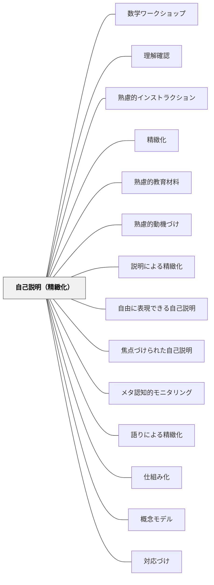

# 自己説明（精緻化）

> 自分の言葉で説明できることが、本当に理解していることの証拠である。

## [Pattern Connection]

**基本文献からの補足（2026-10-14）：思考過程を見せて支える認知的徒弟制（Collinsほか1987）**

articulationは知識・推論・問題解決過程を明らかにする方法である（本文p. 17）。授業案として「なぜこの要約が適切か」を本文と照合して説明する。自己説明の実験研究と同一の介入として扱わず、設計上の接点とする。 出典：[[文献/思考過程を見せて支える認知的徒弟制（Collinsほか1987）]]。

**原典補足（2026-10-14）：学習方法の効果と適用条件（Dunloskyほか2013）**

自己説明は記憶・理解・転移への可能性がある一方、時間の負担や長期保持・教室での証拠の不足から中評価とされた（節2.5）。授業案として、一つの手順の理由を説明し、資料と照合する。説明を長く増やせば必ずよいとはしない。 出典：[[文献/学習方法の効果と適用条件（Dunloskyほか2013）]]。

## 背景（Context）
※旧パタン「精緻化（自己説明）」（熟慮的教材教具の子）と「自己教示（セルフトーク／自己説明／精緻化／体系化）」（熟慮的動機づけの子）を、本ページに統合した（2026-11-11）。『一つの教育のパタン・ランゲージ』では、同じ「自分の言葉で説明して理解を深める」が、教材・指導・動機づけの三つの系列にそれぞれ置かれていた。本ページは三つの系列すべての子として扱う。

山本博樹（2019）『教師のための説明実践の心理学』ナカニシヤ出版は自己説明を学習の認知方略として位置づける。自己説明とは、学習内容を自分の言葉で説明するプロセスであり、精緻化・体系化を促して長期記憶への定着を助ける。「説明できれば理解している」という前提のもと設計される。

## 問題（Problem）
学習者が「わかった」と感じていても、実際には表面的な理解にとどまっていることがある。人に説明しようとすると初めて「どこがわかっていないか」に気づく。受け身での受容だけでは深い理解が生まれにくい。

## 力のかたち（Forces）
- 自己説明は受け手を能動的な処理者に変換する
- 自由に説明させる形（自由な自己説明）から、焦点を絞った形・足場組みの形など5形態がある
- 説明の機会を多く設けすぎると活動時間が圧迫される
- 自分に向けた説明と、他者に向けた説明では、働きが異なる（他者への説明は [[パタン/説明による精緻化]]）
- 自己説明のしかたそのものを、最初は教える必要があることがある
- 声に出す・書くことで、考えが整理されやすい（セルフトーク）

## 解決（Solution）
**学習内容を自分の言葉で説明させる機会を意図的に設計する。「〇〇をとなりの人に説明してみましょう」「今学んだことを3文で書いてみましょう」のように、説明の場を作る。**

自己説明には5形態がある：(1)自由に思いついたことを話す、(2)焦点を絞って説明する、(3)欠落部分を補いながら説明する（足場組み）、(4)資料・法則を使って説明する（リソース利用）、(5)選択肢から選んで説明する（メニュー選択）。学習の段階や目的に応じて形態を選ぶ。

> **研究の裏づけ（2026-10-31）**：発見学習の164研究のメタ分析（Alfieri ほか 2011）は、支えのある発見を三種類に分けて効果を比べた。学習者に説明を求める条件は d = 0.36、足場やフィードバックのある発見は d = 0.50 で、他の指導より学びが多かった。ところが、ルールや答えを自分で生み出すだけの条件（生成）は d = −0.15 で、他の指導のほうが学びが多かった（著者稿 p. 25、表13）。著者は、生成の条件では与えられた情報を超える程度がまちまちだったと考える（p. 31）。答えを出すことと、なぜそうなるかを説明することは別の活動として設計する。出典：[[文献/発見学習の支援条件を見分ける（Alfieriほか2011）]]。

## 近いパタンとの見分け

| パタン | だれに向けて・どの形で説明するか | 使いどころ |
| --- | --- | --- |
| [[パタン/精緻化]] | （親・原理）新しい知識を、既有の知識・経験・例と結ぶ | 説明のほかに、例示・比較・体験への接続なども含む上位の原理 |
| **自己説明（本ページ）** | 自分に向けて説明する（声に出す・書く・心の中で） | 1人ひとりの理解の穴を、本人が見つける |
| [[パタン/説明による精緻化]] | 他者に向けて説明する（ペア・発表・「低学年の子に説明するなら」） | 相手がいることで、説明の組み立てが必要になる |

自己説明の5つの形（山本 2019）は、子どもが白紙から説明を組み立てる負担の大きさで選ぶ。

| 形 | 求め方 | 向いている場面 |
| --- | --- | --- |
| [[パタン/自由に表現できる自己説明]] | 「自分の言葉で説明してみよう」と、制約をつけない | 子どもの理解の実態を見たいとき。負担は最も大きい |
| [[パタン/焦点づけられた自己説明]] | 「○○と□□のちがいを説明しよう」と、対象を一つに絞る | 何を説明すればよいかで手が止まるとき |
| [[パタン/足場組みの自己説明]] | 説明の一部（文の冒頭・骨格）を与え、残りを埋める | 理解が途中の段階。足場は少しずつ外す |
| [[パタン/リソースを利用した自己説明]] | まとめシート・公式一覧・資料を手元に置いて説明する | 思い出すことより、つなぐことに集中してほしいとき |
| [[パタン/メニュー選択の自己説明]] | 説明の候補から選び、選んだ理由を説明する | 全員が入れる入口がほしいとき。誤答の候補でよくある誤りも扱える |

## 結果（Consequences）
- 受け手が自分のわかっていない部分を自覚できる
- 精緻化・体系化が促進され、長期記憶への定着が高まる
- 「説明できる」という到達基準が学習の指標になる
- 説明できたという経験が、自己効力感と学ぶ意欲を支える（旧「自己教示」より）

> **研究の裏づけ（2026-10-31）**：算数の作業例について各手順を説明してもらう研究は、結果がそろっていない。米国教育科学研究所の実践ガイド（Woodward ほか 2012）が確かめた3研究のうち、日本の6年生53人の研究（Tajika ほか 2007）とアメリカの高校生の研究では正の効果、オーストラリアの4年生48人の研究では効果がなかった。同ガイドはまた、子どもの説明が「正しい記述」でも「なぜ」を含まないことがあると例を挙げる（同値な分数で「分子と分母に同じ数をかける」は正しいが、なぜ同じ大きさになるかを説明していない）。説明の量より、理由まで言えているかを見る。出典：[[文献/算数の問題解決を4〜8年生で育てる（Woodwardほか2012）]]。

## クラスター図

## Actionable Insight

- 説明後に「隣の人に今学んだことを自分の言葉で説明してみよう」と毎授業1回入れる——説明しようとすることで学習者が自分の理解の穴に自然と気づく
- 「今日の学びを3文で書いてみましょう」を授業の最後のルーティンにする——定期的な自己説明の習慣が長期記憶への定着と「説明できる」という自信を育てる
- 学習の段階に応じて「自由に話す→焦点を絞る→資料を使って説明する」と形態を変える——5形態の中から目的に合った自己説明を選ぶことが学習の精度を高める
- 「今日学んだことと、前に学んだことで、つながるのはどこ？」を1文書く——新しい知識と既有知識の関連づけが定着を支える（旧「精緻化（自己説明）」より）

## 出典

- 一つの教育のパタン・ランゲージ（岩井輝久）
- 山本博樹（2019）『教師のための説明実践の心理学』ナカニシヤ出版
- 鈴木克明（2002）『教材設計マニュアル――独学を支援するために』北大路書房（旧「精緻化（自己説明）」の出典）

## 関連パタン
- [[文献/思考過程を見せて支える認知的徒弟制（Collinsほか1987）]] — 自分の知識と判断の理由を表出する。
- [[文献/学習方法の効果と適用条件（Dunloskyほか2013）]] — 自己説明の効果と時間・対象の条件を併記する。
- [[文献/算数の問題解決を4〜8年生で育てる（Woodwardほか2012）]] — 作業例の自己説明は結果がそろわない。正しい記述と完全な説明の違い（同値な分数の例）
- [[パタン/数学ワークショップ]]
- [[教科/算数]]
- [[教科/算数・数学で使うパタン]]
- [[パタン/理解確認]]
- [[パタン/熟慮的インストラクション]] — 親パタン
- [[パタン/精緻化]] — 親パタン（原理）。本ページは自分に向けた説明という実装
- [[パタン/熟慮的教材教具]] — 親パタン（旧「精緻化（自己説明）」の系列）
- [[パタン/熟慮的動機づけ]] — 親パタン（旧「自己教示」の系列）
- [[パタン/説明による精緻化]] — 他者に向けて説明する。本ページは自分に向けた説明
- [[パタン/自由に表現できる自己説明]] — 自己説明5形態の一つ（制約なし）
- [[パタン/焦点づけられた自己説明]] — 自己説明5形態の一つ（対象を絞る）
- [[パタン/メタ認知的モニタリング]] — 自己説明を通じて自分の理解を点検する
- [[パタン/語りによる精緻化]] — 話すことで精緻化する
- [[パタン/仕組み化]] — 仕組みの中の学習活動として自己説明を置く
- [[パタン/概念モデル]] — モデルを自分の言葉で説明して内化する
- [[パタン/対応づけ]] — 既知と新しい知識の対応を説明で強める
- [[パタン/記憶術]] — 意味づけによる記憶の補助
- [[パタン/足場組みの自己説明]] — 自己説明5形態の一つ
- [[パタン/リソースを利用した自己説明]] — 自己説明5形態の一つ
- [[パタン/メニュー選択の自己説明]] — 自己説明5形態の一つ
- [[文献/発見学習の支援条件を見分ける（Alfieriほか2011）]] — 説明を引き出す発見は有利（d = 0.36）、答えを生み出すだけは有利ではない（d = −0.15）

## このパタンが働く実践
- [[実践/2列メモ（シンクシート）]]
- [[実践/学習科学の6方略]]
- [[実践/書き出しのクラフト]]

| 実践パタン | どのように自己説明を促すか |
|------------|----------------------------|
| [[実践/10や100を単位にして計算しよう]] | 計算の答えだけでなく、「何を単位として見たか」を自分の言葉で説明する |
| [[実践/カエルの算数：勝ちやすさを表で考えよう]] | 「何通りあるから勝ちやすい」と、表から読み取った根拠を自分の言葉で説明する |

## このパタンが働く教材

| 教材 | どのように自己説明を促すか |
|------|----------------------------|
| [[教材/読書反応の書き出しの手引き]] | 読んで感じたことや予想に「なぜなら」を添え、自分の読みを理由とともに説明する |
