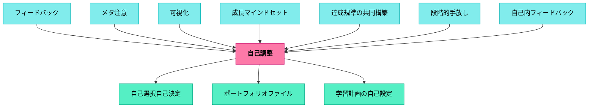

# 自己調整

**このパタンが完成を助ける大きなパタン**：[[パタン/熟慮的動機づけ]]・[[パタン/メタ意識]]

**一文でいうと**：学習者が自分で課題をつかみ、目標と計画を立て、点検し、振り返れるように、その過程を支える。

## 使いどころ・使いすぎ注意

| 観点 | 内容 |
| --- | --- |
| 使いどころ | 子どもが課題を後回しにする・詰め込みに頼る・行き詰まると止まるとき。 |
| 使いすぎ注意 | 四段階を固定した手順として教えない。方略は教科の中で教えるほうがよく、「学び方」だけを別の時間に教える効果の根拠は乏しい（解決の EEF）。 |

> 自己調整のスキルが身につくように、自己調整のプロセスを支援せよ。自己調整のスキルを身につけることで、被教育者は優れた学習者となる。

## 背景（Context）

> 「魚を一匹もらうと、一日は食べていける。魚釣りの方法を学ぶと、一生食べていける。」（孔子 / プロジェクトアドベンチャーの本より）

この言葉は仕事の最初の段階でプロジェクトアドベンチャーの本で出会った。プロジェクトアドベンチャーは「学び方を身につける」という方向性の教育プログラムだ。個別の知識を身につけることも大事だが、知識を生み出す方法・学び方を身につければ、学校から離れた後も生涯にわたって自分で学習を進めることができる。

自己調整のスキルが身についていないために、課題を後回しにしたり、詰め込み勉強をしたりするなど、多くの悪い習慣が身についている。良い結果を出せず、学習に対する自己効力感は低い——そういう状況がある。

## 問題（Problem）

学習の仕方が分からないまま努力しても、非効率な悪い習慣を繰り返すだけになる。どうすれば被教育者が自分自身の学習プロセスを管理・改善できる力を育てられるか。

## 力のかたち（Forces）

- 優れた学習者は自己調整のスキルが身についているため、学力は高く自己効力感も高い傾向にある
- 自己調整は教わるだけでなく、自己調整のプロセスを経験することで身につく
- 生まれつきの差・文化資本の差があっても、学び方を身につければ誰でも力をつけていける
- 自己調整は「主体的に取り組む態度」（文科省）の核となるもの

## 解決（Solution）

自己調整とメタ認知のパタンのどれを使うかで迷ったら、下の「[[#近いパタンとの見分け|近いパタンとの見分け]]」の表を見る。

> **原典による補足：四段階は唯一の共通モデルではない**：Panadero（2017, pp. 18–23）は六モデルを比較し、循環・フィードバックを共有しつつ段階区分や重点は異なると整理する。下記の四段階は実践の整理枠として使い、全モデル共通の固定手順とはしない。SRLには認知だけでなく動機づけ・感情・行動・環境の調整も含む。Wiki側の適用案として、振り返りに「方法」「困り方」「使った支援」を一つずつ残し、次の計画を変える材料にする。出典：[[文献/自己調整学習の六モデル（Panadero2017）]]。


**自己調整のプロセスを支援せよ。**

自己調整学習とは、個人が自分自身で学習プロセスをモニタリング・評価し、必要に応じて自分自身を改善するための学習を確立することだ。

優れた学習者は：
- 学習の方法や進み方に対して**自己モニタリング**を多く使う
- フィードバックを踏まえて、学習の方法や進み方をより良いものへ組織する
- 適切な目標設定をする
- 動機づけや学習プロセスのコントロールを自分で行う

**自己モニタリング**とは、学習のプロセスや結果を内からも外からも観察することだ。

---

### 4段階の循環する自己調整サイクル

```
① 課題の分析とモニタリング
      ↓
② 目標と計画の設定とモニタリング
      ↓
③ 計画の実行とモニタリング
      ↓
④ 振り返り
      ↓（次のサイクルへ）
```

各段階は緩やかに連続し、循環する。

---

#### ① 課題の分析とモニタリング

まず、何を求められているのか——課題（テーマ）や与えられていることを理解すること。学習者はアフォーダンスと制約の中で課題に出会う。

**外的なもの**（環境・状況）：
- 時間はどれだけあるか
- 仲間に援助を頼むことができるか

**内的なもの**（学習者自身）：
- 課題（テーマ）に関する知識
- うまくできるかの見通し
- 課題を解決する方法

課題を本当に理解できているのかモニタリングを行う。

**課題の例**：
- 時間の予定を立て、時間を管理するスキルを育てること
- 俳句を作って発表すること
- 算数の問題を解決する方法を説明すること
- 10分間でできるだけたくさんの解法を説明すること（解法を説明するには、これまで習った既知の方法が未知の問題でも使えるかもしれない）

---

#### ② 目標と計画の設定とモニタリング

課題を理解した学習者は明確な目標を設定する。何が達成の基準となるのか——目標を明確にすることで自己評価を行い、自己フィードバックを受け取ることができるようになる。

目標を立てたら、どうやって到達するのか計画を立てる。学習者は目標を達成するための選択肢について比較検討する。

この段階でも自己モニタリングがある：
- 課題に対して設定した目標と計画は適切か
- そもそも課題を理解できているのか
- 何か与えられていることを見逃していないか

---

#### ③ 計画の実行とモニタリング

学習者は計画したことを実行していく。学習が進むにつれて②で設定した基準から質のモニタリングがなされる。

自己モニタリングの中で方法や途中の結果を自己評価して学習を調整していく。このモニタリングに含まれる**形成的な自己評価**が自己調整学習の重要な要素だ。

- 自分自身の強みや弱みを理解し学習プロセスを評価することで、自己フィードバックを受け取る
- 自己フィードバックを使用して成功した要因や課題を特定し次の計画を立てる
- 学習プロセスに合わせて方法を調整することで学習の成果を最大限に引き出す
- 実行の段階で計画自体が修正されることもある

---

#### ④ 振り返り

振り返りは自己調整の最終段階だ。自分自身が学んだこと・成功したこと・課題や困難に直面したことを振り返ることで、学習プロセスを総括し今後の学習を改善することができる。

---

### 教育者が提供できる支援

自己調整のプロセスを支援するために、様々な支援パターンを考えることができる：
- 課題との出会いを工夫する
- モデルとなるエクセレンスを集めて見せる
- 方法を一緒に考えたり提案したりする

---

### 動画後半：パターンランゲージを身につけることも自己調整

パターンランゲージを作りパターン記述をしながら、それを視点に教育の仕事の計画を立てている。しかし実行の最中にも、子どものリアルタイムな情報がいっぱい入ってくる——やってみたけどうまくいかなかった、やってみたら予想通りうまくいったという情報だ。

その時にパターンリストの視点で即興で計画が変更されていく。**パターンランゲージを身につけるということ自体が自己調整のスキルの一つだ**——それを実践しながら振り返って気づいた。

---

### 動画後半：誰もが自己調整を身につけられる

みんな生まれつきの差もあるし、文化資本などの差もある。しかし**どんな人も、学べば必ず自分なりに力をつけていくことができる**と考えている。

自分より頭がいい人と比べても何の意味もない。どんな人でも、学び方・やり方・考え方を身につけることで、努力することで少しずつ力をつけていける。

子どもたちも同じだ。自信を失っている子・自分に自信を持てない子も、努力すれば必ず少しずつ力をつけていける。力をつけることで：
- 生きていく上での不要な苦しみを避けられる確率が上がる
- 自己実現できる可能性が高まる
- 自分がやれる仕事の可能性が広がる

---

### 「主体的に取り組む態度」との接続

文科省の3つの視点（深い学び・共同的な学び・主体的に取り組む態度）のうち、**「主体的に取り組む態度」の核となるものがこの自己調整**だ。

メタ認知——「自分がどのように認知しているか考える」「自分の計画がうまくいっているか考える」——これが自己調整だ。「粘り強さ」という非認知的なものが主体的に取り組む態度のキーコンセプトとされているが、その核となるものが自己調整学習の成果だと考えている。

「意欲」を評価していた時代から、「主体的に取り組む態度＝自己調整」という形で評価がより明確になったことは、自己調整学習の学問の成果が反映されていると見ることができる。

### 研究の裏づけ

> **研究の裏づけ**：英国の Education Endowment Foundation のメタ認知と自己調整学習の指針（2018）は、自己調整学習を認知・メタ認知・動機づけの三つに分け、メタ認知を「自分についての知識・方略についての知識・課題についての知識」と「計画→点検→評価の循環」で説明する（pp. 9–10）。方略は教科の内容の中で教えるのがよいとし、既有知識を呼び起こす→方略を明示的に教える→手本を示す→方略を覚える→導かれた練習→一人での練習→構造化されたふり返り、の七段階の型を示す（p. 14）。「学び方を学ぶ」「思考スキル」の別の時間で教える効果の根拠は乏しく、子どもは一般的なこつを特定の課題に移しにくいとする（p. 24）。出典：[[文献/メタ認知と自己調整を教科の中で育てる（英国EEF2018）]]。

> **研究の裏づけ**：子どもは自分の学びを正確に判断しにくく、一夜漬けのほうがよく学べたと感じやすい。英国の Education Endowment Foundation の指針（2018）は、間隔をあけた練習の良さを直接教えると判断のずれが減り、フィードバックを与えるだけでは減らなかった実験を引く（p. 24）。自分の学び方を選ぶには、どの方法がなぜ効くかを知ることも要る。出典：[[文献/メタ認知と自己調整を教科の中で育てる（英国EEF2018）]]。

> **研究の裏づけ**：支えをだんだん子どもに渡す流れについて、『How People Learn』（2000）は三人の教師を紹介する。作品を仕上げることに目を配る教師、活動から何を学ぶかに目を配る教師、それに加えて学習の過程をだんだん子どもに渡していく教師である（pp. 12–13）。ただし、だんだん任せる方略指導がそうしない方略指導より効くという強い因果の証拠はない（Shanahan ほか 2010）。出典：[[文献/人の学び方の研究を授業の設計につなぐ（全米研究評議会2000）]]・[[文献/幼稚園〜3年生の読解指導を研究から組み立てる（Shanahanほか2010）]]。

> **研究の裏づけ**：自分の学び方の判断は外れやすい。読み直した大学生ほど、1週間後も覚えているという自信が高かったが、実際の保持は低かった（Roediger と Karpicke 2006、表2）。読みやすさや直後の滑らかさは、後でも思い出せるという判断を過大にしうる（Soderstrom と Bjork 2015, pp. 189–190）。分散学習を自分で選ぶには、効果の説明や日程の支えが要ることがある（Dunlosky ほか 2013, p. 39）。出典：[[文献/想起テストによる長期保持（RoedigerとKarpicke2006）]]・[[文献/その場のできと長く残る学習を分ける（SoderstromとBjork2015）]]・[[文献/学習方法の効果と適用条件（Dunloskyほか2013）]]。

> **研究の裏づけ**：計画・点検・ふり返りの方略を教えた効果の長さを、1〜8年生の48の取り組みで確かめたメタ分析がある。直後 0.50、平均21.6週後に 0.63 で、効果は消えなかった。教科・期間・教えた人（教師か研究者か）・協同学習は、残り方を変えなかった。家庭の経済状況が厳しい子どもで伸びが大きく見えた（4つの取り組み、0.35 対 0.10）。著者は、学び方を新しい課題に移すのは難しいので、新しい課題ごとに方略を教えることを勧める（p. 112）。出典：[[文献/学び方の方略を教えた効果は、教え終えたあとも残るかを48の取り組みから確かめる（deBoerほか2018）]]。

> **研究の裏づけ**：子どものころの自制心（3〜11歳の観察・教師・親・本人の評定）は、32歳の健康・経済状況・犯罪を、知能や家庭の社会階層と同じくらい予測した（ダニーデンの1,037人の縦断研究）。同じ家庭で育ったきょうだいの比較でも、5歳で自制心の低かったほうが、12歳で喫煙・学業不振・反社会的な行動が多かった。自制心の順位が上がった人は32歳の結果がよかったが、著者は、自然な変化が取り組みによる変化と同じとは言えないと断る。自制心の得点には、衝動的な攻撃性・多動・不注意などの問題行動の評定が多く含まれる。出典：[[文献/子どものころの自制心が、32歳の健康・経済状況・犯罪を予測するかを、生まれた子ども全員の追跡から確かめる（Moffittほか2011）]]。

## 近いパタンとの見分け

自己調整とメタ認知のパタンは、目標と計画、途中で自分を見る、振り返る、記録する、で分かれる。子どもの自己調整を支えるパタンと、教師自身が実践を練習するためのパタン（焦点を絞った目標設定・実践ジャーナル）が混ざっているので、主語に気をつけて使う。

| 迷いどころ | パタン | 見分けの問い |
| --- | --- | --- |
| 全体の循環 | **自己調整（本ページ）** | 目標→計画→実行しながら見る→振り返る、の循環を、子どもが自分で回せるよう支えているか |
| 目標と計画 | [[パタン/目標設定]] | 子どもが、具体的で挑戦的な目標を自分で立て、途中で見直しているか |
| 目標と計画 | [[パタン/学習計画の自己設定]] | 「いつ・何を・どのように学ぶか」を、子どもが自分で計画しているか |
| 目標と計画 | [[パタン/焦点を絞った目標設定]] | 教師が一回の実践で意識する焦点を、行動で確かめられる一つに絞っているか（教師の練習） |
| 途中で自分を見る | [[パタン/メタ認知的モニタリング]] | 「今どのくらいわかっているか」を見て、わからなければ直す手を打っているか |
| 途中で自分を見る | [[パタン/自分に投げかける問い]] | 「何を求められている？何がわからない？」と、自分に問う問いの型をもっているか |
| 途中で自分を見る | [[パタン/メタ意識]] | 自分の考え・気持ち・体の状態を、一歩引いて言葉にしているか |
| 途中で自分を見る | [[パタン/制作しながら質を判断する（産出中のモニタリング）]] | 作っている最中に、手元の作品の質が自分で見えているか（細部の点検に張りつめすぎずに） |
| 途中で自分を見る | [[パタン/計画の各段階はどうか]] | 解いた手順の一つずつを、なぜそうしたかとともに振り返っているか |
| 振り返る | [[パタン/自己内フィードバック]] | ゴール・現在地・次の一歩を、子どもが自分でつかむ仕組みと習慣があるか |
| 振り返る | [[パタン/到達レベルの自己評価]] | 規準を使って自分の作品を評価し、そのあと教師の評価と比べているか |
| 振り返る | [[パタン/省察]] | 教師が答えを返さず問い返して、子どもが自分の経験から答えを引き出しているか |
| 振り返る | [[パタン/反省的思考の5段階]] | 困惑→問題の明確化→仮説→推論→検証、の思考の全過程を授業の骨格にしているか |
| 振り返る | [[パタン/振り返りでのねらいの共同構築]] | 学習のあとの気づきを集めて、次のねらいを学級でつくっているか |
| 記録する | [[パタン/自己記録]] | 子どもが自分の伸びを記録し、見返して動機を保っているか |
| 記録する | [[パタン/実践ジャーナル]] | 教師が実践の直後に、「やってみたこと・起きたこと・次」を短く書いているか |
| 記録する | [[パタン/一回できたことと続いていることを分ける（記録の列）]] | 記録の列から言えること（列の形）と、言えないこと（その子の力）を分けているか |
| 記録する | [[パタン/つまずきを構造で記録する（診断の粒度設計）]] | つまずきを、正誤ではなく、どの変化の種類で詰まったかで記録しているか |
| 記録する | [[パタン/省察的評価]] | 観察記録・ポートフォリオ・カンファリングで、子どもが自分の成長を語る評価にしているか |

**混同しやすい組**：
- [[パタン/目標設定]] と [[パタン/焦点を絞った目標設定]]：前者は子どもの学習の目標、後者は教師が一回の実践で意識する焦点を一つ決めること（[[パタン/熟慮的練習]] の教師版）。
- [[パタン/メタ認知的モニタリング]]・[[パタン/自分に投げかける問い]]・[[パタン/メタ意識]]：モニタリングはわかり具合を見て直すこと、自分に投げかける問いはそのための問いの型、メタ意識は考え・気持ち・体を一歩引いて見る構え。
- [[パタン/制作しながら質を判断する（産出中のモニタリング）]] と [[パタン/到達レベルの自己評価]]：前者は作っている最中に質を見る、後者は作り終えてから規準で見る。
- [[パタン/計画の各段階はどうか]] と [[パタン/反省的思考の5段階]]：前者は解いた手順を一つずつ振り返る問い、後者は困惑から検証までの思考の全過程を授業の骨格にする。
- [[パタン/省察]] と [[パタン/自己内フィードバック]]：省察は教師が答えを返さず問い返す関わり、自己内フィードバックは子どもが自分でゴール・現在地・次をつかむ仕組み。
- [[パタン/自己記録]]・[[パタン/実践ジャーナル]]・[[パタン/一回できたことと続いていることを分ける（記録の列）]]：自己記録は子どもが伸びを記録して動機を保つ、実践ジャーナルは教師が実践を書き留める、記録の列は、並べた記録から言えることと言えないことを分ける。

**緊張**：[[パタン/メタ認知的モニタリング]] と [[パタン/制作しながら質を判断する（産出中のモニタリング）]]：自分を見張るほど、作ることそのものが止まることがある。見分けは、**今は作る時間か、見直す時間か**である。作る時間には、評価の知識を背景で働かせる（副次的意識）にとどめ、点検は見直しの時間にまとめる。

### 系列の中の小さなまとまり

上の表に入れなかった、目標と約束、途中で確かめること、自分で進める学び方のパタンを、まとまりごとに並べる。

| 迷いどころ | パタン | 見分けの問い |
| --- | --- | --- |
| 目標と約束 | [[パタン/パーソナル・マスタリー]] | ビジョンと現実の差を、失望ではなく前に進む力として感じられる構造があるか（センゲ） |
| 目標と約束 | [[パタン/行動契約]] | 目標・強化子・条件を子どもと一緒に決め、契約書に署名して、実施しながら調整しているか |
| 目標と約束 | [[パタン/チェックイン・チェックアウト（行動支援）]] | 毎朝と放課後に1〜3分、その日の目標と達成を、担当の大人と確かめているか |
| 目標と約束 | [[パタン/研究動機の先行執筆]] | 研究を書き始める前に、なぜその題材を研究したいのかを言葉にしているか |
| 途中で確かめる | [[パタン/先に見積もってから計算する（答えのあたりをつける）]] | 計算の前に答えのあたりをつけ、出た答えがおかしいかどうかに自分で気づけるようにしているか |
| 自分で進める学び方 | [[パタン/自分で探求する]] | 自力で調べるトピックを持ち、調べたことを人に発表しているか（ヒントは出すが答えは渡さない） |
| 自分で進める学び方 | [[パタン/複線型授業]] | 学習課題・過程・形態を子どもが選び、多様な学びが同時に進んでいるか |
| 自分で進める学び方 | [[パタン/援助要求スキル]] | 困ったときに「助けてください」と言える力を、段階を追って育てているか |
| 自分で進める学び方 | [[パタン/4象限ノートテンプレート（意味のあるノート）]] | 考えをまとめたあとに、四つの欄のテンプレートに、自分で選んだ内容を書いているか |
| 途中で確かめる | [[パタン/メタ注意]] | 自分の注意がそれたことに、自分で気づけているか |
| 途中で確かめる | [[パタン/自分の言葉で]] | 大事な考えを、教科書の言葉の繰り返しではなく、自分の言葉で言えているか |
| 途中で確かめる | [[パタン/チャレンジ理解]] | 理解を試される演習や課題で、自分の理解のすき間に気づく機会があるか |
| 自分で進める学び方 | [[パタン/ラーニングガイド]] | 単元の学習の全体像を事前に受け取り、自分で仮説と学習計画を立てているか |
| 自分で進める学び方 | [[パタン/スキル化]] | 困りごとを性格の問題にせず、練習できるスキルに変えているか（岩井） |

**この表の中で混同しやすい組**：
- [[パタン/行動契約]] と [[パタン/コミットメント]]：行動契約は、教師と子どもが条件を決めて署名する手順。コミットメントは、宣言・誓約・契約を含む自分との約束の全体。
- [[パタン/チェックイン・チェックアウト（行動支援）]] と [[パタン/チェックイン（Checking In）]]：名前は似ているが別物。前者は行動支援で、朝と放課後に目標を確かめる。後者は読書の時間に全員に短く声をかける。
- [[パタン/援助要求スキル]] と [[パタン/フィードバックの要請]]：援助要求スキルは困ったときに助けを求める力そのもの。フィードバックの要請は、自分の作品や学びについて意見を求めること。
- [[パタン/自分の言葉で]] と [[パタン/パラフレイズ（問い）]]・[[パタン/明証性と判明性（自分で確かめる知の習慣）]]：自分の言葉では、本人が理解を確かめる習慣。パラフレイズは教師が「別の言葉で言うと？」と問う型。明証性と判明性は、自分の言葉と根拠で確かめられたかを基準にする考え方。
- [[パタン/スキル化]] と [[パタン/援助要求スキル]]：スキル化は、困りごとを練習できるスキルに変える考え方全般。援助要求スキルは、その代表的な一つ。
- [[パタン/ラーニングガイド]] と [[パタン/方向づけのベース]]：ラーニングガイドは単元の全体像を子どもに渡して計画を立ててもらう道具。方向づけのベースは、学ぶ前に全体の地図を示すという原理。

## 結果（Consequences）

- 自己調整のスキルを身につけることで、被教育者は優れた学習者となる
- 学力は高くなる傾向にあり、自己効力感も高まる
- 学校から離れた後も生涯にわたって自分で学習を進めることができる（生涯学習）
- 不要な苦しみを避け、自己実現できる可能性が広がる

---

## Pattern Connection

**研究からの補足：書く方略と自己調整を低学年で支える（Harrisほか2006）**

本研究では計画・自己点検等を教えた一方、教師が評定した努力・内発的動機づけには改善が確認されなかった（pp. 306–309, 333）。Wiki側の適用案として、方略の使用・作品の変化・本人の感じ方を別々に記録する。作品がよくなったことだけから意欲の向上を推測しない。 出典：[[文献/書く方略と自己調整を低学年で支える（Harrisほか2006）]]。


**研究からの補足：数学の問題解決で方略を選び直す（Schoenfeld1992）**

Schoenfeld（1992, 公開稿 pp. 43–44、64–67）は、知識の不足と知識の利用の問題を区別し、自己調整を教科の学習と結びつける。Wiki側の適用案として、行き詰まったら「使える考えはあるか」を確かめ、必要なら例を示した後で方法を選び直してもらう。自己調整を、援助なしで粘り続けることとは扱わない。 出典：[[文献/数学の問題解決で方略を選び直す（Schoenfeld1992）]]。

**研究からの補足：理解の点検を次の行動につなぐ（Flavell1979）**

Flavell（1979, pp. 908–909）は、方略についての知識があっても実際に活用されるとは限らず、経験や目標との相互作用で行動が変わるとする。Wiki側の適用案として、振り返りでは方法の名前だけでなく「どの困り方に対して、何を変えたか」を一例残す。本論文の四要素は固定的な四段階サイクルではなく、自己調整の全側面を尽くす分類とも扱わない。 出典：[[文献/理解の点検を次の行動につなぐ（Flavell1979）]]。

**研究からの補足：小学生の自己調整学習を支える（Dignathほか2008）**

原典は複数種類の方略と、その利点を伝えることを示唆する（p. 119）。Wiki側の適用案として、計画欄に方法だけでなく「なぜこれを使うか」を短く添え、実行後に見直す。自己調整の全モデルに唯一の手順を指定する研究ではない。 出典：[[文献/小学生の自己調整学習を支える（Dignathほか2008）]]。

**原典補足：社会性と情動の学習を設計し確かめる（Durlakほか2011）**

SELでは感情や対人場面の技能を明示的な学習対象とし、段階的な活動と練習機会を組み合わせる（pp. 408–410）。Wiki側の適用案として、困ったときに使う方法と頼める支援を一緒に選び、実際に使えたか確かめる。自己調整学習全体の因果効果をこの論文で証明したとはしない。 出典：[[文献/社会性と情動の学習を設計し確かめる（Durlakほか2011）]]。

**原典の接続**：自己調整学習の六モデル（Panadero2017）を参照し、循環モデルの共通点と違いを明確にするための補足を本ページに加えた。

**Allen（1999）統合**：

*Words, Words, Words* は語彙の自己調整として「語攻略の12の方略」を提示する。熟達した読者が未知語に出会ったとき、立ち止まらずに複数の方略を柔軟に切り替える——これは読書における自己調整そのものだ。

- **既存パタンとの関連**：自己調整の核心「自己モニタリング→方略の選択→実行→再評価」が、語彙レベルで未知語への対処として具体化されている。「知らない語で止まる」という固定した反応から、「何の方略を使うか状況を判断する」への移行が語彙の自己調整だ
- **補強された点**：自己調整は「課題全体」だけでなく「一語単位のミクロな判断」でも働く——読書中に毎ページ数十回起きる「知らない語への対処」を明示的に教えることが、語彙自己調整の訓練になる
- **修正・拡張された点**：「12番（分からなくても先へ進む）」が重要。自己調整の失敗パターンは「完全に理解するまで先へ進めない」という過剰モニタリングだ。「文脈が積み上がってから戻る」という判断は高度な自己調整スキルであり、明示的に教える価値がある
- **他のパタンへの波及**：[[パタン/語彙指導]] — 語攻略の12方略の詳細。[[パタン/メタ認知的モニタリング]] — 語への意識的な注意と理解の確認

### 語攻略の12の方略（語彙の自己調整ツールボックス）

| # | 方略 | 自己調整の段階 |
|---|---|---|
| 1 | 文中での語の位置から意味を考える | モニタリング |
| 2 | 辞書で調べ文と照らし合わせる | 外部リソース活用 |
| 3 | 教師に聞く | 社会的リソース活用 |
| 4 | 声に出して読む（音から類推） | 別チャンネルでの確認 |
| 5-6 | 同じ文・文頭に戻る | 再読による文脈強化 |
| 7-8 | キーワードを探す・意味を予測する | 推論 |
| 9 | 友達と一緒に考える | 協同的モニタリング |
| 10 | 前後を広く読んでから戻る | 文脈の蓄積 |
| 11 | 挿絵・図を活用する | マルチモダールな補完 |
| **12** | **分からなくても先へ進む** | **柔軟な自己調整の判断** |

**Senge et al.（2000/2012）統合：**

*Schools That Learn* の個人の熟達（Personal Mastery）ディシプリンは、本パタンの「自己調整サイクル」に組織的・動機論的な深みを加える。

- **補強された点**：本パタンの4段階サイクル（課題分析→目標設定→実行→振り返り）に、Sengeの「創造的緊張（Creative Tension）」概念を接続する。目標設定とは、単に「何をするか」を決めることでなく、「自分が本当に望む姿（ビジョン）と現実のギャップ」を正直に見つめ、そのギャップをエネルギーに変えることだ。
- **接続した概念**：創造的緊張 vs. 不安の緊張——不安の緊張はビジョンを下げることで解消しようとする（「やっぱり無理だ」「こんなもんでいい」）。創造的緊張は現実を動かすことを選ぶ。教師が創造的緊張を持ち続けることが、個人の熟達の核心であり、子どもの自己調整学習のモデルになる。
- **他のパタンへの波及**：[[パタン/学習する学校]] では、個人の熟達は組織全体の学習能力の基盤として位置づけられる。教師一人ひとりの創造的緊張が積み重なることで、学習する組織が成立する。

### 岩井輝久（2023）——主体的学習の構造（イメージ→目標設定→自己調整）

> 「主体的に子どもたちが取り組む授業には、主体的に子どもたちが学習に取り組む構造（パタン）がある。例えば、どのような授業であれ、子どもたちが目標設定する機会がなければ、自己調整は起きないし、主体性は出てこない。また、適切な目標設定を可能にする構造（パタン）がある。学習者は、このような姿になりたい、このような姿が良いもの、価値あるものだというイメージがなければ、よい目標設定することはできないだろう。具体的には、ナンシー・アトウェルのジャンル学習のような実践。」（岩井輝久、2023）

- **既存パタンとの関連**：本パタンの4段階サイクル（課題分析→目標設定→実行→振り返り）において、目標設定（②）はサイクルの起点となる。このツイートは「イメージ→目標設定→自己調整→主体性」という因果連鎖を明示し、目標設定がなければ自己調整は起動しないという構造を浮き彫りにする
- **補強された点**：「よいイメージ（モデル）がなければよい目標設定はできない」という洞察が加わった。[[パタン/作ることで学ぶ]]のジャンル学習（アトウェル）が「良い書き手のイメージを作る」ことと本パタンの「目標設定」がセットで機能するという設計の根拠が見えてくる
- **他のパタンへの波及**：[[パタン/作ることで学ぶ]]（類推的学習でイメージを形成→目標設定が可能になる）・[[パタン/内発的動機づけ]]（「なりたい姿」というイメージは内発的動機の源泉）

## 関連パタン
- [[文献/小学生の自己調整学習を支える（Dignathほか2008）]] — 方略の使い方と使う理由を一緒に支える。
- [[文献/メタ認知と自己調整を教科の中で育てる（英国EEF2018）]] — 計画・点検・評価を教科の中で教える七段階の型。「学び方を学ぶ」別時間の効果は乏しい

- [[文献/社会性と情動の学習を設計し確かめる（Durlakほか2011）]] — 感情や対人場面の調整を、教え練習する対象として扱う。

- [[文献/自己調整学習の六モデル（Panadero2017）]] — 循環モデルの共通点と違いを明確にする。
- [[パタン/計量術（メトレーティケー）]]
- [[学級経営/学級経営で使えるパタン]]
- [[特別支援/特別支援で使えるパタン]]
- [[パタン/パタン・ネットワーク図]]
- [[パタン/パフォーマンス課題]]
- [[パタン/能動的関与]]
- [[パタン/複線型授業]]
- [[パタン/受け手を育てる]]
- [[パタン/焦点を絞った目標設定]]
- [[パタン/振り返りでのねらいの共同構築]]
- [[パタン/アイデンティティの複数性]]
- [[パタン/アドベンチャー]]
- [[パタン/コレクションと趣味]]
- [[パタン/パフォーマンスレベルのフィードバック（課題とプロセスと自己調整）]]
- [[パタン/フィードバック文化]]
- [[パタン/フィードフォワード（次に何をするべきか）]]
- [[パタン/メタ意識]]
- [[パタン/よい本の選び方（IPICK）]]
- [[パタン/ラーニングガイド]]
- [[パタン/援助要求スキル]]
- [[パタン/外からの評価を自己評価とつなぐ]]
- [[パタン/学習する学校]]
- [[パタン/学習計画の自己設定]]
- [[パタン/環境調整]]
- [[パタン/教育＝成長]]
- [[パタン/語彙の評価]]
- [[パタン/行動契約]]
- [[パタン/失敗を組み込む]]
- [[パタン/授業の縦糸と横糸]]
- [[パタン/熟慮的インストラクション]]
- [[パタン/熟慮的動機づけ]]
- [[パタン/上級者向け]]
- [[パタン/想起させる誘発]]
- [[パタン/即時的なフィードバック]]
- [[パタン/内発的動機づけ]]

- [[パタン/フィードバック]] — 自己調整の各段階でフィードバックが機能する
- [[パタン/可視化]] — 自己モニタリングを支える可視化
- [[パタン/作ることで学ぶ]] — 作ること自体が自己調整の学習ループ
- [[パタン/ナッジ]] — 自己調整を促す環境設計
- [[パタン/成長マインドセット]] — 自己調整と成長マインドセットは相互に支え合う
- [[パタン/自己内フィードバック]] — 自己調整サイクルの内的駆動
- [[パタン/段階的手放し]] — I Do→We Do→You Do で徐々に手を離し自己調整を育てる
- [[パタン/精緻化]] — 新旧知識をつなぐことが学習の自己管理につながる
- [[パタン/メタ注意]] — 自分の注意状態を観察・調整する力は自己調整の核心
- [[パタン/ポートフォリオファイル]] — 成長の記録が振り返りと次の計画を支える
- [[パタン/自己選択自己決定]] — 選択の経験が自己調整力の基盤をつくる
- [[パタン/間隔学習]] — 学習スケジュールを自分で管理する自己調整の典型実践
- [[パタン/達成規準の共同構築]] — ゴールが見えていることで自己モニタリングが機能する
- [[パタン/テストを繰り返す]] — 検索練習が自己モニタリングのデータを生み自己調整サイクルを動かす
- [[パタン/ナンバートーク]] — 複数解法の比較と振り返りが算数における自己調整の起点をつくる
- [[パタン/制作しながら質を判断する（産出中のモニタリング）]] — 自己調整サイクルの「実行中のモニタリング」に焦点を絞ったもの（Sadler, 1989）

- [[概念/教授学的契約（やり過ごしの均衡）]] — やり過ごしの均衡から抜けた先にある調整
- [[概念/自己調整学習の内側（成長の道とウェルビーイングの道）]] — 自己調整の内部構造。成長の道とウェルビーイングの道、そしてメタ認知と意志（volition）の区別
- [[パタン/メタ認知的モニタリング]] — 自己調整の監視の側。意志（粘り）とは別の機能である
- [[文献/理解の点検を次の行動につなぐ（Flavell1979）]] — 方略を知ることと、その場で選び直せることを分ける。
- [[文献/数学の問題解決で方略を選び直す（Schoenfeld1992）]] — 方法の変更に必要な知識と支援も含めて見取る。
- [[文献/書く方略と自己調整を低学年で支える（Harrisほか2006）]] — 書く行動の改善と動機づけの変化を区別する。
- [[文献/人の学び方の研究を授業の設計につなぐ（全米研究評議会2000）]] — 学習の過程をだんだん子どもに渡す教師（pp. 12–13）
- [[文献/幼稚園〜3年生の読解指導を研究から組み立てる（Shanahanほか2010）]] — だんだん任せる流れの根拠の強さ
- [[文献/想起テストによる長期保持（RoedigerとKarpicke2006）]] — 読み直しは自信を高めるが保持は低い
- [[文献/その場のできと長く残る学習を分ける（SoderstromとBjork2015）]] — 滑らかさは判断を過大にする
- [[文献/学習方法の効果と適用条件（Dunloskyほか2013）]] — 分散学習を選ぶには説明と日程の支え
- [[文献/学び方の方略を教えた効果は、教え終えたあとも残るかを48の取り組みから確かめる（deBoerほか2018）]] — 自己調整の方略を教えた効果の長期の残り方（1〜8年生）
- [[文献/子どものころの自制心が、32歳の健康・経済状況・犯罪を予測するかを、生まれた子ども全員の追跡から確かめる（Moffittほか2011）]] — 子どものころの自制心と、大人の結果の勾配（観察の縦断研究）
- [[文献/自己評価を、点をつけることではなく、直すための手がかりを自分でつくることとして使うと効くかを、76の研究から見直す（Andrade2019）]] — 自己評価は、自分で自分にフィードバックを返す働きで、自己調整の中心にある（総説）

## このパタンが働く実践
- [[実践/ノート指導（読み書きハンドブック・ノート検定）]]

| 実践・パタン | どのように働くか |
|--------------|------------------|
| [[実践/学習科学の6方略]] | 間隔学習・検索練習・精緻化などを、学習者が自分で選び直す方略として使う |
| [[実践/デイリー5の起動]] | 活動選択・スタミナ記録・チェックインで、独立した読み書きを自己管理する |
| [[実践/リーダーズ・ノートの起動]] | 読書中の思考を記録し、読み方や本選びを振り返る |
| [[実践/カンファリング（読書会議）]] | 会議で決めた次の一手を、次回の読書で試し直す |
| [[教材/1週間の読書目標]] | 週ごとの読書計画を立て、実行と振り返りをつなげる |
| [[パタン/4象限ノートテンプレート（意味のあるノート）]] | 収束後に自分の言葉で学びを選び、記録し、次の学習へつなげる |
| [[パタン/ラーニングガイド]] | 単元の見通し・仮説・計画を外部化し、自己調整の足場にする |

## クラスター図
<!-- cluster: manual -->



## Actionable Insight

- 授業の最後5分に「今日の課題をどうやって解決したか」を一文で書く時間をとる——解法ではなく「方法」を聞くことで自己モニタリングが始まる
- 子どもが「分からない」と止まっているとき「こうすればいい」ではなく「どの方法が使えそう？」と問い返す——方法の選択肢を自分で考えることが自己調整の核心
- 4段階サイクル（課題分析→目標設定→実行→振り返り）を掲示して、今どこにいるかを子ども自身が指で示す習慣をつくる

## 出典
- [[文献/みるみる（個別最適な学び）]]

孔子（魚釣りの言葉）／プロジェクトアドベンチャー  
岩井輝久「岩井輝久『一つの教育のパタン・ランゲージ』」（2026-04-29 vault収録）  
岩井輝久「パタン　自己調整（動画記録）」https://youtu.be/q6KzFyN_byQ
