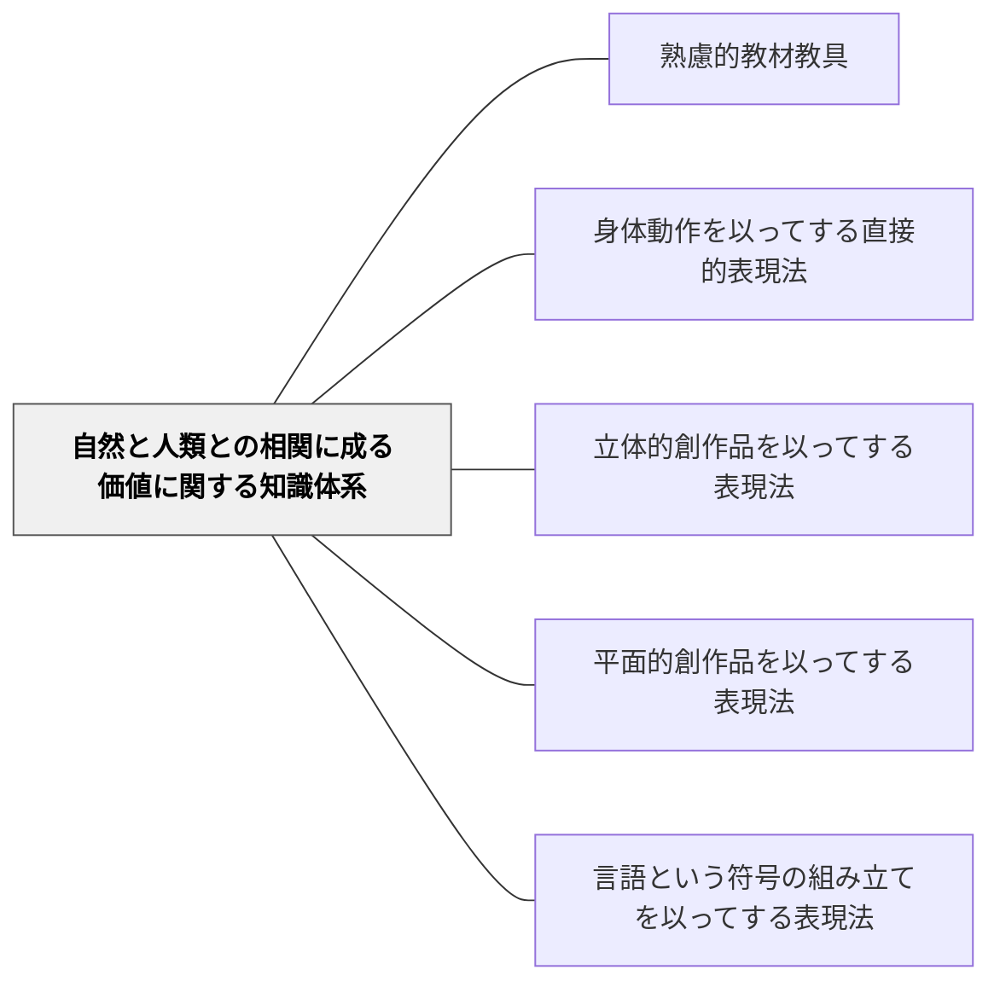

# 自然と人類との相関に成る価値に関する知識体系

> 人間が自然・社会と関わる中で創造した価値の表現法——芸術・言語・身体表現の知識体系。

## 背景（Context）

牧口常三郎の知識体系分類の第三カテゴリ。原文では、この見出しのすぐ後に「内心生活に於て創造した価値の表現法に関する知識体系」が続き、その下に表現法の1〜4が並ぶ。本Wikiでは二つを一つのまとまりとして扱っているが、二つの見出しの関係（言い換えか、別の項目か）は原文からは決めきれない。人間が自然・社会と関わることで生まれた価値を表現するための知識体系で、身体表現・立体創作・平面創作・言語表現の4つに分類される。

**原典では**：牧口はこれらの知識体系について、「この目的を考えずに故なく併合することは、外観上ではいかに簡単化された様でも、其の実は感覚器官として人体に備わった五官の幾つかを閉塞して、他に兼任せしめんとするが如きものに過ぎないので、畢竟無駄な事である」と書き、教科を減らすよりも「一歩進んで教え方を改良するに如かない」と述べた（『創価教育学体系』第4巻 第二章第五節）。（牧口の分類全体は [[文献/創価教育学体系 4（牧口常三郎）]] の「2-2」にまとめた。）

## 問題（Problem）

芸術・言語・体育などの教科が「感性の問題」として扱われ、体系的な知識として位置づけられないことがある。

## 力のかたち（Forces）

- 表現は認識の外化であり、理解を深める
- 多様な表現形式が異なる認知的道具となる

## 解決（Solution）

**近いパタンとの見分け**：教材・教具の表では、本パタンの見分けの問いは「人間が自然との関わりの中でつくり出した価値と、その表現を学ぶ教材か」。全体の表は [[パタン/熟慮的教材教具#近いパタンとの見分け|熟慮的教材教具]] にある。

**芸術・言語・身体表現を「価値を創造し表現するための知識体系」として位置づけ、各表現法の特性を活かした教材設計をする。**

**例：一つの体験を四つの表現法で**（総合・中学年）
遠足で見た川を、体の動きで流れを表す（身体動作）、粘土で地形を作る（立体）、地図に描く（平面）、文章と数で流れの速さを書く（言語・符号）。四つを並べて、どの表し方で何がよく伝わったかを話し合う。

---

**例：まとめの表現法を選ぶ**（各教科）
単元のまとめで、子どもが表現法を選び、なぜその表し方を選んだかを一文で書く。同じ内容を別の表現法で表した友だちの作品と比べる。

## 結果（Consequences）

- 表現力と創造性が育つ
- 多様な形式での理解・表現が可能になる

- 注意点：表現法を広げても、表す内容（何を価値と感じたか）が薄ければ形だけになる

## 関連パタン

- [[パタン/熟慮的教材教具]] — 親パタン
- [[パタン/身体動作を以ってする直接的表現法]] — 下位パタン
- [[パタン/立体的創作品を以ってする表現法]] — 下位パタン
- [[パタン/平面的創作品を以ってする表現法]] — 下位パタン
- [[パタン/言語という符号の組み立てを以ってする表現法]] — 下位パタン

## クラスター図

## Actionable Insight

- 同じ学習内容を「言語表現（文章）」と「身体表現や図解」の2種類で表現させる——異なる表現形式が異なる理解の深さを引き出し多面的な把握を育てる
- 音楽・体育・図工を「感性の問題」ではなく「価値を表現する知識体系」として位置づけ「なぜそう表現するか」を問う——表現の論理への問いが技能から概念理解への移行を促す
- 「この表現活動でどんな価値が生まれているか（利・善・美）」と学習者に問う——価値の言語化が表現と概念のつながりを意識化させる

## 出典

- 牧口常三郎（1972）『牧口常三郎全集第4巻 創価教育学体系 上』聖教新聞社

- 牧口常三郎（2007）『創価教育学体系』第4巻（聖教文庫、第8刷のデジタル版）第二章「教科構造論」— 2026-11-13 に該当箇所の原文を確認。[[文献/創価教育学体系 4（牧口常三郎）]]
