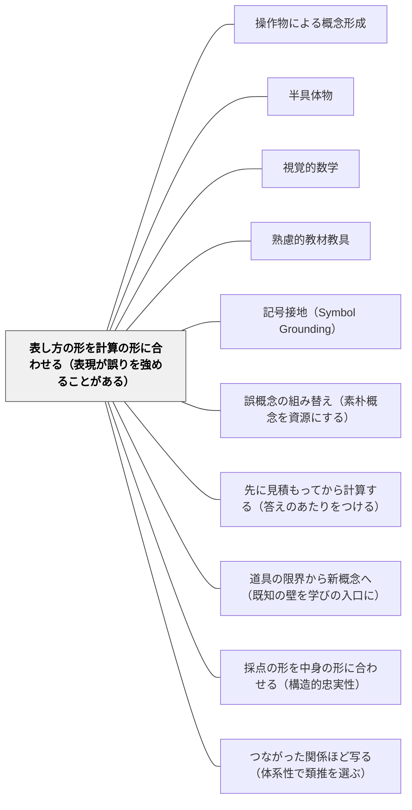

# 表し方の形を計算の形に合わせる（表現が誤りを強めることがある）

> 図や具体物は、使えば理解を助けるとは限らない。分数の足し算にドット用紙を使ったら、分子どうしを足す誤りがかえって増えた研究がある。問うべきは「図を使うかどうか」ではなく、「この表し方の形は、教えたい計算の形と同じか」である。

## [Pattern Connection]

このWikiには、具体物や図を使う理由を書いたパタンがすでに厚くある。[[パタン/操作物による概念形成]] は触れて動かす経験が概念を身体に根づかせると言い、[[パタン/半具体物]] は具体と記号の間をつなぐ段階を置き、[[パタン/視覚的数学]] は「どのように見えるか」を問えば計算の問題が思考の問題になると言う。どれも**表し方を使うこと**の側に立っている。

本パタンが足すのは、**表し方どうしの違い**という座標である。[[文献/Developing Effective Fractions Instruction（Siegler et al., 2010）]] は、分数の計算を教えるとき「教えている計算にそのまま対応する表し方」を選ぶよう勧め、表し方によっては誤概念を強めると書いた（p. 34）。同じ「図を描く」でも、どの図かで子どもが学ぶ手続きが変わる。

- **補強点**：既存パタンの「結果」節には、表し方の利点だけが並んでいた。本パタンは、表し方が**誤った手続きを支える**こともあるという注意を、選び方の基準として置く
- **[[パタン/採点の形を中身の形に合わせる（構造的忠実性）]] との同型**：あちらは「採点の合成規則が、測りたい力の構造を映しているか」を問う。本パタンは「教える表し方が、教えたい計算の構造を映しているか」を問う。評価と教材という別の場所で、**形と中身の対応**という同じ問いが立つ
- **[[パタン/視覚的数学]] との差分**：あちらは図を描くこと・見えを問うこと一般を勧める。本パタンは、描かれた図が計算の構造と合っているかを点検する

---

## 背景（Context）

算数の授業では、テープ図・面積図・数直線・分数の円・ブロック・ドット用紙など、多くの表し方が使われる。教科書や指導書は単元ごとに表し方を決めて載せており、教師はそれをそのまま使うことが多い。表し方を使うこと自体は、現在の算数教育ではほぼ前提になっている。

分数はとくに表し方の選択が効く領域である。分数には、全体の部分・量を測る単位・割り算の商・比など、いくつもの意味がある。表し方ごとに、どの意味が見えやすいかが違う。円や長方形を分けた図は「全体の部分」を見せやすく、数直線は「大きさを持った一つの数」を見せやすい（Siegler et al., 2010, p. 20, 44）。

## 問題（Problem）

**表し方を「使えば分かりやすくなる」ものとして扱うと、表し方の形と計算の形のずれに気づかない。** ずれた表し方は、子どもに誤った手続きを見せ、それを支えてしまう。

- 分数の足し算にドット用紙を使った研究では、共通の分母を求めずに分子を足す誤りが**増えた**（Siegler et al., 2010, p. 34）
- 分数の円や帯も、**分子に当たる部分の数と分母に当たる部分の数を数えるだけ**で答えが出る使い方をすると、分子と分母を別々の整数として見る見方を強める（同 p. 25）
- 面積図は正の分数の足し算は見せやすいが、負の分数の足し算は見せにくい。数直線は両方を見せられる（同 p. 30）

子どもは表し方の上で手を動かし、その動きを手続きとして覚える。表し方の上で「部分を数える」動きをしていれば、式の上でも分子と分母を別々に数える。

## 力のかたち（Forces）

- **表し方は手続きを運ぶ**：子どもが表し方の上でした操作は、そのまま式の操作に写される。表し方を選ぶことは、子どもがどの操作を練習するかを選ぶことでもある
- **一つの表し方ですべては見えない**：全体の部分を見せる表し方は大きさを見せにくく、大きさを見せる表し方は「分けたうちのいくつ」を見せにくい。万能の表し方はない
- **教科書の表し方は単元ごとに決まっている**：教師が表し方を選び直す余地は小さく見えるが、同じ表し方でも**使い方**（部分を数えるのか、量を測るのか）は教師が決められる
- **研究の裏づけは強くない**：ドット用紙の研究は一つであり、表し方と誤りの関係を確かめた研究は多くない。ガイド自身、具体物や図が「いつ役に立ち、いつ立たないかを決める原理はまだよく分かっていない」と書く（p. 36）

## 解決（Solution）

**表し方を選ぶ前に、教えたい計算の「形」を一文で書く。その形がそのまま見える表し方を選び、表し方の上の操作が式の上の操作と一対一に対応しているかを確かめる。**

手順は三つ。

1. **計算の形を一文で書く**：その計算は、表し方の上でどういう操作になるのか。たとえば異分母の足し算なら「大きさの違う単位を、共通の単位に直してから数える」
2. **その形が見える表し方を選ぶ**：単位が一定に保たれ、単位をそろえる必要が目に見える表し方を選ぶ（目盛りのある巻き尺・数直線・同じ長さのテープを分けたもの）
3. **表し方の限界を先に確かめる**：その表し方は、帯分数・仮分数・1より大きい答え・（中学なら）負の数にも使えるか。使えないなら、その先でどの表し方に移るかを決めておく

---

### 具体例①：異分母の足し算——共通の単位が要ることが見える表し方

**計算の形**：「1/2 と 1/3 は単位の大きさが違うので、そのままでは数えられない。共通の単位 1/6 に直してから数える」

ガイドは、1/2 の円と 1/3 の円を並べ、どちらも6分の1に分け直してから合わせる図を示す（p. 28）。この図では「単位が違うから分け直す」という操作が、そのまま通分の式に写る。

ガイドはドット用紙で誤りが増えた理由を書いていない。考えられるのは、点の個数で分数を表すと、「1/2 の点」と「1/3 の点」がどちらも同じ大きさの点の個数として見え、単位の大きさの違いが図から消えることである。そうなると、点を数え足す操作が分子どうしを足す操作と重なって見える（これは推測であり、研究が確かめたことではない）。

テープ図や数直線を使うときも、**同じ長さの1を分けたもの**であることを保つ。長さの違う1を並べると、単位をそろえる必要が見えなくなる。

---

### 具体例②：掛け算と割り算——計算ごとに合う表し方は違う

ガイドは計算ごとに別の表し方を挙げている（p. 28–30）。

| 計算 | 計算の形 | 合う表し方 |
|---|---|---|
| 異分母の足し算・引き算 | 単位をそろえて数える | 分け直した円、目盛りをそろえた数直線 |
| 分数×分数 | 分数の分数＝単位の取り直し（ケーキの 2/3 の、さらに 1/4） | 縦と横に塗り分けた面積図 |
| 分数÷分数 | 割られる数の中に割る数がいくつ入るか（1/2 の中に 1/4 はいくつ） | 同じ長さのリボンを2つに分けたものと4つに分けたもの、数直線 |

一つの単元で一つの表し方を通すのではなく、**計算が変われば表し方も変える**。その切り替えのときに「なぜここでは面積図なのか」を子どもと話すと、計算の意味の違いが見える。

---

### 具体例③：同じ表し方でも、使い方で働きが変わる

分数の帯（テープ）は、使い方しだいで正反対に働く。

- **数える使い方**：「6つに分けたうちの4つを塗ったから 4/6」。分子と分母を別々に数えるだけで答えが出る。分数を二つの整数の組として見る見方を強めうる
- **測る使い方**：一本の帯を1として机を測り、測りきれない残りを 1/2 の帯や 1/4 の帯で測る（ガイドの例1, p. 21）。分数が「1より細かく量を言うための単位」として見える

ガイドは、目盛りのない数直線を使うと「数えるだけ」の使い方を防げると書く（p. 25）。

---

### 特別支援の視点

具体物は特別支援の文脈でとくに頼りにされる（[[パタン/操作物による概念形成]]）。そのぶん、表し方のずれの影響も大きい。表し方の上の動きをそのまま手続きとして覚える子ほど、ずれた表し方から誤った手続きを強く受け取る。「この子には具体物を」と決めたあとに、もう一段「どの具体物を、どう動かすか」を決める。表し方の切り替えが負担になる子には、一つの単元の中で切り替えの回数を減らし、切り替えるときは両方を並べて見せる。

## 結果（Consequences）

**利点**

- 表し方の上の操作がそのまま式の操作になるので、手続きを覚える前に手続きの意味が見える
- 典型的な誤り（分子どうし・分母どうしを足す）を、表し方の段階で入口から減らせる
- 「なぜこの図を使うのか」を教師が説明できるようになり、教材研究の焦点が定まる

**注意点・リスク**

- **根拠は一つの研究に寄っている**：ドット用紙の研究は一件で、表し方と誤りの関係はまだ十分に確かめられていない。「この表し方は誤りを生む」と断定せず、自分の教室で子どもの手の動きを見て確かめる
- **教科書の表し方を否定する口実にしない**：教科書の表し方にも理由がある。本パタンは表し方を替えることより、同じ表し方の**使い方**（数えるか測るか）を点検することに使うほうが多い
- **一つの表し方に固定すると別の意味が見えなくなる**：数直線で大きさを見せることを優先しすぎると、「分けたうちのいくつ」という部分の見方が薄くなる。ガイドも全体の部分の見方を「大切だが、それだけでは足りない」と書いている（p. 19）

## 関連パタン

- [[パタン/操作物による概念形成]] — 触れて動かす経験の価値を述べる親筋。本パタンはその操作物を「どれを、どう動かすか」で選ぶ基準を足す
- [[パタン/半具体物]] — 具体と記号の中間段階。半具体物の形が計算の形と合っているかを点検するのが本パタン
- [[パタン/視覚的数学]] — 図を描くこと・見えを問うこと一般。本パタンは描かれた図と計算の構造の対応を点検する
- [[パタン/熟慮的教材教具]] — 教材教具を熟慮して選ぶ上位パタン。表し方の選択はその算数での具体形
- [[パタン/記号接地（Symbol Grounding）]] — 記号を経験に接地する。どの経験に接地するか（部分か、大きさか）で、記号の意味が変わる
- [[パタン/誤概念の組み替え（素朴概念を資源にする）]] — 誤概念が起きてから組み替えるのがあちら、表し方の段階で誤概念を強めないようにするのが本パタン
- [[パタン/先に見積もってから計算する（答えのあたりをつける）]] — 表し方は計算の意味を見せ、見積もりは計算の結果を確かめる。同じガイドの勧め3の二つの手順
- [[パタン/道具の限界から新概念へ（既知の壁を学びの入口に）]] — 整数の帯で測りきれないところで分数の帯を渡すとき、帯は「測る」使い方になる
- [[パタン/採点の形を中身の形に合わせる（構造的忠実性）]] — 形と中身の対応という同じ問いを、評価の側で立てたパタン
- [[パタン/つながった関係ほど写る（体系性で類推を選ぶ）]] — 形と中身の対応という同じ問いを、類推の側で立てたパタン

## クラスター図

## Actionable Insight

- 次の算数の単元で使う図を一つ選び、「この計算は、図の上でどういう操作になるか」をノートに一文で書いてみる。書けなければ、その図は計算の形と合っていないかもしれない
- 分数の帯や円を使う時間に、子どもが「部分の数を数えて」答えを出していないかを見る。数えているなら、同じ帯で物の長さを測る活動を一つ入れてみる
- 単元の途中で表し方が変わるところ（足し算から掛け算へ、など）に印をつけ、そこで「なぜ図を変えるのか」を子どもと話す時間を5分取る

## 出典

Siegler, R., Carpenter, T., Fennell, F., Geary, D., Lewis, J., Okamoto, Y., Thompson, L., & Wray, J. (2010). *Developing effective fractions instruction for kindergarten through 8th grade: A practice guide* (NCEE #2010-4039). National Center for Education Evaluation and Regional Assistance, Institute of Education Sciences, U.S. Department of Education.

> "Teachers should carefully choose representations that map straightforwardly to the fraction computation being taught. ... Use of some representations can actually reinforce misconceptions." (p. 34)
>
> 教師は、教えている分数の計算にそのまま対応する表し方を注意して選ぶべきである。……表し方によっては、かえって誤概念を強めることがある。

> "These studies indicate that manipulatives and pictorial representations can be effective teaching tools; however, the principles that determine when they are and are not helpful remain poorly understood." (p. 36)
>
> これらの研究は、具体物や図が効果的な教える道具になりうることを示している。しかし、それがいつ役に立ち、いつ立たないかを決める原理は、まだよく分かっていない。
