# 被教育者からのフィードバックを利用して教育改善をする

**このパタンが完成を助ける大きなパタン**：[[パタン/フィードバック]]

> 学習者から得た情報を使って授業を変えることが、真の双方向フィードバックである。

## [Pattern Connection]

**研究からの補足（2026-10-22）：算数の困難に応じて指導を組み合わせる（Gerstenほか2009）**

原典は教師への進捗情報に加え、具体的な指導方針や教材を用意する意義を論じる（pp. 58–59）。Wiki側の適用案として、答案の誤りを一つ選び、次時の例題をどう変えるかまで記録する。情報の収集自体を授業改善の証拠にはしない。 出典：[[文献/算数の困難に応じて指導を組み合わせる（Gerstenほか2009）]]。

**研究からの補足（2026-10-18）：全員の学び方を広げる包摂的な授業（FlorianとBlackHawkins2011）**

原典の授業事例では、子どもとの相談と活動中の観察が、教師の理解や応答に関わる（pp. 822–826）。Wiki側の適用案として、作品を見る際に「使いたかったが使えなかった方法」を一つ聞き、次時の選択肢を修正する。アンケートの有無だけで、本人の声が反映されたと判断しない。 出典：[[文献/全員の学び方を広げる包摂的な授業（FlorianとBlackHawkins2011）]]。

## 背景（Context）

学習者から情報を得ても、それを授業改善に活かさなければ情報が死んでしまう。また、「あなたの声が授業を変えた」という経験が学習者の当事者意識を高める。

フィードバックは教師から学習者への一方向だけではない。学習者の表情・声・作品・理解度、授業中の様子——これらはすべて教師への貴重なフィードバックである。学習者が授業について感じたこと・気づいたこと・改善の提案を教師に返す逆向きの流れは、教師の専門的な成長と授業の質に欠かせない。ウィリアムはこれを形成的評価の双方向性として強調し、学習者が「授業に何が起きているか」を最もよく知る当事者であることを出発点にしている。

※旧パタン「被教育者からフィードバックを得る」「授業後の被教育者から教育者へのフィードバック」を本ページに統合（2026-11-12）。三枚は、集める→授業後に聞く→反映して伝える、という一つの循環の段を別々に書いたものだったため一枚にした。引き出す段は [[パタン/フィードバックの要請]] に残す（指示・説明の直後の確認と、子どもが自分からフィードバックを求める力の指導を扱うため）。

## 問題（Problem）

教師が一方的に「教えた」つもりになっていても、学習者が理解していない・動機がない・困惑しているということは、学習者の側から返ってくるものを見ない限りわからない。学習者が「わかったふり」をしている瞬間、説明がわかりにくかった箇所、もっと時間が必要だった部分は、教師が自分で授業を見るだけでは見えにくい。

多くの教師はアンケートや観察を行うが、その結果を次の授業に反映する仕組みがない。学習者も「フィードバックを出しても変わらない」と感じると、フィードバックを出さなくなる。学習者が正直に返すためには、「言っても怒られない」「実際に反映される」という信頼と実績が要る。

## 力のかたち（Forces）

- 改善が学習者に見える形で示されると、フィードバックの循環が促進される
- すべての声に応えることはできないが、選択と理由の説明が信頼を生む
- 教師自身が「自分の授業が改善された」という体験が、この習慣を支える
- 学習者は自分の困惑や不満を直接伝えることをためらう。アンケートだけでなく、日常の観察も要る
- 匿名にすると率直さは高まるが、対話の機会は失われる

## 解決（Solution）

**近いパタンとの見分け**：子どもから教師へのフィードバックは、引き出す→集める→授業後に聞く→反映して伝える、の一つの循環になっている。本パタンは「集める・授業後に聞く・反映して伝える」の三つの段を扱う（旧「被教育者からフィードバックを得る」「授業後の被教育者から教育者へのフィードバック」を統合）。指示・説明の直後に「わからない」を引き出す段と、子どもが自分から求める力を育てる手は [[パタン/フィードバックの要請]]。フィードバックの系列の全体の表は [[パタン/フィードバック#近いパタンとの見分け|フィードバック]] にある。

**学習者から得たフィードバックを分析し、それに基づいて授業を調整し、その変更を学習者に伝える（「先週みんなからわかりにくいと言われたので、今日は別の方法で説明します」）。**

**① 集める（日々の手がかり）**：学習者の作品・発言・表情・態度を、毎時間の手がかりとして集める。
- 授業中のノート確認・机間巡視（言葉にならない困惑は、表情と手の動きに先に出る）
- 「今日の授業でよくわからなかったこと」の記録
- 出口チケット（終了前に1分で記録）
- 授業後の簡単な3問アンケート

**② 授業後に聞く（授業そのものについて）**：授業の終わりや単元の節目に、授業そのものについての声を集める。「今日の授業で最も役立ったこと・まだわからないこと・一つ改善を提案するとしたら」という短い振り返りカードが使いやすい。月に1回ほど、「先生への提案」を匿名で集める回をもつと、教師が気づけない視点が出てくる。

**③ 反映して伝える**：集めた声で授業を変え、変えたことを伝える。
- 「前回の振り返りで○○がわかりにくかったとあったので…」と授業を始める
- アンケート結果を集計して次の単元計画に反映する
- 学習者の得意・不得意パターンを授業設計に取り込む
- すべての声には応えられない。選んだ理由を一言添える

フィードバックが実際に反映されるという経験が積み重なると、学習者は「自分たちが授業を作っている」という主体感をもち、返ってくるフィードバックの質と量が上がる。集めること自体を授業改善の証拠にはしない。集めた声が読まれ、授業が動いたかまでを見る（[[パタン/声を聞く仕組みを四段で確かめる（欄・行使・考慮・反映）]]）。

## 結果（Consequences）

- フィードバックの循環（収集→改善→再フィードバック）が確立する
- 学習者が授業の共同設計者として参加意識を持つようになる
- 教師が学習者の実態と視点に基づいて授業を調整できるようになる
- フィードバックの双方向性が文化として根付き、学習コミュニティ全体の学習観が変わる

## クラスター図

```mermaid
flowchart LR
    ne8a2abe69599e882b2e88085e3818be38289e381aee38395e382a3e383bce38389e38390e38383e382afe38292e588a9e794a8e38197e381a6e69599e882b2e694b9e59684e38292e38199e3828b["被教育者からのフィードバックを利用して教育改善をする"]
    ne38395e382a3e383bce38389e38390e38383e382af["フィードバック"]
    ne38395e382a3e383bce38389e38390e38383e382afe381aee8a681e8ab8b["フィードバックの要請"]
    ne38395e382a3e383bce38389e38390e38383e382afe382b7e382b9e38386e383a0["フィードバックシステム"]
    ne68f90e6a188e38199e3828be69687e58c96["提案する文化"]
    ne79c81e5af9fe79a84e8a995e4bea1["省察的評価"]
    ne88083e38188e3828be69687e58c96["考える文化"]
    ne4b8bbe8a681e6a682e5bfb5e381a7e8a995e4bea1e38199e3828b["主要概念で評価する"]
    ne881b4e3818de696b9e38292e5a489e38188e3828befbc88e8a995e4bea1e79a84e383bbe8a7a3e98788e79a84e383bbe8a7a3e98788e5ada6e79a84efbc89["聴き方を変える（評価的・解釈的・解釈学的）"]
    ne881b4e3818de59088e38186e69687e58c96["聴き合う文化"]
    ne5bda2e68890e79a84e8a995e4bea1["形成的評価"]
    ne382b3e3839fe383a5e3838be38386e382a3e38292e381a4e3818fe3828b["コミュニティをつくる"]
    ne3819de381aee9818ee7a88be3818ce69cace5bd93e381abe5838de38184e3819fe3818be38292e7a2bae3818be38281e3828b["その過程が本当に働いたかを確かめる"]
    ne5a3b0e38292e8819ee3818fe4bb95e7b584e381bfe38292e59b9be6aeb5e381a7e7a2bae3818be38281e3828befbc88e6ac84e383bbe8a18ce4bdbfe383bbe88083e685aee383bbe58f8de698a0efbc89["声を聞く仕組みを四段で確かめる（欄・行使・考慮・反映）"]

    ne8a2abe69599e882b2e88085e3818be38289e381aee38395e382a3e383bce38389e38390e38383e382afe38292e588a9e794a8e38197e381a6e69599e882b2e694b9e59684e38292e38199e3828b --- ne38395e382a3e383bce38389e38390e38383e382af
    ne8a2abe69599e882b2e88085e3818be38289e381aee38395e382a3e383bce38389e38390e38383e382afe38292e588a9e794a8e38197e381a6e69599e882b2e694b9e59684e38292e38199e3828b --- ne38395e382a3e383bce38389e38390e38383e382afe381aee8a681e8ab8b
    ne8a2abe69599e882b2e88085e3818be38289e381aee38395e382a3e383bce38389e38390e38383e382afe38292e588a9e794a8e38197e381a6e69599e882b2e694b9e59684e38292e38199e3828b --- ne38395e382a3e383bce38389e38390e38383e382afe382b7e382b9e38386e383a0
    ne8a2abe69599e882b2e88085e3818be38289e381aee38395e382a3e383bce38389e38390e38383e382afe38292e588a9e794a8e38197e381a6e69599e882b2e694b9e59684e38292e38199e3828b --- ne68f90e6a188e38199e3828be69687e58c96
    ne8a2abe69599e882b2e88085e3818be38289e381aee38395e382a3e383bce38389e38390e38383e382afe38292e588a9e794a8e38197e381a6e69599e882b2e694b9e59684e38292e38199e3828b --- ne79c81e5af9fe79a84e8a995e4bea1
    ne8a2abe69599e882b2e88085e3818be38289e381aee38395e382a3e383bce38389e38390e38383e382afe38292e588a9e794a8e38197e381a6e69599e882b2e694b9e59684e38292e38199e3828b --- ne88083e38188e3828be69687e58c96
    ne8a2abe69599e882b2e88085e3818be38289e381aee38395e382a3e383bce38389e38390e38383e382afe38292e588a9e794a8e38197e381a6e69599e882b2e694b9e59684e38292e38199e3828b --- ne4b8bbe8a681e6a682e5bfb5e381a7e8a995e4bea1e38199e3828b
    ne8a2abe69599e882b2e88085e3818be38289e381aee38395e382a3e383bce38389e38390e38383e382afe38292e588a9e794a8e38197e381a6e69599e882b2e694b9e59684e38292e38199e3828b --- ne881b4e3818de696b9e38292e5a489e38188e3828befbc88e8a995e4bea1e79a84e383bbe8a7a3e98788e79a84e383bbe8a7a3e98788e5ada6e79a84efbc89
    ne8a2abe69599e882b2e88085e3818be38289e381aee38395e382a3e383bce38389e38390e38383e382afe38292e588a9e794a8e38197e381a6e69599e882b2e694b9e59684e38292e38199e3828b --- ne881b4e3818de59088e38186e69687e58c96
    ne8a2abe69599e882b2e88085e3818be38289e381aee38395e382a3e383bce38389e38390e38383e382afe38292e588a9e794a8e38197e381a6e69599e882b2e694b9e59684e38292e38199e3828b --- ne5bda2e68890e79a84e8a995e4bea1
    ne8a2abe69599e882b2e88085e3818be38289e381aee38395e382a3e383bce38389e38390e38383e382afe38292e588a9e794a8e38197e381a6e69599e882b2e694b9e59684e38292e38199e3828b --- ne382b3e3839fe383a5e3838be38386e382a3e38292e381a4e3818fe3828b
    ne8a2abe69599e882b2e88085e3818be38289e381aee38395e382a3e383bce38389e38390e38383e382afe38292e588a9e794a8e38197e381a6e69599e882b2e694b9e59684e38292e38199e3828b --- ne3819de381aee9818ee7a88be3818ce69cace5bd93e381abe5838de38184e3819fe3818be38292e7a2bae3818be38281e3828b
    ne8a2abe69599e882b2e88085e3818be38289e381aee38395e382a3e383bce38389e38390e38383e382afe38292e588a9e794a8e38197e381a6e69599e882b2e694b9e59684e38292e38199e3828b --- ne5a3b0e38292e8819ee3818fe4bb95e7b584e381bfe38292e59b9be6aeb5e381a7e7a2bae3818be38281e3828befbc88e6ac84e383bbe8a18ce4bdbfe383bbe88083e685aee383bbe58f8de698a0efbc89

    classDef hub fill:#f0f0f0,stroke:#555,color:#000,font-weight:bold
    class ne8a2abe69599e882b2e88085e3818be38289e381aee38395e382a3e383bce38389e38390e38383e382afe38292e588a9e794a8e38197e381a6e69599e882b2e694b9e59684e38292e38199e3828b hub
```

## Actionable Insight

- 「前回○○がわかりにくかったとあったので、今日は別の方法で説明します」と授業を始める——変更を学習者に伝えることで「自分の声が届いた」という経験が参加意識を高める
- 授業の終わりに「今日わからなかったこと」を1文書く出口チケットを使う——毎回の小さな記録が、学習者の実態をつかむ最も簡単な方法になる
- 机間巡視で、表情・手の動き・ノートの様子を見る——言葉にならない困惑は、アンケートより先に行動に出る
- アンケート結果を集計して次の単元計画に具体的に反映する——活用される実績がフィードバックの質と頻度を継続的に高める
- 「先週の振り返りカードを読んで、今日の授業を少し変えました」と1文添える——教師がフィードバックを読んでいるという事実だけで学習者の書く誠実さが変わる

## 出典

- 一つの教育のパタン・ランゲージ（岩井輝久）
- Wiliam, D. (2011). *Embedded Formative Assessment*. Solution Tree.（旧「授業後の被教育者から教育者へのフィードバック」）
- Hattie, J. & Timperley, H. (2007). The Power of Feedback. *Review of Educational Research*, 77(1), 81–112.（同上）

## 関連パタン

- [[パタン/フィードバック]] — 親パタン
- [[パタン/フィードバックの要請]] — 引き出す段。指示・説明の直後の確認と、子どもが自分から求める力
- [[パタン/フィードバックシステム]] — 循環の仕組み化
- [[パタン/提案する文化]] — 学習者が改善提案をする文化
- [[パタン/省察的評価]] — フィードバックを省察的評価のサイクルに組み込む
- [[パタン/考える文化]] — 学習者が改善提案できる「考える文化」の土台
- [[パタン/主要概念で評価する]] — 主要概念への学習者フィードバックが評価設計を改善する
- [[パタン/聴き方を変える（評価的・解釈的・解釈学的）]] — 子どもの発言を教え方についての情報として読む段。10分の書き起こしという実行形式
- [[パタン/聴き合う文化]] — 学習者が本音を語れる聴き合う文化の土台
- [[パタン/形成的評価]] — 授業後のフィードバックは教師にとっての形成的評価
- [[パタン/コミュニティをつくる]] — 双方向フィードバックがコミュニティの信頼を深める
- [[パタン/その過程が本当に働いたかを確かめる]] — 子どもを「課題がいい課題かどうか」の検証の協力者に置く。同じ構造の反転
- [[パタン/声を聞く仕組みを四段で確かめる（欄・行使・考慮・反映）]] — 欄を作ることと、書かれること・読まれること・記録が動くことは、別の出来事である
- [[文献/全員の学び方を広げる包摂的な授業（FlorianとBlackHawkins2011）]] — 選択と参加の実態を、次の支援の調整に使う。
- [[文献/算数の困難に応じて指導を組み合わせる（Gerstenほか2009）]] — つまずきの情報を、次に教え直す内容へつなぐ。

