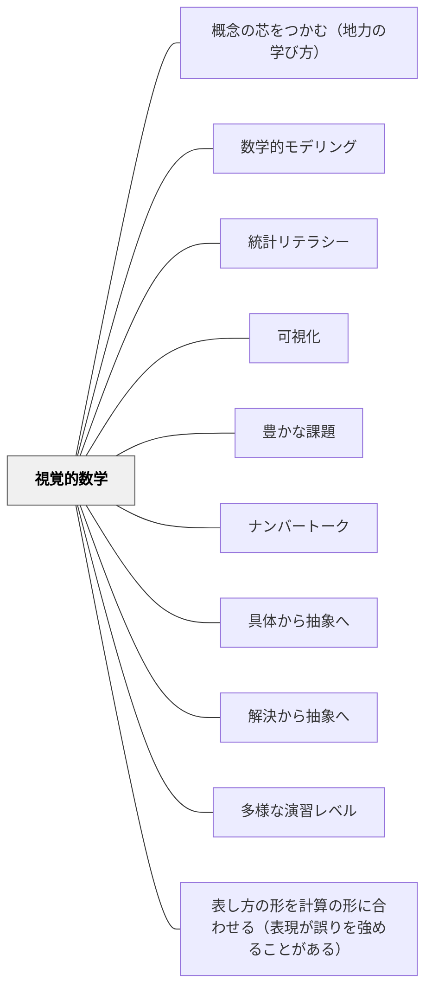

# 視覚的数学

**このパタンが完成を助ける大きなパタン**：[[パタン/可視化]]・[[パタン/数学ワークショップ]]

> 「どのように見えますか？」この一つの問いが、計算の問題を数学的思考の問題に変える。

## [Pattern Connection]

Boaler（2016）の **Mathematical Mindsets** は、算数における視覚的思考の重要性を丁寧に示している。教師が「答えを出す」ではなく「どのように見えるか」を問うだけで、子どもたちの数学への関わり方が根本的に変わる。このパタンは [[パタン/可視化]] の「見える形にする」という解決策を、数学固有の実践として具体化したものである。

- **補強点**：視覚的表現は「記録のツール」ではなく「思考のツール」——見ることで、聞くだけでは生まれない理解が起きる。Boaler が Ch.4 で紹介する研究では、脳の異なる経路を使うときに最も力強い学びが起き、事実・技術的な情報を扱う左側と、視覚・空間的な情報を扱う右側が連絡し合うときに数学の学習と成績が最もよくなる。引き算などの計算で最も成績の高い人は、脳の両側の結びつきが最も強かった（Park & Brannon, 2013; Boaler, 2016, Ch.4）
- **拡張点**：「見えを問う」だけで授業が変わる——高い技術は要らない。色分け（Color Coding）を使うと概念の構造が計算以前に「見えてくる」。フィールズ賞受賞者 Maryam Mirzakhani の研究はほぼ全て手書きスケッチと絵——数学の最高峰でさえ視覚的思考が中心
- **他のパタンへの波及**：[[パタン/豊かな課題]]・[[パタン/ナンバートーク]]・[[パタン/多様な演習レベル]]・[[パタン/数学的モデリング]]

---

## 背景（Context）

算数の授業では、子どもたちは数を「手順」として扱うことに慣れている。12×4=48という事実を覚え、それを繰り返す。しかし数の概念は本来、視覚的・空間的なイメージと深く結びついている。

数学者たちは問題を解くとき、視覚的に考える。図形のパタンを見たり、面積として分数を捉えたり、成長の関数を形として把握したりする。しかし学校の算数では、この視覚的な数学観がほとんど共有されない。

## 問題（Problem）

数式や計算手順だけを扱う授業では、子どもたちは「数学は記号の操作である」という誤った信念を持ちやすい。視覚的に考える機会がなければ、概念の深い理解も、複数の方法で問題を見る柔軟さも育たない。

## 力のかたち（Forces）

- 視覚的表現は「すでに分かっている子」だけでなく、「まだ分からない子」にこそ手がかりを与える
- 見え方は人によって違う——複数の視点を共有することで、数学の多様な構造が見えてくる
- 「どのように見えますか？」という問いは、正誤の問いではないため、全員が安全に参加できる
- 視覚化の習慣は、算数に限らず理科・社会・国語の思考にも転移しやすい

## 解決（Solution）

**数学の問題に「どのように見えるか？」「別の見方は？」という視覚的な問いを加え、自分の見え方をクラスで共有する機会をつくる。**

**近いパタンとの見分け**：算数・数学の表では、本パタンの見分けの問いは「「どのように見える？」「別の見方は？」と問い、見え方をクラスで共有しているか」。全体の表は [[教科/算数・数学で使うパタン#近いパタンとの見分け|算数・数学で使うパタン]] にある。

---

具体例①：`1 ÷ 2/3` を視覚的に解く（Boaler, 2016, Ch.5）

Cathy Humphreys は7年生のクラスに `1 ÷ 2/3` を出し、二つの条件を足した——自分の答えの意味を説明すること、図による証明（visual proof）を示すこと。授業の始めに彼女は「この問題を解く規則を知っているかもしれないけれど、今日は規則は関係ありません。答えの意味をつかんで、なぜその答えで筋が通るのかを説明してほしい」と言う（Boaler と Humphreys の共著のビデオ事例。Figure 5.19）。

- ある生徒たちは、数の組（1・2・3）を数学的な意味づけなしに操作して、答えを6だと考えた。けれども、それを図で示したり意味づけたりすることはできなかった
- ほかの生徒たちは、さまざまな図で、1の中に 2/3 が1つ半（one and a half）入っている理由を示した

図で示し答えの意味をつかむという要求が、正解と方法が一つずつの固定的な問題を、成長マインドセットの課題に変え、意味づけと理解に満ちた授業を生んだ。

---

具体例②：パタンの成長を「どのように見るか」

多連結キューブでできた形が成長する図（Exhibit 5.1）を示し、「この形はどのように成長していると見えますか？」と問う（Ruth Parker の課題。Boaler, 2016, Ch.5 の Growing Shapes、[[教材/形の成長を見る]] 参照）。Boaler たちはサマースクールで、100番目や n 番目を求めることから始めず、まず一人で、数でなく図で、各段階のどこにキューブが増えるかをノートにスケッチすることを求めた。

- Luke と Jorge は、毎回いちばん下にキューブが加わると見た（クラスで「ボウリングのレーン法」と呼ばれた）
- Carlos は、各列の上にキューブが降ってくると見た（「雨粒法」）
- Boaler が一緒に取り組んだ教師や生徒の見え方には、ほかにも、真ん中の列が高く伸びて残りが溶岩のように続く「火山法」、列が分かれて真ん中の列が現れる「紅海が割れる法」、層を三角形として見る「相似な三角形法」、層を斜めに見る「スライス法」、並べ替えると毎回正方形になる「正方形法」がある（Figures 5.3〜5.11）

見え方が違っても、どれも正しい。形は一辺 n+1 の正方形として育ち、n 番目のキューブの数は (n+1)² になる。図で見た生徒は、なぜ二乗になるのか、n が何を表すのかを説明できた。（1, 3, 6, 10… と増える「階段」は、本書では別の課題 Exhibit 5.10 の staircase で、Alonzo が4方向に伸ばした課題がそれにあたる）

---

具体例③：平行線と角度を色で見る（Boaler, 2016 Ch.5）

「平行線と横断線が作る角度の関係を色鉛筆で分類してください」と問う。計算式を書く前に、まず色分けする。

- 本書の課題（Exhibit 5.9「平行線と横断線」）：①色分けで等しい角を見つける ②対頂角と補角を見つける ③見える関係を、図と同じ色を使って文章で書く
- 本書の生徒の例（Figure 5.21）では、色で塗り分けた角について、角どうしの和の関係や、4つの角の和が360°になることなどを書き出している

この「色分け」という視覚的操作によって、角度の関係の構造が計算以前に見えてくる（本Wikiの見立て。Boaler は、Railside の教師が代数で x を式・グラフ・図で同じ色にして関係を示すよう求めた例とあわせて、角の関係にも色分けを使えると勧める）。

---

> **研究の裏づけ**：米国教育科学研究所の算数に困難のある小学生への介入の実践ガイド（Fuchs ほか 2021）は、数直線を使うことを勧め、根拠を strong とした（14研究）。0〜1を2・4・8等分して分数を置き、1より大きい分数も示す。同じ点に来る分数は等しい。0・1/2・1を目安に大きさを比べる。異分母のたし算・ひき算では、二本の数直線で 1/2 と 6/12 が同じ長さだと示し、通分がなぜ必要かを見えるようにする（pp. 29–38）。一方で、1より小さい分数どうしのかけ算は数直線では表しにくく、面積図のほうがよいとする（p. 39）。ただし根拠の44研究はすべて複数の要素を組み合わせた介入で、この要素だけの効果は分けられない（p. 65）。出典：[[文献/算数に困難のある子への介入を研究から組み立てる（Fuchsほか2021）]]。

> **研究の裏づけ**：Lewis と Perry（2014）の授業研究の手引きは、分数を長さ（線分の測定）で表すことを重視する。同じ単位をくり返して等しい部分をとらえる、数直線につなぎやすい、1メートルのような決まった全体で全体を見失いにくい、単位分数を重ねて分数をつくる、の四つを理由に挙げる（p. 6）。手引きで授業研究をした教師は、長さの表し方を使う回答が増え、「分数は数である」「全体の理解」「単位分数」の理解が伸びた（p. 13）。出典：[[文献/教材の手引きを添えた授業研究で教師の分数の知識が伸びる（LewisとPerry2014）]]。

## 結果（Consequences）

- 「1つの正しい解き方」でなく「数学には複数の見え方がある」という信念が育つ
- 視覚的に考える習慣が、文章題や応用問題での「立式前の見通し」を助ける
- 算数が苦手な子にとって、視覚は言語的な説明より先に理解の入口になることがある
- 見え方の共有は[[パタン/能動的関与]]を自然に生む

## 関連パタン
- [[パタン/概念の芯をつかむ（地力の学び方）]]
- [[教科/LowFloorHighCeilingタスク集]]
- [[教科/分数パズル（youcubed）]]
- [[教科/算数・数学で使うパタン]]
- [[教科/算数]]
- [[パタン/数学的モデリング]]
- [[パタン/統計リテラシー]]
- [[文献/算数に困難のある子への介入を研究から組み立てる（Fuchsほか2021）]] — 数直線で分数の大きさ・等しい分数・異分母のたし算（strong）。かけ算は面積図
- [[文献/教材の手引きを添えた授業研究で教師の分数の知識が伸びる（LewisとPerry2014）]] — 分数を長さで表す（単位分数のくり返し・数直線・決まった全体）
- [[文献/授業研究と分数の手引きの効果を追試で分けて確かめる（Schoenほか2023）]] — 長さで分数を表す手引きの追試。授業の質は上がったが、子どもの成績は伸びなかった

- [[パタン/可視化]] — 考えを「見える形」にする上位パタン
- [[パタン/豊かな課題]] — 視覚的な問いを含む豊かな課題の設計
- [[パタン/ナンバートーク]] — 数の見え方を共有する具体的な活動
- [[パタン/具体から抽象へ]] — 視覚的表現は「具体」から「抽象」への橋
- [[パタン/解決から抽象へ]] — 自分の見え方から共通の構造へ
- [[パタン/多様な演習レベル]] — 視覚的問いが参加のフロアを下げる
- [[パタン/表し方の形を計算の形に合わせる（表現が誤りを強めることがある）]] — 図を描くこと一般に対して、描かれた図が計算の構造と合っているかを点検する
- [[文献/Developing Effective Fractions Instruction（Siegler et al., 2010）]] — 視覚的な表し方を勧めつつ、根拠の強さを勧めごとに付けた分数の実践ガイド

## クラスター図

## Actionable Insight

- 今週の算数問題に「この計算を図に描いてみてください」を1問加える——答えを求める前に、見え方を描かせるだけでよい
- 「どのように見えましたか？」と黒板の前で問い、3人の見え方を板書して「同じ答えでも見え方が違う」と言う
- 算数の宿題を「計算を10問解く」ではなく「今日学んだ考え方を図で描いて、家族に説明してみる」に変える1週間を試す
- 角度・分数・代数の問題に色鉛筆を渡して「関係する部分を同じ色にしてください」と言う——色分けが概念の構造を計算前に見えるようにする（Color Coding, Boaler 2016 Ch.5）
- Maryam Mirzakhani の言葉を教室に貼る：「書き留めたくない……でも描く過程が繋がりを保つのを助けてくれる」——描くことが数学思考そのもの

## 出典

Boaler, J. (2016). *Mathematical Mindsets: Unleashing Students' Potential Through Creative Math, Inspiring Messages and Innovative Teaching*. Jossey-Bass.

[[文献/Mathematical Mindsets（Boaler）]]
