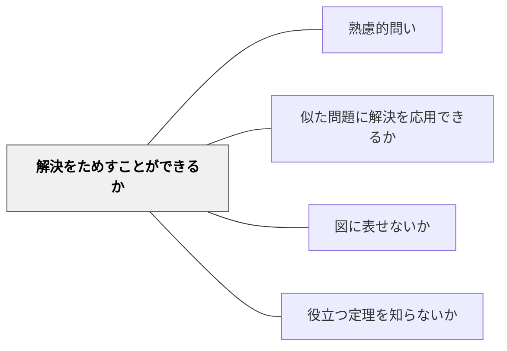

# 解決をためすことができるか

**このパタンが完成を助ける大きなパタン**：[[パタン/熟慮的問い]]

> 答えや解決が本当に正しいか、実際に確かめてみる問い。

## 背景（Context）
問題を解いて答えを出したとき、その答えが正しいかどうかを確認しないまま次に進んでしまうことがある。検証のステップを省略すると、誤った理解がそのまま定着してしまう。学習者が「できた」と思っても、実際には誤解を含んでいる場合は少なくない。

**岩井の講話では**：ポリアの問いの中に、計画を立ててやってみたあと「その経過を評価するような」問いがあると説明し（13:48〜14:04）、「計画の各段階はどうか」を実施している段階を評価する問いとして挙げたあと、本パタン（講話では「解答を試すことができるか」）を「似た問題に解決を応用できるか」と続けて読み上げ、解決した後の問いとして扱っている（16:15〜16:40）。

**本Wikiの関連ページでは**：[[パタン/ポリアの問題解決法]] は Step 4「振り返る」に「答えは問題の条件を満たしているか」「計算は正しいか」を置き、問いかけの例に「この答えで本当に合っているか確認できる？」を挙げる。同ページの Woodward ほか（2012）の項は、「その答えは意味が通る？」を含む問いかけの一覧を子どもが使うことを、根拠の強い勧めとして紹介している。

## 問題（Problem）
解答を出した後、その正しさを自分で検証する習慣が身についていない。教師や答え合わせに頼るだけでは、自立した思考力は育たない。自己検証の方法を問わなければ、学習者は解答プロセスの最後のステップを見落とし続ける。

## 力のかたち（Forces）
- 答えを出すことに満足し、確認を怠りがちな心理
- 検証方法を知らないと確かめることができない
- 自己訂正の機会を与えることで深い理解が生まれる
- 別の方法で解いて同じ答えが出れば信頼性が高まる

## 解決（Solution）
**近いパタンとの見分け**：問いの型の表では、本パタンの見分けの問いは「出した答えが正しいか、実際に確かめているか」。全体の表は [[パタン/熟慮的問い#近いパタンとの見分け|熟慮的問い]] にある。

「その答え、本当に合っているか試せるか？」「別の方法で確かめてみよう」と問いかけ、検証のプロセスを学習活動に組み込む。たとえば、方程式の解を元の式に代入して確かめる、地図で推測した距離を実測と比べる、実験結果を予測と照合するなど、具体的な検証行動を引き出す。

---

**例：ひき算の答えをたし算でためす**（算数・2年）
1. 「52−18」を計算して答えが出たら、「その答えが合っているか、ためす方法はあるか」と問う。
2. 子どもが「答えに18をたすと52に戻るはず」と言えたら、34＋18 を計算する。
3. 52に戻らなかったときは、ひき算のどの位でまちがえたかを、筆算の上で探す。
4. 「たし算でためす」を教室の掲示に書き足し、次のひき算でも子どもが自分で使う。

---

**例：答えが問題の場面に合うかをためす**（算数・3年）
1. 「子どもが25人いる。1つの長いすに4人ずつすわる。全員がすわるには、長いすは何きゃくいるか」を解く。
2. 「25÷4＝6あまり1」から「6きゃく」と答えた子がいたら、「その答えを場面に当てはめてためせるか」と問う。
3. 6きゃくなら24人しかすわれず1人あまること、7きゃくなら4×7＝28で全員すわれることを、図や式で確かめる。
4. 「計算の答え」と「問題の答え」がちがうことがある、と子どもの言葉でまとめる。

## 結果（Consequences）
- 自己修正の習慣が身につき、誤りに自ら気づける力が育つ
- 解答への信頼度が高まり、確信をもって次のステップに進める
- 検証という思考習慣が他の場面にも転移する

- 注意点：同じ方法で計算し直すだけでは、同じまちがいをくり返すことがある。たし算で戻す、場面に当てはめるなど、別の道でためす。

## 関連パタン
- [[パタン/熟慮的問い]] — 親パタン
- [[パタン/似た問題に解決を応用できるか]] — 検証から応用へ
- [[パタン/図に表せないか]] — 図示による解法の検証
- [[パタン/役立つ定理を知らないか]] — 適切な定理を使って検証する

## クラスター図

## Actionable Insight

- 解答を出した後「その答え、本当に合っているか試せるか？別の方法で確かめてみよう」と問いかける——自己修正の習慣が身につき誤りに自ら気づける力が育つ
- 方程式の解を元の式に代入して確かめる、実験結果を予測と照合するなど、具体的な検証行動を授業に組み込む——解答への信頼度が高まり確信をもって次のステップに進める
- 「別の方法で解いて同じ答えが出るか」を試させる——検証という思考習慣が他の場面にも転移する

## 出典
- [[文献/熟慮的問いのパターンリスト（動画記録）]]
- ジョージ・ポリア（1954）『いかにして問題をとくか』丸善出版

- 岩井輝久（年不明）『熟慮的問いのパターンリスト』［動画］ https://youtu.be/WivskVtxG34 — 2026-11-13 に文字起こしで確認（13:48〜14:04、16:15〜16:40）
- [[文献/算数の問題解決を4〜8年生で育てる（Woodwardほか2012）]] — [[パタン/ポリアの問題解決法]] の記述による
