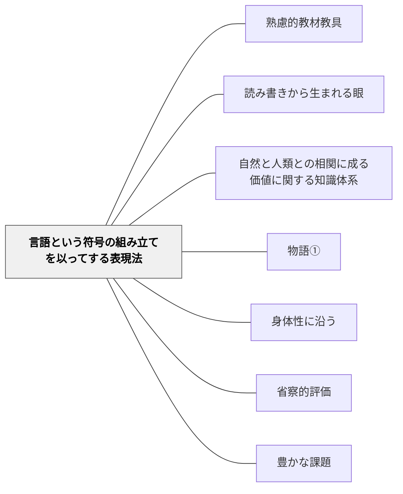

# 言語という符号の組み立てを以ってする表現法

> 歌・談話・文章・数式・音楽——言語的・記号的表現で価値を伝える。

## 背景（Context）

牧口常三郎の表現法分類の第四項目。言語・数式・音楽記号などの記号体系を使って価値を表現する活動。国語・数学・音楽・外国語など多くの教科がここに含まれる。読み書きが「概念装置」となり新しい認識を生む（内田義彦『読書と社会科学』）。

**原典では**：牧口はこの表現法をさらに分け、聴覚に訴える音声（談話・唱歌等の技術と其の知識）と、視覚に訴える表音符号に分けた。後者には、象形文字（漢字）と表音文字（仮名）による文章＝国語科、「数学という特別記号を以て分量を表すもの」＝算術科、「音程を表す為に音符を以て表現するもの」＝唱歌科、が入る（『創価教育学体系』第4巻 第二章第五節）。国語・算数・音楽を「符号を組み立てて表す」という一つの見方で並べたのが特徴である。外国語を含めるのは本Wikiの広げ方である。（牧口の分類全体は [[文献/創価教育学体系 4（牧口常三郎）]] の「2-2」にまとめた。）

## 問題（Problem）

言語的表現の習得が「記号の習得」だけになると、表現の意味や力が失われる。

## 力のかたち（Forces）

- 言語・記号は人類最大の認知的道具
- 豊かな言語体験が概念形成を支える
- 過度な形式化が表現の喜びを奪う

## 解決（Solution）

**近いパタンとの見分け**：教材・教具の表では、本パタンの見分けの問いは「歌・談話・文章・数式・音楽など、符号を組み立てて表す教材か」。全体の表は [[パタン/熟慮的教材教具#近いパタンとの見分け|熟慮的教材教具]] にある。

**歌・談話・作文・数式・音楽など多様な言語的表現活動を教育材料として設計し、表現の意味と力を体感させる。**

**例：文・式・図の三つで表す**（算数・中学年）
一つの文章題の場面を、文章・式・図の三つで表し、どれがどこを分かりやすくしているかを比べる。三つの間を行き来できることを、理解のしるしとする。

---

**例：歌詞と楽譜を重ねて読む**（音楽）
歌詞の言葉の区切りと楽譜のフレーズの区切りがどう重なるかを、確かめながら読む。言葉の抑揚と旋律の上がり下がりが合っている所を探す。

## 結果（Consequences）

- 言語的表現力と概念形成が育つ
- 多様な記号体系を通じた理解が深まる

- 注意点：符号の操作（漢字の書き取り・計算）だけが練習されると、符号で何を表すのかが置き去りになる

## 関連パタン

- [[パタン/熟慮的教材教具]] — 親パタン
- [[パタン/読み書きから生まれる眼]] — 同じ活動を一般語彙で記述。本パタンは牧口の表現法四分類（教育材料論）の一部
- [[パタン/自然と人類との相関に成る価値に関する知識体系]] — 上位分類

- [[パタン/物語①]] — 言語表現の典型としての物語・ナラティブ
- [[パタン/身体性に沿う]] — 言語的表現に身体的・感覚的体験を組み合わせる
- [[パタン/省察的評価]] — 表現活動を書いて振り返ることで言語理解が深まる
- [[パタン/豊かな課題]] — 言語表現を核にした豊かな課題設計

## クラスター図

## Actionable Insight

- 同じ内容を「文章で書く・数式で表す・歌や詩で表現する」のうち2種類で表現させる——異なる記号体系で同じ内容を表現する経験が概念の多面的な理解を育てる
- 作文・作詞・数式作成など「表現の創造」を学習の最終課題に位置づける——表現することが理解の深さの確認になる
- 学習者が記号・言語の形式だけを習得して意味を失っていないか、「この表現は何を伝えているか」と問い返す——意味と形式のつながりを意識させることが表現の力と概念形成を支える

## 出典

- 牧口常三郎（1972）『牧口常三郎全集第4巻 創価教育学体系 上』聖教新聞社

- 牧口常三郎（2007）『創価教育学体系』第4巻（聖教文庫、第8刷のデジタル版）第二章「教科構造論」— 2026-11-13 に該当箇所の原文を確認。[[文献/創価教育学体系 4（牧口常三郎）]]
