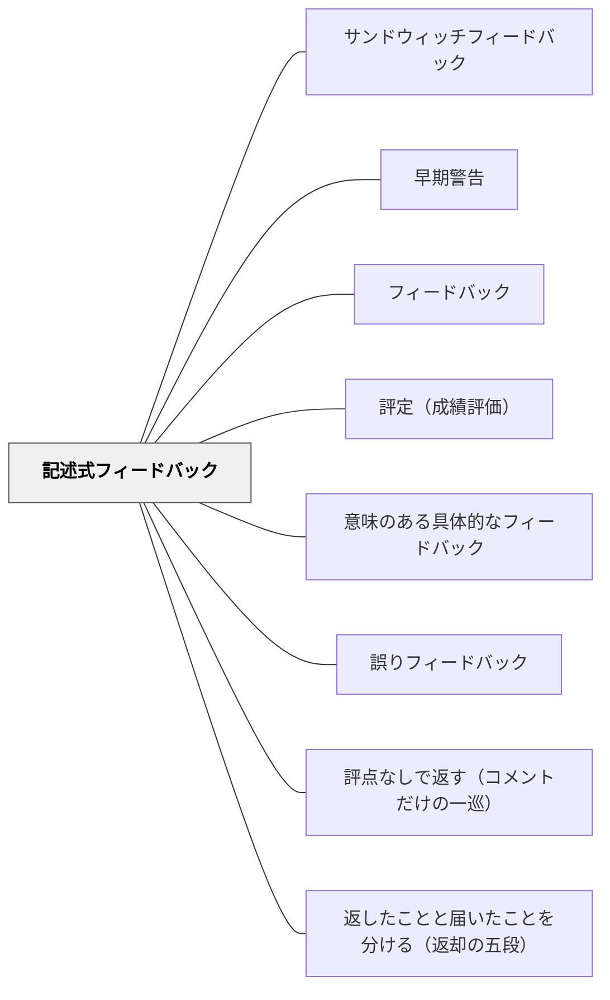

# 記述式フィードバック

> 「B+」ではなく、「この段落の主張は明確だが、根拠が一例しかない。もう一つ追加するとより説得力が増す」と書く。

## [Pattern Connection]

**研究からの補足（2026-10-22）：評点とコメントが向ける注意を確かめる（Butler1988）**

原典のコメントは個人の遂行と改善方向を示す短文である（p. 4）。1988年はコメントのみ・評点のみ・併記の三条件で、称賛のみ群はない。最終場面の結果（pp. 7–10）は「どんな評点でもコメントを必ず無効化する」という一般法則ではない。Wiki側の適用案として、コメントを返した後に一つ実行してもらい、具体的に使われたかを見る。 出典：[[文献/評点とコメントが向ける注意を確かめる（Butler1988）]]。

## 背景（Context）

学習者が作品・課題・パフォーマンスを提出したとき、教師はそれに何らかの応答をする。記号や数値による評定は伝達が速く管理しやすいが、学習者に改善のための情報を届けるという点では限界がある。コメント・文章による記述式フィードバックは、評定に比べてはるかに豊かな情報を持ち、学習改善に直接つながる手段として注目されてきた。

記述式フィードバックは、添削、コメント、ルーブリックへの記入、音声コメント、対話的なやり取りなど多様な形をとる。対面でも書面でもデジタルでも実践できる。

## 問題（Problem）

評定だけでは「結果」しか伝わらず、学習者は次に何をすればよいかわからない。一方、記述式フィードバックを書くにはコストと技術が必要であり、時間がかかる。内容が曖昧だったり、量が多すぎたりすると、かえって学習者が混乱したり、フィードバックを読まなくなったりすることもある。

また、記述が称賛か批評かのどちらかに偏ると、学習改善には結びつかない。「すばらしい作品でした」という称賛も、「ここが間違っています」だけの批評も、それ単体では行動可能な情報とは言いにくい。

## 力のかたち（Forces）

- 記述は評定より多くの情報を含み、学習者の改善を具体的に方向づけられる
- 教師側のコストが大きく、フィードバックの質が教師のスキルと時間に依存する
- 学習者が記述を読まない・活用しないという問題が起きやすい

## 解決（Solution）

記述式フィードバックは、現在の到達点・ギャップ・次の一歩の三要素を含むように意識して書く。「何がよかったか」「何が不十分か」「具体的にどう改善するか」を一つか二つに絞って伝える。全てを指摘しようとせず、最も重要な改善点に焦点を当てる。

フィードバックを受け取った後に学習者が行動できるよう、授業の設計として「受け取ったフィードバックを基に改訂する時間」を確保することが重要である。フィードバックを書くことと同じくらい、それを活用する機会のデザインが必要である。[[パタン/評定（成績評価）]]と分離して、評定なしでコメントのみを返す機会を作ることも有効である。

### 研究の裏づけ

> **研究の裏づけ（2026-10-31）**：『How People Learn』（2000）は、アメリカ独立革命の原因を書いた高校生の同じ作文に、2人の教師が書いたコメントを並べる。一人は「主題文が弱い」「事実をもっと書く」「つづりと文法の直しを見る」。もう一人は「なぜ植民地の人は反乱したのかに、考えて取り組んだのがこの作文のいちばんのよさ」と書いたうえで、初め・中・終わりで自分の立場を示す組み立て方を具体的に示し、「書き直して出し直そう」と結んだ（pp. 158–161、囲み7.1、Wilson & Wineburg 1993）。前者は作文を能力の分布の一点と見、後者は「歴史は事実を覚えることだ」という誤解の表れと見ていた。コメントの中身は、教師がその教科をどう捉えているかを映す。また報告書は、フィードバックは単元や作品の途中で、考えを直すのに使えるときに最も価値があると書く（p. 141）。出典：[[文献/人の学び方の研究を授業の設計につなぐ（全米研究評議会2000）]]。

> **研究の裏づけ（2026-10-31）**：英国の Education Endowment Foundation のフィードバックの指針（2021）は、書くフィードバックは成績を上げうるが効果はばらつき、教師の負担という機会費用が大きいとする。中学1〜3年の教師は週6.3時間を書くフィードバックに使っていた（p. 35）。成績を外して「詳しいコメント」だけにした学級が、成績とわずかなコメントを受けた学級より成績が低かった例も紹介し、コメントが「もっと頑張ろう」のように中身のないものだったことを理由に挙げる（p. 25）。出典：[[文献/学びを前に進める教師のフィードバックを整える（英国EEF2021）]]。

> **研究の裏づけ（2026-11-05）**：書き込みのコメントを重ねても、伸びは大きくならないことがある。意見文の無作為化比較で、要素ごとのルーブリック＋お手本に、さらに余白の書き込みのコメントを足した組（1本約9分40秒）は、ルーブリック＋お手本だけの組（約3分半）より、組の中の伸びが小さかった（英語の意見文 d = 0.71 対 0.90、ジャンルの知識 0.65 対 0.98）（pp. 4–7）。著者は、フィードバックは多ければよいわけではないという先行研究と合うとする（p. 9）。一方、ドイツ語の意見文に有意な伸びが出たのは、書き込みのコメントだけの組だった（d = 0.40, p. 7）。組どうしの差は多くが有意に届いておらず、比べ方は組の中の伸びの大きさである。出典：[[文献/意見文へのフィードバックを、書き込みのコメントにするか、ルーブリックとお手本にするかで、書く力の伸びは変わるかを、無作為に分けて確かめる（Peltzerほか2024）]]。

## 結果（Consequences）

- 学習者が具体的な改善行動をとりやすくなる
- 評定より記述の方が学習改善に効果的であることがメタ分析で示されている（Hattie）
  - （出どころの補足・2026-10-11）[[文献/The Power of Feedback（Hattie & Timperley, 2007）]] はこれを、ハッティ自身のメタ分析ではなく、Page（1958, 74学級の実験）・Butler（1987, 1988）の実験と、Black & Wiliam（1998）・Crooks（1988）の総説から述べている（p. 92）。Butler（1988）では、最終場面でコメントのみ群が評点のみ群・評点とコメントの併記群を上回った。称賛のみ群は1988年の実験にはない（2026-10-22、原典pp. 4, 7–10で訂正）
- **ただし、記述に評点を添えると、記述の効果が弱まることがある**。Butler（1988）では「コメントのみ」群が得点を上げ（「約3分の1」は Black & Wiliam 1998 の要約）、「評点＋コメント」群は「評点のみ」群と同様に低下した。教科外の課題・学級内の相対評価・約2日間という条件での結果で、どんな評点でもコメントを無効化するという一般法則ではない。Butler（1987）でも、コメント群だけが評点群・称賛群・無フィードバック群より1標準偏差高かった。つまり本パタンの効果を引き出すには、[[パタン/評定（成績評価）]] と**同居させない工夫**が役立つと考えられる（Black & Wiliam, 1998）
- フィードバックが最も効果的なのは、正誤を示すだけでなく**元の学習との関係で誤りへの思慮深いアプローチを促す**よう設計されているとき。鍵は学習者側の応答における「マインドフルネス」である（Bangert-Drowns et al., 1991・平均効果量0.58）
- フィードバックの量・質・タイミングに注意しないと、効果が限定的になる

## 関連パタン
- [[パタン/サンドウィッチフィードバック]]
- [[パタン/早期警告]]
- [[文献/人の学び方の研究を授業の設計につなぐ（全米研究評議会2000）]] — 同じ作文への2人の教師のコメント（囲み7.1）と、直す機会のあるフィードバック
- [[文献/学びを前に進める教師のフィードバックを整える（英国EEF2021）]] — 書くフィードバックの効果と負担。中身のないコメントは成績に負けた

- [[パタン/フィードバック]] — 親パタン
- [[パタン/評定（成績評価）]] — 対比：記述より情報が乏しい総括的フィードバック
- [[パタン/意味のある具体的なフィードバック]] — 記述の内容として求められる質
- [[パタン/誤りフィードバック]] — 誤りに特化した記述式フィードバックの形
- [[パタン/評点なしで返す（コメントだけの一巡）]] — 本パタンが効くための前提条件を制度化したもの。評点と同居させない
- [[概念/自我関与と課題関与（フィードバックが向ける先）]] — 記述が効き、評点と称賛が効かない理由を説明する軸
- [[文献/Assessment and Classroom Learning（Black & Wiliam）]] — 評点のみ・評点とコメントの併記より、コメントのみが効いた実験（Butler, 1988）を紹介した系統的レビュー（Black & Wiliam, 1998）

- [[概念/形成的評価の5つの戦略（3×3の枠組み）]] — 戦略③「学習者を前進させるフィードバック」の実装
- [[パタン/返したことと届いたことを分ける（返却の五段）]] — 書いたコメントが読まれ、解釈され、実際に使われたかを分けて見る
- [[文献/The Power of Feedback（Hattie & Timperley, 2007）]] — 評点よりコメント（Page, 1958; Butler, 1988）を紹介した総説
- [[文献/評点とコメントが向ける注意を確かめる（Butler1988）]] — コメントの形式だけでなく、比較条件と使用の実態を確かめる。
- [[文献/意見文へのフィードバックを、書き込みのコメントにするか、ルーブリックとお手本にするかで、書く力の伸びは変わるかを、無作為に分けて確かめる（Peltzerほか2024）]] — 書き込みのコメントを重ねても伸びは大きくならなかった

## クラスター図

## Actionable Insight

- フィードバックを書くとき「何がよかったか・何が不十分か・具体的にどう改善するか」の3要素のうち最も重要な1点に絞る——全部指摘より一点集中が学習者の改善行動を促す
- フィードバックを渡した後に必ず「読んで改善する時間」を授業に設ける——改善機会のないフィードバックは行動に結びつかない
- 評定なしでコメントのみを返す機会を単元に1回作る——評定と分離することで学習者がコメントを真剣に読む

## 出典

Hattie, J. (2009). *Visible Learning*. Routledge.
Black, P. & Wiliam, D. (1998). Assessment and Classroom Learning. *Assessment in Education*, 5(1), 7–74.
