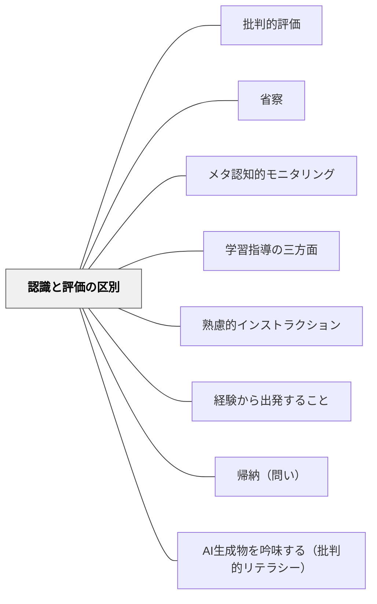

# 認識と評価の区別

> 評価作用をあせりがちに先行させず、飽くまで冷静着実なる科学的態度を以て認識に臨む——牧口常三郎

## Pattern Connection

### 牧口常三郎（1934）——認識作用と評価作用の分離

牧口は *創価教育学体系 第4巻* において、人間の心的作用を「認識作用」と「評価作用」として明確に区別し、日常ではこの二つが混同されることの弊害を詳述した。

**認識作用**：物事の事実・性質・因果関係を正確に把握する知的作用。「何であるか・どうなっているか」を問う。
**評価作用**：物事の価値（利・善・美）を判断する作用。「よいか悪いか・美しいか醜いか・役に立つか否か」を問う。

**問題の核心**：日常では評価作用が認識作用に先立って働くことが多く、「好き・嫌い」「高い・安い」「有名・無名」などの評価的ラベルが先行することで、事実の認識が歪められる。

牧口はこの現象の具体例として以下の場面を挙げている：
1. **友人への忠告**：友人の不実を知らせた人に、事実を確かめず弁解で返し、ときには絶交にまで至る（第五編第三章第一節 例一）
2. **国際連盟の判断**：満洲について認識不足のまま、中国の宣伝を信じて判断した例（例二）
3. **汽車の中の手帳**：ドイツ人記者と米国人が互いに相手の第一印象を手帳に書き、あとで見せ合って笑った話。不完全な材料で一般的概念をつくる危険（例三）
4. **「羹に懲りて膾を吹く」**：ある経験で懲りた結果、同種のものすべてを同じと決めつける（例四）
5. **雨乞いの史実**：事実を聞く前に頭から否定して反感を示す（例五）
6. **「力は即ち正義なり」**：一方に偏った人間には正直な認識ができないのか、という見方（例六。認識と評価の峻別の重要性を痛感させる例とされる）
6. **学習への向き合い方**：「この科目は苦手だ」という評価先行が、内容の認識を始める前に意欲を奪う

**解決として牧口が提示した原則**：

> 「あせりがちの評価作用を意力的に抑圧しておいて、飽くまで冷静着実なる科学的態度を以て臨み、時間的と空間的との紛糾錯綜せる因縁果報の関係を解剖分析し、出来得る限りの忍耐を以て、一つ一つの因果関係を見出すことに努めなければならぬ。」（第4巻 第七編）

また：

> 「人と事との峻別をなし、……平凡の頭脳には他愛もなく看過されるであろう真砂の中から宝玉を拾い出すことこそ、科学者の尊ぶべき任務であると覚悟し、……」

**既存パタンとの関連**
- **他のパタンへの波及**：[[パタン/熟慮的インストラクション]]（指示設計に認識先行の構造を組み込む）・[[パタン/学習指導の三方面]]（認識・評価・創価の三作用の区別はこのパタンを前提とする）

---

## 背景（Context）

教師は授業参観・児童観察・教材研究を日常的に行う。しかし「あの授業は良かった・悪かった」「あの子は頑張っている・やる気がない」という評価が先行していると、事実の正確な観察（認識）が阻まれる。児童も同様に「この科目は嫌いだ」「この問題は難しそう」という評価が先立つと、内容に正確に向き合えない。

## 問題（Problem）

人間の心的作用では、評価（価値判断・感情）が認識（事実把握）に先立って働くことが多い。この「評価先行」は日常的な意思決定には便利だが、教育の文脈では認識の精度を下げる。教師が評価先行のまま授業観察すると学びが少なく、児童が評価先行のまま学習課題に向かうと取り組む前から判断が出来上がってしまう。

## 力のかたち（Forces）

- 評価（好き・嫌い・良い・悪い）は認識より素早く働く——進化的に合理的な機能だが、学習場面では逆効果になることがある
- 評価ラベル（肩書き・価格・噂）が先に与えられると、その後の認識がそのラベルに沿って歪む（確証バイアス）
- 感情的な評価は認識の邪魔をするだけでなく、認識への意欲も奪う（「苦手だ」→取り組まない）
- 科学的・合理的な観察は、評価作用を意識的に遅らせることで初めて成立する
- 一方で評価なき認識は目的を持てない——認識の後に評価を行うことが重要であり、評価自体を否定するわけではない

## 解決（Solution）

**近いパタンとの見分け**：教育思想・教師の構えの表では、本パタンの見分けの問いは「事実をとらえる認識を先に行い、良い悪いの評価をあとにしているか（牧口）」。全体の表は [[概念/教育思想の系譜#近いパタンとの見分け|教育思想の系譜]] にある。

**認識（事実の把握）と評価（価値判断）を意識的に分離し、まず認識を先行させる。評価は認識が一定程度完了した後に行う。**

教師のための実践：
1. **授業観察の前に**：「あの先生は○○だ」という評価ラベルを意識的に保留する——「今日は事実（何が起きているか）を先に記録する」と決めてから臨む
2. **観察中**：「よい・悪い」ではなく「学習者はどう反応しているか・どんな発言があったか」という事実記述を先行させる
3. **評価は後で**：事実記録の後で「この場面は効果的だったか・なぜか」と評価に移る

児童のための実践：
1. **課題への向き合い方**：「難しそう」「どうせ無理」という評価を先にしないよう、「まず問題文を読んでみよう」「何が書いてあるか確認しよう」と誘導する
2. **観察学習**：「かわいい・気持ち悪い」の前に「何が見えるか」を記録させる（事実記述が先）
3. **議論・対話**：相手の意見を聞くとき「まず内容を繰り返してみよう」——賛否（評価）の前に要約（認識）を求める

---

**具体例1：授業研究での観察**

授業研究会で他の先生の授業を見るとき、「あの先生のクラス管理は厳しすぎる」という事前評価があると、同じ場面でも「管理的」に見えてしまう。評価を保留して「児童が手を挙げるまでの時間は何秒か・発言した児童の割合は・どんな言葉が使われたか」という認識先行の記録を取ると、気づきが全く変わる。

**具体例2：算数の問題解決**

「文章問題は難しい」と評価が先行している子に対して、「まず問題文を声に出して読んでみよう」「何が問われているか言葉で言ってみよう」と認識作業から始めると、評価（難しい・できない）が後退して取り組みが始まる。

**具体例3：生き物観察**

理科で昆虫を観察するとき、「気持ち悪い」という感情的評価が先に来る子には「まず足は何本あるか数えてみよう」「体はどんな形に分かれているか記録しよう」と認識課題を先に与える。事実記述が始まると評価的反応が後退し、観察への関与が深まる。

## 結果（Consequences）

- 授業観察・授業研究の質が高まる（事実に基づく議論ができる）
- 児童が課題に先入観なく向き合えるようになる
- 科学的思考・論理的思考の基礎が育つ
- 教師自身が省察の精度を上げられる（感情的評価でなく事実に基づく振り返り）
- 「好き嫌い」ではなく「できている・できていない」の客観的把握が可能になる

## 関連パタン
- [[パタン/批判的評価]]

- [[パタン/省察]] — 認識先行が省察の精度を高める；評価先行では「感情の確認」になり省察にならない
- [[パタン/メタ認知的モニタリング]] — 「今どのくらい理解しているか」の問いに認識先行の態度が必要
- [[パタン/学習指導の三方面]] — 認識・評価・創価の三作用の区別が、このパタンを発展させた学習論
- [[パタン/熟慮的インストラクション]] — 評価先行を生まない指示の設計
- [[パタン/経験から出発すること]] — 経験（直観）から始まる認識が、評価先行を防ぐ出発点
- [[パタン/帰納（問い）|帰納的研究法]] — 事実観察（認識）から始めて法則（評価基準）に向かう科学的方法
- [[パタン/AI生成物を吟味する（批判的リテラシー）]] — AI出力をまず事実として検証（認識）し、価値判断（評価）を保留する科学的態度の適用

## クラスター図

## Actionable Insight

- 今週の授業参観・授業研究で、観察シートの最初のセクションを「事実記述」専用にする——「学習者は○○した」という記述を最初に5つ書いてから評価欄に移る
- 児童が「嫌い」「難しい」と言ったとき、「でもまず見てみよう・やってみよう」と認識先行を促す一言を返す習慣をつける
- 自分の授業後の振り返りで「今日の授業は良かった・悪かった」から始めず、「今日何が起きたか」を先に箇条書きしてから評価する

## 出典
- [[文献/創価教育学体系 4（牧口常三郎）]]

牧口常三郎（1934/2017）『創価教育学体系 第4巻（教育方法論・教材論・教育技術論）』聖教新聞社（電子版）

> 「あせりがちの評価作用を意力的に抑圧しておいて、飽くまで冷静着実なる科学的態度を以て臨み、時間的と空間的との紛糾錯綜せる因縁果報の関係を解剖分析し、出来得る限りの忍耐を以て、一つ一つの因果関係を見出すことに努めなければならぬ。」——牧口常三郎

> 「人と事との識別をなし...平凡の頭脳には看過されるであろう真砂の中から宝玉を拾い出すことこそ、科学者の尊ぶべき任務である。」——牧口常三郎
