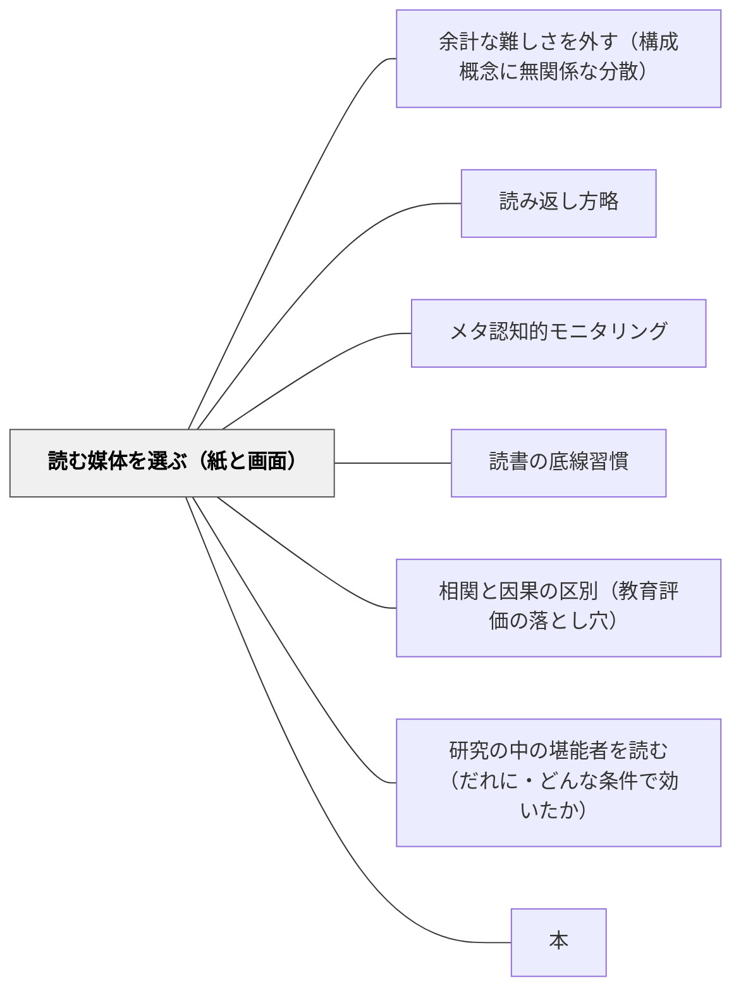

# 読む媒体を選ぶ（紙と画面）

**このパタンが完成を助ける大きなパタン**：[[パタン/熟慮的教材教具]]

> 紙か画面かは、どちらが正しいかではなく、何を・どんな条件で読むかで選ぶ。説明文を時間を区切って読むなら紙。画面で読むなら、スクロールでなくページをめくる形で。

## 背景（Context）

一人一台の端末が入り、教科書の説明文も、資料も、テストも、画面で読む場面が増えた。紙の本を読む時間は、端末での読みに置き換わりつつある。紙と画面で同じ文章を読んだときに理解が変わるかを比べた研究は多く、2018年以降、それをまとめたメタ分析がいくつも出ている。

## 問題（Problem）

紙と画面を区別せずに配ると、条件によっては、同じ文章でも画面で読んだ子の理解が下がる。とくに、説明文を時間を区切って読む場面や、縦に長いページをスクロールして読む場面である。逆に、「画面は悪い」と決めて端末を避けると、ページめくりの形なら紙と同じくらい読める場面まで手放すことになる。

## 力のかたち（Forces）

- 端末は、配る・集める・拡大する・読み上げるが手軽で、手放せない
- 紙で読むほうが理解が高いという研究が多い。ただし差は小さく、条件で大きく変わる
- スクロールして読むと、読んだ文が紙面のどこにあったかという手がかりが崩れ、読み返しにくい（研究者の説明で、確かめられた原因ではない）
- 画面では、手早く浅く読む構えになりやすく、時間に追われるとそれが強く出る、という説がある
- 子どもの読む力の差と、端末の読みの多さのどちらが原因かは、まだ分かっていない

## 解決（Solution）

**何を・どんな条件で読むかを先に決め、紙か画面かを選ぶ。説明文を時間を区切って読むときは紙を用意する。画面で読むときは、スクロールでなくページをめくる形にし、画面の大きい端末を使い、読み終えたら要点を書く一手を入れる。**

| 読む場面 | 選び方 | 根拠 |
|---|---|---|
| 説明文を、時間を区切って読む（テスト・資料の読み取り） | 紙を用意する。画面なら時間に余裕を持たせる | 時間の制限があるとき g = −0.26、自分のペースなら −0.09 で差は確かめられない（Delgado ほか 2018） |
| 長めの説明文を画面で読む | 縦スクロールでなく、紙面の形（PDF のページ送りなど）で配る | スクロールが必要なとき紙がはっきり良く（g = 0.35〜0.38）、不要なときは差が確かめられない（Clinton-Lisell と Litzinger 2026） |
| 画面で読む端末を選ぶ | スマートフォンより画面の大きいタブレット | 紙に近い順に、タブレット、電子書籍端末とパソコン、スマートフォン（同上） |
| 物語を楽しんで読む | 紙でも画面でも。子どもが選んでよい | 物語文だけの研究では差がない（Delgado ほか 2018。研究は7つと少ない） |
| 家で読む習慣を励ます | 紙の本を読む時間を、端末の読みで置き換えずに守る | 余暇の端末の読みと読解力の相関は r = .055 と小さい（Altamura ほか 2023。相関の研究） |

**例（本 Wiki の想定）**
- 5年社会：グラフと説明文のある資料を15分で読み取る学習では、資料を紙で配る。端末には、写真や動画など紙にできないものを置く
- 4年国語：説明文の教材を端末で読むときは、教科書の紙面と同じページ送りの PDF で配り、段落番号を振っておく。読み終えたら、ノートに「大事な言葉を三つ」書いてから問いに答える
- 2年国語：好きな物語を読む時間は、紙の本と電子書籍のどちらを選んでもよい、とする

---

**近いパタンとの見分け**：[[パタン/余計な難しさを外す（構成概念に無関係な分散）]] は、測りたい力の外の難しさを外すこと全般。本パタンは、その一つである「読む媒体」に絞り、テストだけでなく日々の読みにも使う。

### 研究の裏づけ

- **紙と画面の読み比べ**：54研究・約17万人のメタ分析で、紙のほうが理解が高かった（g = −0.21）。差がはっきりしたのは、時間の制限があるときと説明文のとき。研究が新しいほど紙の有利は大きかった（[[文献/紙と画面で読んだときの理解を比べ、時間の制限と説明文で紙が有利になることを確かめる（Delgadoほか2018）|Delgadoほか2018]]、pp. 29–33）
- **スクロールと端末**：説明文の56研究をネットワーク・メタ分析で比べると、スクロールが必要なときだけ紙がはっきり良く、ページをめくる形ならどの端末も紙との差が確かめられなかった。ただし、元の研究の多くは英語で理科の文章を読む大学生（[[文献/紙と四つの端末を比べ、スクロールが理解を下げる鍵かを確かめる（Clinton-LisellとLitzinger2026）|Clinton-LisellとLitzinger2026]]、pp. 1627–1630）
- **余暇の読みの習慣**：端末で読む習慣と読解力の相関は小さく（r = .055）、紙の本を読む習慣（r = .36 前後）よりずっと弱い。小・中学生では負の側に出たが、段階ごとにはゼロと区別できない（[[文献/余暇にデジタルで読む習慣と読解力の関係を、学校段階ごとに確かめる（Altamuraほか2023）|Altamuraほか2023]]、pp. 19–20）
- **全体では差がないとした研究**：中国語と英語の46実験のメタ分析では、全体として差がなかった（g = 0.046）。ただし、時間の制限があるとき・1000〜2000語の文章・大学生では紙が有意に良く、対話的な機能のある電子書籍・物語文では画面が有意に良かった。画面にしかない機能や幼児の電子絵本を含めているので、媒体の違いと機能の違いが混ざっている（[[文献/紙と画面の読みの比較を、対話的な機能や物語文も含めて見直す（LiとYan2024）|LiとYan2024]]、表3）
- **画面の不利を消す一手**：要約のキーワードを書く、課題を大事なものと位置づける、といった簡単な手立てで、時間の制限があっても画面の不利が消えたという研究がある、と Delgado ほか（2018、p. 35）が紹介する。本 Wiki は元の研究（Lauterman と Ackerman 2014、Sidi ほか 2017）を読んでいない

## 結果（Consequences）

**よくなること**
- 説明文を読む場面で、媒体のせいで理解が下がるのを防げる
- 端末を手放さずに、端末の弱いところ（スクロール・小さい画面）だけを避けられる
- テストの結果に、デジタルで読む力の差が混ざるのを減らせる

**注意点・リスク**
- 紙と画面の差は平均では小さい（g = 0.2 前後）。紙に戻せば読解力が上がる、という大きな期待は持たない
- 研究の多くは大学生のもので、小学生の研究は少ない。小学生に当てはまるかは、自分の学級で確かめる
- 読み上げ・拡大・文字の大きさの調整など、端末が読みを支える子もいる。この場合は、媒体の平均の差より、その子の必要を優先する（[[パタン/余計な難しさを外す（構成概念に無関係な分散）]]）
- 「画面で読むと読解力が下がる」とは言い切らない。習慣の研究は相関で、原因の向きは分かっていない

## 異論と反証

このパタンに反する研究・批判・訂正を、このページの中から集めた。くわしくは（ ）の節へ。考え方は [[異論と反証]]。

- **研究どうしの食い違い**：中国語と英語の46実験のメタ分析では、全体として紙と画面に差がなかった（g = 0.046）。対話的な機能のある電子書籍や物語文では、画面のほうが有意に良かった（[[文献/紙と画面の読みの比較を、対話的な機能や物語文も含めて見直す（LiとYan2024）|LiとYan2024]]・「研究の裏づけ」）。
- **効く条件が限られる**：ページをめくる形で読むなら、どの端末でも紙との差は確かめられなかった。紙が有利になるのは、スクロールが必要なときにほぼ限られる（[[文献/紙と四つの端末を比べ、スクロールが理解を下げる鍵かを確かめる（Clinton-LisellとLitzinger2026）|Clinton-LisellとLitzinger2026]]・「研究の裏づけ」）。
- **効く条件が限られる**：物語文だけを読んだ研究では、紙と画面の差がなかった。ただし研究は7つと少ない（[[文献/紙と画面で読んだときの理解を比べ、時間の制限と説明文で紙が有利になることを確かめる（Delgadoほか2018）|Delgadoほか2018]]・「解決」の表）。

## 関連パタン

- [[パタン/余計な難しさを外す（構成概念に無関係な分散）]] — 端末で受けるテストに混ざる、読む媒体の難しさを外す
- [[パタン/読み返し方略]] — 読んだ場所を手がかりに読み返す。スクロールはその手がかりを崩しうる
- [[パタン/メタ認知的モニタリング]] — 画面で読むと、分かったつもりになりやすいという先行研究がある
- [[パタン/読書の底線習慣]] — 毎日読む習慣は、紙の本で示された関係。端末の読みに置き換えない
- [[パタン/相関と因果の区別（教育評価の落とし穴）]] — 読む習慣の研究は相関で、端末の読みが原因とは言えない
- [[パタン/研究の中の堪能者を読む（だれに・どんな条件で効いたか）]] — 全体の平均ではなく、時間の制限・文章の種類・スクロールの条件で読む
- [[パタン/本]] — 紙の本という教育材料

## クラスター図

## Actionable Insight

- 次に説明文を時間を区切って読む授業で、資料を紙で配る
- 端末で配っている読み物を一つ選び、縦スクロールになっていないか確かめる。なっていれば、ページ送りの PDF に変える
- 画面で読んだあとは、問いに答える前に「大事な言葉を三つ」ノートに書く時間を1分取る
- 学級の読書記録に「紙／端末」の欄を足し、どちらで読んでいるかを見えるようにする

## 出典

- Delgado, P., Vargas, C., Ackerman, R., & Salmerón, L. (2018). Don't throw away your printed books: A meta-analysis on the effects of reading media on reading comprehension. *Educational Research Review*, 25, 23–38. → [[文献/紙と画面で読んだときの理解を比べ、時間の制限と説明文で紙が有利になることを確かめる（Delgadoほか2018）]]
- Clinton-Lisell, V., & Litzinger, C. (2026). Decoding digital reading: A network meta-analysis of comprehension across devices. *Education and Information Technologies*, 31, 1611–1643. → [[文献/紙と四つの端末を比べ、スクロールが理解を下げる鍵かを確かめる（Clinton-LisellとLitzinger2026）]]
- Altamura, L., Vargas, C., & Salmerón, L. (2023). Do new forms of reading pay off? A meta-analysis on the relationship between leisure digital reading habits and text comprehension. *Review of Educational Research*. → [[文献/余暇にデジタルで読む習慣と読解力の関係を、学校段階ごとに確かめる（Altamuraほか2023）]]
- Li, Y., & Yan, L. (2024). Which reading comprehension is better? A meta-analysis of the effect of paper versus digital reading in recent 20 years. *Telematics and Informatics Reports*, 14, 100142. → [[文献/紙と画面の読みの比較を、対話的な機能や物語文も含めて見直す（LiとYan2024）]]

## 根拠の確かめ（自動生成）

<!-- source-check: 自動生成。手で編集しない。文献ページの frontmatter の source_check から作る -->
このページが引く文献を、本 Wiki が原典でどこまで確かめたかで分けた。くわしくは各文献ページの「書誌・確認した範囲」や「原文との照合」へ。

- **原典照合**（原典にあたって、引用や要約を照らした）：[[文献/紙と画面で読んだときの理解を比べ、時間の制限と説明文で紙が有利になることを確かめる（Delgadoほか2018）|Delgadoほか2018]]・[[文献/紙と四つの端末を比べ、スクロールが理解を下げる鍵かを確かめる（Clinton-LisellとLitzinger2026）|Clinton-LisellとLitzinger2026]]・[[文献/余暇にデジタルで読む習慣と読解力の関係を、学校段階ごとに確かめる（Altamuraほか2023）|Altamuraほか2023]]・[[文献/紙と画面の読みの比較を、対話的な機能や物語文も含めて見直す（LiとYan2024）|LiとYan2024]]
