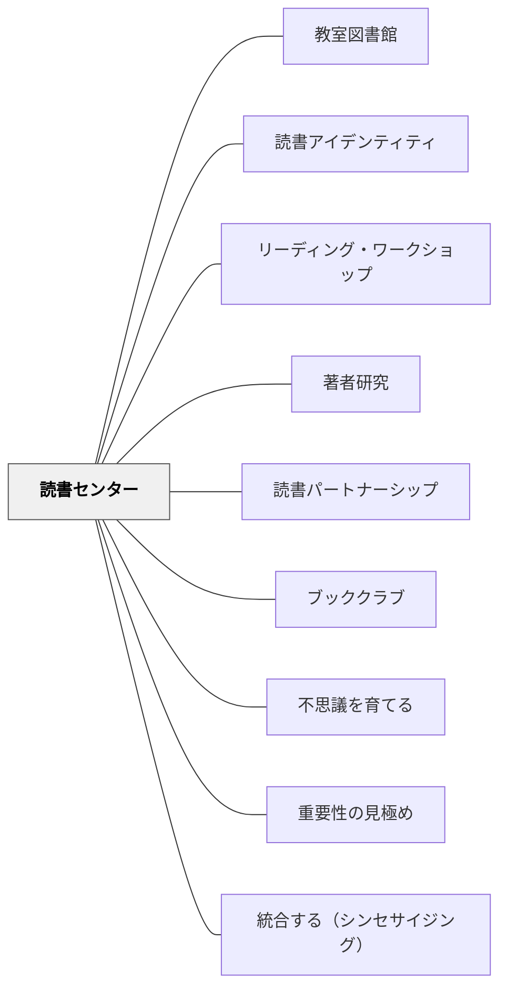

# 読書センター

**このパタンが完成を助ける大きなパタン**：[[パタン/リーディング・ワークショップ]]

> 二人組のパートナーが選んだジャンル・著者・テーマを中心に集まり、私読みの時間とは別に「追求する読書」を育てる場を設ける。

---

## 背景（Context）

リーディング・ワークショップが定着し、一人読みとパートナー読みが根づいてきたとき、次のステップとして「**読書の興味を深める場**」が必要になる。2〜5月（Collins の「Readers Pursue Their Interests」単元）に設けるのが Reading Centers（読書センター）だ。

## 問題（Problem）

毎日の私読み（Private Reading Time）は個人の読書スタミナを育てるが、それだけでは「本を深く探究する」体験が生まれにくい。「速く多く読む」から「深く選んで読む」への転換点が必要。

## 力のかたち（Forces）

- 同じジャンル・著者・テーマについて話し合える仲間がいると、読書が知的な社会活動になる
- しかし全員が同じテーマを同時に研究すると、興味の多様性が失われる
- 私読み時間（Just-Right Books）は毎日維持しつつ、センター活動を加える必要がある——削ると読書量が落ちる
- 話し合いの構造がないと「好きな話をするだけ」で終わり、読書力が伸びない

## 解決（Solution）

**私読みの時間を毎日維持しつつ、パートナー読みの時間を週4回ほどセンター活動に置き換える**。センターでは二人組のパートナーが、特定のテーマを2〜4週間かけて研究する（Collins は、センター活動のない日はいつもどおり一人読みのあとにパートナー読みをする）。

**近いパタンとの見分け**：パートナーが新しいテーマを2〜4週間追究する場が本パタン。すでに教えたことを練習する場は [[パタン/リテラシー・ワークステーション]]。系列の全体の表は [[パタン/リーディング・ワークショップ#近いパタンとの見分け|リーディング・ワークショップ]] にある。

### センターの種類（Collins, 2004 Chapter 7）

| センター名 | 研究するもの | 育てる読み手の力 |
|-----------|-------------|----------------|
| **著者研究** | 好きな著者の全作品 | 著者の文体・テーマの類似と相違に気づく力 |
| **登場人物研究** | 好きなシリーズキャラクター | 人物の動機・成長を推論する力 |
| **詩の研究** | 詩のジャンル・技法 | 声に出して読む・詩人の技法を評価する力 |
| **ノンフィクション研究** | テーマ別ノンフィクション本 | 重要性の見極め・情報の統合 |
| **プロジェクト読書** | 自分で設定した研究テーマ | 自律的な読書計画と目標設定 |

---

### 運営の基本構造

Collins によれば、どの研究も同じリズムで進む：**Immersion → Launching → Cycle 1 → Cycle 2 → Cycle 3（任意）→ Projects or Celebrations**。

**Immersion（浸る。たいてい1週間ほど）**
- センターを始める直前に、読み聞かせや共有読書で、これから扱う種類の本に触れる（著者研究なら、1週間ほど一人の作家を読み聞かせで取り上げる）
- この時期は、独立読書のミニレッスンでは単元をまだ扱わない。子どもは just-right books を読み、いつもどおりパートナーと話す

**Launching（立ち上げ。たいてい2〜3日）**
- 独立読書のミニレッスンで単元を扱い始め、パートナーどうしで、これから読む種類の本を探る
- クラスで作家ごと・登場人物ごとなどのかごを作り、週の終わりに各パートナーが研究するかごを選ぶ

**Cycle 1（1週間ほど）**
- 各パートナーが選んだセンターのかごから読み、話し合う
- ミニレッスンは単元の研究を支え、子どもがその道の専門家になるのを助ける

**Cycle 2**
- 多くの場合、新しいセンターを選ぶ（同じものを続けてもよい）
- 難しかった概念のミニレッスンは繰り返し、研究を深める

**Cycle 3（任意）**
- 作業がより高度になる。著者研究なら、かごを組み替えて、共通点のある複数の作家の本を一つのかごに入れ（「子どものことを書く作家」「おもしろい本を書く作家」など）、比べたり対照したりして考えを立てる

**Projects or Celebrations**
- 研究の終わりに、子どもが身につけた専門性を何らかの形で分かち合うプロジェクトや祝い

---

### 登場人物研究の具体例

Collins 自身の子どもの頃の愛読キャラクター：Harriet the Spy、Mrs. Piggle-Wiggle、Pippi Longstocking、Encyclopedia Brown。

低学年版の登場人物研究では：
- Henry（Henry and Mudge シリーズ）のセンターを選んだパートナーが読む
- Mudge がいなくなったときの Henry の気持ちを、自分の猫がいなくなってあちこち探した経験とつなげて「よくわかる」と話す子がいる——自分の経験とのつながりが本の理解を深める例（Collins の表「センターで気づき、支えたい考え」より）
- キャラクターが長編シリーズに登場するとき、「成長」を追うことができる

---

### 詩のセンターの計画例（Collins, 2004）

| サイクル | 活動 |
|---------|------|
| Cycle 1 | 詩を感情を込めて声に出して読む練習 |
| Cycle 2 | 詩人の仕事を味わう：言葉の選び方、心に絵が浮かぶ部分、考えを変えてくれる詩に気づく。同じ詩人の詩どうし・同じテーマの詩どうしを比べる |
| Cycle 3 | 自分が愛する詩を集め、なぜ好きかを語る |
| Celebration | クラス詩集を作る・詩のスラム・詩をギフトとして贈る |

---

### 日本の文脈での実装

- センターは週2回（例：火・木）の読書時間に設ける（原本では週4回ほど、パートナー読みの時間をセンターに置き換える。週2回は日本の時間割に合わせた本Wikiの提案）
- 「今日は私読み day」「今日はセンター day」を明示する
- センターの本は学校図書館と連携してテーマバスケットを作る
- 登場人物研究は「国語の教科書の登場人物」からスタートできる

## 結果（Consequences）

- 読書が「量の競争」から「質の探究」に転換する
- グループでの読書対話が自然に深まる——「あのシーンどう思った？」が始まる
- ノンフィクション研究は理科・社会の調べ学習への橋渡しになる
- センターで深めた著者やジャンルが、その後の一人読みの選書に影響する

## 関連パタン
- [[実践/リーダーズ・ノートの起動]]
- [[実践/読書への情熱を育てる実践集]]
- [[パタン/教室図書館]]
- [[パタン/読書アイデンティティ]]

- [[パタン/リーディング・ワークショップ]] — センターが組み込まれる親構造
- [[パタン/著者研究]] — 著者センターの詳細
- [[パタン/読書パートナーシップ]] — センターの話し合いもパートナーベースで行われる
- [[パタン/ブッククラブ]] — センターの発展形として文学討論グループへ
- [[パタン/不思議を育てる]] — ノンフィクションセンターで「問いをもつ」が育つ
- [[パタン/重要性の見極め]] — ノンフィクションセンターでの核心的ストラテジー
- [[パタン/統合する（シンセサイジング）]] — センター研究の最終段階で起きる

---

## クラスター図

## Actionable Insight

- 読書センターの導入前に「読み聞かせで同じ著者の本を3回連続で取り上げる」週を設ける。子どもが自然と「またこの著者だ」と気づく体験が、センター活動への動機になる
- 最初のセンターは「著者研究」がシンプルで始めやすい——著者バスケット（1著者の本3〜8冊、6冊前後）を紙袋に入れて棚に並べるだけで準備できる
- Cycle終わりの共有は「他のセンターに1分だけ報告する」形式にすると全員が聴き合える

---

## 出典

Collins, K.（2004）*Growing Readers: Units of Study in the Primary Classroom*. Stenhouse Publishers.

> "Readers gather and read texts by authors they love."
> "Readers Pursue Their Interests in Books and Other Texts"（第7章の単元名）
