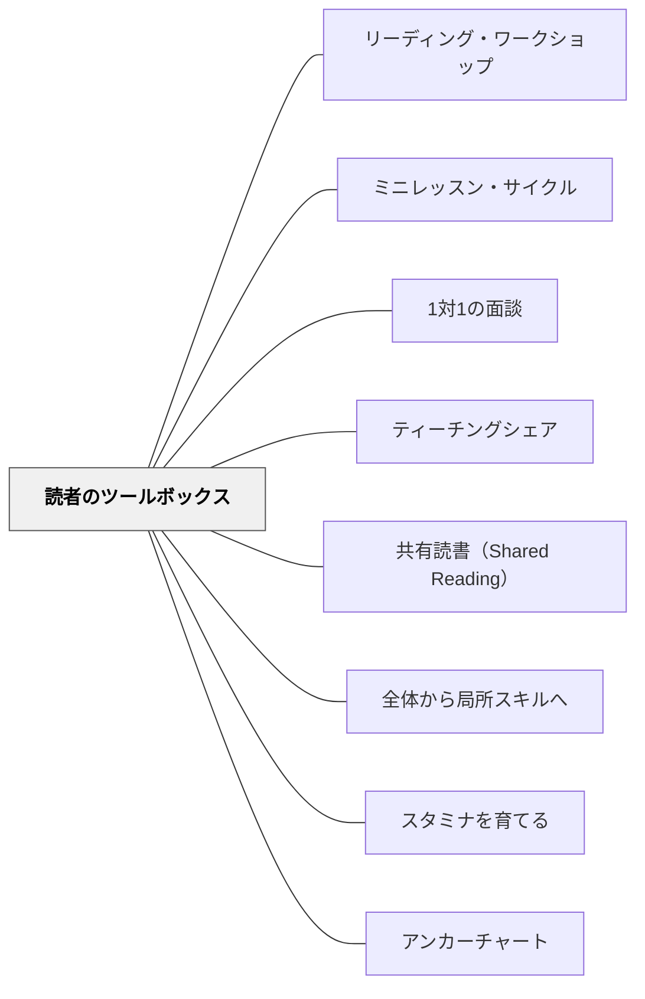

# 読者のツールボックス

**このパタンが完成を助ける大きなパタン**：[[パタン/リーディング・ワークショップ]]

> 「意味が通るか・音として正しいか・字の形が合うか」の3つの問いを持てる読み手は、詰まったとき自分で動き出せる。

---

## 背景（Context）

リーディング・ワークショップで独立読書をしている低学年の子どもたちは、知らない言葉や難しい文章に頻繁に出会う。このとき「どうやって読み進めるか」の手立てを持っているかどうかが、読書体験の質を大きく左右する。

Collinsは第5章（Readers Use Strategies to Figure Out Words）で、この手立てを**Reader's Toolbox（読者のツールボックス）**と呼ぶ。工具箱には複数の道具が入っており、状況に応じて使い分ける——それが熟練した読み手の姿だという考え方がこのパタンの核心だ。

## 問題（Problem）

「わからない字は一字一字声に出して読む（phonics drillのみ）」という一つのストラテジーしか持たない読み手は、意味を追う読み方ができなくなる。反対に「なんとなく流して読む」読み手は、文字情報を活かさない。どちらも「詰まったときに自分で動き出せない」という問題を持っている。

## 力のかたち（Forces）

- 低学年にはデコーディング（文字を音に変換する）の明示的指導が必要
- しかしフォニックス・ドリルだけでは「意味を作る読み」への転移が起きにくい
- 複数のストラテジーを持つと、一つが機能しないとき別の手段を試せる
- 「どれを使うか」の判断は文章の文脈によって変わる——文脈から切り離した練習では身につかない
- 自分のストラテジー使用を意識（メタ認知）できる読み手ほど、問題解決が速い

## 解決（Solution）

Collins（2004）のツールボックスの中身は、クラスで作るチャート「Readers' Strategies: Tools to Help Us Read Words」（字を読むのを助ける読み手の手立て）である。最初の項目は「Readers study the pictures and think about the story.（絵をよく見て、お話を考える）」で、2週間ほどのミニレッスンで項目を足していく。Collins は、どの手立ても、意味をつかむこと・お話として何が通るかを考えることと組み合わせて教える。

下の「MSV三点クロスチェック」は本Wikiの整理である。Collins は M・S・V という語を使わない。ただし1月の Word Power の単元の説明で、より難しい本を読む子どもは、意味・文法・字と音（semantic, syntactic, and graphophonic）の情報源を効率よく組み合わせる必要があると書いている。

---

### MSV三点クロスチェック

知らない言葉や詰まったとき、次の3つを問う：

| 問い | 意味 | キューの種類 |
|------|------|-------------|
| **M: Does it make sense?（意味が通る？）** | 文脈・物語の意味から考える | 意味（Meaning）キュー |
| **S: Does it sound right?（音として正しい？）** | 日本語として自然か、文法として通るか | 構造（Structure）キュー |
| **V: Does it look right?（字の形と合う？）** | 実際に書いてある文字と一致するか | 視覚（Visual）キュー |

熟練した読み手は三点を**同時・無意識**に使っている。初心者は意識的に順番に確認する練習が必要。

---

### 詰まったときに使える具体的な手立て

```
① 絵をよく見て、お話を考える（Readers study the pictures and think about the story）
② 語のはじめの文字の音を言う（最初の一字だけでなく、はじめの数文字）
③ 語の終わりに気をつける
④ 語全体を左から右へ見ていく
⑤ いつも、意味が通るかを考える（Does this make sense?）
```

これは Collins が第5章のミニレッスンとして挙げる5つである。はじめの文字の手立てには、文の初めから読み直して、何が通るかを考える手立てを組み合わせる。語全体を見るときは、「語の中の知っている語を探して」という促しは役に立たないことが多い（easy の中の as など）とし、左から右へ見て、知っている綴りの部分（ea、ou など）を手がかりにすると教える。

これらをクラスのチャート「Readers' Strategies: Tools to Help Us Read Words」に足していく。「ツールボックス」は、子どもに手立て（strategy）を具体的に感じてもらうための比喩で、Collins は「reading tools」と「reading strategies」を同じ意味で使う。

---

### 流暢さ（Fluency）——同じ単元の、別の区切り

Collins は流暢さを、字を読み解く手立て（ツールボックス）とは別の区切り（bend）として、同じ単元の中で教える。教えるのは、**遅すぎず、話しているような声で読むこと**。ゆっくり一語ずつ読むと、お話が分かりにくくなるからだ。

- 「ロボット声（robot voice）」：一語ずつ区切って読む——流暢でない状態
- 「話す声（talking voice）」：ふだん話しているような声で読む——流暢な状態

**ミニレッスン例（流暢さ）**：教師がチャートに書いた一文を2回読む——1回目はゆっくりのロボット声で、2回目はふだん話すような声で。ふつうの声のほうが分かりやすかったことに気づいたか問い、違いが聞き取れたら親指を上げてもらう。そのあと全員で同じ文を話す声で読んで練習する。

---

### ランニングレコードとツールボックスの接続

（この節は本Wikiの整理。M・S・V のキューを使った観察の手順は Collins の記述ではない）

1対1のカンファランス（[[パタン/1対1の面談]]）でランニングレコードを取ると、子どもがどのキュー（M・S・V）を使いすぎているか、使えていないかが見える。

- 「意味は取れているが字が違う」→ Visual キューへの注目を促す
- 「字は読めているが意味を確認していない」→ Meaning キューの問いを持つよう促す

この観察がミニレッスンの選択を決定する——ツールボックスのどの工具を全体に教えるかは、カンファランスの観察から始まる。

---

### 「ツール化」の原則

ストラテジーを**いつでも取り出せるツール**として子ども自身が持つこと——これはツールボックスの比喩から本Wikiが引き出す要点である。Collins は単元の始めのミニレッスンでこう語りかける。

> "Imagine that we also carry around a toolbox, a reader's toolbox, that has the tools we can use to figure out words."（Collins, 2004、第5章）

そのため：
- アンカーチャートは子どもが参照できる場所に常時掲示する
- カンファランスで「今日どのツールを使った？」と聞く
- ティーチングシェア（[[パタン/ティーチングシェア]]）でツールの使い方を仲間の言葉で共有する

**近いパタンとの見分け**：読むの表では、本パタンの見分けの問いは「詰まったとき、意味・音・字の形の三つで自分で確かめられるか」。全体の表は [[パタン/リーディング・ワークショップ#近いパタンとの見分け|リーディング・ワークショップ]] にある。

### 研究の裏づけ

> **研究の裏づけ（2026-11-01）**：全米読書委員会（2000）の第2章は、フォニックスの指導（38研究）が語を読む力には効いた一方、2年生以上の読解には有意な効果がなかった（0.12。読みの障害のある子だけで見ると小さな効果 0.27）とする。委員会は、フォニックスは読みの指導の全体ではなく、子どもの読みを、本への興味や読み聞かせの内容の理解など、いくつもの面から見るよう求める（pp. 2-94, 2-97, 2-116）。出典：[[文献/音素の意識とフォニックスの指導が、だれにどんな条件で効いたかを確かめる（全米読書委員会2000）]]。

## 結果（Consequences）

- 詰まったとき自分で動き出せる読み手が育つ——教師への依存が減る
- 「フォニックスだけ」から「意味を作る読み」への転換が起きる
- ランニングレコードを通じて教師の観察眼が鋭くなる——カンファランスの質が上がる
- 流暢さの向上が「読書が楽しくなる」という体験につながる

## 関連パタン

- [[パタン/リーディング・ワークショップ]] — ツールボックス指導が組み込まれる4部構造
- [[パタン/ミニレッスン・サイクル]] — ストラテジーの最初の指導はミニレッスンで行う
- [[パタン/1対1の面談]] — ランニングレコードでツール使用状況を診断する
- [[パタン/ティーチングシェア]] — ツールの実践をクラス全体で共有する
- [[パタン/共有読書（Shared Reading）]] — ツールのモデルを教師が示す場
- [[パタン/全体から局所スキルへ]] — 全体読書の文脈の中でストラテジーを教える
- [[パタン/スタミナを育てる]] — ツールが機能すると詰まりが減り、読書スタミナが伸びる
- [[パタン/アンカーチャート]] — ツールボックスの内容を視覚化し教室に常設する
- [[文献/音素の意識とフォニックスの指導が、だれにどんな条件で効いたかを確かめる（全米読書委員会2000）]] — フォニックスは語の読みに効くが、2年生以上の読解には効きにくかった

---

## クラスター図



## Actionable Insight

- アンカーチャートに「詰まったら……」という見出しで3〜4つのストラテジーを子どもと一緒に作る——「クラスのツールボックス」として壁に貼ると、独立読書中に自分で参照できる
- カンファランスで「今どのツールを使った？」と一問添える習慣をつける——自分の使ったストラテジーを言語化することがメタ認知の練習になる
- 1週間に1回、同じ文を「ロボット声」と「話す声」で読み比べる2分間を設ける——流暢さが聴いてわかる体験が、子どもに「どう読むか」の目標を与える

---

## 出典

Collins, K.（2004）*Growing Readers: Units of Study in the Primary Classroom*. Stenhouse Publishers. → [[文献/Growing Readers（Collins）]]

> "They are expected to use a variety of strategies to figure out words, self-correct at the point of error, read with fluency, and understand their stories so their ability to orchestrate semantic, syntactic, and graphophonic sources of information needs to be efficient and effective." ——Collins（2004）、1月の Word Power の単元の説明（They は、より難しい本を読むようになった子どもたち）
