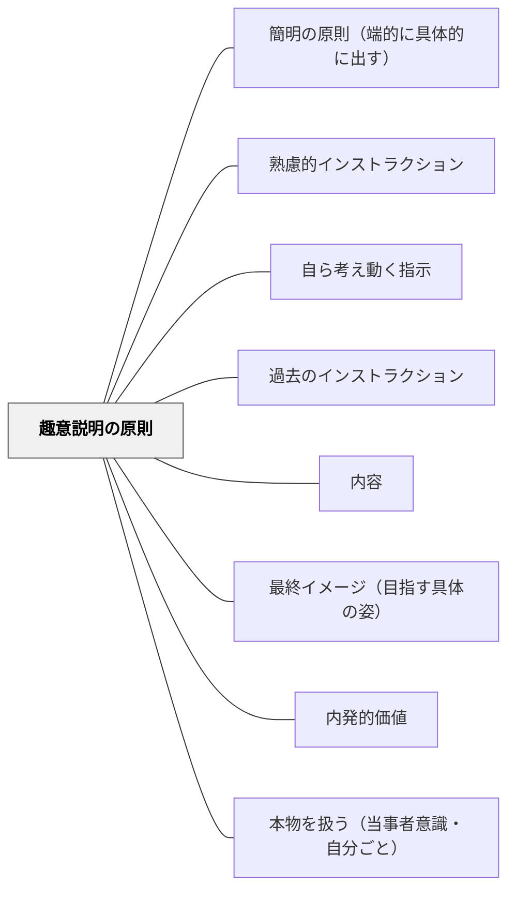

# 趣意説明の原則

**このパタンが完成を助ける大きなパタン**：[[パタン/熟慮的インストラクション]]

> なぜそうするのかを説明することで、受け手は納得して行動できる。

## 背景（Context）
趣意説明の原則は向山洋一（1985）『授業の腕をあげる法則』明治図書に示される10原則の一つである。「なぜこのルール・手順が必要か」を伝えることで、受け手は指示の意味を理解し、主体的に行動するようになる。趣意なき指示は命令となり、受け手の自律性を損なう。

同じ考えは、ほかの二つの系列にもある。ワーマンはインストラクションの内容を6要素で整理し、その最初に「使命（ミッション）」——何のためにこれをするのか——を置いた。岩瀬直樹・チン聖子は「価値のインストラクション」として、なぜこれをやるのかの意味・価値を伝えることを、過去・現在・未来のどのインストラクションも支える土台に置いた。

※旧パタン「使命（目的）説明の原則」「価値のインストラクション」を本ページに統合（2026-11-12）。三枚は互いに「同概念」と書き合っていたため一枚にした。熟慮的インストラクションの表では、6要素の「使命」、内容の種類の「価値」として、旧名のまま並べている。

## 問題（Problem）
教師が「こうしなさい」と行動だけを指示し、その理由を示さないことがある。受け手（特に子ども）は意味がわからないまま従うか、反発するかのどちらかになる。趣意が伝わらない指示は、場面が変わると応用が効かない。

目的が伝わらないまま手順だけが伝わると、手順の一つがうまくいかないとき全体が止まる。アビアンカ航空事故では、「燃料が切れそうだ」という事実は伝えたが、「緊急事態である」という使命が管制に伝わらなかった。

## 力のかたち（Forces）
- 趣意を理解した受け手は、状況が変わっても自分で判断できるようになる
- 毎回詳しく趣意を説明すると授業のテンポが落ちる
- 趣意を伝えることで、受け手の「なぜ？」という疑問が解消される
- 目的が明確だと、手順の一部があいまいでも受け手が自分で補える
- 価値の説明が「説得」になると押しつけになる
- 目的（使命）は最終イメージより抽象的で、両方が要る

## 解決（Solution）
**指示を出す前や後に「〇〇するのは△△のためです」という形で、その指示・ルールの目的を一文で添える。**

**近いパタンとの見分け**：何のためか（目的・価値）を一文添えるのが本パタン（旧「使命（目的）説明の原則」「価値のインストラクション」を統合）。できあがりの姿を見せるのは [[パタン/最終イメージ（目指す具体の姿）]]、指示そのものを短く言うのは [[パタン/簡明の原則（端的に具体的に出す）]]。指示の系列の全体の表は [[パタン/熟慮的インストラクション#近いパタンとの見分け|熟慮的インストラクション]] にある。

たとえば「姿勢を正すのは、声がよく通るようにするためです」「ノートに書くのは、考えを整理するためです」のように、手短に趣意を伝える。全ての指示に毎回詳しく説明する必要はなく、初めて出す指示・繰り返したい行動・定着させたいルールに絞って使う。

**活動やインストラクションの冒頭では、目的を先に置く**（旧「使命（目的）説明の原則」）：「今日のゴールは○○です」「これをやる目的は△△のためです」と、手順に入る前に一文で示す。目的と最終イメージ（具体的な完成形、[[パタン/最終イメージ（目指す具体の姿）]]）は別物なので、両方を示す。子どもが途中で止まったら、「この活動の目的は何だったか思い出してみよう」と目的に立ち返る。

**価値は、子どもの生活の言葉で言う**（旧「価値のインストラクション」）：「大事だから」ではなく、「こうすることで△△ができるようになります」「〜に役立ちます」と、子どもの生活や目標につながる具体的な言葉で言う。ときには「なぜこれをするのだと思う？」と問い、子どもが自分で価値を見つける形にする。

## 結果（Consequences）
- 受け手が指示の意味を理解し、主体的に行動するようになる
- ルールへの納得感が高まり、反発や形式的な従順さが減る
- 受け手が指示の背後にある「目的」を考える習慣が育つ
- 手順の一部が抜けても、目的に基づいて対応できるようになる。「なぜ動かなかったのか」の原因を、目的が伝わっていなかったこととして見つけやすくなる

## クラスター図

## Actionable Insight

- 指示を出す前や後に「○○するのは△△のためです」という形で目的を一文で添える——受け手が指示の意味を理解し、主体的に行動するようになる
- 初めて出す指示・繰り返したい行動・定着させたいルールに絞って趣意を伝える——毎回詳しく説明せず必要な場面だけに使うことで授業のテンポを保つ
- 「なぜそうするのか分かる？」と問いかけてから趣意を示す——受け手が指示の背後にある目的を考える習慣が育つ

## 出典

- 一つの教育のパタン・ランゲージ（岩井輝久）（旧「使命（目的）説明の原則」「価値のインストラクション」を含む）
- 向山洋一（1985）『授業の腕をあげる法則』明治図書

## 関連パタン
- [[パタン/簡明の原則（端的に具体的に出す）]]
- [[パタン/熟慮的インストラクション]] — 親パタン
- [[パタン/自ら考え動く指示]] — 目的を共有して手段を委ねる（趣意説明の前提にある受け手への信頼）
- [[パタン/過去のインストラクション]]
- [[パタン/内容]] — 6要素の枠組み（旧「使命」）
- [[パタン/最終イメージ（目指す具体の姿）]] — 目的と対で要る要素
- [[パタン/内発的価値]] — 価値の内面化
- [[パタン/本物を扱う（当事者意識・自分ごと）]] — 価値を感じられる学習設計
- [[文献/課題の目的・やること・評価の規準をはっきり示すと、大学1年生、とくに家族で初めて大学に進んだ学生の自信と所属感は伸びるかを確かめる（Winkelmesほか2016）]] — 課題の目的を取りかかる前に伝えると、大学1年生の自信と所属感の自己評定が上がった（透明な課題設計・仮説）

