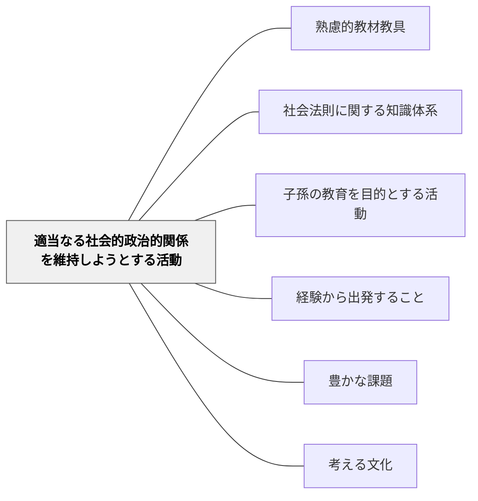

# 適当なる社会的政治的関係を維持しようとする活動

> 社会・歴史・政治を理解し、健全な市民として生きる知識。

## 背景（Context）

ハーバート・スペンサーの活動分類の第四項目。社会科学・歴史学・政治学・経済学など、社会的・政治的な関係を維持・改善するための知識・活動。社会科・公民・歴史の教科内容がここに含まれる。

**原典では**：スペンサーの論文「いかなる知識が最も価値あるか」（1859年）は、人間の生活を成り立たせる主な活動を、重要さの順に五つに分けた。本項はその第4で、原文は “those activities which are involved in the maintenance of proper social and political relations”。スペンサーは五つのどれについても、最も価値ある知識は「科学（Science）」だと結論した。
牧口常三郎は『創価教育学体系』第4巻で、この五要素を「教材の選択論上、今でも一顧せざるを得ない貴重なる文献」と評し、第4を「適当なる社会的政治的関係を維持せんとする活動＝市民としての生活の準備＝市民としての歴史及び社会に関する自然史」と訳している。

## 問題（Problem）

社会科・歴史が「暗記科目」として扱われると、市民としての参加意識や批判的思考が育ちにくい。

## 力のかたち（Forces）

- 社会参加・民主主義の基盤となる教育内容
- 現代社会の複雑さが学習者の理解を困難にする

## 解決（Solution）

**近いパタンとの見分け**：教材・教具の表では、本パタンの見分けの問いは「社会と政治の関係を保つ知識（歴史・社会科学など）につながる教材か」。全体の表は [[パタン/熟慮的教材教具#近いパタンとの見分け|熟慮的教材教具]] にある。

**社会・政治・歴史の内容を「市民として社会に参加するための知識」として位置づけ、現代社会の実際の問題と結びついた教材設計をする。**

**例：学級会で決める**（特別活動）
議題を出し合い、話し合って決める。多数決で決めたあと、少数の意見をどう生かすかも話し合う。

---

**例：地域のごみ出しのきまり**（社会・4年）
市のごみの分け方の資料を読み、なぜそのきまりがあるのかを調べ、自分たちにできる提案をまとめる。

## 結果（Consequences）

- 市民リテラシー・批判的思考が育つ
- 社会への当事者意識が高まる

- 注意点：スペンサーは五つを重要さの順に並べたが、順位をそのまま時間配分にすると、教育の幅が狭くなる

## 関連パタン

- [[パタン/熟慮的教材教具]] — 親パタン
- [[パタン/社会法則に関する知識体系]] — 関連する知識体系
- [[パタン/子孫の教育を目的とする活動]] — スペンサーの第三活動カテゴリ（育児・次世代教育の知識）

- [[パタン/経験から出発すること]] — 社会的実践の体験を学びの起点にする
- [[パタン/豊かな課題]] — 社会的活動を核にした豊かな課題設計
- [[パタン/考える文化]] — 社会的・政治的問いを問い続ける「考える文化」

## クラスター図

## Actionable Insight

- 社会科・歴史の授業に「この問題は今の社会でどう現れているか？」を必ず結びつける——暗記科目から市民として参加するための知識へと学習の意味が変わる
- 時事ニュースや地域の問題と授業の内容を結びつけた教材を作る——現実の問題との接続が学習者の当事者意識と批判的思考を育てる
- 「市民として自分がこの問題にどう関われるか？」を考えさせる活動を単元に1回設ける——市民リテラシーは知識だけでなく参加の感覚から育つ

## 出典

- ハーバート・スペンサー（知識の分類）
- [[文献/熟慮的教育材料のパターンリスト（動画記録）]]

- Spencer, H. (1911). What knowledge is of most worth? In *Essays on education and kindred subjects* (pp. 1–44). J. M. Dent.（初出1859年。Project Gutenberg 版 #16510 で原文を確認）
- 牧口常三郎（2007）『創価教育学体系』第4巻（聖教文庫、第8刷のデジタル版）第二章「教科構造論」— 2026-11-13 に該当箇所の原文を確認。[[文献/創価教育学体系 4（牧口常三郎）]]
