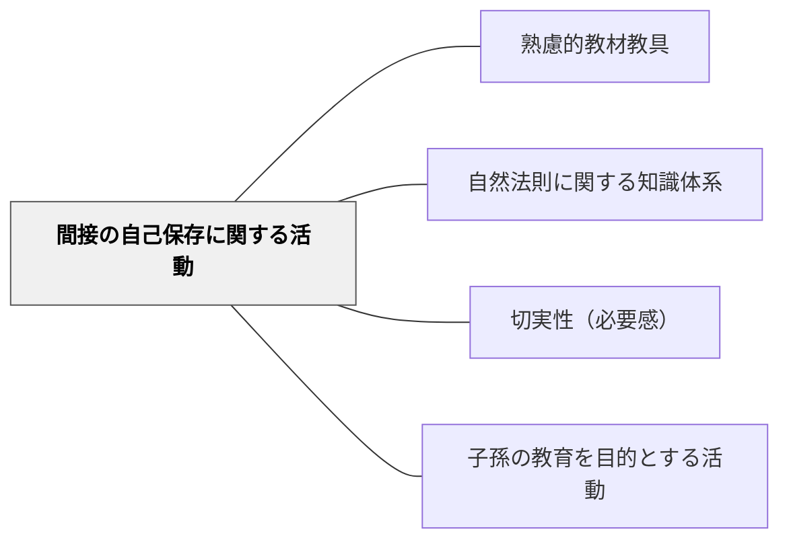

# 間接の自己保存に関する活動

**このパタンが完成を助ける大きなパタン**：[[パタン/熟慮的教材教具]]

> 数学・物理学・化学・生物学——自然を理解することで生活を支える知識。

## 背景（Context）

ハーバート・スペンサーの活動分類の第二項目。数学・物理学・化学・生物学・社会学など、自然法則や社会の仕組みを理解することで間接的に生活を豊かにし自己を守る知識・活動。現代学校教育の主要教科の多くがここに含まれる。

**原典では**：スペンサーの論文「いかなる知識が最も価値あるか」（1859年）は、人間の生活を成り立たせる主な活動を、重要さの順に五つに分けた。本項はその第2で、原文は “those activities which, by securing the necessaries of life, indirectly minister to self-preservation”。スペンサーは五つのどれについても、最も価値ある知識は「科学（Science）」だと結論した。

牧口常三郎は『創価教育学体系』第4巻で、この五要素を「教材の選択論上、今でも一顧せざるを得ない貴重なる文献」と評し、第2を「間接の自己保存に関する活動＝間接なる自己保存の準備＝数学、物理学、化学、生物学、社会学」と訳している。

## 問題（Problem）

これらの教科が「試験のための知識」として扱われ、なぜそれを学ぶかという生活との関連が見えにくくなりがちである。

## 力のかたち（Forces）

- 科学的な知識が生活・社会の問題解決に役立つ
- 抽象度が高く学習者が意義を感じにくいことがある

## 解決（Solution）

**近いパタンとの見分け**：教材・教具の表では、本パタンの見分けの問いは「生計を支える知識（数学・物理・化学など）につながる教材か」。全体の表は [[パタン/熟慮的教材教具#近いパタンとの見分け|熟慮的教材教具]] にある。

**数学・理科などの教科を「生活・社会の問題を解決するための知識」として位置づけ、実生活との接続を意識した教材設計をする。**

**例：割引とポイントの割合**（算数・5年）
「2割引」と「20%ポイント還元」はどちらが得かを、割合の考えで確かめる。生活の中の判断に、割合の学習を使う。

---

**例：電気代の明細を読む**（理科・6年）
家の電気代の明細（または教師が用意した例）を読み、使った電気の量と時間の関係を調べる。

## 結果（Consequences）

- 教科の意義が学習者に伝わりやすくなる
- 学習の切実性が高まる

- 注意点：スペンサーのいう「間接の自己保存」は、生活の糧を得ること（gaining a livelihood）である。教科の知識を、暮らしを立てる力との関係で見直す視点になる

## 関連パタン

- [[パタン/熟慮的教材教具]] — 親パタン
- [[パタン/自然法則に関する知識体系]] — 関連する知識体系
- [[パタン/切実性（必要感）]] — 意義を実感させる
- [[パタン/子孫の教育を目的とする活動]] — スペンサーの第三活動カテゴリ（育児・次世代教育の知識）

## クラスター図

## Actionable Insight

- 単元の導入で「この知識がなければ解決が難しかった現実の問題」を1つ紹介する——学問が実際の生活・社会問題に役立っているという実感が学習の意義を生む
- 「もしこの法則を知らなかったら、日常生活で何が困るか」を学習者に考えさせる——知識の不在を想像することが知識の価値を浮き彫りにする
- 教科書の抽象的な内容を1つ選んで、現代の社会課題（環境問題・医療・テクノロジーなど）への応用を示す——切実性のある文脈が学習の必要感を高める

## 出典

- ハーバート・スペンサー（知識の分類）
- [[文献/熟慮的教育材料のパターンリスト（動画記録）]]

- Spencer, H. (1911). What knowledge is of most worth? In *Essays on education and kindred subjects* (pp. 1–44). J. M. Dent.（初出1859年。Project Gutenberg 版 #16510 で原文を確認）
- 牧口常三郎（2007）『創価教育学体系』第4巻（聖教文庫、第8刷のデジタル版）第二章「教科構造論」— 2026-11-13 に該当箇所の原文を確認。[[文献/創価教育学体系 4（牧口常三郎）]]
