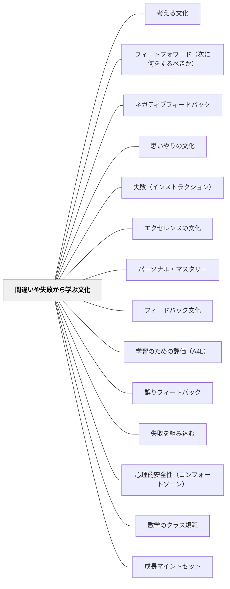

# 間違いや失敗から学ぶ文化

**このパタンが完成を助ける大きなパタン**：[[パタン/フィードバック]]・[[パタン/文化をつくる]]・[[パタン/心理的安全性（コンフォートゾーン）]]

> 間違いは問題ではない。間違いを恥じる文化が問題である。

## [Pattern Connection]

**研究からの補足：誤りを訂正につないで学ぶ（Metcalfe2017）**

原典では、誤り生成の利益を訂正フィードバックの条件とともに論じる（pp. 6.4–6.7）。Wiki側の適用案として、誤りを出してくれたことを受け止めた後、どこをどう考え直せたかまで確かめる。このレビューを「間違えるだけで必ず成長する」という主張の証明としては扱わない。 出典：[[文献/誤りを訂正につないで学ぶ（Metcalfe2017）]]。

Boaler（2016）の **Mathematical Mindsets** は「間違いにも必ずロジックがある」という視点を加える。子どもの間違いをただ「誤り」として扱わず、「その考え方がどこから来たか」を見ることで、誤りは学習の材料になる。

- **補強点**：「間違いは脳を成長させる」という神経科学的根拠（Moser et al., 2011）を、教師が子どもに伝えられる言葉で提供。ERN（Error-Related Negativity）とPe（Error Positivity）という2つの神経反応が間違い時に発生し、成長マインドセット者はこの反応が有意に大きい——つまり間違いから実際により多くを学ぶ
- **拡張点**：Boaler は「生徒の考えには、いつも何らかの筋道（logic）がある」と書く（Ch.9）。課題が完全に間違っていても、その課題がその子には難しすぎるという考えを与えないよう気をつける——そのロジックを探して承認することで、心理的安全性が深まる。また、子どもが「全部正解だった」と帰ってきたら、親は「ああ、ごめんね。それは、何かを学ぶ機会をもらえなかったということだね」と言うとよいという Carol Dweck の親へのメッセージ（Ch.2）——難しさのないところに学習はない
- **他のパタンへの波及**：[[パタン/成長マインドセット]]・[[パタン/失敗を組み込む]]・[[パタン/数学のクラス規範]]

**Boaler の言葉**：
> 生徒が間違えたら、「それは違います」と言う代わりに、その考えを探してそれを使って取り組む。たとえば分数のたし算で分子どうし・分母どうしを足した生徒には、「ああ、何をしているかわかるよ。整数のたし算について知っていることを使って、上の数どうしと下の数どうしを足しているんだね。でもこれは分数で、分数を足すときは、分数を作っている一つ一つの数ではなく、分数全体を考えなければならないんだ」（"Oh, I see what you are doing; you are using what we know about adding whole numbers to add the top and bottom numbers, but these are fractions, and when we add them we have to think about the whole fraction, not the individual numbers that make up the fraction."）と言える。生徒の考えには、いつも何らかの筋道がある。それを見つけるのはよいことだ——「失敗」という考えを避けるためではなく、生徒の考えを尊重するために（"There is always some logic in students' thinking, and it is good to find it, not so that we avoid the “failure” idea, but so that we honor students' thinking."）。（Boaler, 2016, Ch.9）

---

## 背景（Context）

間違いは学習の必然的副産物である。間違いのないところに学習はない。しかし多くの教室では、間違いは「できないこと」の証拠として扱われ、学習者は間違いを隠そうとする。

Carol Dweck の**成長マインドセット（Growth Mindset）**は、「能力は固定されたものではなく努力によって成長する」という信念が、失敗への向き合い方を根本的に変えることを示した。失敗を「能力の証明」として捉えると、失敗を避けるようになる——難しい課題を回避し、安全な範囲にとどまる。失敗を「成長の情報」として捉えると、失敗から学ぼうとする——より難しい挑戦を選び、粘り強く取り組む。[[パタン/エラー分析]] はこの考え方を授業に具体化したものだ。

※旧パタン「失敗」を本ページに統合（2026-11-13）。どちらも、間違いを学びの情報として扱い、安全に間違えられる文化をつくるという同じ解決だった。旧ページの背景・問題・実践の形・結果は、それぞれの節に移した。

## 問題（Problem）

間違いを恐れる文化では、学習者は確実に正解できることしかやろうとしない。チャレンジを避け、難しい問いに向かわず、フィードバックを受け取れない。「分からない」と言えなくなり、簡単な課題を選ぶようになる。結果として、ZPD（最近接発達領域）での学習が起きない。

## 力のかたち（Forces）

- 脳科学的研究：間違えたとき（特に正しい答えを直後に知ったとき）が最も記憶に定着しやすい
- 間違いの原因は様々（知識不足・理解の誤り・注意ミス・新しい挑戦）；原因によって対応が異なる
- 「失敗を称える」文化も形式化すると意味を失う
- 正解・不正解の評価より「どう考えたか」を問うことが失敗の恐怖を下げる
- 段階的手放し（[[パタン/段階的手放し]]）の設計が不適切だと「必然的な失敗」が起きる

## 解決（Solution）

**間違いを「学習データ」として扱い、分析・共有・感謝する文化をつくる。**

**近いパタンとの見分け**：誤りを学習の材料として扱うのが本パタン。批評を受け取る関係は [[パタン/フィードバック文化]]、高い基準と磨き直しは [[パタン/エクセレンスの文化]]。文化の系列の全体の表は [[パタン/文化をつくる#近いパタンとの見分け|文化をつくる]] にある。

実践例：
- 「今日の素晴らしい間違い」を毎授業取り上げる
- 教師自身の失敗・試行錯誤を率直に共有する
- 「間違えてくれてありがとう、おかげでみんなが学べた」を習慣にする
- 間違いの種類を分類する（ケアレスミスと概念的誤解は異なる）
- リトライ・再挑戦を当然のこととする
- クシャクシャにした紙を脳に見立てて線が増えるほど成長と色付ける（Boaler の実践）
- 上海の授業観察：教師が意図的に間違えた生徒を選んで発表させる——間違いを誇りとする文化
- ナンバートーク（[[パタン/ナンバートーク]]）で複数の解法（間違いを含む）を並べて検討する
- 「もし○○だったら、どう考えが変わる？」と反事実的な問いで失敗を学習材料にする

**ERN/Pe神経反応（Moser et al., 2011）**：
間違いを犯したとき、たとえ自分で気づいていなくても、脳は2段階の神経反応を起こす：
- ERN（Error-Related Negativity）：間違い直後の反応——脳がエラーを検知
- Pe（Error Positivity）：ERN後の反応——間違いに注意を向け、次の行動を調整

成長マインドセットを持つ人はPe反応が有意に大きく、間違いに注意を向けて実際により多くを学ぶ。固定マインドセットの人はPe反応が小さく、間違いから目を背ける。

### 研究の裏づけ

> **研究の裏づけ**：『How People Learn』（2000）は、学級の規範が学習に強く効くとする。「まちがえたところや知らないところを見つかってはいけない」という暗黙の規範があると、子どもは分からないときに質問したり、新しい問いを試したりするのをためらう（p. 145）。算数でも「答えを計算できること」が規範になっている学級と、「分かること」が目標の学級とで、教える中身と評価が変わる（p. 145）。日本の教師がまちがえた子に考えを学級で話してもらうやり方は、全員の理解を深める。ただしそれが働くのは、子どもが互いから学び、誤りの分析が学びに実りがあると尊重する学級の文化を教師が育ててきたからであり、「日本の教え方を一つ二つ取り入れても、望む結果は出ないかもしれない」と書く（p. 147、波多野・稲垣 1996）。誤答を取り上げる手立ては、文化とセットで働く。出典：[[文献/人の学び方の研究を授業の設計につなぐ（全米研究評議会2000）]]。

> **研究の裏づけ**：間違いから学ぶ文化を、子どもが学級をどう見ているかで測った縦断研究がある。ドイツの算数・数学の69学級（5〜6年生）では、間違いを分析して直そうとする反応が2年間で平均して下がった。学級の誤りの雰囲気がよいと子どもがみる学級ほど、その下がり方が小さかった。著者は、教師にできることとして、間違いを学びの一部として許容する、否定的に評価しない、間違いのあとに手助けする、否定的な反応を見せない、の4つを挙げる。雰囲気を測ったのは途中の1回だけで、因果は言えない。学力も測っていない。出典：[[文献/間違いを受けとめる学級の雰囲気と、間違いから学ぶ力の2年間の変化を確かめる（Dreselほか2024）]]。

## 結果（Consequences）

- 学習者がより難しい問いに向かうようになる
- 間違いが共有されることでクラス全体の学習が加速する
- 失敗への恐れが減り、冒険的な学習行動が増える
- 教師にとって「間違いのパターン」が指導の情報源になる

## 関連パタン
- [[学級経営/学級経営で使えるパタン]]
- [[学級経営/心理的安全性]]
- [[学級経営/文化をつくる]]
- [[パタン/考える文化]]
- [[教科/算数・数学で使うパタン]]
- [[パタン/フィードフォワード（次に何をするべきか）]]
- [[パタン/ネガティブフィードバック]]
- [[パタン/思いやりの文化]]
- [[パタン/失敗（インストラクション）]]
- [[パタン/エクセレンスの文化]]
- [[パタン/パーソナル・マスタリー]]
- [[パタン/フィードバック文化]]
- [[パタン/学習のための評価（A4L）]]
- [[パタン/誤りフィードバック]]
- [[パタン/失敗を組み込む]]
- [[パタン/心理的安全性（コンフォートゾーン）]]
- [[パタン/数学のクラス規範]]
- [[パタン/成長マインドセット]]
- [[パタン/非確証フィードバック]]
- [[パタン/副次的学習]]
- [[文献/人の学び方の研究を授業の設計につなぐ（全米研究評議会2000）]] — まちがいを分析する手立ては、それを尊重する学級の文化とセットで働く

- [[パタン/文化をつくる]] — 親パタン
- [[パタン/答えの出どころを推し量る（誤答の解釈）]] — 「ばかなことを言わないの」と返さない教室の条件
- [[文献/A National Experiment Reveals Where a Growth Mindset Improves Achievement（Yeager et al., 2019）]] — 考え方を変える働きかけは、挑戦を支える仲間の雰囲気がある学校で効果が続いた（種と土）
- [[文献/誤りを訂正につないで学ぶ（Metcalfe2017）]] — 誤りの受容に、訂正を理解できる支援を組み合わせる。
- [[パタン/心理的安全性（コンフォートゾーン）]] — 認められる経験の積み重ねが、間違いを出せる文化の土台になる
- [[文献/間違いを受けとめる学級の雰囲気と、間違いから学ぶ力の2年間の変化を確かめる（Dreselほか2024）]] — 誤りの雰囲気の8つの側面と、間違いから学ぶ反応の2年間の変化
- [[パタン/前へ進む力（不完全さを推進力に）]]
- [[パタン/遅咲きの一歩（perfectibilité - いつからでも）]]
- [[パタン/利己愛の罠（比較が内発的動機を壊す）]]
- [[パタン/エラー分析]] — 失敗のパターンを分析して指導に生かす
- [[パタン/段階的手放し]] — 失敗のリスクを適切に設計する
- [[パタン/内発的動機づけ]] — 失敗への向き合い方が内発的動機の質を決める
- [[パタン/再提出を許す（リトライ・サイクル）]] — 「失敗から学ぶ」を教師の言葉ではなく評価制度として実装する
- [[パタン/誤概念の組み替え（素朴概念を資源にする）]] — 安全に予想や誤答を出せる「失敗の文化」が、素朴概念を顕在化させる前提になる

## このパタンが働く実践

| 実践パタン | どのように間違いを学びに変えるか |
|------------|----------------------------------|
| [[パタン/ナンバートーク]] | 不正解や途中の考えも板書し、どこまで合っているかをみんなで考える |
| [[パタン/誤りフィードバック]] | 誤りの種類を診断し、次の修正につながる情報として返す |
| [[パタン/エクセレンスの文化]] | 最初の作品を最終版にせず、複数ドラフトで改善を重ねる |

## クラスター図

## Actionable Insight

- 「今日の素晴らしい間違い」を授業で1つ取り上げる——間違いを称えることが文化をつくる最小の一手
- 教師自身が「先生も間違えた・迷った」を授業中1回声に出す——モデリングが「失敗は恥ずかしくない」という文化を育てる
- リトライ・再提出を「当然のこと」として設計する——最初の作品が最終版でないことを前提にすることで改善のサイクルが文化になる
- 算数の授業で意図的に「どこで間違えやすいか」を先に教える——失敗の予告が失敗を安全にする（旧「失敗」）

## 出典

- 動画記録：[[文献/コミュニティオブプラクティスと文化をつくるパタン（動画記録）]]
- ピーター・ジョンストン（2012）"Opening Minds"
- 一つの教育のパタン・ランゲージ（岩井輝久）（旧「失敗」）
