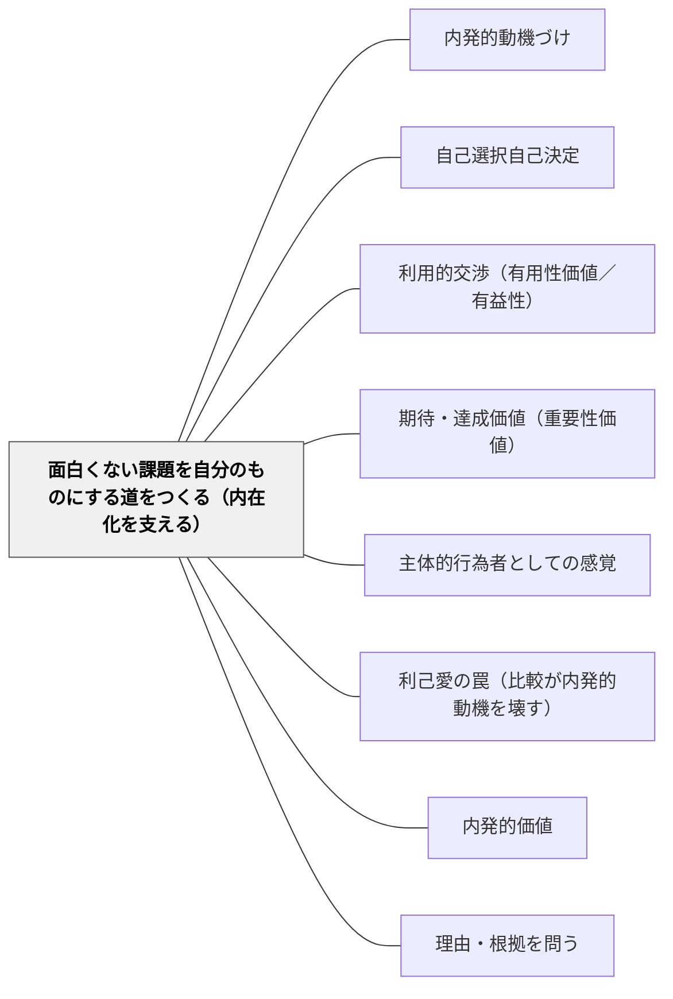

# 面白くない課題を自分のものにする道をつくる（内在化を支える）

> 漢字の書き取り、計算の練習、掃除当番。学校には、そもそも面白くない活動がたくさんある。そこで「面白さ」を演出しようとしても限界がある。大事なのは、その活動の意味を子どもが自分でつかみ、自分の理由で取り組めるようになる道をつくることである。

## [Pattern Connection]

このWikiの動機づけのパタンは、内発的動機づけ——活動そのものが面白いから取り組む——を育てる側に厚い（[[パタン/内発的動機づけ]]・[[パタン/内発的価値]]）。しかし [[文献/Self-Determination Theory（Ryan & Deci, 2000）]] は、はっきりこう書いている。

> It is critical to remember, however, that people will be intrinsically motivated only for activities that hold intrinsic interest for them, activities that have the appeal of novelty, challenge, or aesthetic value. For activities that do not hold such appeal, the principles of CET do not apply (p. 71)
>
> ただし忘れてはならないのは、人が内発的に動機づけられるのは、その人にとって内発的な興味のある活動——新しさ、挑戦、美しさの魅力を持つ活動——に対してだけだということである。そうした魅力を持たない活動には、認知的評価理論の原理は当てはまらない。

面白くない活動のために自己決定理論が用意しているのが、**内在化**（外から求められた価値や決まりを取り込むこと）と**統合**（それを自分のものにすること）の理論である。外発的動機づけは一色ではなく、外的調整 → 取り入れ → 同一化 → 統合と、自律の度合いが違う（p. 71–72）。

- **補強点**：wiki の一部は自己決定理論を「外発的か内発的か」の二項対立として書いていた。本パタンは、外発的動機づけの中にある**自律の度合いの違い**を、教室で扱える形にする
- **[[パタン/利用的交渉（有用性価値／有益性）]] との差分**：あちらは「これで何かできる」という有用性が動機をつくる、という価値の側の話である。本パタンは、理由を示すだけでなく、**それを統制的にでなく、自律と関係性を支えながら示す**ことで、取り入れにとどまらず同一化・統合へ進む、という条件の側の話である
- **[[概念/自我関与と課題関与（フィードバックが向ける先）]] との関係**：取り入れ的調整は自我関与の動機づけ的な姿である。本パタンが避けたいのは、罪悪感や誇りで動く「取り入れ」にとどまることである

---

## 背景（Context）

学校で求められることの多くは、厳密には内発的に動機づけられていない。とくに幼児期を過ぎると、面白くない活動をする社会的な圧力が増える（Ryan & Deci, 2000, p. 71）。漢字や計算の練習、決まりを守ること、整理整頓、当番活動。どれも子どもの将来や学級の暮らしに必要だが、活動そのものが面白いとは限らない。

教師はこうした活動に、報酬（シール・ポイント）、罰（やり直し・居残り）、比較（早くできた人から）、あるいは「みんなやっているよ」「できないと恥ずかしいよ」という言葉で、子どもが取り組むように仕向けがちである。それで子どもは動く。しかし、動く理由はどれも子どもの外にある。

## 問題（Problem）

**面白くない活動を、報酬・罰・罪悪感・誇りで動かすと、子どもは動くが、その活動は「自分のもの」にならない。** 外からの支えがなくなれば止まり、続いても不安と失敗への弱さがついてくる。

ライアンとコネル（1989）の学校での研究では（Ryan & Deci, 2000, p. 72–73）：

- **外的調整**（報酬や罰のため）が強い子ほど、興味・価値・努力が少なく、悪い結果を教師など他人のせいにした
- **取り入れ的調整**（罪悪感を避ける・誇りを得るため）は努力の多さと関係したが、**不安の高さと失敗への対処の悪さ**とも関係した
- **同一化的調整**（自分にとって大事だと価値づけて）は、学校への興味と楽しさ、前向きな対処、努力の多さと関係した

「できないと恥ずかしいよ」は努力を引き出すが、それは取り入れであり、不安とセットになる。

## 力のかたち（Forces）

- **面白さの演出には限界がある**：内発的動機づけの原理は、もともと興味の持てる活動にしか当てはまらない
- **人は大事な人のために始める**：面白くない行動を人が最初に行う主な理由は、つながりを感じている大事な人が、それを促し、手本を示し、価値を置いているからである（p. 73）。教師とのつながりが内在化の入口になる
- **理解できないものは内在化できない**：発達的にまだ習得できない、または理由を理解できない段階で求められた行動は、せいぜい部分的にしか内在化されず、外的調整か取り入れにとどまる（p. 73）
- **統制的な文脈では取り入れどまり**：顕著な報酬や脅しがあれば外的調整が、周りの集団が認めていれば取り入れが生まれる。自律的な調整が生まれるのは、自律を支える文脈だけである（p. 73–74）
- **段階を追う必要はない**：内在化は、外的調整から順に段階を通る必要はない。状況しだいで、連続体のどの位置にもすぐに内在化されうる（p. 72）

## 解決（Solution）

**面白くない活動では、面白さを演出するより、その活動の意味を伝え、子どもが自分の理由を見つけられるようにする。意味を伝えるときは、命令や脅しではなく、子どもの気持ちを認め、選ぶ余地を残す。教師とのつながりと、できる手応えを同時に支える。**

ライアンとデシが引く実験（Deci, Eghrari, Patrick, & Leone, 1994）では、面白くない行動について**意味のある理由**を示し、**自律と関係性を支える**と、その行動の内在化と統合が進んだ。統制的な文脈では内在化が少なく、起きた内在化も取り入れにとどまりがちだった（p. 74）。

教室での手順は四つ。

1. **意味のある理由を伝える**：「なぜこれをするのか」を、子どもの暮らしや目標につながる言葉で伝える。「決まりだから」「テストに出るから」で終わらせない
2. **気持ちを認める**：「正直、面白くないよね」と、活動が退屈だという子どもの気持ちを否定しない
3. **選ぶ余地を残す**：やるかやらないかは選べなくても、順番・方法・量の配分・目標の立て方など、選べるところを残す
4. **できる手応えとつながりを支える**：子どもが今できる範囲の課題にする（有能さ）。教師が一緒にやる、見守る、気にかけていることを伝える（関係性）

---

### 具体例①：漢字の書き取り

統制的な言い方：「宿題だからやりなさい。やらないと休み時間にやり直しです」

内在化を支える言い方：

- **理由**：「手紙や日記で、自分の気持ちを相手にきちんと伝えるのに、この字が使えると便利なんだ」
- **気持ちを認める**：「同じ字を何度も書くのは、正直あきるよね」
- **選ぶ余地**：「10回書くのと、この字を使った短い文を3つ作るのと、どちらで覚える？」
- **有能さとつながり**：「今日の5字のうち、もう書けそうなのはどれ？ 先生もいちばん難しい字を一緒に書いてみるね」

---

### 具体例②：掃除当番

統制的な言い方：「ちゃんとやらないと、先生が見ているからね」「1班はもう終わったよ」

内在化を支える言い方：

- **理由**：「みんなで使う教室を、明日も気持ちよく使えるようにするため」
- **選ぶ余地**：「今週は、どこを担当したいか班で決めていいよ」
- **振り返り**：「きれいになったところを見て、どう思う？」——子どもが自分の言葉で価値を言えたら、それは同一化の入口である

監視（先生が見ている）と比較（1班はもう終わった）は、どちらも外的調整や取り入れを生みやすい。

---

### 具体例③：「恥ずかしいよ」を言い換える

「そんな字だと恥ずかしいよ」「6年生なのにできないの？」は、罪悪感や誇りを使う言い方で、取り入れ的調整を育てる。努力は引き出せるが、不安と失敗への弱さもついてくる。

言い換えの例：「この字、読む人が読みやすいように、もう一度ていねいに書いてみようか。どこを直すと読みやすくなるかな」——理由（読む人のため）と、自分で直す余地を残す。

---

### 特別支援の視点

理由を言葉で伝えても、抽象的すぎると理解できない子がいる。そのときは、理由を目に見える形にする（使う場面の写真、活動の後の姿の見本）。「理由を理解できない段階で求められた行動は、取り入れや外的調整にとどまる」（p. 73）という指摘は、とくにここで効く。また、選ぶ余地が多すぎると負担になる子には、二択にする。つながりの支え（関係性）は、取り組む前の安心として、ほかのどの支えより先に置く。

## 結果（Consequences）

**利点**

- 外からの報酬や監視がなくても、活動が続きやすくなる
- 取り入れ（罪悪感・誇り）にとどまらないので、不安や失敗への弱さを育てにくい
- 子どもが活動の意味を自分の言葉で言えるようになり、ほかの場面への持ち出しが起きやすくなる

**注意点・リスク**

- **理由の押しつけは統制になる**：「これはあなたのためなのよ」を繰り返すと、理由そのものが圧力になる。理由は伝えるが、受け取り方は子どもにゆだねる
- **すぐには変わらない**：内在化は時間がかかることもある。一回の説明で「自分のもの」になることを期待しない
- **報酬を一律に禁じる話ではない**：本パタンは、報酬や決まりをすべてなくせと言っているのではない。それだけで動かすと内在化が進まない、という話である。原文が「確実に損なう」とするのは、遂行に随伴する、あらかじめ約束された有形の報酬である（p. 70）
- **自律の支えは放任ではない**：自律性は独立ではなく、自ら進んで行う感覚である（p. 74）。教師とのつながりと、できる手応えの支えと一緒に働く

## 関連パタン

- [[パタン/内発的動機づけ]] — 面白い活動への内発的動機づけを育てる側。本パタンは、面白くない活動の内在化を支える側
- [[パタン/自己選択自己決定]] — 選ぶ余地を残すことは、内在化を統合へ進める自律の支え
- [[パタン/利用的交渉（有用性価値／有益性）]] — 「これで何かできる」という有用性は、伝える理由の中身になる
- [[パタン/期待・達成価値（重要性価値）]] — 自分にとって大事だと価値づけることは、同一化的調整にあたる
- [[パタン/主体的行為者としての感覚]] — 三つの欲求の充足が主体性を育てる
- [[パタン/利己愛の罠（比較が内発的動機を壊す）]] — 比較で動かすことは、取り入れを育てやすい
- [[パタン/内発的価値]] — 活動そのものの価値。内在化の先にある統合は、内発的動機づけと多くの性質を共有する
- [[パタン/理由・根拠を問う]] — 子どもに理由を問うことは、子ども自身が活動の意味を言葉にする機会になる
- [[概念/動機づけ]] — 外発的動機づけの四つの調整の一般的な位置づけ
- [[概念/自我関与と課題関与（フィードバックが向ける先）]] — 取り入れ的調整は自我関与の動機づけ的な姿。本パタンはそこにとどまらない道をつくる

## クラスター図

## Actionable Insight

- 明日、子どもに「やりなさい」と言いそうな活動を一つ選び、その活動の意味を子どもの暮らしにつながる一文で書いてみる。言うときは「正直、面白くないよね」と一言添える
- 練習の量や順番など、子どもが選べるところを一つ見つけて、選んでもらう
- 「恥ずかしいよ」「〜年生なのに」と言いかけたら、「読む人のために」「明日のみんなのために」と、理由の言い方に言い換える

## 出典

Ryan, R. M., & Deci, E. L. (2000). Self-determination theory and the facilitation of intrinsic motivation, social development, and well-being. *American Psychologist, 55*(1), 68–78.

> "Unlike some perspectives that view extrinsically motivated behavior as invariantly nonautonomous, SDT proposes that extrinsic motivation can vary greatly in its relative autonomy" (p. 71)
>
> 外発的に動機づけられた行動を、つねに自律的でないとみなす見方とは違い、自己決定理論は、外発的動機づけはその相対的な自律の度合いにおいて大きく異なりうると提案する。

Deci, E. L., Eghrari, H., Patrick, B. C., & Leone, D. R. (1994). Facilitating internalization: The self-determination theory perspective. *Journal of Personality, 62*, 119–142.（Ryan & Deci, 2000 による引用）

Ryan, R. M., & Connell, J. P. (1989). Perceived locus of causality and internalization: Examining reasons for acting in two domains. *Journal of Personality and Social Psychology, 57*, 749–761.（Ryan & Deci, 2000 による引用）
