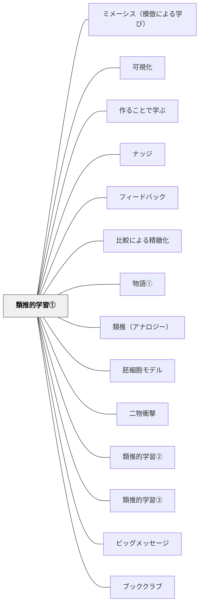

# 類推的学習①

**一文でいうと**：複数の良い例を比べて型（構造）を見つけ、その型を使って自分で作る。

## 使いどころ・使いすぎ注意

| 観点 | 内容 |
| --- | --- |
| 使いどころ | 書く・作る活動の前。評価の観点を子どもと一緒につくりたいとき。 |
| 使いすぎ注意 | ささいにしか違わない例を比べても効果は薄い。比べるあとに、言葉で整理する段階を置く（下の研究の裏づけ）。 |

> 複数の作品を読み比べ、構造的類似（型）を発見し、その型を使って自分で書く——アトウェルのジャンル学習が体現する比較・アナロジーによる学習。

## 背景（Context）

子どもたちに「書き方」を教えようとして、ルールを説明したり模範文を見せたりしても、実際に書けるようにはなりにくい。何を書くか（内容）と、どう書くか（型）の両方を教師が指定すると、学習者の自律性が育たない。

## 問題（Problem）

「書きなさい」という指示だけでは型がわからない。「このように書きなさい」という指示では主体性が育たない。学習者が自分で型を発見し、自分の内容でその型を使うようになるにはどうすればよいか。

## 力のかたち（Forces）

- 型（構造）は教えることができる——しかし教えすぎると学習者が自分で考えなくなる
- 複数の良い作品を読み比べると、学習者は自然にパターンを発見する
- 自分で発見した型は、受け取った型より深く理解され、応用される
- 認知科学のメタ分析（57実験・336テスト）では、事例を比べる学習は、一つずつ見る学習や従来の授業より、多くの場合、学びが大きかった（d = 0.50）。効き方は、比べる目的・原理を示す時機・内容・テストまでの間隔で変わった（Alfieri et al., 2013）

## 解決（Solution）

### 類推的学習の定義

「類推的学習」は「アナロジカルラーニング（analogical learning）」の直訳である。アナロジーとは：
1. 複数の対象を比較し類似点（類似点そのもの）を見出すこと
2. 類似点や知っていることを元にして、未知の事柄の解決や推論をすること

この類推的思考を用いた学習が類推的学習である（岩井輝久「教科科学国語教育」2016年6月号）。

---

### アトウェルのジャンル学習（4ステップ）

1. **読み比べ**：同じジャンルの作品を複数読む（教師の作品・先輩の作品・プロの作品）
2. **気づきを書く**：「書き手は何を・どのように書いているか」を宿題等で記録する
3. **共有・クラスで整理**：気づきをグループで共有し、そのジャンルの評価基準リストをクラスで作る
4. **制作**：評価基準を手がかりに自分でそのジャンルの作品を書く

**ブックレビューの実践（小学4年生）**：
- 複数のブックレビューを読み比べ、「優れたブックレビューの特徴」をクラスで発見
- 子どもたちが出したリスト例：本のタイトルと著者がある、おすすめ度と理由がある、あらすじはあるが結末を書かない、引用を使っている、自分のメッセージがある
- 完成作品を製本 → 次年度の選書ガイドブックとして機能

---

### ノート検定の実践（類推的学習の応用）

**明治図書「教科科学国語教育」2016年6月号**（特集：子どもの思考を活性化するノート指導、中学年担当）に掲載した実践より。

ノート検定の評価基準を**子どもたちが自分で作る**実践：
- 優れたノートの実例をいくつか観察・比較する
- 類似点（例：見出しをつける、色を使う、ページを区切るなど）を見出す
- その類似点から評価基準（1級・2級・3級など）を子どもたちが自作する

これが類推的学習である：「優れたノートに似ているところ（類似点）を見つけて、自分のノートを書くことに生かしていく」。Shirley Clarkeの形成的評価実践（評価基準を学習者が共同作成する）とほぼ重なる。

---

### 3人の実践者に共通する類推的学習

立場は異なるが、共通して類推的学習を体現している：

| 実践者 | 立場 | 実践 |
|--------|------|------|
| 牧口常三郎（約100年前）| 系統学習寄り・プロジェクト学習批判 | 文系応用主義（同種のものを比較して応用） |
| Nancy Atwell | 子ども中心・自己選択・リーディング/ライティングワークショップ | ジャンル学習 |
| Shirley Clarke | 形成的評価の研究実践者 | 評価基準の共同作成、くじ引きによるランダム取り上げ |

牧口とアトウェルは教育観が真逆に近い（系統学習 vs 子ども中心）にもかかわらず、「複数の類似した例を比較して型を見出し、それを自分の問題解決に使う」という学習法において一致している。これは類推的学習が教育的立場を超えた普遍性を持つことを示す。

**近いパタンとの見分け**：比較の表では、本パタンの見分けの問いは「複数の作品を読み比べて型を見つけ、その型を使って自分で書いているか（アトウェルのジャンル学習）」。全体の表は [[パタン/比較で概念をつくる（事例ペアの設計）#近いパタンとの見分け|比較で概念をつくる（事例ペアの設計）]] にある。

### 研究の裏づけ

> **研究の裏づけ**：何と何を比べるかで、伸びるものが変わる。Rittle-Johnson と Star（2009）は、中学1・2年生162人を、同じ型の方程式どうしを同じ解き方で比べる群、違う型の方程式どうしを同じ解き方で比べる群、同じ方程式を二つの解き方で比べる群に分けた。概念の理解は、同じ問題を二つの解き方で比べる群がほかの二群より高かった（pp. 22–24）。比較を支えた特徴として、比べる解き方をそろえて並べる、似ている点と違う点を見つける場、効率を考える問い、ステップの共通の名前、比較を補う直接の説明の五つを挙げ（pp. 33–34）、ささいにしか違わないものを比べても効果は薄いだろうとする（pp. 31–32）。出典：[[文献/何と何を比べると学びが伸びるかを確かめる（RittleJohnsonとStar2009）]]。

> **研究の裏づけ**：『How People Learn』（2000）は、うまく並べた対比の事例は、見落としていた特徴や、どの特徴が大事かに気づく助けになるとする（p. 60）。同時に、データを比べたあとに講義を聞いた大学生の群が転移のテストでいちばんよく、比べる時間を2倍にして講義を受けなかった群は成績が悪かった例を挙げ、「講義は必要だった」と書く（p. 59）。比べて型を見つけたあとに、言葉で整理する段階を置く。出典：[[文献/人の学び方の研究を授業の設計につなぐ（全米研究評議会2000）]]。

> **研究の裏づけ**：『Writing Next』が挙げるお手本の研究の例は、比べて型をつかみ、別の題で使う流れになっている。同じ題で反対の立場をとる、よい説得文を2本見せて教師と話し合い、翌日、そのうち1本を手元に置いて、別の題で説得文を書く（Knudson 1991、p. 20）。4〜12年生を対象にした報告の6研究の平均効果は 0.25 で、小さいが6研究すべてで正だった。出典：[[文献/作文指導の有効な要素を組み合わせる（Writing Next2007）]]。

> **研究の裏づけ**：どちらもまだよく分かっていない二つの事例でも、比べれば原理が見えてくる。交渉の初心者の大学生128人に、同じ原理（オレンジを半分ずつではなく、果汁と皮で分けるような「取引」など）の二つの事例を、比べて共通点を書く組と、一つずつ読む組に分けて読んでもらうと、見かけの違う新しい交渉の問題で原理を使ったのは、比べる組 48% 対 一つずつ読む組 19% だった（実験2、p. 399）。一つずつ読む組では、二つを続けて読んだのに、二つを結びつけて書いた人は16%だった。実際に向かい合っての交渉でも、手引きつきの比較 90%・比べるだけ 70%・一つずつ 55%・学びなし 37% の順だった（実験3、p. 401）。著者は、学習者は並べられても自分からは比べないので、比べることをはっきり求める必要がある、と書く（p. 403）。大学生の、学んだ直後の転移の実験である。出典：[[文献/二つの事例を一つずつ読むのではなく比べると、共通の原理がつかめて新しい場面で使えるかを、三つの実験で確かめる（Gentnerほか2003）]]。

> **研究の裏づけ**：類推は、出すだけでなく、支えを添えてはじめて生きる。TIMSS 1999 の授業ビデオから、米国・香港・日本の中学2年生の数学の授業を国ごとに10本選んで比べると、どの国でも類推はたくさん出ていた（米国195・香港185・日本139）。しかし、子どもがよく知っている「もと」を使う、「もと」を目に見える形で示し見えるところに残す、対応を位置や矢印で示す、比べることを身ぶりで示す、頭の中に絵を描くよう促す、という六つの支えは、すべて米国が香港と日本より少なかった（p. 1129）。頭の中の絵を促すのは日本がもっとも多かった。著者は、支えのない類推は、教師の意図と違う関係を学んだり、誤った考えを生んだりしうると書く。教師の行動の観察で、子どもの学びは測っていない。出典：[[文献/数学の授業で類推を使うとき、教師がどんな支えを添えているかを、米国・香港・日本の授業ビデオで比べる（Richlandほか2007）]]。

### 岩井の原稿から（類推的学習①）

（原稿のうち、すでに本ページの上の節にそのまま入っている段落は、ここでは繰り返さない。）

−ナンシー・アトウェルの

実践を重厚にしている、

もう一つの柱について−

　　　　　　　　　　　　　　　　　　　　　岩井輝久

比較する類推的学習活動があるケースは、学習者を共通してよりよい学習の結果に導く。

「類推的学習」とは、Analogical Learningを筆者が日本語に直訳したものです。類推(アナロジー)には、いくつかの定義がありますが、類似点そのもの、複数の対象を比較し類似点を見出すこと、また類似点や知っていることをもとにして 未知の事柄の解決をしたり推論をしたりすることを意味します。この類推(アナロ ジー)を用いた学習を類推的学習(Analogical Learning)と言います。

類推(アナロジー)は、学習においても、核となる重要なものであると考えられています。近年の認知科学におけるメタ分析論文によると、過去20年間に渡って、多くの比較による学習の調査がありました。57の実験で行われた336のテストが明らかにするところによれば、類推的(アナロジー)ではないケース、また一つのケースと比べて、比較する類推的学習活動があるケースは、学習者を共通してよりよい学習の結果に導きました (Alfieri, Nokes-Malach, & Schunn, 2013)。

類推の研究をリードしてきたゲントナーたちも、比較による類推が、学習を促進させるということを実験証明しました(Gentner, 2015)。 その実験は、類推的トレーニングが、建築技術の原理である筋交いを、子どもたちが理解することを助けるのかテストするというものです。筋交いとは、柱と柱の間に斜めに入れて建築物や足場の構を補強する部材のことです。このいくつかのグループを比べる実験によって、たった一つの比較による短い類推のトレーニングが、筋交いの原理を理解する助けになることが分かりました。また筋交いなどの言葉、概念はとても大事だということも分かりました。建物を構築する際に、両親が筋交いに関する言葉を使っ ていた場合、子どもたちは筋交の原理を応用して建物を修理することをよりよくできる傾向にあったからです。

さて、この類推的学習というパタンこそが、ナンシー・アトウェルの重厚な実践を支える柱の一つであるということをお伝えたしたいです。これから紹介するアトウェルのジャンル学習で、子どもたちは、テキストを直接観察、比較し、類似点を見出します。その類似点を視点として読み書きの学習に取り組んでいくのです。また、私がナンシー・アトウェルの本から学び実践したことも合わせてお伝えします。

ナンシー・アトウェルは、リーディング&ライティング・ワークショップの代表的な実践者です。アトウェルの主著であるIn the MIddle第３版は、６００ページを超える大著で、ワークショップの運営のエッセンスを説明した前半部分とジャンル別の読み書きの学び方（ジャンル学習）について扱った後半部分に分かれています。それぞれ３００ページくらいあります。２０１８年に出版された翻訳書である『イン・ザ・ミドル　ナンシー・アトウェルの教室』は、前半部分を中心とする抄訳となっています。私がこれからIn the MIddle第３版の後半部分について書いてお伝えすることが、この翻訳書を補足し、ナンシー・アトウェルの実践についての理解を助けるものとなることを願っています。

アトウェルのリーディング&ライティング・ワークショップの柱となるものは、「自己選択・自己決定（チョイス）」のパタンです。読んでみたい本リストや書けそうなことリストを書き、徹底して読みたい本をたくさん読み、書きたいことをたくさん書く。そして、学期末には、子どもたちが自分が読んできたことや書いてきたを振り返って自己評価します。　　　　　　　　　　　　　　　　　　　　　　　　　　　　　　　　　　　　　　　　　　　　　　　　　　　　　　　　　　　　　　　　　　　　　　　　　　　　　　　　　　　　　　　　　　　　　　　　　　　　　　　　　　　　　　　　　　　　　　　　　　　　　　　　　　　　　　　　　　　　　　　　　　　　　　　　　　　　　　　　　　　　　　　　　　　　　　　　　　　　　　　　　　　　　　　　　　　　　　　　　　　　　　　　　　　　　　　　　　　　　　　　　　　　　　　　　　　　　　　　　　　　　　　　　　　　　　　　　　　　　　　　　　　　　　　　　　　　　　　　　　　　　　　　　　　　　　　　　　　　　　　　　　　　　　　　　　　　　　　　　　　　　　　　　　　　　　　　　　　　　　　　　　　　　　　　　　　　　　　　　　　　　　　　　　　　　　　　　　　　　　　　　　　　　　　　　　　　　　　　　　　　　　　　　　　　　　　　　　　　　　　　　　　　　　　　　　　　　　　　　　　　　　　　　　　　　　　　　　　　　　　　　　　　　　　　　　　　　　　　　　　　　　　　　　　　　　　　　　　　　　　　　　　　　　　　　　　　　　　　　　　　　　　　　　　　　　　　　　　　　　　　　　　　　　　　　　　　　　　　　　　　　　　　　　　　　　　　　　　　　　　　　　　　　　　　　　　　　　　　　　　　　　　　その一連の流れやミニレッスンなどについて扱ったものがIn the MIddle第３版の前半部分です。この読み書きの学習の視点を創り出すものこそが、後半部分のジャンル学習です（前半部分のミニ・レッスンも読み書きの視点を創り出すものです。また前半部分の終わりに手紙形式で文学を読んで考えたことをやりとりするレター・エッセイという学習について書いてあります。このレター・エッセイのジャンル学習は、後半部分のジャンル学習へ橋渡しする内容になっています）。後半部分のジャンル学習は、前半部分で扱われている要素と関係し合い、重なり合いながらアトウェルの重厚な教育実践を支えているのです。

この後半部分のジャンル学習でアトウェルが扱うジャンルは、詩、回想録、ショートフィクション、レビュー、新聞の論説などです。子どもたちは、同じジャンルの複数のテキストを観察し、その優れた書き手が行なっていることや作品の特徴を抽出します。このジャンル学習は、次のような同じ手順で行われます。

(1)同じジャンルの作品をいくつか読みます(アトウェル自身の作品や卒業生の作品、 プロの作家の作品などが使われます)。

(2)複数の作品を読み比べて、そのジャンルの書き手が何を書いているか、どのように 書いているかなど、気づいたことを宿題として書きます。

 (3)個人で気づいたことをグループで共有します。

 (4)そのジャンルでの評価基準(そのジャンルのよい作品に共通する特徴のリスト)を クラスで作ります。

例えば、レビューのジャンル学習では、本と映画とテレビのレビューを生徒たちはそれぞれ読み比べます。アトウェルは、そのレビューを雑誌や新聞などから集めるそうです。この集めたレビューを、週末の宿題で一時間以上かけて読んで、ノー トにレビュアーが何を書いているのか、どのように書いているのか、気づいたことを書いてきます。休み明けの月曜日に、ブック・レビュー、ムービー・レビュー、テレビジョン・ レビューの三つのグループに分かれて、気づいたことを共有し、それぞれ効果的なレビュー の特徴のリストを作ります。これはレビューの評価基準にもなります。 アトウェルのクラスでは、次のような効果的なブック・レビューの特徴のリストができました(Nancie Atwell, 2014)。

（原稿では、ここにNancie Atwell（2014）からの引用（アトウェルのクラスで作られた、効果的なブック・レビューの特徴のリスト）が入っている。長い引用は wiki には載せない。）

この特徴のリストは、子どもたち自身が作る評価基準でもあります。アトウェルは、このような評価基準を子どもたちに与えるのではなくて、子どもたちが、自ら評価基準を作ることにこだわっています。仮によい評価基準が できると、次の年度の子どもたちに使い回したくなってしまいます。しかしその評価基準は、次の年度の子どもたちにうまく働きません。なぜなら子どもたちは作品と作品を比べ観察して、共通する特徴を自ら見出すことで、時間をかけて、その評価基準を理解するからです。この理解した評価基準のリストを、子どもたちは、目標設定、実際に読んだり書いたりすること、ふり返り（自己評価）など学習に生かしていくわけです。

（原稿では、ここにヴィゴツキー（2001）『思考と言語』（新読書社）267〜268頁と、柴田義松『ヴィゴツキー入門』（寺子屋新書）からの引用が入っている。長い引用は wiki には載せない。）

ジャンル学習の実践で重要なことは、子どもたちがテキス トを直観(直接観察)し、比較することで、ヴィゴツキーが指摘するような 概念体系を構築できることだと考えています。読み書きの授業に限ったことではありませんが、子どもたちは、概念体系をもつことで、自覚的に意識的に知識を運用できるようになります。またペスタロッチ主義の「観念ヲ先ニシ表出ヲ後ニスベシ」という考えにも通じると思います。思想の表出よりも理解が先だよということです。はじめの読み比べて視点、評価基準を創り出すという段階を丁寧にやると、どの学習でも子どもたちのパフォーマンスが明らかによくなることを実感しています。次に、アトウェルのジャンル学習から学んで、私が実践したことについて紹介します。

#### ブック・レビュー

ブック・レビューとは、本の評価文を書く課題です。毎年、私の学級では、ブック・レ ビューをリーディング・ワークショップの一環として続けてきました。子どもたちは、どんな本があるのかという知識に乏しいことが多いようです。これは教員としての子どもたちとの経験からも、自分の被教育者としても経験からもそう思います。大学の教育で最も有り難かったことの一つは、大学の先生におすすめの本を紹介してもらったことです。大学一年生の頃を振り返ると、私に限って言えば、何を読むべきか分かりませんでした。それぞれの分野には、読むべき古典、良書と呼べる質の高い本があります。大学一年生の時に、授業の中などで、大学の先生から読むべき本を教えてもらい、片っ端から夢中になって読んだことを思い出します。児童書の中にも、読むべき優れた本がたくさんあります。そのことを多くの子どもたちは知りません。だから、選書を助けるために、本と子どもたちを繋げることは、とても大切なことだと考えています。教師によるブック・トークで本と子どもたちを繋げることも大切ですが、ブック・レビューのように子どもたち同士で本を紹介し合い、繋げ合うことも大切なことです。はじめは、アマゾンのブック・レビューを参考にして、私は、モデルとなるブック・レ ビューの作品を書き、子どもたちに見せ、ブック・レビューを書くための手引きを渡していました。この時はハガキサイズの紙にブック・レビューを書いていました。今はA4の1cm方眼のレポート用紙をエクセルで作って、ブック・レビューの用紙として使っていま す。マス目が印刷された面が、うっすらと写る裏面にブック・レビューを書くようにして います。 類推を意識して、アトウェルのように作品を読んで比べるという段階を強く意識 して授業をデザインするようになったのは、ここ数年のことです。今では、ブック・レ ビューをいくつか読み比べて、その手引きにあたるものを子どもたちと一緒に作るように しています。いくつか作品を小学校4年生の子たちと一緒に読み比べると、次のような優れたブック・レ ビューの特徴が出てきました。

優れたブック・レビューの特徴

□本の題名がある。

□作者の名前がある。

□新聞の見出しのように本の題名や作者の名前を大きく書いている。 
□自分の名前がある。

□おすすめ度を星の数で表している。

□おすすめ度の理由を説明している。

□どんな話か(あらすじ)を紹介している。

□登場人物について書いている。

□物語の結末を書かない。

□主人公に起きた問題を紹介している。

□はじめ・中・おわりがある。

□読むことをすすめている。
□段落がある。

□自分の考え・メッセージがある。

□引用している(「」を使って書き抜き)

□感想を書いている。

□絵がある。

　前に紹介したアトウェルの生徒たちとは、読み比べているものが違います。だから、アマゾンのレビューのように星の数でおすすめ度を表すなど、子どもたちが気づくことも違ってきます。この優れたブック・レビューの特徴のリストを作った後で、実際にブック・レビューを書きます。 中高の国語科の教員でしたら、雑誌などからプロのライターのレビューをアトウェルと同じように集めて使えそうです。小学校でも、ブック・レビューを本の紹介の実践とし て大きく捉えるならば、小学生新聞で小学生向けに本の紹介があるなど、作品を収集することは難しくないかもしれないです。共有の方法です。私の授業では、ブック・レビューを書けた人から、マグネットで作品を黒板に貼るようにして、簡単にまず共有しました。書くことに苦戦している子たちの中には、ここで友だちの作品を見て、書けるようになる子もいます。また、ここ数年は、さらに締め切りを設けてA4の紙に書いた作品をカラーコピーして製本しています。その本にあるブック・レビューの多くは、クラスに置いてある本を紹介し ています。そのみんなで作ったブック・レビューの本は、クラスにあるたくさんの本と子 どもたちを繋げてくれるガイドブックとして、次の年度も機能してくれます。 最後にブック・レビューの作品例をいくつか紹介します。子どもたちの作品の実際は、絵があり、レイアウトなどもそれぞれ違います。

（ここには原稿では子どもの作品例が入っている。子どもの作品は wiki には載せない。）

#### 俳句

世界で一番短い定型詩と言われる俳句は、教材として価値が高く、学校の授業で扱うのに適していると実感しました。短くて定型詩であるのが、よいです。短いので、アンソロジー(俳句など作品を集めたもの)として紙一枚の両面にたくさんの作品を収めることができます。短いので、読むことも書くことも容易です。簡単なものから難しいものへというパタン（原則）にも適っています。短いですが、比喩、オノマトペ、押韻、リフレイン、対比など書くための技法をたくさん学ぶ ことができます。類推(アナロジー)を教育で効果的に扱うために、「類似性」「構造」「目的」という考えるべき3つの視点をホリオークは指摘しています(『アナロジーの力−認知科学の新しい探求』)。理想的にはこの3つの制約を満たすことが望ましいとされています。システム(構造)レベルのアナロジーではなく、表層的で浅いレベルの単なる属性や関係のアナロジーは、重大な誤解に導く可能性があります。例えば、医学生はよく衰弱した心臓を、伸びきってたるんだ風船にたとえるようです。心臓も風船も衰弱した時には大きくなります。しかし見た目の類似性にもかかわらず、その基になる因果関係はまったく似 ていません。風船のアナロジーを使う学生は、風船の空気が抜けるとその張力も減るので、心臓が停止すると心壁の張力は小さくなると考えがちです。しかし、実際には、心壁の張力は増えます。この表層的なアナロジーにもとづく推論は、心臓がどう機能するかに関して深刻な誤解を生み出しています。俳句は、五七五という一定の形式・音数律があり、構造的な対応、類似性が明確です。 類推による学習の目的は、類似性から俳句の形式や優れた俳句の特徴を理解し、俳句をよりよく書けるようになることです。特に形式があること、限定されていること、つまり定型詩が良いと思ったのは、形式から外れることを学べるからです。俳句には五七五や季語が一つなどの約束事がありますが、 約束事があるから、その形式から外れることができます。俳句の読む範囲が広がると、字余りや字足らず、句またがり、無季などの作品に出会います。子どもたちは、こうやって約束事はあるけれど、外れもよいのだということを、構造レベルの形式があるからこそ学 べると私は思いました。俳句の約束事を意識し、外れる分には、字余りでも字足らずでも、無季でも俳句であるとすることができます。小学校の3、4年生の国語(俳句)の授業です。千野帽子の『俳句いきなり入門』にヒントを得て、はじめに30くらいの俳句を表にして紹介し、句会をしました。一番好きな俳句は特選で2点です。他にもお気に入りの俳句を6つまで選びます。これは、正選で1点としました。最も得点が高かった作品から、なぜよかったのか簡単に話し合いました。 子どもたちには、「これから俳句を書いて、みんなが書く俳句でも句会という遊びをするよー」と伝えました。

俳句のアンソロジーを編み、子どもたちと共有しました(はじめの句会で扱った作品も含まれています)。アンソロジーにある俳句を読み、お気に入りの俳句の暗唱にチャレンジした時もありました。子どもたち同士でも暗唱テストができるようにし、好きな色鉛筆で、暗唱できた俳句の番号をチェックするよ うにしました。アンソロジーで紹介した俳句は、次のようなものです。

（原稿では、ここに授業で使った「俳句アンソロジー2018」として、松尾芭蕉・小林一茶から現代の俳人までの俳句百余句が入っている。他者の作品の本文がまとまって続くため、wiki には載せない。）

これらに加えて「松岡正剛の千夜千冊」から小学生が書いた俳句も紹介しました。

松岡正剛の千夜千冊

https://1000ya.isis.ne.jp/0362.html

ブック・レビューの時と同じように俳句を読み比べて、子どもたちとよい俳句の特徴のリストを作りました。

よい俳句にはどのような特徴があるのだろうか?

・季語(季節の言葉)がある。

 (例)蝉/蛍/雪/柿/ぶどう/落ち葉/風鈴/風光る

・切れ字を使っている。

(例)や/かな/けり
・イメージ(想像)しやすい。
・リズムがよい。
・見たことを書いている。
・オノマトペ(様子を表す言葉)で書き表している。

 (例)「キュッキュッキュと」/「ずずずずと」/「ゆらりゆらりと」/「ど かんどかんと」/「くりくりしたる」/「こきこきこきと」/「ぽろぽろと」

・ひゆ(たとえ)で書き表している。

 (例)船長のように蜜豆食べている/青がえるおのれもペンキぬりたてか

・きれい 。

・おもしろい。

 ・だいたん 。

・平凡ではない感じがする。

 ・○○の□□という書き方をしている。

 (例)春の海/耳の雪/蝉の声/水の音/秋の空/春の風/天の川

・数字で書き表している

(例)筍や雨粒ひとつふたつ百/秋風や模様のちがふ皿二つ

・どの文字で書き表すか考えている。

（例）をりとりてはらりとおもきすすきかな／黒板にDo Your bestぼたん雪

・言葉の順序を工夫している。

・「は」「が」「も」「を」「へ」などの使い方を考えている。

・共感できる。

・対比で書き表している。

・表現は無限

・音をそろえている(押韻)

「共感できる」から下にあるものは、はじめの読み比べの後に追加したものです。この読み比べから、よい俳句の特徴を抽出した後に俳句を書いてみますが、その後のプロセスから、リストが修正されることがありました。

句会をした後に、最も得点が高かった作品のどこがよかったのかをみんなで考えていた時に、「共感できるのがよかった」とありました。「共感できる」というのは、よい俳句に大事なんだねとなり、このリストに追加することになりました。

また小学校4年生の国語の教科書で『一つの花』という作品を読みました。この作品は小学校3年生で学ぶ『ちいちゃんのかげおくり』と同じで、戦争と平和の場面が 対比表現になっている作品です。このタイミングで、対比表現のある俳句と詩を学級資料(私は、学級通信ではなく教材として、共有したい情報や子どもたちの作品を掲載した学級資料というものを学級経営や授業の一環として発行しています。これは作文の会の方から学んだ一枚文集という実践に触発されてはじめたものです)で紹介しました。学級資料を一部抜粋します。

（原稿では、ここに工藤直子（1985）『のはらうた２』の詩「かたつむりのゆめ」の全文が入っている。他者の作品の本文は wiki には載せない。）

唇の火傷のような花の冷え 北大路翼

●二つの対立する(反対の)ことを並べると(書くことで)、その違いを強調することができます。こういう作文の技があります。対比と言います。 それぞれの詩で、どことどこが対比になっているか、分かりますか。読むときに対比を見つけると、作品の主題(テーマ/作者の伝えたい)にせまることが できることが多いです。書き手(作家)としては、対比を使うことで、自分の伝えたいことを強調して伝えることができます。 実は、『一つの花』も対比を使って作品が作られています。どことどこが対比になっているか見つけてみましょう。

「かたつむりのゆめ」は工藤直子さんの作品です。この俳句の授業から少し外れてしまいますが、対比というものが俳句や詩だけではなく、物語を書く時にも使われていることを子どもたちは理解します。「表現は無限」というものは、『あかぼし俳句帖』という漫画の6巻の場面を紹介した作家の時間のミニ・レッスンで加わったものです(私は総合の学習として「作家の時間(ライティングワークショップ)に取り組んでいました)。夜景を見て眩しい。俳句に限らず、もし「光る」という言葉がなかったら、この明かりをどのように言うことができるだろう か。「走り来る」「打ち懸かる」「咲く」「裂く」「踊り出ず」「音響に似る」「ぶつかってくる」など、表現は無限です。押韻については、はじめの俳句を比べ読みする段階で出てこなかったので、学級資料に 追加のアンソロジーということで、押韻のある俳句をいくつか混ぜて紹介しました。押韻 のある俳句をいくつか読み聞かせして、なぜリズムがよいと感じるのかと考えてもらいま した。それで「音をそろえている」がよい俳句の特徴のリストに追加されました。 このよい俳句の特徴のリストを意識しながら、子どもたちは、俳句を書き続けます。もちろん、このリストは読む時の視点にもなります。

#### 詩

詩のアンソロジーを共有し、同じことをしていました。その時に作ったリストは以下のものです。

よい詩にはどのような

とくちょうがあるのだろうか。

□時間をかけ、よく考えて言葉をえらんでいる。

□題名を工夫している。

□くりかえしている(少しずつ変えることもある)。

□きそくてきである。

□イメージしやすい。

□たとえ(ひゆ)がある。

□まとまり(れん)に分けて書いている。

□ひらがな、カタカナ、漢字を使い分けている。

□様子を表す言葉(オノマトペ)がある。

□季節を表す言葉(季語)がある。

□教え(メッセージ)がある。

□動物を人みたいに書いている(ぎ人法)。

□リズムがいい。

□後ろの音をそろえている(ライム)。

□頭の音をそろえている(アリレーション)。

□作者の気持ちが伝わってくる。

俳句のアンソロジーでも、詩のアンソロジーも、子どもたちにどのようなことを理解してもらいたいかなどの教員の意図などから、順番を変えたり、扱う作品を変えたり、限りない改善が続くと思いますが、この時に子どもたちに共有したアンソロジーの詩は次のようなものでした。比喩や押韻など詩の表現の工夫を理解してほしいという意図で、アンソロジーを編みました。

詩のアンソロジー

「詩 又又又」堀口大学

「五十音」北原白秋

「アクロスティック」『詩ってなんだろう』谷川俊太郎

「えんそく」『詩ってなんだろう』かわぐちのりこ

「きました」『詩ってなんだろう』阪田寛夫

「あめ」山田今次

「おれはかまきり」工藤直子

「ねがいごと」工藤直子

「ばった」郡山半次郎

「そうだ村の村長さん」阪田寛夫

「水」大関松三郎

「夕日」大関松三郎

「星とたんぽぽ」金子みすず

「いたいな」木島始

「イナゴ」まどみちお

「うんこ」谷川俊太郎

「ことば」まどみちお

「はじまりの日」ボブディラン(アーサービナード訳)

「雨ニモマケズ」宮澤賢治

「心に太陽を持て」山本有三

「生きる」谷川俊太郎

「花がふってくると思う」八木重吉

「果物」八木重吉

「桜」八木重吉

「桃子よ」八木重吉

「朝のリレー」谷川俊太郎

「石」壷井繁治

「花」村野四郎

「もうひとつの目」まどみちお

「春の風」高田敏子

「貝殻」新美南吉

「赤い手押車」ウイリアム・カーロス・ウイリアムス(鍵谷幸信訳)

「詩」ウイリアム・カーロス・ウイリアムス(鍵谷幸信訳)

「塀の間の」ウイリアム・カーロス・ウイリアムス(鍵谷幸信訳)

「いつまでも地面にへばりつくな」ゲーテ(井上正蔵訳)

「本気」坂村真民

「自分の感受性」茨木のり子

「詞集 たいまつ10」むのたけじ

「詞集 たいまつ100」むのたけじ

「詞集 たいまつ114」むのたけじ

「こころの目」『すこやかに おだやかに しなやかに』谷川俊太郎

「愛が消える」『すこやかに おだやかに しなやかに』谷川俊太郎

「自分を育む」『すこやかに おだやかに しなやかに』谷川俊太郎

「すこやかに」『すこやかに おだやかに しなやかに』谷川俊太郎

#### ショートフィクション

私は、ショートショートやマイクロフィクションなど、短いお話の総称としてショート フィクションという言葉を使っています。 日本のSF作家である高井信の『ショートショートの世界』によれば、ショートショート とは、簡単に言うと、「短編小説よりもさらに短くて、ピリリとしたオチのついた小説の ことです」(高井、2005)。そして高井は、多くのショートショート作家の先人の意 見、さらにショートショートの現状を踏まえた上で、ショートショートを原稿用紙「約二 十枚以下のアイデア・ストーリー」と定義しています。また、同書でショートショートの 最も重要な三要素として、中原弓彦のエッセイをから、

● 完全なプロット ● 新鮮なアイデア ● 意外な結末

この三つを挙げています。 
小学校などの国語科の授業で扱い易いお話作りの授業として、ショートフィクションを扱った実践を紹介します。ナンシー・アトウェルは、”In the Middle”のショート・フィクションという章で、300単語以下のとても短いお話であるマイクロ・フィクションをジャンル学習として紹介しています(Nancie Atwell, 2010)。 もし小学校の授業でお話作りを授業として扱うならば、アトウェルの学校のように、短いお話がいいだろうと考えていたところ、小学生ならば、誰でも応募できるという「12 歳の文学賞」の第一次審査を、恩師やお世話になった先輩のクラスの子たちの多くが突破したという、嬉しいニュースを目にしました。その恩師は、長年、作家の時間(ライティ ング・ワークショップ)に取り組んできた小学校の先生です。作家の時間はすごいなと感 心している中、12歳の文学賞の受賞作品、その中でもハガキ部門の作品は、ショートフィ クションの作品で、しかも小学校の授業で取り上げるに相応しい作品の宝庫ではないかと考えました。「12歳の文学賞」のホームページを覗くと、ハガキ部門の作品を読めるようになっていました(本にもなっていて、違う作品を読むことができます)。いくつか読 んでみると、優れたショートショート、しかも300単語以下のマイクロ・フィクション がたくさんありました。これはいいと思い、その中から10の作品を精選して子どもたちに紹介しました。

また俳句と同じように、ショートフィクションのアンソロジーを作成しました。いきなり作品を印刷し製本してもよいのですが、大変ですので、少しずつ読み聞かせした 作品をこつこつクリアファイルに入れるようにしました。予定の作品まで読み聞かせを終えたら、表紙をつけてホッチキスで綴じて製本しました。 私がこの2年間で読み聞かせをし、アンソロジーに収録したショートフィクションの作品を紹介します。

「アイスクリームの宮殿」『パパの電話を待ちながら』ジャンニ・ロダーリ 「ブリフ、ブルフ、ブラフ」『パパの電話を待ちながら』ジャンニ・ロダーリ 「ピオンビーノのおいしい雨」『パパの電話を待ちながら』ジャンニ・ロダーリ 「太陽と雲」『パパの電話を待ちながら』ジャンニ・ロダーリ

 「アリーチェ・コロリーナ」『パパの電話を待ちながら』ジャンニ・ロダーリ 「ミダス王」『パパの電話を待ちながら』ジャンニ・ロダーリ

 「猫を食べたネズミ」『パパの電話を待ちながら』ジャンニ・ロダーリ

 「リオン」『気まぐれロボット』星新一

「失敗」『気まぐれロボット』星新一

「さまよう犬」『星新一ショートショートセレクション 3 ねむりウサギ』星新一

「鏡のなかの犬」『へんな怪獣(新・名作の愛蔵版)』星新一

「へんな怪獣」『へんな怪獣(新・名作の愛蔵版)』星新一

「すみれの花のさくころ」『白ぶたピイ (今江祥智ショートファンタジー (4))』今江祥智

「ズボンつり」『とうさん おはなしして』アーノルド・ローベル

「風船売りのお祭り」『小さな町の風景』杉みき子

 「できすぎ」『ショートショートの広場』吉沢景介

「海」『ショートショートの広場』安土萌

「おくさまの部屋」『ムギと王さま―本の小べや〈1ñ』エリナー・ファージョン 「ゴーストバスター・ヒグレ古アパートの幽霊たち」『コリドラス・テイルズ』斉藤洋

「ゴーストバスター・ヒグレトイレの花子さん」『コリドラス・テイルズ』斉藤洋

「ゴーストバスター・ヒグレじゃんけんの手」『コリドラス・テイルズ』斉藤洋 「マリコちゃん」『にぎやかな未来』筒井康隆

「きつね」『にぎやかな未来』筒井康隆
「たぬき」『にぎやかな未来』筒井康隆
「日向」『掌の小説』川端康成 
「むかし夕日の公園で」『ZOO2』乙一

これらの作品を少しずつ読み聞かせし、ホッチキス留めで製本したものを読み比べ、よ い物語の特徴について宿題で考えてきてもらいます。グループで考えて、出てきたものをまとめたのが以下のリストです。

よい物語にはどのようなとくちょうがあるのだろうか。

・書き出しで読み手の心をつかんでいる(書き出しの工夫)

→会話文から書き出している。
→見たことから書き出している。
・登場人物に名前がある。

 ・物語の終わり方を工夫している。おどろきのある終わり方をしている (『失敗』など)

→思っていた(予想していた)のとはちがう終わり方(お話の展開)を している。

・きれいな作品も下品な作品もある。(『ふしぎな石』『せいちょうのキンメダル』)

・文章(書き方)に工夫がある。

→ひゆ(たとえ)とオノマトペをつかっている。

・自分の気持ちを物語(エピ ードなど)で伝えている。

・ストーリー(内容)がおもしろい。(『レンタルキャット』)

 →みりょくてきな登場人物

 ・とくべつな登場人物が出てくる。(「アリーチェ」「ナルト」など)

・登場人物と対人物が出てくる。

・登場人物についてくわしく書いている。

・おもしろい(みりょくてきな)登場人物が出てくる。(「グレッグ」 「ザックパワー」「リリアーネ」「かいけつゾロリ《おもしろい》」)

・(うその話を)おもしろく書いている。

・実際にないことを書いている。

・大人も子どもも楽しめるようにくふうして書いている。

・読者を楽しませるところがある。

・最初から最後までおもしろい。ドキドキする。

・いろいろな出来事が起きる。

・大きな出来事(問題)が起きる。

→解決がある場合とない場合がある。

・ハッピーエンドもバッドエンドもある。

・あっとおどろくふしぎなことが起きる。きせきが起きる。

・どれもおもしろい工夫がある。

・ですます言葉いがいを使っている。

・ですます言葉を使っている。

・ですます調など使い分けている。

・題名からドキドキする。

(「アイスクリームの宮殿」、「ピオンビーノのおいしい雨」など」)

・題名がおもしろい。

(「君の名は」「ス ーウォーズ」「はなくそ」など)

・題名がストーリーで一番大事なところをまとめた名前になっている。

・文章中の言葉が題名にされていることがある。

・題名とお話(ストーリー)が合っている。

・はじめ、中、おわりがある。

・はじめに登場人物を説明している。

・はじめに時と場所を書いている。

・はじめに季節が書いてある。

・長い話も短い話もある。

・話に大きな変化がある。

・会話文がおもしろい。

・段落がある。

・おどろきがある。

・アイテム(道具)がある。

グレッグやリリアーネシリーズなど、子どもたちの普段の読書経験もこのリストに表れ ています。このリストを意識してショートフィクションを書いたり、読み合ったりしま す。

#### その他

他のジャンルの学習でも応用できます。いくつか紹介します。

まず、説明文です。どの学年を担任する時も、教科書の説明文を扱う前に、はじめに二瓶弘行(2010).『二瓶弘行の「説明文一日講座」―これ一冊で説明文の授業がわかる!授業で勝負する実践家たちへ 』という本にある「いろいろなふね」を読むところから、説明文の授業が始まります。この説明文は小学校一年生の国語の教科書で扱われていた教材です。この説明文と、その学年の教科書の説明文を読み比べることで「はじめ・中・ おわり」、「段落」など説明文に共通する大切な要素の雛形をインプットす ることができます。読んだ時に学んだことを説明文を書く時に活かします。説明文は社会科でも理科でも、算数でも、他の多くの場面で書く機会が多いです。そのたびに、読み比べて学んだことに戻って、説明文を書くように子どもたちを促します。

 「新聞を作ろう」という小学校4年生の学習でも小学生新聞を読み比べし、新聞の特徴を理解し、よい見出しや記事がどうなっているかなども分析し、分かったことをリストにしました。そのリストを意識して新聞を書きます。

読書感想文を書くとなった時にも、読み比べるという段階を大切にしています。全国の読書感想文コンクールに入賞した作品は本になっています。その中のいくつかの作品を読み比べますと、優れた感想文にどのようなことが書かれているのか、優れた読み手は、ど のような思考をしているのか、その特徴を見出すことができます。

小学校の3年生の社会科で、年表を作るという学習内容がありました。その時は、教科書のサンプルしか読みませんでした。しかしここでも、教科書だけではなく、年表のサンプルをいくつか読み比べて、優れた年表の特徴を考えると、また結果が明らかに違っただろうと考えています。ノート指導でも応用できそうです。これまでモデルとなるノートを見せて、検定基準を子どもたちに与えて、ノート検定に取り組みました。次にやりたいアイデアがあります。 モデルとなるノートのサンプルをいくつか子どもたちに与えて、比較させるようにします。 そして、優れたノートの特徴を抽出し、自分たちでノート検定の基準を作るというものです。まだ実践できていないですが、学年を問わず、中学校からの上の学校でも活用できそうなアイデアだと思います。このノート指導については、明治図書の国語教育2016年6月号に記事を書かせてもらいました。

#### 最後に

２０１４年の１２月から、ナンシー・アトウェルの”In the Middle”を、中高の国語科教員である先生とSkypeを使って、ペアで読む機会に恵まれました。ペアでIn the Middle”を読んで、二人でおしゃべりしている時にアトウェルの授業に繰り返し現れる授業のパタンが牧口常三郎の作文教育と重なることに気づきました。またアトウェルと牧口の作文授業を比べていると、認知科学の領域で類推の研究をリードしてきた世界的な学者であるゲントナーのことを思い出しました。彼女が、来日して講演した時に知ることができた類推が学習を促進させるという認知科学の研究があります（ここでも少し紹介させていただきました）。牧口常三郎とナンシー・アトウェルは、類推的学習を授業の核としているのではないか。そんな問いを抱いて、資料を読み返していくと、二人に共通する類似点や差異が見えてきました。二人の偉大な教育家と類推についての資料を読み実践をする中で、わかったことをお伝えしようと試みたものが『読み書き教育における類推的学習: ～牧口常三郎とナンシー・アトウェルから学ぶ～』というレポートです。重なる部分は多いですが、このレポートも、ご興味がある方は、特に牧口常三郎の部分をぜひ読んで欲しいです（And onと同じように電子書籍として読むことができます）。私は、牧口常三郎の作文教育（文型応用主義）と関連づけて、アトウェルのジャンル学習を理解することで、アトウェルのジャンル学習は、リーディング&ライティング・ワークショップの実践の中で、考えていた以上に大きな働きをしていることに気づくことができました。教育のパタン・ランゲージについて書いたことにも繋がるのですが、子どもたちは、あるジャンルのテキストなどを直観し比較することで視点を構成します。それらは、子どもたちが何かを作る時、また振り返る時、自己評価する時の視点となります。その視点を言葉にして構成するからこそ、自覚的に考えること、書くことができるのです。私たちは、言葉にすることによって、はじめて自覚的になれるのです。私は、ここでも引用したヴィゴツキーの考え方とも関連づけて、こう考えました。

私たちは言語の海に生まれ落ちた。でも自分の言葉にしない限り無自覚なのだ。

#### 関連として牧口常三郎の文型応用主義について

#### 文型応用主義

1921年(大正10年)、「綴り方教授の科学的研究」は、牧口の持論である「文型応用主義」の見地から、芦田恵之助らの「自由選題主義」に論争を挑んだ論文です。牧口の「文型応用主義」とは、次のように要約されています。

（原稿では、ここに牧口常三郎（1982）『牧口常三郎全集 第7巻』399頁からの引用が入っている。長い引用は wiki には載せない。）

この要約の直前に文型応用主義の詳しい説明があります。 
>>

（原稿では、ここに牧口常三郎（1982）『牧口常三郎全集 第7巻』397頁からの引用が入っている。長い引用は wiki には載せない。）

つまり、「文章の全体を構成する思想の系統的排列並に其の連結手段等」を意味する「文型」 を直観させるために、模範原文を提示します。その「文型」を応用した別内容の応用範文を示して原文との比較を通じ、共通点と差異を弁別することで、「文型」の概念を明らかにします。 その「文型」を適用して児童と別の内容の文章を共作し、これを通じて児童に作文への自信を 与え、自由作文の目標に達するというプロセスをとります。応用範文を提示するという教師からの指導プロセスを設けることに、この「主義」の特色があり、直観—比較—応用と いうこのプロセスを牧口は「科学的」と名づけ、どんな子どもにも綴り方の面白さとそれへの 自信を与える手続きであると主張しました。このような「科学的」指導の重視は、牧口の教授論を通じる基底的な特色でした。牧口はこの案の「価値判定の標準は教育経済」にあるとし、 「教育目的の概念中に経済といふ一条項を加へなければならぬ」と論じました。

牧口の文型応用主義とアトウェルのジャンル学習は、テキストを読み比べ、類似点を推理するなど、似ているところがたくさんあります。どちらも類推的学習です。

どちらかというと、ナンシー・アトウェルは、基本的に子どもたちが書きたいことを書きたいように書いていくという、チョイス（自己選択・自己決定）を重んじる自由選題主義の立場の人です。しかし、アトウェルの授業には、その自由選題主義と相反するパタンが共存しているということだと思います。私は、そのことがとても面白いと思いました。アレグザンダーの言うパタンの圧縮が、アトウェルの教育の事例にも見事にあるということです。アトウェルの生き生きとしたワークショップの授業を支える大きな柱が、チョイス（自己選択・自己決定）とは別にもう一つの存在するということです。

【参考文献】

工藤直子（１９８５）『のはらうた２』童話屋

鈴木宏昭(1996)『類似と思考』共立出版株式会社
鈴木宏昭 (2001)「人間の推論」『 人工知能学会誌16, 858 - 865』
鈴木宏昭 (2001)「思考のダイナミックな性質の解明に向けて」『認知科学,8,212 - 225』

鈴木宏昭、大西仁編著(2001)『類似から見た心』共立出版

高井信(2005)『ショートショートの世界』集英社.

ナンシー・アトウェル/小坂敦子、澤田英輔、吉田新一郎(2018)『イン・ザ・ミド ル ナンシー・アトウェルの教室』三省堂

二瓶弘行(2010)『二瓶弘行の「説明文一日講座」―これ一冊で説明文の授業がわ かる!授業で勝負する実践家たちへ 』文渓堂

牧口常三郎(1982)『牧口常三郎全集 第7巻』第三文明社

Alfieri, L., Nokes-Malach, T. J., & Schunn, C. D. (2013). Learning through case comparisons: A meta- analytic review. Educational Psychologist, 48(2), 87-113.
Gentner, D. (1983). Structure-mapping: A theoretical framework for analogy. Cognitive Science, 7(2).

Gentner, D., Jee, B. D., Uttal, D. H., , Manduca, C., Shipley, T., Sageman, B., Ormand, C. J., & Tikoff, B. (2010). Analogical thinking in geoscience education. Journal of Geoscience Education, 58 (1), 2-13.
Gentner,D, Susan C. Levine, Raedy Ping, Ashley Isaia, Sonica Dhillon, Claire Bradley,Garrett Honkeg.(2015), Rapid Learning in a Children’s Museum via Analogical Comparison.

Holyoak, Keith J. and Paul Thagard(1995), Mental Leaps: Analogy in Creative Thought, Cambridge, MA: MIT Press.(邦訳)『アナロジーの力』鈴木宏昭・河原哲雄 監訳. 新曜社. 1998 年.
Nancie Atwell, The Reading Zone: How to Help Kids Become Skilled, Passionate, Habitual, Critical Readers, Heinemann, Scholastic Prof Book Div,2007.

Nancie Atwell, Reading in the Middle: Workshop Essential, Heinemann, 2010. Nancie Atwell, In the Middle: A Lifetime of Learning About Writing, Reading, and Adolescents. Heinemann. 2014.

（俳句のジャンル学習）

有間しのぶ（２０１７）『あかぼし俳句帖６』小学館

甲斐睦朗ほか四十一名編（２０１５）『国語五銀河』光村図書出版株式会社

北大路翼（２０１５）『天使の涎』邑書林

北大路翼（２０１７）『時の瘡蓋』ふらんす堂

小林一茶、丸山一彦校注（１９９０）『一茶俳句集』岩波書店

佐藤文香（２０１７）『天の川銀河発電所 Born after 1968 現代俳句ガイドブック』左右社

坪内捻典（２００３）『俳人漱石』岩波書店

谷川俊太郎（２００７）『詩ってなんだろう』筑摩書房

千野帽子(2012)『俳句いきなり入門』NHK出版

堀本裕樹（２０１２）『十七音の海 俳句という詩にめぐり逢う』カンゼン

正岡子規、高浜虚子選（１９９３）『子規句集』岩波書店

松尾芭蕉、中村俊定校注（１９７０）『芭蕉俳句集』岩波書店

与謝蕪村、尾形仂校注（１９８９）『蕪村俳句集』岩波書店

【ホームページ】

あすこまっ!

http://askoma.blog.jp

あすこまさんのブログ。最もナンシー・アトウェルについて日本語で詳しく書かれているブログだと思います。


12歳の文学賞
http://family.shogakukan.co.jp/special/12saibungaku/

松岡正剛の千夜千冊

https://1000ya.isis.ne.jp/0362.html

（以上、岩井の原稿「教育のパタン・ランゲージ 集約」の「パタン　類推的学習①」から。）

## 結果（Consequences）

- 型を「教わった」のではなく「発見した」という感覚が、制作への動機を高める
- 評価基準をクラスで共同作成することで、評価の観点を学習者が所有する
- 書けない子の足場になる（クラスでの共作段階が特に効果的）
- 単一ジャンルの型を超えて、「型を発見する方法」自体を学ぶ

## このパタンが働く実践
- [[実践/ノート指導（読み書きハンドブック・ノート検定）]]

| 実践 | どのように類推的学習①が働くか |
|------|--------------------------------|
| [[実践/俳句と短歌を楽しもう]] | 複数の俳句・短歌に触れ、よい作品の特徴を確認してから自分の表現へ生かす |
| [[実践/言葉をよりすぐって俳句を作ろう]] | 俳句の実例を読み比べ、よい俳句の特徴を推敲ポイントとして構成する |
| [[実践/個別支援級の複式算数：重さと面積をわたり・ずらしで学ぶ]] | 長さ・かさ・重さ・面積の単位を比較し、既習の単位関係から新しい単位を類推する |

---

## [Pattern Connection]

**研究からの補足：次の学びへの準備として転移を捉える（BransfordとSchwartz1999）**

原典のPFLは、過去の知識を使って次の学びを進められるかに注目する（公開著者稿pp. 8–9, 35）。Wiki側の適用案として、型を見つけた後に別の作品を読み、型について理解を修正・追加した箇所を残す。本パタンのジャンル学習全体を検証した研究ではない。 出典：[[文献/次の学びへの準備として転移を捉える（BransfordとSchwartz1999）]]。

**研究からの補足：事例比較の効果と条件を確かめる（Alfieriほか2013）**

原典は多領域の事例比較を集約した研究であり（pp. 87, 107–110）、本パタンのジャンル学習全体を直接検証していない。Wiki側の適用案として、読み比べで見つけた型を、自作のどこで何のために使ったか示してもらう。 出典：[[文献/事例比較の効果と条件を確かめる（Alfieriほか2013）]]。

### Nappo & Valente（2026）——Gentnerの4学習モードで読み解く類推的学習①

Gentner（2010）の構造マッピング理論が提示する4学習モードは、アトウェルのジャンル学習の4ステップとほぼ1対1で対応する：

| Gentner学習モード | アトウェルの4ステップ | 類推的学習①の操作 |
|---|---|---|
| **Abstraction（抽象化）** | ①読み比べ → ②気づきを書く | 「複数の作品に共通する構造（型）は何か？」 |
| **Contrast（対比）** | ③共有・クラスで整理 | 「優れた作品とそうでない例のどこが違うか？」 |
| **Re-representation（再表現）** | 評価基準リストの共同作成 | 「型を評価基準として別の言葉・リストで表すと？」 |
| **Inference projection（推論投影）** | ④制作 | 「この型を自分のテーマに使うとどうなる？」 |

この対応が示すのは、類推的学習①は「類推を活用する授業活動」ではなく、**Gentnerが示した認知的に最も深い学習サイクルを4ステップとして実装したもの**だということだ。特に「③共有・クラスで整理（評価基準の共同作成）」がRe-representation（再表現）に対応するのは重要——型を「発見する」だけでなく「別の言葉で表し直す」操作が、学習者の内的構造を再構成する。

**補強された点**：「複数の作品を読み比べ、型を発見する」という記述が、Gentnerの4学習モードという認知科学的枠組みで精緻化される。

**他のパタンへの波及**：[[パタン/類推（アナロジー）]] — Gentnerの4学習モードの基本；[[パタン/比較（問い）]] — Contrast学習モードの問い；[[パタン/変換（問い）]] — Re-representation学習モードの問い

→ [[文献/Analogical Reasoning in Science（Nappo & Valente）]]

## 関連パタン
- [[パタン/ミメーシス（模倣による学び）]]
- [[パタン/可視化]]
- [[パタン/作ることで学ぶ]]
- [[教科/国語]]
- [[パタン/ナッジ]]
- [[パタン/フィードバック]]
- [[パタン/比較による精緻化]]
- [[パタン/物語①]]
- [[パタン/類推（アナロジー）]]
- [[パタン/胚細胞モデル]]

- [[パタン/二物衝撃]] — 俳句の取り合わせ技法が類推的学習の実装形態（複数の句を比べて共通するものを発見する）
- [[パタン/類推的学習②]] — 物語の書き換え（パロディ作文）による類推的学習
- [[パタン/類推的学習③]] — 文型応用主義と推理式指導算術
- [[パタン/ビッグメッセージ]] — ミニレッスンで型のエッセンスを届ける
- [[パタン/ブッククラブ]] — 読み比べから対話的読みへ
- [[パタン/知識から技能へ]] — 型の知識（概念）→ 制作（技能）の構造
- [[パタン/発散し尽くす]] — 気づきを出し切ってから整理する
- [[概念/パタン・ランゲージ概論]]
- [[パタン/つながった関係ほど写る（体系性で類推を選ぶ）]] — お手本の特徴を拾うとき、特徴どうしのつながりを問う
- [[文献/Structure-Mapping（Gentner, 1983）]] — 構造写像理論の原典（4学習モードは2010年の別論文）
- [[文献/事例比較の効果と条件を確かめる（Alfieriほか2013）]] — 型の発見と、自分の作品への使用を分けて確かめる。
- [[文献/次の学びへの準備として転移を捉える（BransfordとSchwartz1999）]] — 型を使えたかに加え、新しい作品から学べるかを見る。
- [[文献/何と何を比べると学びが伸びるかを確かめる（RittleJohnsonとStar2009）]] — 同じ問題を二つの解き方で比べると概念の理解が伸びる
- [[文献/人の学び方の研究を授業の設計につなぐ（全米研究評議会2000）]] — 対比の事例（p. 60）と、比べたあとの講義（p. 59）
- [[文献/作文指導の有効な要素を組み合わせる（Writing Next2007）]] — 2本のよい作文を比べて型をつかみ、別の題で書く
- [[文献/二つの事例を一つずつ読むのではなく比べると、共通の原理がつかめて新しい場面で使えるかを、三つの実験で確かめる（Gentnerほか2003）]] — 類推による符号化：二つの事例を比べると、一つずつ読むより原理が使える（三つの実験）
- [[文献/数学の授業で類推を使うとき、教師がどんな支えを添えているかを、米国・香港・日本の授業ビデオで比べる（Richlandほか2007）]] — 類推に支えを添える：よく知っている「もと」・見える形・位置や身ぶり（米国・香港・日本の授業ビデオ）
- [[文献/学び方の方略は、学びのどの段階で使うかで効き方が変わるかを、228のメタ分析から整理する（HattieとDonoghue2016）]] — 転移は、似たところと違うところを見つけることで起きる（メタ統合で1.32）

## クラスター図

## Actionable Insight

- 次の作文・制作の前に、同じジャンルの良い作品を2〜3点読み比べる時間を設ける——型を教えるより先に、子どもが型を発見できるようにする
- 「優れた○○の特徴は何か」をクラスで話し合ってリストにする——子どもたちが作ったリストが評価基準となり、フィードバックの共通言語になる
- 類推的学習の4ステップ（読み比べ→気づきを書く→共有→制作）を1つの単元で1回試してみる

## 出典
- [[文献/一つの教育のパタン・ランゲージ]]
- [[文献/読み書き教育における類推的学習の研究（第二版）]]

岩井輝久「岩井輝久『一つの教育のパタン・ランゲージ』」（2026-04-29 vault収録）  
岩井輝久「読み書き教育における類推的学習の研究第二版」2017年（2026-04-30 vault収録）  
岩井輝久「普遍的な学習理論につながるノート指導」教科科学国語教育 2016年6月号（明治図書）  
岩井輝久「教育のパタン・ランゲージ図解バージョン変遷記録（動画記録）V5（2024/12/01）」
