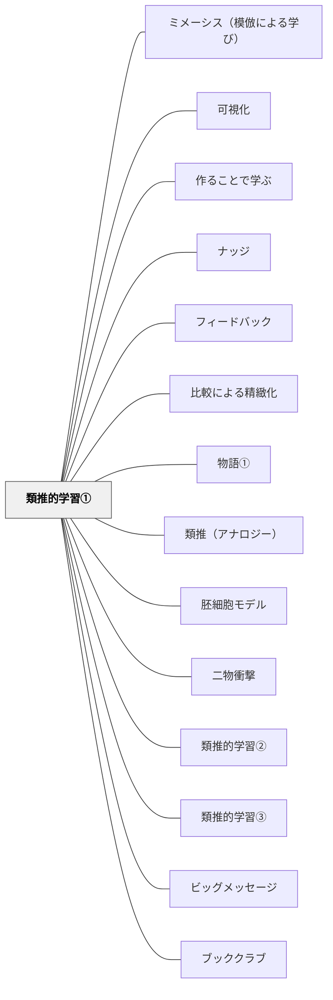

# 類推的学習①

**一文でいうと**：複数の良い例を比べて型（構造）を見つけ、その型を使って自分で作る。

## 使いどころ・使いすぎ注意

| 観点 | 内容 |
| --- | --- |
| 使いどころ | 書く・作る活動の前。評価の観点を子どもと一緒につくりたいとき。 |
| 使いすぎ注意 | ささいにしか違わない例を比べても効果は薄い。比べるあとに、言葉で整理する段階を置く（下の研究の裏づけ）。 |

> 複数の作品を読み比べ、構造的類似（型）を発見し、その型を使って自分で書く——アトウェルのジャンル学習が体現する比較・アナロジーによる学習。

## 背景（Context）

子どもたちに「書き方」を教えようとして、ルールを説明したり模範文を見せたりしても、実際に書けるようにはなりにくい。何を書くか（内容）と、どう書くか（型）の両方を教師が指定すると、学習者の自律性が育たない。

## 問題（Problem）

「書きなさい」という指示だけでは型がわからない。「このように書きなさい」という指示では主体性が育たない。学習者が自分で型を発見し、自分の内容でその型を使うようになるにはどうすればよいか。

## 力のかたち（Forces）

- 型（構造）は教えることができる——しかし教えすぎると学習者が自分で考えなくなる
- 複数の良い作品を読み比べると、学習者は自然にパターンを発見する
- 自分で発見した型は、受け取った型より深く理解され、応用される
- 認知科学のメタ分析（57実験・336テスト）では、事例を比べる学習は、一つずつ見る学習や従来の授業より、多くの場合、学びが大きかった（d = 0.50）。効き方は、比べる目的・原理を示す時機・内容・テストまでの間隔で変わった（Alfieri et al., 2013）

## 解決（Solution）

**近いパタンとの見分け**：比較の表では、本パタンの見分けの問いは「複数の作品を読み比べて型を見つけ、その型を使って自分で書いているか（アトウェルのジャンル学習）」。全体の表は [[パタン/比較で概念をつくる（事例ペアの設計）#近いパタンとの見分け|比較で概念をつくる（事例ペアの設計）]] にある。

### 類推的学習の定義

「類推的学習」は「アナロジカルラーニング（analogical learning）」の直訳である。アナロジーとは：
1. 複数の対象を比較し類似点（類似点そのもの）を見出すこと
2. 類似点や知っていることを元にして、未知の事柄の解決や推論をすること

この類推的思考を用いた学習が類推的学習である（岩井輝久「教科科学国語教育」2016年6月号）。

---

### アトウェルのジャンル学習（4ステップ）

1. **読み比べ**：同じジャンルの作品を複数読む（教師の作品・先輩の作品・プロの作品）
2. **気づきを書く**：「書き手は何を・どのように書いているか」を宿題等で記録する
3. **共有・クラスで整理**：気づきをグループで共有し、そのジャンルの評価基準リストをクラスで作る
4. **制作**：評価基準を手がかりに自分でそのジャンルの作品を書く

**ブックレビューの実践（小学4年生）**：
- 複数のブックレビューを読み比べ、「優れたブックレビューの特徴」をクラスで発見
- 子どもたちが出したリスト例：本のタイトルと著者がある、おすすめ度と理由がある、あらすじはあるが結末を書かない、引用を使っている、自分のメッセージがある
- 完成作品を製本 → 次年度の選書ガイドブックとして機能

---

### ノート検定の実践（類推的学習の応用）

**明治図書「教科科学国語教育」2016年6月号**（特集：子どもの思考を活性化するノート指導、中学年担当）に掲載した実践より。

ノート検定の評価基準を**子どもたちが自分で作る**実践：
- 優れたノートの実例をいくつか観察・比較する
- 類似点（例：見出しをつける、色を使う、ページを区切るなど）を見出す
- その類似点から評価基準（1級・2級・3級など）を子どもたちが自作する

これが類推的学習である：「優れたノートに似ているところ（類似点）を見つけて、自分のノートを書くことに生かしていく」。Shirley Clarkeの形成的評価実践（評価基準を学習者が共同作成する）とほぼ重なる。

---

### 3人の実践者に共通する類推的学習

立場は異なるが、共通して類推的学習を体現している：

| 実践者 | 立場 | 実践 |
|--------|------|------|
| 牧口常三郎（約100年前）| 系統学習寄り・プロジェクト学習批判 | 文系応用主義（同種のものを比較して応用） |
| Nancy Atwell | 子ども中心・自己選択・リーディング/ライティングワークショップ | ジャンル学習 |
| Shirley Clarke | 形成的評価の研究実践者 | 評価基準の共同作成、くじ引きによるランダム取り上げ |

牧口とアトウェルは教育観が真逆に近い（系統学習 vs 子ども中心）にもかかわらず、「複数の類似した例を比較して型を見出し、それを自分の問題解決に使う」という学習法において一致している。これは類推的学習が教育的立場を超えた普遍性を持つことを示す。

### 研究の裏づけ

> **研究の裏づけ（2026-11-01）**：何と何を比べるかで、伸びるものが変わる。Rittle-Johnson と Star（2009）は、中学1・2年生162人を、同じ型の方程式どうしを同じ解き方で比べる群、違う型の方程式どうしを同じ解き方で比べる群、同じ方程式を二つの解き方で比べる群に分けた。概念の理解は、同じ問題を二つの解き方で比べる群がほかの二群より高かった（pp. 22–24）。比較を支えた特徴として、比べる解き方をそろえて並べる、似ている点と違う点を見つける場、効率を考える問い、ステップの共通の名前、比較を補う直接の説明の五つを挙げ（pp. 33–34）、ささいにしか違わないものを比べても効果は薄いだろうとする（pp. 31–32）。出典：[[文献/何と何を比べると学びが伸びるかを確かめる（RittleJohnsonとStar2009）]]。

> **研究の裏づけ（2026-11-01）**：『How People Learn』（2000）は、うまく並べた対比の事例は、見落としていた特徴や、どの特徴が大事かに気づく助けになるとする（p. 60）。同時に、データを比べたあとに講義を聞いた大学生の群が転移のテストでいちばんよく、比べる時間を2倍にして講義を受けなかった群は成績が悪かった例を挙げ、「講義は必要だった」と書く（p. 59）。比べて型を見つけたあとに、言葉で整理する段階を置く。出典：[[文献/人の学び方の研究を授業の設計につなぐ（全米研究評議会2000）]]。

> **研究の裏づけ（2026-11-04）**：『Writing Next』が挙げるお手本の研究の例は、比べて型をつかみ、別の題で使う流れになっている。同じ題で反対の立場をとる、よい説得文を2本見せて教師と話し合い、翌日、そのうち1本を手元に置いて、別の題で説得文を書く（Knudson 1991、p. 20）。4〜12年生を対象にした報告の6研究の平均効果は 0.25 で、小さいが6研究すべてで正だった。出典：[[文献/作文指導の有効な要素を組み合わせる（Writing Next2007）]]。

> **研究の裏づけ（2026-11-05）**：どちらもまだよく分かっていない二つの事例でも、比べれば原理が見えてくる。交渉の初心者の大学生128人に、同じ原理（オレンジを半分ずつではなく、果汁と皮で分けるような「取引」など）の二つの事例を、比べて共通点を書く組と、一つずつ読む組に分けて読んでもらうと、見かけの違う新しい交渉の問題で原理を使ったのは、比べる組 48% 対 一つずつ読む組 19% だった（実験2、p. 399）。一つずつ読む組では、二つを続けて読んだのに、二つを結びつけて書いた人は16%だった。実際に向かい合っての交渉でも、手引きつきの比較 90%・比べるだけ 70%・一つずつ 55%・学びなし 37% の順だった（実験3、p. 401）。著者は、学習者は並べられても自分からは比べないので、比べることをはっきり求める必要がある、と書く（p. 403）。大学生の、学んだ直後の転移の実験である。出典：[[文献/二つの事例を一つずつ読むのではなく比べると、共通の原理がつかめて新しい場面で使えるかを、三つの実験で確かめる（Gentnerほか2003）]]。

> **研究の裏づけ（2026-11-05）**：類推は、出すだけでなく、支えを添えてはじめて生きる。TIMSS 1999 の授業ビデオから、米国・香港・日本の中学2年生の数学の授業を国ごとに10本選んで比べると、どの国でも類推はたくさん出ていた（米国195・香港185・日本139）。しかし、子どもがよく知っている「もと」を使う、「もと」を目に見える形で示し見えるところに残す、対応を位置や矢印で示す、比べることを身ぶりで示す、頭の中に絵を描くよう促す、という六つの支えは、すべて米国が香港と日本より少なかった（p. 1129）。頭の中の絵を促すのは日本がもっとも多かった。著者は、支えのない類推は、教師の意図と違う関係を学んだり、誤った考えを生んだりしうると書く。教師の行動の観察で、子どもの学びは測っていない。出典：[[文献/数学の授業で類推を使うとき、教師がどんな支えを添えているかを、米国・香港・日本の授業ビデオで比べる（Richlandほか2007）]]。

## 結果（Consequences）

- 型を「教わった」のではなく「発見した」という感覚が、制作への動機を高める
- 評価基準をクラスで共同作成することで、評価の観点を学習者が所有する
- 書けない子の足場になる（クラスでの共作段階が特に効果的）
- 単一ジャンルの型を超えて、「型を発見する方法」自体を学ぶ

## このパタンが働く実践
- [[実践/ノート指導（読み書きハンドブック・ノート検定）]]

| 実践 | どのように類推的学習①が働くか |
|------|--------------------------------|
| [[実践/俳句と短歌を楽しもう]] | 複数の俳句・短歌に触れ、よい作品の特徴を確認してから自分の表現へ生かす |
| [[実践/言葉をよりすぐって俳句を作ろう]] | 俳句の実例を読み比べ、よい俳句の特徴を推敲ポイントとして構成する |
| [[実践/個別支援級の複式算数：重さと面積をわたり・ずらしで学ぶ]] | 長さ・かさ・重さ・面積の単位を比較し、既習の単位関係から新しい単位を類推する |

---

## [Pattern Connection]

**研究からの補足（2026-10-17）：次の学びへの準備として転移を捉える（BransfordとSchwartz1999）**

原典のPFLは、過去の知識を使って次の学びを進められるかに注目する（公開著者稿pp. 8–9, 35）。Wiki側の適用案として、型を見つけた後に別の作品を読み、型について理解を修正・追加した箇所を残す。本パタンのジャンル学習全体を検証した研究ではない。 出典：[[文献/次の学びへの準備として転移を捉える（BransfordとSchwartz1999）]]。

**研究からの補足（2026-10-16）：事例比較の効果と条件を確かめる（Alfieriほか2013）**

原典は多領域の事例比較を集約した研究であり（pp. 87, 107–110）、本パタンのジャンル学習全体を直接検証していない。Wiki側の適用案として、読み比べで見つけた型を、自作のどこで何のために使ったか示してもらう。 出典：[[文献/事例比較の効果と条件を確かめる（Alfieriほか2013）]]。

### Nappo & Valente（2026）——Gentnerの4学習モードで読み解く類推的学習①

Gentner（2010）の構造マッピング理論が提示する4学習モードは、アトウェルのジャンル学習の4ステップとほぼ1対1で対応する：

| Gentner学習モード | アトウェルの4ステップ | 類推的学習①の操作 |
|---|---|---|
| **Abstraction（抽象化）** | ①読み比べ → ②気づきを書く | 「複数の作品に共通する構造（型）は何か？」 |
| **Contrast（対比）** | ③共有・クラスで整理 | 「優れた作品とそうでない例のどこが違うか？」 |
| **Re-representation（再表現）** | 評価基準リストの共同作成 | 「型を評価基準として別の言葉・リストで表すと？」 |
| **Inference projection（推論投影）** | ④制作 | 「この型を自分のテーマに使うとどうなる？」 |

この対応が示すのは、類推的学習①は「類推を活用する授業活動」ではなく、**Gentnerが示した認知的に最も深い学習サイクルを4ステップとして実装したもの**だということだ。特に「③共有・クラスで整理（評価基準の共同作成）」がRe-representation（再表現）に対応するのは重要——型を「発見する」だけでなく「別の言葉で表し直す」操作が、学習者の内的構造を再構成する。

**補強された点**：「複数の作品を読み比べ、型を発見する」という記述が、Gentnerの4学習モードという認知科学的枠組みで精緻化される。

**他のパタンへの波及**：[[パタン/類推（アナロジー）]] — Gentnerの4学習モードの基本；[[パタン/比較（問い）]] — Contrast学習モードの問い；[[パタン/変換（問い）]] — Re-representation学習モードの問い

→ [[文献/Analogical Reasoning in Science（Nappo & Valente）]]

## 関連パタン
- [[パタン/ミメーシス（模倣による学び）]]
- [[パタン/可視化]]
- [[パタン/作ることで学ぶ]]
- [[教科/国語]]
- [[パタン/ナッジ]]
- [[パタン/フィードバック]]
- [[パタン/比較による精緻化]]
- [[パタン/物語①]]
- [[パタン/類推（アナロジー）]]
- [[パタン/胚細胞モデル]]

- [[パタン/二物衝撃]] — 俳句の取り合わせ技法が類推的学習の実装形態（複数の句を比べて共通するものを発見する）
- [[パタン/類推的学習②]] — 物語の書き換え（パロディ作文）による類推的学習
- [[パタン/類推的学習③]] — 文型応用主義と推理式指導算術
- [[パタン/ビッグメッセージ]] — ミニレッスンで型のエッセンスを届ける
- [[パタン/ブッククラブ]] — 読み比べから対話的読みへ
- [[パタン/知識から技能へ]] — 型の知識（概念）→ 制作（技能）の構造
- [[パタン/発散し尽くす]] — 気づきを出し切ってから整理する
- [[概念/パタン・ランゲージ概論]]
- [[パタン/つながった関係ほど写る（体系性で類推を選ぶ）]] — お手本の特徴を拾うとき、特徴どうしのつながりを問う
- [[文献/Structure-Mapping（Gentner, 1983）]] — 構造写像理論の原典（4学習モードは2010年の別論文）
- [[文献/事例比較の効果と条件を確かめる（Alfieriほか2013）]] — 型の発見と、自分の作品への使用を分けて確かめる。
- [[文献/次の学びへの準備として転移を捉える（BransfordとSchwartz1999）]] — 型を使えたかに加え、新しい作品から学べるかを見る。
- [[文献/何と何を比べると学びが伸びるかを確かめる（RittleJohnsonとStar2009）]] — 同じ問題を二つの解き方で比べると概念の理解が伸びる
- [[文献/人の学び方の研究を授業の設計につなぐ（全米研究評議会2000）]] — 対比の事例（p. 60）と、比べたあとの講義（p. 59）
- [[文献/作文指導の有効な要素を組み合わせる（Writing Next2007）]] — 2本のよい作文を比べて型をつかみ、別の題で書く
- [[文献/二つの事例を一つずつ読むのではなく比べると、共通の原理がつかめて新しい場面で使えるかを、三つの実験で確かめる（Gentnerほか2003）]] — 類推による符号化：二つの事例を比べると、一つずつ読むより原理が使える（三つの実験）
- [[文献/数学の授業で類推を使うとき、教師がどんな支えを添えているかを、米国・香港・日本の授業ビデオで比べる（Richlandほか2007）]] — 類推に支えを添える：よく知っている「もと」・見える形・位置や身ぶり（米国・香港・日本の授業ビデオ）
- [[文献/学び方の方略は、学びのどの段階で使うかで効き方が変わるかを、228のメタ分析から整理する（HattieとDonoghue2016）]] — 転移は、似たところと違うところを見つけることで起きる（メタ統合で1.32）

## クラスター図

## Actionable Insight

- 次の作文・制作の前に、同じジャンルの良い作品を2〜3点読み比べる時間を設ける——型を教えるより先に、子どもが型を発見できるようにする
- 「優れた○○の特徴は何か」をクラスで話し合ってリストにする——子どもたちが作ったリストが評価基準となり、フィードバックの共通言語になる
- 類推的学習の4ステップ（読み比べ→気づきを書く→共有→制作）を1つの単元で1回試してみる

## 出典
- [[文献/一つの教育のパタン・ランゲージ]]
- [[文献/読み書き教育における類推的学習の研究（第二版）]]

岩井輝久「岩井輝久『一つの教育のパタン・ランゲージ』」（2026-04-29 vault収録）  
岩井輝久「読み書き教育における類推的学習の研究第二版」2017年（2026-04-30 vault収録）  
岩井輝久「普遍的な学習理論につながるノート指導」教科科学国語教育 2016年6月号（明治図書）  
岩井輝久「教育のパタン・ランゲージ図解バージョン変遷記録（動画記録）V5（2024/12/01）」
