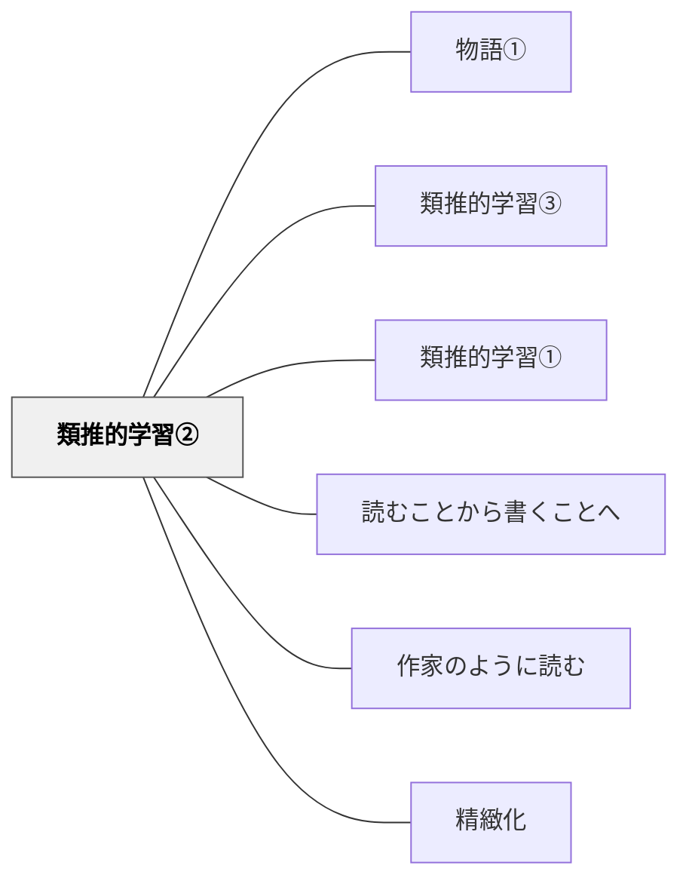

# 類推的学習②

**このパタンが完成を助ける大きなパタン**：[[パタン/類推的学習①|類推的学習]]

> 何かを書き換えていくことも類推的学習の一つです。

---

## [Pattern Connection]

### Nappo & Valente（2026）——「書き換え（翻作）」はRe-representationの最深部

Gentner（2010）の4学習モードの中で、翻作（パロディ作文・書き換え）が最も直接に対応するのは**Re-representation（再表現）**——「同じ構造を、別の素材・言葉・文脈で表し直す」操作だ。

翻作とは、原作の*構造*（登場人物の役割・事件の展開・表現技法）を保ちながら*内容*（登場人物の名前・舞台・具体的な出来事）を入れ替える活動。これはまさに「ソース（源領域）の構造をターゲット（自分の内容）に投影する」——類推的推論の中核操作そのものだ。

Gentnerが「No difference without similarity」と言うように、書き換えで「原作と自分の作品がどこで違うか」が見えるのは、まず「どこが共通しているか（構造）」が特定されているから。翻作を通じた学習が深い理解を生む認知的理由がここにある。

さらに翻作は、発見的類推（heuristic view）と正当化的類推（inductive view）の両方を使う：
- 「ローベルみたいに書いてみよう」→ 発見的（構造探索の出発点として類推を使う）
- 「この箇所はローベルの〇〇と同じ構造になっている」→ 正当化的（自分の作品を評価する根拠として類推を使う）

**補強された点**：「書き換え＝類推的学習」という直観的説明が、Gentnerの構造マッピング理論とheuristic vs inductive viewによって認知科学的に裏付けられる。

**他のパタンへの波及**：[[パタン/類推（アナロジー）]] — 書き換えの認知的基盤；[[パタン/変換（問い）]] — Re-representation学習モードとしての問い

→ [[文献/Analogical Reasoning in Science（Nappo & Valente）]]

---

## 背景（Context）

物語の書き換え（パロディ作文・翻作）は、お手本の物語の構造や表現を借りて自分の物語に作り替える学習で、読むことと書くことをつなぐ類推的学習の一つである。

## 問題（Problem）

書き換え（翻作）は、理解と表現にまたがる学習で、ジャンルの文章の構造や組み立て方、表現技法を身につけていくことができる。けれども、意識して授業に織り込まなければ、読むことと書くことが別々に教えられ、この一石二鳥の機会が生かされない。

## 力のかたち（Forces）

- 教育者の意図と学習者の実態のギャップ
- 個々の状況に応じた柔軟な対応の必要性
- 経済性（無駄なコスト・苦しみを省く）の原理

## 解決（Solution）

お手本の物語（『ももたろう』、『とってもいいひ』、『ズボンつり』など）を読み、物語の組み立てを表にして確かめてから、登場人物や場面を自分で選んで書き換える。教師も自分で書き換えた物語を書いて、手本として見せる。

（この節には、岩井の原稿「教育のパタン・ランゲージ 集約」の本文が入る。2026年12月に掲載する。）

**近いパタンとの見分け**：比較の表では、本パタンの見分けの問いは「お手本を書き換えながら（翻作）、その表現の型を自分のものにしているか」。全体の表は [[パタン/比較で概念をつくる（事例ペアの設計）#近いパタンとの見分け|比較で概念をつくる（事例ペアの設計）]] にある。

## 結果（Consequences）

- 学習者の力能（なしうる力）が増大する
- パタンの圧縮による教育の経済性が実現する

## このパタンが働く実践

| 実践 | どのように類推的学習②が働くか |
|------|--------------------------------|
| [[実践/ローベルみたいな物語を書こう]] | ローベル作品の物語構造を借りて書き換え、構成や表現技法を学ぶ |
| [[実践/俳句と短歌を楽しもう]] | 優れた俳句や短歌の表現を借り、本歌取として自分の興味や経験へ作り替える |

## 関連パタン
- [[教科/国語]]
- [[パタン/物語①]]
- [[パタン/類推的学習③]]

- [[パタン/類推的学習①]] — 翻作（書き換え）はアナロジー学習の実践的上位にある類推的学習①の具体形
- [[パタン/読むことから書くことへ]] — 読んだテキストを書き換えることで読解と表現を統合する
- [[パタン/作家のように読む]] — 構造・表現を分析してから書き換える視点
- [[パタン/精緻化]] — 書き換えが精緻化学習（elaboration）の強力な形式
- [[概念/パタン・ランゲージ概論]]
- [[文献/Teaching Elementary School Students to Be Effective Writers（Graham et al., 2012）]] — お手本の構成を足がかりにして別の内容を書く活動（勧め2b）

## クラスター図

## Actionable Insight

- 教科書の例文・例題の「構造」だけ残して内容を入れ替えさせる——「書き換え」の最小版として、1文だけパロディにするところから始めると抵抗が少ない
- 物語の読み取りで「この場面を別の登場人物から書き換えたら？」という問いを1回投げかけてみる——視点の書き換えが理解の深さを可視化する
- 既存の説明文の「型」を板書して示し、別のテーマで同じ型を使って書かせる——型の意識化が表現力の飛躍的向上につながる

## 出典
- [[文献/一つの教育のパタン・ランゲージ]]
- [[文献/読み書き教育における類推的学習の研究（第二版）]]

岩井輝久「類推的学習②−物語の書き換え（パロディ作文）−」『一つの教育のパタン・ランゲージ』（2026-04-29 vault収録）

原稿の参考文献：

アーノルド・ローベル（１９７３）『とうさんおはなしして』文化出版局

卯月啓子、首藤久義（１９９９）『ことばがひろがるⅠ』東洋館出版社

楠山正雄（２００３）『桃太郎』青空文庫

ケビンヘンクス（２００８）『とってもいいひ』BL出版

ナンシー・アトウェル/小坂敦子、澤田英輔、吉田新一郎(2018)『イン・ザ・ミド ル ナンシー・アトウェルの教室』三省堂

プロジェクトワークショップ（２００８）『作家の時間: 「書く」ことが好きになる教え方・学び方【実践編】』新評論

三藤恭弘(2010)『書く力がぐんぐん身につく「物語の創作/お話づくり」のカリ キュラム30―ファンタジーの公式』明治図書

リンドグレーン（１９６４）『長くつ下のピッピ−−世界一つよい女の子』岩波書店

リンドグレーン（２０００）『ピッピ船に乗る』岩波書店

Ted Demille（２００８）Making Believe on Paper: Fiction Writing With Young Children, Heinemann
