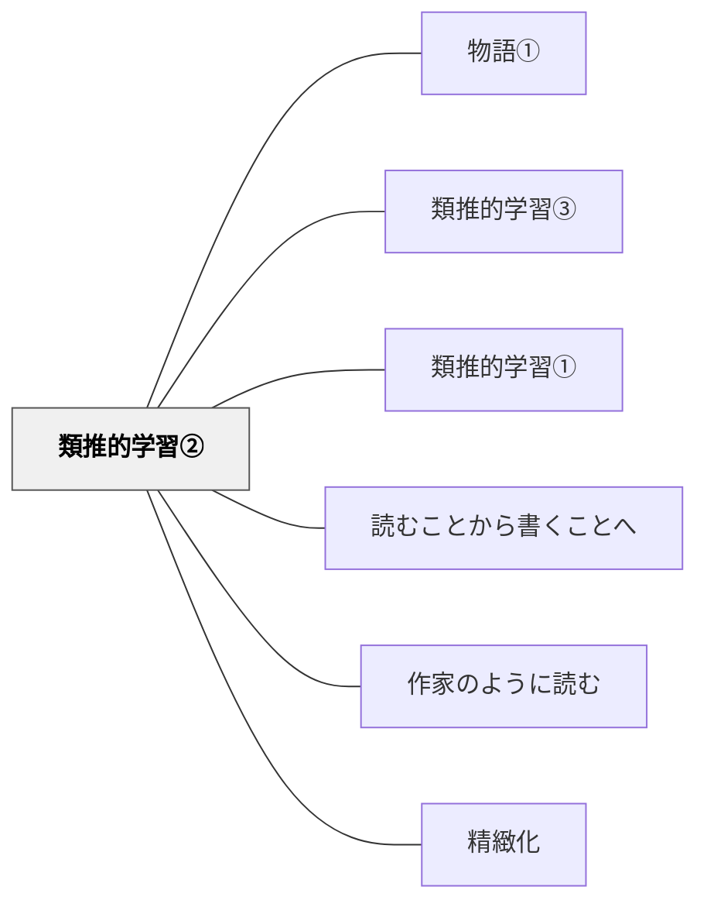

# 類推的学習②

> 何かを書き換えていくことも類推的学習の一つです。

---

## [Pattern Connection]

### Nappo & Valente（2026）——「書き換え（翻作）」はRe-representationの最深部

Gentner（2010）の4学習モードの中で、翻作（パロディ作文・書き換え）が最も直接に対応するのは**Re-representation（再表現）**——「同じ構造を、別の素材・言葉・文脈で表し直す」操作だ。

翻作とは、原作の*構造*（登場人物の役割・事件の展開・表現技法）を保ちながら*内容*（登場人物の名前・舞台・具体的な出来事）を入れ替える活動。これはまさに「ソース（源領域）の構造をターゲット（自分の内容）に投影する」——類推的推論の中核操作そのものだ。

Gentnerが「No difference without similarity」と言うように、書き換えで「原作と自分の作品がどこで違うか」が見えるのは、まず「どこが共通しているか（構造）」が特定されているから。翻作を通じた学習が深い理解を生む認知的理由がここにある。

さらに翻作は、発見的類推（heuristic view）と正当化的類推（inductive view）の両方を使う：
- 「ローベルみたいに書いてみよう」→ 発見的（構造探索の出発点として類推を使う）
- 「この箇所はローベルの〇〇と同じ構造になっている」→ 正当化的（自分の作品を評価する根拠として類推を使う）

**補強された点**：「書き換え＝類推的学習」という直観的説明が、Gentnerの構造マッピング理論とheuristic vs inductive viewによって認知科学的に裏付けられる。

**他のパタンへの波及**：[[パタン/類推（アナロジー）]] — 書き換えの認知的基盤；[[パタン/変換（問い）]] — Re-representation学習モードとしての問い

→ [[文献/Analogical Reasoning in Science（Nappo & Valente）]]

---

## 背景（Context）

−物語の書き換え（パロディ作文）−

　　　　　　　　　　　　　　　　　　　　　岩井輝久

人生は、書き換えである。

書き換えとは、「パロディ作文」「翻作」「リライト」などと呼ばれることがある学習です。何かを書き換えていくことも類推的学習の一つです。私は、「人生は、書き換えである」と考えています。私たちは、言語の海に生まれ落ちて、先人たちが築いてきた言語表現と財産を獲得し、書き換えていきます。私たちの多くの仕事も、先人が築いてきた仕事を書き換えるものです。書き換えの学習を意識的に織り込むことで、子どもたちは、少ない労力で、効率的に言語の力を伸ばしていくことができます。さらには、人生全般に通じる能力を身につけることができます。

「類推的学習」とは、Analogical Learningを筆者が日本語に直訳したものです。類推(アナロジー)には、いくつかの定義がありますが、類似点そのもの、複数の対象を比較し類似点を見出すこと、また類似点や知っていることをもとにして未知の事柄の解決をしたり推論をしたりすることを意味します。この類推(アナロジー)を用いた学習を類推的学習(Analogical Learning)と言います。

書き換えは、理解と表現をまたがる、インプットとアウトプットの境界にある学習活動であり、自然にあるジャンルの文章の構造や組み立て方、表現技法などを身につけていくことができる一石二鳥の学習方法です。この書き換えの意義についての優れた説明と考察が卯月、首藤（１９９９）にありますので、紹介します。何らかの原作をもとに、それをなぞったり変えたりして表現することを卯月、首藤は、翻作と読んでいます。私は、書き換えという言葉を同じ意味で使っています。

「さて、先にも述べたように、翻作法とは、作品の本文をそのままなぞったり、作りかえたりして、絵本や紙芝居やカセットブックを作ったり、劇にして上演したりして表現することを通して、作品をくり返し読み、作品の内容・形式の両方になじみを深めるという学習法である。翻作法では、翻作すること自体が表現の学習になるが、翻作するために原作をくり返し読むうちに内容理解がさらに深まったり、確かなものになったりするということが起きる。そして、原作の内容や形式になじみが深まるということが起きる。表現されたものを読んで理解したり、自分で表現したりする際に活用される素養が豊かになるということであって、それはすなわち、理解力・表現力の資本が学習者の内部に蓄積されるということである。

　言語活動の四領域（話す・聞く・書く・読む）という面から見ると、翻作は、言語を通して理解する活動（聞く・読む）と言語を通して表現する活動（話す・書く）とを同時的・相補的に行うものであり、表現・理解の両方にまたがる活動である。翻作とは、表現・理解の両方にまたがる学習なのである。

　が、それだけではない。翻作の過程ではまた、言語の要素とその結合法についての学習、つまり言語事項の学習もなされる。しかも、要素及びその結合法の一つ一つが別々に学ばれるのではなくて、文脈の中で有機的に関連して働きあっている姿そのままに学ばれる。例えば、朗読劇の上演のような、音声による翻作の場合には、発音・発声に関わる事項の学習があわせてなされることになる。視写絵本・翻作絵本など、文字を翻作する場合には、書写や平仮名・片仮名・漢字などに関わる文字学習を始めとして、各種表記法や、文法・文章構成法・修辞法・文体・レイアウトなどに至るまでの事項が学習されることになる。翻作法は、表現、理解および言語事項にわたる学習の方法として活動できる、総合的な学習法である。」（卯月、首藤１９９９）

創作と書き換え（翻作）の関係についても、卯月、首藤（１９９９）にわかりやすい説明があるので紹介します。

「なお、内容や文体まで変える『変える翻作』はその変える度合いが大きくなると、原作とはかけ離れた作品になるわけで、そうなるともう、それは翻作の範囲をこえて、創作と呼んでもよいものになる。私は、創作とは、つまるところ、翻作の究極の形であると考えている。

　ことばで表現する限り、ことばを使って表現された何らかの作品との類似点が皆無な創作作品などありえない。使われている単語が類似していたり、単語の配列が共通していたり、言い回しが似ていたりというように、それ以前に作られた作品との、内容や形式の上における類似点が全くない創作作品は、存在し得ないのである。

　ことばによる創作は、人々の間ですでに使われていることばの組み合わせを変えることによって、新しい独自の世界を創造しているのである。それが創作と呼ばれているのである。」（卯月、首藤１９９９）

## 問題（Problem）

書き換え（翻作）は、理解と表現にまたがる学習で、ジャンルの文章の構造や組み立て方、表現技法を身につけていくことができる。けれども、意識して授業に織り込まなければ、読むことと書くことが別々に教えられ、この一石二鳥の機会が生かされない。

## 力のかたち（Forces）

- 教育者の意図と学習者の実態のギャップ
- 個々の状況に応じた柔軟な対応の必要性
- 経済性（無駄なコスト・苦しみを省く）の原理

## 解決（Solution）

**近いパタンとの見分け**：比較の表では、本パタンの見分けの問いは「お手本を書き換えながら（翻作）、その表現の型を自分のものにしているか」。全体の表は [[パタン/比較で概念をつくる（事例ペアの設計）#近いパタンとの見分け|比較で概念をつくる（事例ペアの設計）]] にある。

私は、説明文など、多くの学習で書き換えを意識していますが、今回は、物語の書き換え（パロディ作文）の授業実践についてお伝えします。

パロディ作文（物語の書き換え）

パロディ作文とは、知っている物語を書き換える作文のことです。パロディ作文は、物語の構成等の入れ物をそっくりそのまま貸していただきながら、主人公や時、場所の設定などを変えて物語を書きなおす学習です。多くの子どもたちはおもしろがって取り組みますし、物語の構造や表現方法も吸収できる、大変に有効な学習方法です。

桃太郎のパロディ作文

私は、低学年から高学年まで多くの学年で桃太郎のパロディ作文を書き換えの導入で扱います。桃太郎は、今の子どもたちにも馴染深い作品で、書き換えの始めのレッスンにうってつけだと思うからです。また桃太郎には、「主人公の出発」「主人公にふりかかる難題」「アイテムや身方を手に入れる」など昔話の典型的なパタン(要素）が多く入っています。そういったことを学ぶベースとしても優れています。桃太郎の書き換えをして、他の昔話の作品と比較すれば、昔話に共通する優れたパタンを発見・構成できると思います。その発見・構成したパタンを物語の創作に生かすことができれば、これもまた類推的学習を重ねていくことになります。

三藤恭弘(２０１０)『書く力がぐんぐん身につく「物語の創作/お話づくり」カリキュラム 30―ファンタジーの公式』という物語の創作の授業を説明した本があります。この本では、二つのパロディ作文（『桃太郎』と『雪の女王』のパロディ作文)の授業を扱っています。その本の中には、『桃太郎』の元のお話とそれを書き換えた『かぼちゃ姫』という作品のテキストがあります。私は、その『桃太郎』とパロディ作文である『かぼちゃ姫』のテキストを教材としていつも使ってきました。次のような授業の流れで実践しました。

授業の展開

１．めあてを確認する。

〔めあて 〕『ももたろう』を書き換えよう。

２．『ももたろう』を読む。

３．書き換えの方法をを学ぶ。

書き換えとは、お手本になる物語の構成などはそのままに、人や場所、道具などを入れ替え、楽しみながら創作の技を学ぶ学習です。

４．『ももたろう』を書き換えた『かぼちゃ姫』を読んで、主にどんなところが書き換えられているか、みんなで確認する。例えば登場人物、主人公の敵（おに）、道具（刀ときびだんご）、身方（犬・きじ・さる）など。

○ももたろう→かぼちゃ姫　○おに→吸血鬼　○おにが島→アルガード城　○刀→十字架　○きびだんご→にんにく　○犬・きじ・さる→馬・おおかみ・大たか

５．『桃太郎』の書き換えをやってみる。

６．作品を読み合い、感想を伝え合う。

７．振り返る

（ここには原稿では子どもたちの作品例が入っている。子どもの作品は wiki には載せない。）

AND ONを読んでくださっている方がすぐに実践できるように、自分としても詩などの学習とこの学習の繋がりを明確にして、次にこの実践に取り組むことを考えて、三藤恭弘(２０１０)の桃太郎と楠山正雄（２００３）の桃太郎の資料を読み比べて、教材づくりを試みてみました。特にオノマトペを入れるように意識して修正してみました。もしよろしければ私の修正案も使ってください。楠山正雄の桃太郎は青空文庫で読むことができます。

楠山正雄（２００３）『桃太郎』青空文庫

https://www.aozora.gr.jp/cards/000329/files/18376_12100.html

（原稿では、ここに三藤恭弘（2010）の「ももたろう」を修正した本文が入っている。本文は出典を参照。）

次は、ケビン・ヘンクスの『とってもいいひ』とアーノルド・ローベルの『とうさんおはなしして』に収録されている『ズボンつり』のパロディ作文の授業を紹介します。この授業は、Center for Teaching & Learning というナンシー・アトウェルが創設した学校で物語作りを教えている Ted Demillde の授業を修正追試したものです。２５年間物語作りを教えてきた Ted Demillde （２００８）には、大きく三つの授業が紹介されています。その二つは、『とってもいいひ』と『ズボンつり』のパロディ作文の授業です。 Ted Demilldeの授業では、この二つのパロディ作文を経て、類推を働かせながら、より自由な物語（ファンタジーのお話）作りに取り組むようです（これがTed Demillde の三つ目の授業です）。

Ted Demillde は学校の先生でもあり、芸術家でもあります。そのこともあってか、厳選された学習材が素晴らしいと思いました。Ted Demilldeが授業のためにパロディ作文の元 の作品として選んだ、ケビン・ヘンクスの『とってもいいひ』とアーノルド・ローベルの『ズボンつり』を読んでいない方がいたら、ぜひ読んでほしいです。物語の創作に大事なパタン（要素）をコンパクトにぎゅっと学べる素敵な作品なので、パロディ作文の授業に取り組みたくなるかもしれません。

『とってもいいひ』のパロディ作文（絵本の書き換え）

Ted Demillde （２００８）を参考にして、低学年の子どもたちに向けて授業作りをしましたが、中学年や高学年で取り組んでもいいと思います。

1．『とってもいいひ』を読みます。

２．全体で『とってもいいひ』のあらすじを振り返ります。

わるいことが四ひきの動物たちにそれぞれ起きます。しかし、動物たちの運が好転します。その後 にそれぞれの動物にいいことが起きます。そして最後に子どもが出てきて、動物に起きた悪い出来事の時に、その動物が残していったものをひろって「とってもいいだね」と親に伝えるという話です。

３．『とってもいいひ』のパロディ作文の手本を読みます。手本として私が作ったものは、この原稿の最後にあります。

４．元の作品とパロディの作品を比べます。比べると登場人物、場所などの設定、問題、解決などが変わっていることに気づくことができます。ここで、読み取ったことは、物語を読む時にも、書く時にも重要なことです。

５．子どもたちにアイデアを出してもらいながら、拡大した構成表をクラス全体で共作し完成させました。アメリカでは全体で一斉に作文をつくることをシェアード・ライティングと言うそうです。私は修正の過程を教える時など作文のミニ・レ ッスンで共作(シェアード・ライティング)をよくやります。この過程で完成する構成表が 以下の写真のワークシートです。登場人物(動物)を考えます。それぞれの動物に起きる悪い出来事を考えます。そしてその解決、つまりよい出来事も考えます。何を贈り物とするのかも考えます。悪い出来事の時に登場人物が残したものが、最後の場面で贈り物になります。

６．子どもたちは自分で考えて一人ひとり構成表を完成させます。

７．下書きをします。八つ切りの画用紙を半分にしたものを使いました。

８．修正・校正をします。

９．清書をします。文をマジックペンで書いた時に間違いがあった場合は、画用紙を切り貼りして直しました。

１０．完成したものを机の上に置いて、みんなでお互いの作品を読み合いファンレターを書き合います。

（ここには原稿では子どもたちの作品例が入っている。子どもの作品は wiki には載せない。）

『ズボンつり』のパロディ作文

−アーノルド・ローベルみたいなお話を書こう−

小学校3年生を担任した時の実践です。アーノルド・ローベルの『とうさんおはなしして』に収録されている『ズボンつり』の物語の構造をそのまま借りて書き換えをすることで、遊び感覚で楽しみながら、自然にストーリーの組み立て方や表現技法を身につけるられるようにしました。「登場人物をどうしようか？」「どんな問題を設定する？」「どのような問題の解決にしますか？」など質問する中で、物語の構成を子どもたちと一斉に共作しました。アメリカでは、シェアード・ライティングと呼ばれる手法で、書くプロセスを全体で練習し確認することができます。シェアード・ライティングがあることは、書くプロセスを全体で体験し一人で書くことへの橋渡しになります。このシェアード・ライティングは、私が作文教育でよく使う手法です。

また、何度か実践を重ねる中で、自分も書くプロセスを子どもたちに見せるようにしました。書くプロセスを見せて、時間があれば、さらにこのシェアード・ライティングもできるとより丁寧な授業になると思います。教師が書くプロセスを見せることについて、アトウェル（２０１８）には、次のような説明があります。

「教師が書き手としてどのように考えて、どのように書いているのかを生徒にはっきりと見せる形で教えると、書き手としての考え方や行動の仕方が理解できるようになります。これより効果的な方法は思いつきません。大人である教師の取り組み中の姿を観察することで、書くときに何ができるのかという世界が生徒の中に広がります。これはとても価値あることです。そのためには、教師が大作家でなくてもよいのです。生徒にはっきり見せて教え、そこで教えたことを土台にしていくために、教師は生徒よりほんの少しだけよい書き手であればよいのです。」（アトウェル、２０１８、p１６６）

「もし、あなたが、書き手としての経験に乏しく、自分の書くプロセスがどのようなものか実感できていないなら、１行ずつ空けて書いたり、メモ書きを使ったりという方法を、実験的に試してみる機会だと考えてください。生徒たちにとって大切なのは、生徒たちよりも、ほんの少しだけであっても先輩の書き手が、紙を目の前にして考え、その考えを変えたり、どんなふうにすれば良い文になるのかに思いを巡らしたり、自分らしい文や内容を作り出そうとしたりしている、その実際の姿を見ることなのです。」（アトウェル、２０１８、p１６７）

「私が論文や本を執筆していることは事実ですが、教室で私が書き手として尊敬されているとしたら、それは、自分の作品を授業で使い続けているおかげでしょう。…私が心をむけて書くことに奮闘する姿を見ることで初めて、生徒たちは、大人がどのように書くことに価値を見出し、紙の上で考えるのか、という視点を得ることができるのです。」(アトウェル、２０１８、p１７４)

ここで大切なのは、結果だけではなく書くプロセスを子どもたちに見せるということです。今回の授業では、Ted Demille（２００８）を参考にして、物語づくりを助けるために、文章の組み立てと質問のワークシートをそれぞれ用意しました。授業では、私が使ったそのワークシートを見せて、どのように考えて書いたのかなど、書くプロセスが子どもたちに分かるようにしました。

１．単元の見通しをもちます。

一□  学習の見通しをもつ。
二□ 『ズボンつり』を読む。
三□ 『ズボンつり』のパロディ作文を読む。
四□ 元の作品とパロディ作文をくらべて、気づいたことを出し合う。

五□ 文章の組み立てを考える。
六□ お話づくりの質問に答える。
七□ 下書き
八□ 修正(自分の作品を繰り返し読んで、作品を磨く)

九□校正
十□ 清書
十一□ 作品を読み合い、ファンレターを贈り合います。

ライティング・ワークショップの作家のサイクルを回すように単元設計しました。ライティ ング・ワークショップの作家のサイクルについては『作家の時間: 「書く」ことが好きになる教え方・学び方【実践編】』を参照。

２．『ズボンつり』を一緒に読み、『ズボンつり』のあらすじを確認します。6つの場面からできている作品です。

①おおまかな状況設定の説明があります。

②思いがけない問題が主人公に起きます。

③助けを主人公が求めても助けてもらえません。

④主人公の嫌いな登場人物が主人公を助けに来ます。

⑤問題の解決があります。

⑥主人公の変容、そしてハッピーエンディングがあります。

３．手本の『ズボンつり』のパロディ作文を読みます。

トラのおじちゃんが見た夢

　　　　　　　　　　　　　　岩井　輝久

　毎日、森でプロレスをするトラのおじちゃんがいたんだって。このおじちゃんは、バクの子どもたちがきらいだった。道に子どもたちがいようものなら、つばをはきすて、こうどなったんだ。

「なんだ？そのノの字みたいなしっぽは！ちかよってくるな！しっしっし！！」

　ある日のことからさ、おじちゃんは、わるい夢ばかり見るようになった。それは、ばくだんやしょういだんが落ちてくるせんそうの夢だった。そのあとには、きまっておばけが出るんだ。おじちゃんは、わるい夢のためによくねむれなくなったしまった！

　ヒョウのおねえさんがとおりかかった。

「わるい夢ばかり見るんだ！」

おじちゃんはさけんだ。

でもヒョウのおねえさんは、おどろいた声で、

「あら、へんなおじさん！ちかよってこないで！かみついちゃうわよ！！」

と言うと、すごいスピードで走りさってしまった。

　おじちゃんは、走ってお家に帰り、大声で言った。

「わるい夢ばかり見るんだ！よくねむれないんだ！！」

おくさんは、こういっただけだった。

「わけのわからないことばかり言っていないで、さっさと仕事に行きなさい！！」

そして、ザアッ、ザアッ、おじちゃんの顔をひっかいた。

　おじちゃんは、いたみとぜつぼうで泣いてしまったよ。すると、子どもたちがとおりかかった。

「どうしたんですか？」

子どもたちは言った。

「わるい夢ばかり見て、ねむれないんだ。」

「ぼくたちでたすけてあげますよ。バクは夢を食べられるんですよ。きっとうまくいきますよ。」

バクの子どもたちは、おじちゃんがねている間にわるい夢を食べくれた。

　つぎの日の朝、

「おお、よくねむれたよ！わるい夢を見なかった！大好きなプロレスをしている夢だったよ！！」

おじちゃんは、大きな声を出した。

「こんなにぐっすりねむれたのは、どれくらいぶりだろう！！」

　もうバクの子どもたちがわるい夢を食べてくれたおかげで、二度とわるい夢を見なかったんだって。そしてね、それからというもの

おじちゃんと子どもたちはいっしょにくらすようになったんだって。


４．元の作品とパロディの作品を比べて、何が変わっているかなど、気づいたことを出し合いまいます。

○題名(タイトル)

○登場人物 ○はじめ・中・おわり

○出来事 ○問題 ○解決 ○セリフ ○時 ○場所

５．教師が書いた構成表で、ワークシートの構成表の書き方を確認します。

【例１】 筆者が書いたパロディ作文の構成表の事例

主人公  トラのおじちゃん

主人公が嫌いな登場人物　バクの子どもたち

 思いがけない問題　悪い夢ばかり見るようになる

 ある登場人物が助けてくれない　ヒョウのおねえさんとトラのおじちゃんの奥さん

問題の解決 わるい夢を食べてもらう

ハッピーエンディング　トラのおじちゃんとバクの子どもたちは友達になる

子どもたちには、自分が書いた構成表を紹介する中で、私が山之口獏という詩人が好きなところからバクの子どもたちという登場人物を設定したことやバクという動物が夢を食べると言われることから連想してお話の問題と解決を考えたことなど、構想の段階のプロセスについて話しました。

【例２】 Ted Demille（２００８）にある構成表の事例を筆者が日本語訳しました。

主人公 ねこ

主人公が嫌いな登場人物　ねずみ

思いがけない問題  おふろにねこが落ちる

ある登場人物が助けてくれない　固形せっけんとおふろの栓

 問題の解決　お風呂の栓を抜く

ハッピーエンディング  ねこはねずみと友だちになった。

全体で構成表を共作します。構成表の共作（シェアード・ライティング）です。一人ひとりが構成表を完成させます。


６．物語づくりを助ける質問のワークシートの書き方を教師が書いたものを通して確認します。物語づくりを助ける質問の答えの共作します。その後、一人でも質問の答えを考えて書きます。

【例】 物語づくりを助ける質問の答え

※写真のワークシートは、はじめてこの授業をした時に作ったものです。例の質問は少し修正したものです。

（１）どんな動物を中心人物（主人公）にしますか。

森でプロレスをするのが好きなトラのおじちゃん

（２）主人公が嫌っている登場人物は何にしますか。

バクの子どもたち

（３）中心人物が対人物をきらっていることをどんな会話文に表しますか。

「なんだ？そのノの字みたいなしっぽは！ちかよってくるな！しっしっし！！」

（４）どのような問題が中心人物におきますか。

わるい夢ばかり見るようになった。

（５）どんな登場人物が中心人物をどのように助けるのをやめますか。

ヒョウのおねえさんが「あら、へんなおじさん！ちかよってこないで！かみついちゃうわよ！！」とさけぶ。トラのおじちゃんのおくさんが「わけのわからないことを言ってないで、さっさと仕事に行きなさい！！」と言って、トラのおじちゃんの顔を爪で引っかいて、家の外においだした。

（６）どのように中心人物は、マイナスの気持ち（かなしさなど）を見せますか。

いたみとぜつぼうで、ぼろぼろ泣いてしまったよ。

（７）対人物は、どのようにやさしさを見せて中心人物を助けに行きますか。

「どうしたんですか？」子どもたちは言った。

バクのおじちゃんが「わるい夢ばかり見るんだ」と答えると、

「かわいそうに。ぼくたちは、わるい夢を食べることができますよ。」

（８）どんな工夫で中心人物は問題を解決しますか。

わるい夢を食べる。

（９）どのように物語を終わらせますか。中心人物がきらっていた対人物にたいする中心人物の心の変化をどのように書きますか。

トラのおじちゃんとバクの子どもたちは、お友だちになった。

（１０）この物語の題名は？

トラのおじちゃん

（１１）どのようなことを編集会議で相談したいですか。

どのようなわるいゆめを見たのか。

もう少し終わり方を工夫したいが、いい考えはないか。

題名をもっとよくしたい

※（１１）の質問は、構想の段階で、悩み相談をするというピアカンファレンス（編集会議／読み合いフィードバックし合うこと）の準備の質問です。校内研究で、このパロディ作文のピアカンファレンスのところで授業をしました。質問の答えを書き終わった段階で、ピアカンファレンスをしました。

７． 絵本の第2場面まで、クラスのみんなで共作した構成表に従って、パロディ作文を下書きの共作をします。その後に自分の作品の下書きをします。

８．修正

９．校正
１０．清書して作品を完成させます。
１１．作品を読み合ってファンレターを書きます。

いつくか作品例を紹介します。小学校の二年生、三年生、四年生で実践して、実際の作品は絵本であったり、文章だけであったりしました。 元の作品が両面コピーで２枚に収まります（７ページあります）。それを見ながら、絵本に一斉に書き換えをする時がありました。文章だけで書き換えをする時もありました（早く終わった人は絵本化にチャレンジするとしました）。

（ここには原稿では子どもたちの作品例が入っている。子どもの作品は wiki には載せない。）

13 お互いの作品を読み合いファンレターを書き合う。

教師も書くこと

ライティング・ワークショップ（作家の時間）の出版活動では、クラス文集を作って、私も子どもたちと同じように作品を投稿してきました。様々なジャンルの文章を投稿しましたが、その中で、物語の書き換えにチャレンジしたことが何回かあります。ピッピシリーズを読んでいた時に、ここは書き換えができそうと思う場面がいくつかあり、書き換えてみたパロディ作文を紹介します。

長くつ下のピッピの書き換え

今日のレイランちゃん　薬局の巻

「や…っ…きょ…く。あああ、ここ、くさりを買うとこじゃない？」

「そうだよ。くすりを買うとこだよ。」レイランちゃんのお友達である犬のぺぺちゃんは答えました。

「あら、それならわたしすぐに行って買わなくちゃ。」

「でもレイランちゃん、病気じゃないでしょ？」

「今、そうじゃなくてもなるのかもしれないのよ。毎年、毎年、たくさんの人間がくさりを買わなかったせいで、病気になって死ぬんだわ。でもわたしはそうはならないわ。」

　薬局では、薬屋さんが、丸薬を丸めていました。もう店を閉めるつもりだったのです。そこに、レイランちゃんとぺぺちゃんが売り場のレジにきたのです。

「くさりをね、十リットルほどいただきたいわ。」とレイランちゃんは言いました。

「どんなクスリです？」くすり屋さんは、ききました。

「病気によくきくのだと一番だけど。そうね、ヘルパンギーナとインフルエンザ、腹いたに水ぼうそう、節分の豆を鼻のあなに入れちゃった時とか、そんなのにきくのがいいわ。それに、教室をピカピカにみがけるのだと、ぐあいがいいわね。ほんとによくきくくさりがほしいの。」

「そんなによくきくくすりなんて、ありっこないですよ。病気がちがえば、くすりだってちがうんです。」と、くすり屋さんは言ってきかせました。

　それからレイランちゃんが、治したい病気を、あと十ほどならべ立てますと、くすり屋さんが、台の上に、たくさんのびんをずらりをならべてくれました。レイランちゃんは、お金をはらって、たくさんのびんをかかえこみ、お礼をいって、出ていきました。薬局の前の階段にこしをおろすと、くすりびんをずらっとならべました。

「大人って、むだなことをするわね。ここに八つのびんがあるけど、みんな一つのびんにちょうどうまいぐあいに入るの。わたしに健全なじょうしきがあることを、ありがたく思うわ。」

　レイランちゃんは八つのびんのふたをあけると、中のくすりをみんなひとつのびんにうつし、けいきよくびんをふりました。それからびんを口元にもっていくと、ぐいと一気に飲みほしました。ぺぺちゃんは、その中にぬり薬がまじっているのを知っていたので、少し心配になりました。

「でもね、レイランちゃん。このくすりが毒ではないって、どうしたらわかるんだい？」

「それは、わかるわ。おそくても明日になればわかるわ。もし、わたしが明日まで生きていたら、このくさりは、毒じゃないのよ。それだったら、どんなに小さい子にのましても、だいじょぶよ。」

　ぺぺちゃんは頭をひねって考えていました。

「でも、もしかして毒だったら、どうなるかな？」

「そしたら、あんたは、びんにのこっているので、教室のつくえやいすをみがくのよ。そうすれば、毒だって毒じゃなくたって、買ったくさりはむだにならないわ。それに、ねえきいてよ。このくさり、ほんといいくさりだと思うわ。わたし、もうとても元気になった気がするの。とくべつ、おしりのとこが、げんきで、あつくなった気がするわ。」

　レイランちゃんは、そういうと、小さなおしりを、ふりふりながら、家へと歩いていきましたが、ちょっぴりおなかがいたいような気がしてきました。

今日のレイランちゃん　駄菓子屋の巻

「うまい棒を１０kgほどいただけないかしら。」

「おじょうちゃん、うまい棒１０本ね。何味がいいの。」

駄菓子屋の店主あっちゃんは答えました。

レイランは、

「１０kgよ。」

と言い、ポシェットの中にザクザクとある金貨をチラッと見せました。

「金貨じゃあーりませんか！」

あっちゃんは、目を皿のように丸くし、すっとんきょうにさけびました。

レイランの父は、金貨を家にたくさん残してくれていたのです。

あっちゃんは、大急ぎでうまい棒を味ごとに大きなビニール袋へつめこんでいきました。メンタイ味、コーンポタージュ味、チーズ味、ヤサイサラダ味、テリヤキバーガー味、チキンカレー味、牛タン塩味、エビマヨネーズ味、タコヤキ味、なっとう味、オニオンサラダ味、ピザ味、シュガーラスク味の種類別に入ったビニール袋がそれぞれできました。

「わたし、このうまい棒を小学校の子どもたちに食べてもらいたいわ。車を用意してくれないかしら。」

「車なら、となりのおもちゃ屋から用意しましょう。」

車にうまい棒をつめこむと小学校へ出発しました。小学校へ着くと体育館に子どもたちを集めました。

「今日は、うまい棒を好きなだけ食べていいからね。」

　子どもたちの笑い顔とうまい棒の香ばしいにおいが体育館に広がりました。うまい棒を食べたいだけ食べた子どもたちは、給食をたくさん残してしまいました。あら、レイランちゃん、今日もやっちゃったね。

今日のレイランちゃん　遠足の帰り道の巻

　リリコ先生は、子どもたちを呼び集めて、みんなは怪物の森から出て行くと砂漠が広がっていました。リリコ先生は、梨の花のように美しい先生です。漢字では梨々子と書きます。

　外の道に出ると、男や荷物を乗せたラクダがやってきました。ラクダは、年寄りでひどく弱っていました。ラクダは、砂漠の砂に足を取られると、ガクッと足を折って、転んでしまいました。男は、ミーチャというのですが、おそろしくはらをたてました。ラクダがどじだから、こんなことになったんだと、思ったのです。ミーチャは、ぼうを取り出すと、ラクダの背中をたたき続けました。ラクダは必死に立ち上がろうとしますが、どうにもなりません。ミーチャは、ますます怒って、ますます激しくたたき続けるのでした。ちょうどそのとき、リリコ先生がこの様子を見たのです。

「どうして、ラクダをそんなにいじめるのです？」

　先生は、ミーチャに言いました。ミーチャは、つばをはいてから、返事しました。

「おまらには、関係ないだろう。ごちゃごちゃ言っていると、このぼうで、同じ目にあわせてやるかもしれないないぜえ。おまえら、全員にな。」

　そういうと、もう一度、ぺっとつばをはいて、ぼうをふり上げました。かわいそうなラクダは、ヒクヒクふるえていました。その時です。子どもたちの間から、光のようなはやさで飛び出してきたものがありました。レイランちゃんです。レイランちゃんは、まっすぐミーチャの方につき進むと、ミーチャのこしのところをつかまえて、空高く投げ飛ばしました。４回、５回、６回と、ミーチャは空中飛行を続けました。７回、８回、９回と最後には宇宙まで投げ飛ばされ、レイランちゃんにキャッチされました。

「なんてこと、するんだー！」

　ミーチャは、ふるえながらどなりました。レイランちゃんは、ミーチャを地面に投げすてました。

「あんた、これからはラクダをぶつんじゃないよ。前に港南台でね、あんたみたいにラクダをいじめている男に出会ったことがあるわ。その男、すごく立派な制服を着てたけど、わたしはこう言ってやったわ。『これからあんたがラクダをたたいたら、わたしがあんたをたたいてやる。あんたの立派な制服だって、糸一本ものこらないくらい、めちゃくちゃにたたいてやるよ。』ってね。ところがよ、一週間あとで、その男は、また自分のラクダをたたいたの！あんなに立派な制服だったのに、おしいことをしたわね！」

　ミーチャは、ぼうぜんと、道にしゃがみこんだままでした。

　この様子を見ていたリリコ先生は、言いました。

「よくやってくれたわね。動物には、親切にしなければいけません。もちろん人間にも親切にするのですよ。レイランちゃん、少しやりすぎてしまいましたね。」

　今日もやってしまいまいました、レイランちゃん。レイランちゃんは、ミーチャに言いました

「この荷物は、どこに持っていくつもり？」

「あそこの建物でさー。」

「さーラクダちゃん、今度は楽させてあげるわね。」

レイランちゃんは、強い両手でラクダを持ち上げると、あそこの建物まで運んであげました。レイランちゃんが戻ってくると、重い荷物のふくろを一つ持ち上げて、ミーチャの背中にのせました。

「あんた、ぼうでたたくのが得意だから、ちょっとこれでたたいてあげるところだけど、人間にも親切にしないとね。」

レイランちゃんは、そう言うと強い両手で荷物ごとミーチャを持ち上げると、あそこの建物までラクダと同じように運んであげました。

　　　　　　　　　　　　　　　　　　　（長くつ下のピッピのパロディ作文）

## 結果（Consequences）

- 学習者の力能（なしうる力）が増大する
- パタンの圧縮による教育の経済性が実現する

## このパタンが働く実践

| 実践 | どのように類推的学習②が働くか |
|------|--------------------------------|
| [[実践/ローベルみたいな物語を書こう]] | ローベル作品の物語構造を借りて書き換え、構成や表現技法を学ぶ |
| [[実践/俳句と短歌を楽しもう]] | 優れた俳句や短歌の表現を借り、本歌取として自分の興味や経験へ作り替える |

## 関連パタン
- [[教科/国語]]
- [[パタン/物語①]]
- [[パタン/類推的学習③]]

- [[パタン/類推的学習①]] — 翻作（書き換え）はアナロジー学習の実践的上位にある類推的学習①の具体形
- [[パタン/読むことから書くことへ]] — 読んだテキストを書き換えることで読解と表現を統合する
- [[パタン/作家のように読む]] — 構造・表現を分析してから書き換える視点
- [[パタン/精緻化]] — 書き換えが精緻化学習（elaboration）の強力な形式
- [[概念/パタン・ランゲージ概論]]
- [[文献/Teaching Elementary School Students to Be Effective Writers（Graham et al., 2012）]] — お手本の構成を足がかりにして別の内容を書く活動（勧め2b）

## クラスター図

## Actionable Insight

- 教科書の例文・例題の「構造」だけ残して内容を入れ替えさせる——「書き換え」の最小版として、1文だけパロディにするところから始めると抵抗が少ない
- 物語の読み取りで「この場面を別の登場人物から書き換えたら？」という問いを1回投げかけてみる——視点の書き換えが理解の深さを可視化する
- 既存の説明文の「型」を板書して示し、別のテーマで同じ型を使って書かせる——型の意識化が表現力の飛躍的向上につながる

## 出典
- [[文献/一つの教育のパタン・ランゲージ]]
- [[文献/読み書き教育における類推的学習の研究（第二版）]]

岩井輝久「類推的学習②−物語の書き換え（パロディ作文）−」『一つの教育のパタン・ランゲージ』（2026-04-29 vault収録）

原稿の参考文献：

アーノルド・ローベル（１９７３）『とうさんおはなしして』文化出版局

卯月啓子、首藤久義（１９９９）『ことばがひろがるⅠ』東洋館出版社

楠山正雄（２００３）『桃太郎』青空文庫

ケビンヘンクス（２００８）『とってもいいひ』BL出版

ナンシー・アトウェル/小坂敦子、澤田英輔、吉田新一郎(2018)『イン・ザ・ミド ル ナンシー・アトウェルの教室』三省堂

プロジェクトワークショップ（２００８）『作家の時間: 「書く」ことが好きになる教え方・学び方【実践編】』新評論

三藤恭弘(2010)『書く力がぐんぐん身につく「物語の創作/お話づくり」のカリ キュラム30―ファンタジーの公式』明治図書

リンドグレーン（１９６４）『長くつ下のピッピ−−世界一つよい女の子』岩波書店

リンドグレーン（２０００）『ピッピ船に乗る』岩波書店

Ted Demille（２００８）Making Believe on Paper: Fiction Writing With Young Children, Heinemann
