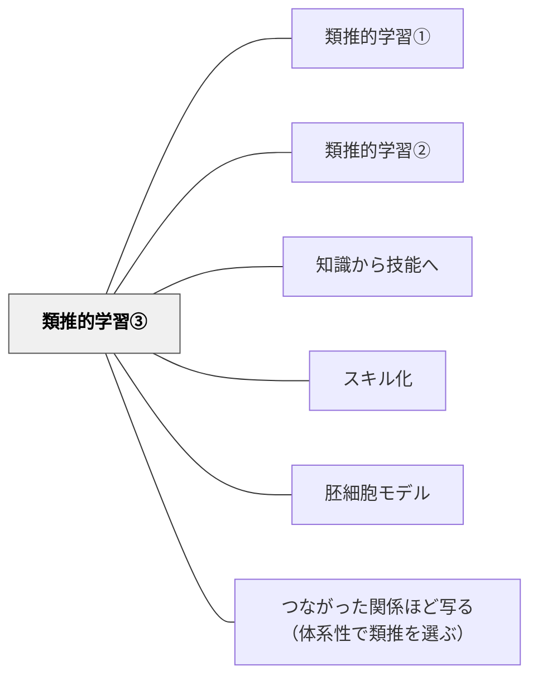

# 類推的学習③

**このパタンが完成を助ける大きなパタン**：[[パタン/類推的学習①|類推的学習]]

> 文章の「型（構造）」を比較・観察し、その型を自分の作文に応用する——牧口常三郎の文型応用主義が体現する類推的学習。

---

## [Pattern Connection]

### Nappo & Valente（2026）——牧口の文型応用主義をGentner SMTで読み解く

類推的学習③は既に「ゲントナーの構造写像理論（SMT）」を力のかたちで参照している。Nappo & Valente（2026）を通じて、牧口の4段階とGentnerの4学習モードの対応をより精緻化する：

| 牧口の4段階 | Gentner学習モード | 認知的操作 |
|---|---|---|
| ①共読（メンターテキストを読む） | 源領域の特定 | ターゲット（自分の文章）に対するソース（文型）を認識する |
| ②分析（型を観察・分析する） | **Abstraction（抽象化）** | 「この文章の高次の関係構造（序論・本論・結論）は何か？」 |
| ③共作（クラスで共同制作） | **Re-representation（再表現）** | 「別のテーマで同じ型を使うとどうなるか」を実演する |
| ④個人制作 | **Inference projection（推論投影）** | 「この型を自分の内容に適用すると？」 |

**Contrast（対比）**は全段階を通じて機能する——特に②分析で「この文章とあの文章の構造はどこが同じでどこが違うか」を問うとき。

SMTの核心は「属性の類似（内容が似ている）ではなく関係の等値写像（構造が同型）を写像する」こと——まさに文型応用主義の「内容は関係ない、型だけを借りる」という発想と同型だ。牧口がヘルバルト教授学の「観念類化作用」を教育実践に翻訳した発想を、Gentnerが100年後に認知科学理論として精緻化したとも言える。

**補強された点**：力のかたちで参照されていたゲントナーSMTが、4学習モードとして牧口の4段階に明示的に対応付けられる。

**他のパタンへの波及**：[[パタン/類推（アナロジー）]]・[[パタン/比較（問い）]]（Contrast）・[[パタン/変換（問い）]]（Re-representation）

→ [[文献/Analogical Reasoning in Science（Nappo & Valente）]]

---

## 背景（Context）

作文指導において、子どもが「何を書くか」は浮かぶが「どのように書くか」がわからない状態が続く。また教師の技能に依存する指導では、教師が変わると質が落ちてしまう。ペスタロッチは「教授法を行う個人の技能がすぐれているためというより、その方法の様式の本性そのもののために成果が挙がるような方法」を求めていた。

## 問題（Problem）

文章の型（構造）を教えようとすると、教師が「こう書きなさい」と指定し、学習者が受動的に従う形になりやすい。しかし型を強制されると、創造性が失われ、内容も形骸化する。

## 力のかたち（Forces）

- 型（構造）は学習を経済的にする——無駄な試行錯誤を省く
- しかし型を受け取るのではなく「発見する」過程が主体性を生む
- 文章の構造的類似（序論・本論・結論、段落の組み立て）は高次の関係——属性（内容）より構造が写像される（ゲントナーの構造写像理論）
- 「観念を先にし表出を後にすべし」（ペスタロッチ）——型の理解が先、制作が後

## 解決（Solution）

**牧口の文型応用主義**（4段階）：

1. **共読**：教師がメンターテキスト（模範文）を示し、全員で読む
2. **分析**：文章の型（序論・本論・結論、段落構造、接続詞の使い方）を観察・分析する
3. **共作**：全体で一つの文章を共同作成する（足場）
4. **個人制作**：型を手がかりに、自分の内容で書く

**近いパタンとの見分け**：比較の表では、本パタンの見分けの問いは「文章の型を観察して比べ、その型を自分の作文に応用しているか（牧口の文型応用主義）」。全体の表は [[パタン/比較で概念をつくる（事例ペアの設計）#近いパタンとの見分け|比較で概念をつくる（事例ペアの設計）]] にある。

**構造写像理論との接続**（ゲントナー）：
- 「文型」とは文章の高次の関係（論理構造）のシステム
- 属性（何について書いているか）は写像しない——型（どのように組み立てているか）を写像する
- これが「文型応用」の認知科学的説明

**推理式指導算術**（戸田城聖、1930年）との接続：
- 牧口の文型応用主義を算数に適用した実践
- 算数の文章問題の「型」（問いの構造・解き方のパターン）を類推的に学ぶ
- 教科書教材を修正し、自然に類推を働かせる問題配列にデザインする

**牧口の「観念類化作用」**（1896年、最初の公刊論文）：
- 既知の観念をもとに未知の観念を理解する
- ヘルバルト教授学の「観念類化」を教育実践に適用
- 「已知より未知に進め」（ペスタロッチ）と同型の原理

### 岩井の原稿から（類推的学習③）

−文型応用主義と推理式指導算術−

　　　　　　　　　　　　　　　　　　　　　岩井輝久

キーワード　類推　アナロジー　同型　

（原稿では、ここにペスタロッチー「ゲルトルートはいかにしてその子を教うるか」（『ペスタロッチー全集第八巻』平凡社）からの引用が入っている。長い引用は wiki には載せない。）

※ペスタロッチーが「ゲルトルートはいかにしてその子を教うるか」で紹介した、シュタンツでペスタロッチーの子どもたちを見て感激したフィッシャーの言葉です。

　類推的学習の事例として、ナンシー・アトウェルのジャンル学習、パロディ作文（書き換え）の教育実践について書いてきました。今回は、類推とは何か認知科学でどのように捉えられているか概説し、それと関連づけて、牧口常三郎の教育理論（文型応用主義）を実践した戸田城聖の『推理式指導算術』を参考に算数の教科書教材を修正した実践について報告します。どれも自然に類推を子どもたちが働かせることができるようにデザインされたものです。

※『推理式指導算術』は、昭和5年（１９３０年）に出版されて、ベストセラーとなった中学受験向けの算数の参考書です。今読んでも、多くの人を学問に誘った独創的な参考書だと思います。

目次

類推（アナロジー）

　　　　・類推（アナロジー）とは何か

　　　　　・構造写像理論

　　　　　・多重制約理論

　　　　　　同型

　　　　　・学習における類推

文型応用主義と推理式指導算術

　　　　・新教育学建設のスローガン

　　　　　　ペスタロッチ主義の影響

　　　　　・観念類化作用

　　　　　・文型応用主義

　　　　　・推理式指導算術

#### 類推（アナロジー）

　類推的学習とは、Analogical Learningを筆者が日本語に直訳したものです。類推（アナロジー）には、いくつかの定義がありますが、類似点そのもの、複数の対象を比較し類似点を見出すこと、また類似点や知っていることをもとにして未知の事柄の解決をしたり推論をしたりすることを意味します。この類推的思考（アナロジー）を用いた学習を類推的学習（Analogical Learning）と言います。

　まず認知科学では、どのようにアナロジーを捉えているかを紹介します。実践から読みたい方は、飛ばしてお読みください。

#### 類推（アナロジー）とは何か？

　牧口常三郎やナンシー・アトウェルの授業に共通する重要な要素として類推（アナロジー）があると考えます。

※アトウェルの授業については、Nancie Atwell（２０１４）、ナンシー・アトウェル（２０１８）、岩井輝久（２０１８）を参照。

　類推のことをアナロジーとも言いますが、類推（アナロジー）とは、どのようなことを意味するのでしょうか。まず、辞書や認知科学の論文などから、類推（アナロジー）には、どのような定義があるのか確認しました。

（原稿では、ここに『大辞林』の「類推」の項からの引用が入っている。長い引用は wiki には載せない。）

（原稿では、ここに『新英和中辞典』の「analogy」の項からの引用が入っている。長い引用は wiki には載せない。）

analogy

a comparison between two situation, processes etc that seem similar , or the process of making this comparison(ロングマン現代英英辞典、１９９９)

analogy

if you make or draw an analogy between two things. You show that they are similar in some way．（Collins COUBUID ADVANCES）

認知科学者鈴木宏昭の定義

類推とは知りたいこと、あるいはよく知らないことをよく知っていることにたとえて考えることを指す。別の言い方をすれば、知っている事柄をよく知らない事柄に当てはめて推論を行なうのが類推である。（鈴木宏昭、１９９６）

類推は類似した過去の経験＝ベースをもとにして、現在の問題＝ターゲットを理解、説明、解決する推論の形式を指す。（鈴木宏昭、２００１）

類推は「類似を用いた知識の拡張」ということができる。（鈴木宏昭、２００１）

認知科学者ホリオークらの定義

アナロジー（類推）とは、ある状況を別の状況に置き換えて理解すること(Holyoak and Thagard, 1995)

認知科学者ゲントナーの類推（アナロジー）の定義

Analogical thinking is the ability to identify similar features and relationships between those features across cases or example(Gentner,2003)

Analogy is a kind of similarity in which the same system of relation holds in two different examples.（Gentner, 2010）

　いくつか定義を比べてみると、大きく二つの意味があることが分かります。ゲントナーの類推（アナロジー）の定義は類似点そのものや類推的思考が類似点を見出すことを指しているのに対して、日本の認知科学者が定義する類推は、類似点や知っていることをもとにして、未知の事柄の解決をしたり推論したりすることを意味しているようです。

　国語辞典や英英辞典、英和辞典で類推（analogy）という言葉を調べると、国語辞典では日本の認知科学者鈴木宏昭の定義のように、主に類似点から推理することを意味し、英英辞典や英和辞典だと類似点を見出すことを意味していることが多いようです。数学や生物学での意味もあります。

　また、昨今の認知科学の研究によると、類推は「類似を用いた知識の拡張」ということができるそうです。この「類似を用いた知識の拡張」という定義は、ヘルバルトの類化作用と重なるように思います。ヘルバルトの類化作用についても後で説明します。

#### 構造写像理論

　鈴木（１９９６）などをもとに、認知科学などで使われる基本的な用語の意味を確認し、類推の理論について紹介します。

　認知科学の類推研究を、その初期からリードしてきたのは、デドリ・ゲントナーとそのグループです。認知科学の類推の分野をリードしてきたゲントナーたちは、構造写像理論（structure mapping theory）を提案しました。今では、構造写像理論を拡張した構造整列仮説や、生成的類推など、この分野の研究は発展し続けているようですが、基本と言える構造写像理論から紹介します。普段はあまり使わない言葉が出てきますので、まずは類推の研究で使われる用語について確認します。

【ターゲットドメイン（target domain）】

　知りたいこと、あるいはまだ知らないことは、ターゲットドメイン、あるいは単にターゲットと呼びます。

【ベースドメイン（base domain）】

　すでによく知っていることはベースドメイン、あるいは単にベースと呼びます。いくつかこの分野の論文を読んでいると、同じことを指してソースということもあるようです。

【写像(mapping)】

　写像とは、検索されたベースの中のどの要素が現在の問題（ターゲット）のどの要素と関係（対応）しているか決定するプロセスです。ベースドメインの要素をターゲットドメインに写像（mapping）するという言い方をします。

　認知科学では、一般的に世界や知識を記述する時に、対象（物）（object）、属性（attribute）、関係(relation)を区別します。

【対象】

　対象とは世の中、あるいは知識の中に存在する事物に該当する。たとえば、猫、いちご、イギリス、社会などは対象です。対象はいわゆる物であってもよいし、抽象的な観念であってもよいです。

【属性・値】

　属性とは対象の性質であり、典型的には形、色、重さ、大きさなどのことです。この属性は種や個体ごとに特定の値（value）を持っています。たとえば、いちごは色という属性について、赤という値を持っているという言い方をします。

【関係・項・引数】

　関係とは、対象同士を結びつける役割を持っています。たとえば、「猫がいちごを踏んだ」という文においては、猫という対象といちごという対象が「踏む」という関係によって結ばれていると考えます。この時、関係によって結びつけられる対象を関係の項あるいは引数(argument)といいます。

【次数】

　物事の複雑さなどの段階を、ある観点から表すように定めたもの。普通は自然数で表します。

【外延】

　ある概念に対応する事物ないしその集合。例えば「動物」の外延は人間・犬・猿など。

【内包】

　ある概念において、その適用される事物（外延）が共通に有する性質。概念に含まれる意味・内容。例えば、「人間」の内包は人間を特徴づけるさまざまな性質。さらに「日本人」の内包は、これに「日本国籍をもつ」などが加わる。（大辞林）

【構造】

　構造とは、ゲントナーによれば関係のシステムのことです。しかし、もっとシンプルに構造とは関係であると言い換えても自分はよいと考えています。ゲントナーのシステムを関係という言葉に言い換えると構造とは関係の関係のことだということになりますが、例えば関係の関係でなくても、私はゴーヤを食べる。僕はケーキを食べる、この二つの文は食べるという述語が主語と目的語をとるという、つまり同じ関係があり、同じ構造、関係の文だということができます。ただゲントナーは、より高次の関係、システムを構造と呼びたいようです。

　ゲントナーが提案した構造写像理論は、写像の過程で生じる膨大な無意味な仮説を排除するために、構造という概念を持ち出しました。写像の過程で、ベースとターゲットに関して似ているものが無数に出てくるわけです。そのベースとターゲットの類似の中でも何が重要で優先されるのか基準となるものが構造的な一致です。

　私は、このゲントナーの持ち出した構造という言葉の理解が難しいと思ったのですが、構造は仕組みという言葉の意味にも近いと思います（だからゲントナーはシステムという言葉を使っているのだと思うのですが）。関係の仕組み。対象同士を結びつける働きがある関係をさらに関係づけるもの。例えば文と文を関係づける働きをする仕組み、システムのこと。牧口常三郎の文型応用主義の型。文章と文章を比較観察した時に類似する序論・本論・結論などの組み立て、段落、接続詞などの文章の仕組み。今回、もっともお伝えしたい推理式指導算術は、この文型応用主義の考え方を算数で実践したものだと考えています。文型応用主義についても後で説明します。

　類推における、構造という概念は算数の事例が最もわかりやすいと思います。例えば、１０＋５＝１５と２０＋３＝２３は、１０や１５などの材料の違いはあっても、構造的に一致しています。この二つの式を比べるときに、どちらも数字があるとか、足される数は何十の数だとか、足される数は二桁であるとか、足す数は一桁だとか、色々な類似を人は、見出すことができるわけです。今、そのディスプレイで見ている式はどちらも金星から同じくらいには離れている、そのような無意味な類似を無数に見出すこともできます。そういう低次の見た目の一致や無意味な一致ではなくより高次の構造的（関係的）な一致が類推では、優先されるとゲントナーの類推の理論では考えられています。

#### 類推のプロセス

　類推のプロセスは、ターゲット表象の生成、ベースの検索、写像、正当化/適合、学習のサブプロセスからなるとされています。

　ターゲット表象の生成とは、類推のもっとも最初に存在するプロセスであり、ターゲット問題を理解するプロセスです。例えば、算数の文章問題で問題文を読み取るプロセスです。

　ベースの検索とは、関連するベースを長期記憶から検索するプロセスです。同じく算数の文章問題で言えば、その文章問題の場面と似たようなことがなかったかを思い出すプロセスです。

　写像は、ベースとターゲットの要素を対応づけるプロセスです。例えば、過去の経験から類似の方法で新しい問題を解決したら、これは過去の経験の重要な部分を現在の問題解決において利用したということで、写像が行われたということです。

　例えば、「私の飼っている犬は茶色だ。」という文がベースで、「チョコレートは茶色だ。」という文の理解をターゲットとする。この事例だと、私の飼っている犬←→チョコレート、茶色だ←→茶色だと対応づけて、AはBだという構造的な一致を捉え、写像が行われてたということができます。

　正当化は、写像のあとに後にくるプロセスです。写像の結果が妥当なものであるかどうか判断するプロセスです。例えば、複数の写像が可能な場合も多いです。こうした時に、その中のどれがもっとも適当か判断します。

　類推を行った結果、何らかの新たな認識が生まれ、それが長期記憶に知識として保存される。これが学習のプロセスです。

 構造写像理論を理解するために、関係についてもう少し詳しくみていく必要があります。関係には様々な種類が考えられますが、次のような区別が重要です。それは関係がとる項の数です。例えば、「買う」という関係は少なくとも、「誰が」と「何を」という２つの項をとると考えられます。一方、「話す」「与える」などは「誰が」、「何を」、「誰に」など少なくとも３つの項をとります。一般に関係は対象を引数とします。こうした関係は一次（first-order）の関係と呼ばれます。このように、関係は対象を項とする場合もありますが、他の関係自体を項とする場合もあります。こうした関係は高次（high-order）の関係と呼ばれ、「引き起こす（cause）」や「意味する(imply)」などはその例です。高次の関係は、因果関係など、その領域において重要な情報を表したものであることが多いです。

　たとえば「次郎が悪口を言ったので、花子が部屋を出て行った。」という記述を考えてみます。まず「次郎が悪口を言う」ということは、「言う」という一次の関係で表現される原因です。「花子が部屋を出て行く」ということは「出て行く」という一次の関係で表される結果です。そしてこれらの原因と結果は、「引き起こす」という高次の関係によって結びつけられて、全体として「次郎が悪口を言ったので、花子が部屋を出て行った。」ということを表しています。

　構造写像理論によれば、妥当な類推写像は以下の３つの基準を満たすものです。

属性の非写像：対象の属性は写像されません。

構造的一貫性：　構造的に整合しているものが一対一に写像されます。ベース中の対象は、ターゲット中の対象に一対一対応します。また、関係は項の数が等しいもの同士が一対一に対応づけられます。また対応づけられた関係が束縛する対象同士も必ず対応づけられます（parallel connectivity）。

システム性原理：高次の関係が優先的に写像されます。また一次の関係の中でも高次の関係の引数であるものが写像されます（systematicity principle）。

難しいところですので、少し長いですが、鈴木宏昭『類似と思考』p５５から事例の説明を引用します。

（原稿では、ここに鈴木宏昭（1996）『類似と思考』p.55からの引用が入っている。長い引用は wiki には載せない。）

　構造における類似は牧口常三郎が「文型応用主義」で着目しているところでもあります。文章と文章における構造の類似、あるいは一致について考える時にも構造写像理論は参考になります。構造の類似が見出せるように教育をデザインすることが大切だと考えます。

#### 多重制約理論

　ゲントナーらは、写像がベースとターゲットの表象の構造だけによって行われていると主張していました。しかし、キース・ホリオークらによって、類推には、構造以外の他の要因、対象レベルの類似やプラグマティックな要因も関与していることが実験的に明らかになっています。

　たとえば、対象の構造は単一ではなく、同じものであっても、類推を行う目的に応じて異なった構造が現れます。

　また人間は未知のターゲットを理解するために類推を行うので、ターゲットの構造はほとんど分からない場合もあります。このような場合は、人間は属性や見かけの一致などに基づく類似性をたよって、類推を行います。これらのレベルの類似性は類推の妥当性を保証するものではないですが、現実ではよく似た２つのものが同じ構造を持つことも多いです。

　こうしたことから構造に加えて、プラグマティックな類似性や属性レベルの類似性を制約として組み込んだ多重制約理論がホリオークらによって提案されました。多重制約理論によって、実際の人間の類推により近いモデルが生み出されたと考えることができます。

　ただし、構造以外の他の要因も類推には関与していますが、構造的な一致が類推おいてもっとも重要であると、多くの実験的な結果から考えられています。写像をする際には、同程度に重要な事柄があるとすれば、より大きな構造に含まれるものを選択的に取り上げるはたらきが、わたしたちの類推のメカニズムに含まれているとゲントナーらによって実験証明されているようです。これがシステム性原理というものです。

#### 同型

　同型という概念について、ホリオークら（１９９８）をもとに説明し直してお伝えします。書いている中で、類推（アナロジー）の研究と推理式指導算術を貫くキーワードに同型という言葉があることに気づきました。同型を説明する前の段階が長いですがお付き合いください。

（原稿では、ここにホリオーク、サガード（1998）『アナロジーの力』（鈴木宏昭・河原哲雄監訳、新曜社）に拠った「同型」の説明が入っている。訳書の表現に近いので wiki には載せない。）

　実は、このような思考法や能力を身につけることができるようになっているのが、これから説明する文型応用主義であり、推理式指導算術です。この認知科学で言及されている同型を念頭において、この後を読んでみてください。

#### 学習における類推（アナロジー）

　類推（アナロジー）は、学習においても、思考においても、核となる重要なものであると考えられています。わたしたちは意識的にも無意識的にも類推をしています。プロ野球選手であるイチローがなぜヒットを打てたのか説明できることが大切だと言っていました。類推による学習は、意識していなくても無意識的にできている時があります。学校の教科書が類推を促すように構成されていることがあります。しかし、そのことを言語化して説明することで、より計画的に類推を教育に組み入れてデザインしていくことができます。そのことによって、わたしは教育の場面での打率を上げることができるでしょう。またより少ないコストで、高い学習効果を期待することができるのではないかと考えています。

　近年の認知科学におけるメタ分析論文によると、過去２０年間に渡って、多くの比較による学習の調査がありました。５７の実験で行われた３３６のテストが明らかにするところによれば、類推的（アナロジー）ではないケース、また一つのケースと比べて、比較する類推的学習活動があるケースは、学習者を共通してよりよい学習の結果に導きました(Alfieri, Nokes-Malach, & Schunn, 2013)。

　ゲントナーたちも、比較による類推が、学習を促進させるということを実験証明しました（Gentner, 2015）。

　その実験は、類推的トレーニングが、建築技術の原理である筋交いを、子どもたちが理解することを助けるのかテストするというものです。筋交いとは、柱と柱の間に斜めに入れて建築物や足場の構造を補強する部材のことです。比較による短い類推のトレーニングは、子どもたちが建築技術である筋交いの原理を理解することに、影響を及ぼすのでしょうか。

　三つの状況をテストします。比較による短い類推のトレーニングを受けるHA(high alignment)とLA(low alignment)の状況、そしてトレーニングのないNT（no training）の状況です。この実験の学習では、三つの状況にある子どもたちとその家族が、１２分間から１５分間で、一緒に建築物の模型（a model skyscraper）をできるだけ高く構築します。

　HAとLAの状況は、二つの建物のモデルが与えられます。一方は、筋交いが入っていて建物は安定しています、もう一方は、筋交いがなく建物は安定していません。HAの状況は、幅や高さなどがまったく同じ二つの建物が与えられます。違いは、一方は筋交いが二つ入っていますが、もう一方は、筋交いの代わりに二つ水平の横材が入っています。LAの状況は、いくかの点で異なる二つの建物が与えられます。梁の幅が違い、いくつかの横材が突き出ています。ここでもまた一方は筋交いがあり、もう一方には筋交いがありません。しかし比較対象の対応関係を探すことが難しく、筋交いと水平の横材とのコントラストに気づきにくくなっています。

　HAとLAのトレーニングについてです。トレーナーは、子どもたちに与えた二つの建物のモデルを比べて、どちらの建物が安定しているか予想するように求めます。この予想をテストするために、二つの建物を動かします。筋交いがない建物は簡単に崩れ、筋交いのある建物は形をそのままに保てることが明らかになります。どちらの建物が強いかと質問をすると、９４％の子どもたちが正答しました。

　建物を組み立てる活動には、６歳から８歳の子たち、HAの子が３０人、LAの子が３１人、NTの子が３０人参加しました。９１人中５６人が建物の内部に構造材を置くことができました。自発的に筋交いを置くことができたのは、その中でも２２人でした。そのうちHAの子が８人、LAの子が１２人、NTの子が２人でした。HAとLAに大きな違いはありませんでしたが、HAとLAのトレーニングありの子たちは、NTのトレーニングがない子たちと比べて、筋交いを入れる傾向が強く見られました。その実験結果は、短時間のたった一つの類推的な比較が深い理解を与えることを示していました。

 この実験にはもう一つテストがあって、三つの状況の子どもたちに、建物がぐらぐらしているから、安定するように修理をしてくれと依頼するというものでした。筋交いを置くことができるかをテストするものです。子どもたちは、構造材を水平に入れるのか、垂直に入れるのか、筋交いを入れることができるのか。

　この修理するテストでは、HAの状況の子たちが、LAとNTの状況の子たちよりも、筋交いを入れることに成功する傾向にあると結果が出ました。また建物のモデルをできるだけ高く構築するという活動で、両親が筋交いという概念に関連する言葉を少なくとも一回でも使っていた場合、建物を修理するという活動で、三つのどの状況の子どもたちも、その言葉を両親が使っていない場合よりも成功する傾向にありました。

　この二つのテストから明らかになることがあります。たった一つの類推的な比較をする経験が、子どもたちが建築の原理を理解することを助けることです。また筋交いなどの言葉、概念は大事だということです。建物を構築する際に、両親が筋交いに関する言葉を使っていた場合、子どもたちが建物を修理することをよりよくできる傾向にあったからです。

　この言葉が大事ということに関しては、ウィギンズらの『理解をもたらすカリキュラム設計』にあるキーコンセプト（鍵概念）や「概念は体系の中でのみ自覚性と随意性を獲得できる。」（『思考と言語』）というヴィゴツキーの考えに接続して考えると理解が深まります。

　これは建築学の分野の事例ですが、ほかの分野でも同じように類推的な比較をする経験が、学習を促進させるであろうと考えることができます。

#### 文型応用主義と推理式指導算術

　文型応用主義は、牧口常三郎の教育理論です。それを応用したものとして戸田城聖の推理式指導算術を私は理解しています。またそれらは、現代科学（認知科学）で言う、類推的学習に位置付けられえるとして、学んだことを教育現場で私は活かしています。牧口常三郎と牧口の文型応用主義について概説した後に戸田城聖の推理式指導算術の考え方で教科書をどう修正して実践したのかお伝えします。

　わたしの牧口常三郎（１８７１−１９４４）との出会いは、高校生の頃まで遡ります。海外の研究者が牧口常三郎を扱った本がたまたま家にありました。このレポートでは扱いませんが、その本には価値論という牧口の思想を紹介しているところがありました。それを読んだ時に、混沌としていた自分の心の中に光が差し込んでくるような、明るい部屋に入ったような気もちになったことを思い出します。

　牧口常三郎といえば、『創価教育学体系』全４巻があります。同書で牧口常三郎は、大胆な教育改革案を多数提示しています。小学校長登用試験制度、国立教育研究所の設置、視学の廃止、半日学校制度、学校自治権の確立——これらの提言のうちいくつかは戦後の日本で実現されました。

牧口常三郎は『創価教育学体系』で教育学理論と制度改革案を書いただけで、具体的な授業などについては、何も残さなかったのでしょうか。じつはそうではありません。牧口はかなりの数の具体的な教授案を残しています。

牧口常三郎には、「綴り方教授の科学的研究」という論考があります。牧口常三郎が１８７１年生まれで、芦田恵之助が１８７３年生まれで、二人とも同時代の教育者です。「綴り方教授の科学的研究」は、大正１０年（１９２１年）に、綴り方の随意選題か課題かをめぐって芦田恵之助と友納友次郎が小倉で講演会を行ったのと同じ年に出された論考です。牧口は、自由作文自体を否定していたわけではありませんが、学習経済の視点から「随意選題」の批判論に加わりました。学習経済の視点について、牧口は、「経験から出発せよ」「価値を目標とせよ」「経済を原理とせよ」と創価教育学のスローガンを表しました。これまでの牧口研究から、この三つのスローガンが、イマヌエル・カントの思想を淵源としているだろうということが分かっています。詳しくは斎藤正二の『牧口常三郎の思想』などをお読みください。

戸田城聖の実践の理解のために、牧口常三郎の全集、斎藤（２０１０）、伊藤（２０００）、伊藤（２０１０）をもとに新教育学説建設のスローガン、ペスタロッチ主義、観念類化作用、文型応用主義、牧口の作文の授業について説明します。ここでは扱いませんが、牧口の作文の授業に大きな影響を与えたものとして、ヘルバルトの多方興味論があります。この点については、斎藤（２０１０）や伊藤（２０１０）をお読みください。また伊藤（２０１０）では、牧口に影響を与えたヘルバルトの教授学の類化や多方興味論などをふまえ、牧口の作文の授業を再現したものを読むことができます。

#### 新教育学説建設のスローガン

まず、類推的学習に直接関連する牧口常三郎の観念類化作用と文型応用主義について説明する前に、前提となる牧口の考え方に触れておきます。

　牧口常三郎は、「創価教育学とは人生の目的たる価値を創造し得る人材を養成する方法の知識体系を意味する。」（第三文明社版『牧口常三郎全集』第五巻、十三項）と創価教育学を定義しました。創価教育学は、実践体系でもなければ信仰体系でもなく、知識体系以外の何者でもないということです。

　このことについて牧口は次のように言い換えています。「教育学は創価指導を対象とした教師の人格価値を創造するを目的としての科学で、心理学や社会学等の研究によりて定立された法則を直ちに応用して価値創造の作用を営む働きと全く異ふ。即ち教師のその創価作用を研究対象としてそれの法則に達し、斯くして定立した法則を以て教育作用の価値を批判し、更に之を次の生活の原則となして、教育者に価値創造の作用を営ましめんが為めにする知識の系統である。」（『創価教育学体系・第二巻—第三篇　価値論—』第七章　評価法及創価法/第二節　創価法原理。全集第五巻　４０５項）。つまり教師が自力で価値創造するよう指導するための科学（＝知識の系統）であると言うのです。

　牧口は、「価値哲学は最近欧米の哲学界に最も重要視される思潮であるが故に、教育学に於ても此の点から考察し、この価値原理から更に構成し直さなければならぬことを、吾々は痛切に考へるのである。因って余は世の教育学者に、否、全教育家に向つて、新教育学説のスローガンを提唱したい」（全集第五巻、２７項）と述べ、そして次に有名な一節が来ます。

＞＞

　経験より出発せよ。

　価値を目標とせよ。

　経済を原理とせよ。

学習力に於て、教授力に於て、時間に於て、費用に於て、言語に於て、音声に於て、常に経済原理を旨とし、文化価値を目標として進め。

　天上を仰いで歩むよりは、地上を踏み占めて、一歩一歩進め。（同２７項）

＜＜

　この新教育学建設のスローガンである「経験より出発せよ」「価値を目標とせよ」「経済を原理とせよ」について、それぞれ「経験から出発せよ」はヘルバルト、「価値を目標とせよ」は新カント派、「経済を原理せよ」は左右田喜一郎をきっかけにして生まれたものです。これらのいずれもが、カント哲学に源を発しています。ここで特に指摘しておきたいところは、教育から無駄な時間・費用・労力等を排する「学習の経済」を提唱している点です。この経緯について詳しく知りたい方には、『創価教育学体系』研究序説―「新教育学建設のスローガン」について―（斎藤、２０１０）、同論文を含めて、多数の論考が収録されている斎藤正二著『牧口常三郎の思想』がおすすめです。

　創価教育学については、自分自身も、年月を重ねるごとに、認識が新たになっています。参考にと思い、斎藤正二の著作からいくつか引用してから次の説明に移ります。

「『創価教育学を一言に要約すると、どうなる』といった虫のいい質問を受ける機会があります。そういうとき、即座に『頑張ることをやめよ、頑張らずに頭を使うよう努めよ、というふうに要約し得ます』と回答することにしています。すると、相手の質問者は、露骨に惘れ顔をしてみせ、わたくしの前から立ち去って行くのを常とします」（『牧口常三郎の思想』、４８項）

（原稿では、ここに斎藤正二（2010）『牧口常三郎の思想』p.70からの引用が入っている。長い引用は wiki には載せない。）

#### ペスタロッチ主義の影響

　白井毅という人がいました。ペスタロッチ主義の権威として知られた教育学者です。白井が北海道師範学校に赴任したのは1893年3月です。白井は、1883年にペスタロッチ主義の指導書 『改正教授術』の共著者(もうひとりの著者は若林虎三郎)として広く知られていました。『改正教授術』は当時師範学校で、教科書のひとつになっていました。だから、牧口はこの本を読んでいたと考えられています。

　『改正教授術』巻一の「教授ノ主義」という項目では、ペスタロッチ主義が９か条の格言に要約されています。

（原稿では、ここに白井毅・若林虎三郎（1883）『改正教授術』巻一「教授ノ主義」の九か条からの引用が入っている。長い引用は wiki には載せない。）

　牧口の思想や作文教育の教授案に影響を与えたと考えることができる格言ばかりです。特に『改正教授術の「七、観念ヲ先ニシ表出ヲ後ニスベシ（表現よりも理解が先だよということです）」、「八、已知ヨリ未知二進メ」は、このレポートの主題である類推（アナロジー）、また牧口の思想や実践と重なるところです。

#### 観念類化作用

　１８９６年の「観念類化作用」は、牧口が２５歳のときに書いた最初の公刊論文です。「観念類化」というのは、ヘルバルト教授学の用語で、観念を類化（＝同化）する、つまり既知の観念をもとに未知の観念を理解することを指します。同論文で牧口は次のように述べます。

「吾人の観念は、自余の観念群と関係し同化せられて始めて把住せられ、永久の心意の所有 となるものなり。然らば即ち、類化作用は吾人の心意を成熟せしむるの最要なる精神的働作なりと謂ふべく、従て之を遂げしむるは、教育作業中の最も緊要なるものと断言するを得べし」（『牧口常三郎全集　第７巻』、１４７項）

　同論文で、牧口は、猫という観念を獲得するプロセスを例示して、類化作用について説明しています。白か斑点の猫しか見たことがない子どもにとって、猫とは白色か斑点のものでしかないです。そこへ黒猫を連れてきて、その子に見せると、その子は類似の旧観念を再現します。黒猫の四肢、顔、鳴き声が旧観念と融合し、色のみが衝突します。しかし旧観念との共通項が多いため、「これは猫だ。」という観念が形成されます。それゆえ、その子のなかでは、猫は色に関わらずと、猫という観念の内容、すなわち内包が減少し、猫の範囲、すなわち外延は増加します。これが類化です。

　この例は、『類似から見た心』に収録されている認知科学の分野の「概念発達と言語発達における類似性の役割」（今井、２００１）という論文で、子どもたちが概念を獲得していく過程を明らかにようと試みた実験と類似しています。この実験で、子どもたちが、既知の観念を修正し新しい観念を獲得してく過程は、まさに「類化」と言えるでしょう。

　牧口は、この説明を裏付けるためにリンドネルの「類化作用とは、軟弱なる新観念を、勢力及内部組織に於て之より勝れたる、即ち強大なる旧観念によりて、変化するの作用なりと。尚其必要を述べて、類化作用は思想を緊縮する一種の作用にして、因て以て吾人の意識の有機的形成を遂ぐるものなり。能類化観念は記憶の最良支柱なり。若し此作用なくは、吾人外囲の事実は、飄然として吾人の心中を通過するのみならんと」（同、１４７項）という文章を含めて、１頁近い引用をして、この節を終えます。

　牧口が「類化」に注目したのは、この理論が、子どもたちの学習への「興味」を引き出すうえで有効だと判断したからです。１８９７年１月から１８９８年９月まで連載された論文「単級教授の研究」では、こう述べています。

「興味は巧みに類化作用を誘導するより生ず。類化作用は児童各自の自動によりて行はる。此点より見るときは、よく生徒をして自動し奮励するを得せしむれば、夫れ丈教師の教授は不要に属す。蓋ぞ殊更 に華美の外観的教授を要せんや。児童をして自ら教授に奮進せしめんとせば、即類化作用を軽快ならしめんとせば、旧観念と新観念の連絡点を明瞭たらしめざるべからず」（同、２１０項）

　牧口は、既知の観念と未知の観念とのつながりを明確にすれば、子どもたちは新しい観念を難なく吸収し（＝類化）、学習に興味をもつようになる。興味さえあれば子どもたちは自発的に学ぶので、その分教師の作業は軽減されると言います。同論文の次の言葉は、こうした牧口の教育論を要約しています。

「教授の目的は興味にあり、智識其物を授くるよりは、これより生ずる愉快と奨励にあり」（同、１７０項）

#### 文型応用主義

　１９２１年（大正１０年）、「綴り方教授の科学的研究」は、牧口の持論である「文型応用主義」の見地から、芦田恵之助らの「自由選題主義」に論争を挑んだ論文です。牧口の「文型応用主義」とは、次のように要約されています。

（原稿では、ここに牧口常三郎（1921）「綴り方教授の科学的研究」（『牧口常三郎全集　第７巻』p.399）からの引用が入っている。長い引用は wiki には載せない。）

　この要約の直前に牧口の詳しい説明があります。

（原稿では、ここに牧口常三郎（1921）「綴り方教授の科学的研究」（『牧口常三郎全集　第７巻』p.397）からの引用が入っている。長い引用は wiki には載せない。）

　つまり、「文章の全体を構成する思想の系統的排列並に其の連結手段等」を意味する「文型」を直観させるために、模範原文を提示します。その「文型」を応用した別内容の応用範文を示して原文との比較を通じ、共通点と差異を弁別することで、「文型」の概念を明らかにします。その「文型」を適用して児童と別の内容の文章を共作し、これを通じて児童に作文への自信を与え、自由作文の目標に達するというプロセスをとります。応用範文を提示するという教師からの指導プロセスを設けることに、この「主義」の特色があり、この点で自由作文即無干渉・無指導という「児童中心」の綴り方論と真っ向から対立するものでした。直観—比較—応用というこのプロセスを牧口は「科学的」と名づけ、どんな子どもにも綴り方の面白さとそれへの自信を与える手続きであると主張しました。このような「科学的」指導の重視は、牧口の教授論を通じる基底的な特色でした。牧口はこの案の「価値判定の標準は教育経済」にあるとし、「教育目的の概念中に経済といふ一条項を加へなければならぬ」と論じました。

　では具体的には、どのような授業だったのでしょうか。

牧口常三郎が『創価教育学体系』第４巻（１９３４年）を出版したあとに、母校・北海道師範学校の同窓会から依頼されて書いた「四十五年前教生時代の追懐」という文章があります。

　牧口が教生時代の教案を一文で紹介しています。なんとそれは同級生の補欠として突然回ってきた、牧口の最初の授業です。次のようなものでした。

（原稿では、ここに牧口常三郎「四十五年前教生時代の追懐」（『牧口常三郎全集　第７巻』p.411）からの引用が入っている。長い引用は wiki には載せない。）

はじめの教案を一文にまとめたところを、「牧口常三郎の教授法」（伊藤、２０１０）は、次のように説明しています。

（原稿では、ここに伊藤貴雄（2010）「牧口常三郎の教授法」からの引用が入っている。長い引用は wiki には載せない。）

　以上は「川」を主題とした作文です。その次に「円山」「手稲山」「恵庭岳」というように「山」を主題にして、同様に３段階で指導することで、子どもたちに作文の仕方がいっそう定着することになります。このように、川なら川、山なら山と系統立てて、いわゆるホップ・ステップ・ジャンプの３段階指導を繰り返すことで、牧口は子どもたちに「応用自作」の力を育もうとしたのです。

　ただ最初の授業の教案には「文型応用主義」の四段階の第ニ段階である「応用範文の提出、及び原文と比較読解に依る文型概念の抽出並に応用方面の探究奨励及応用力活動の鼓吹」が欠けています。第ニ段階の比較読解によるところは、ゲントナーの類推の理論やアトウェルのジャンル学習に繰り返し現れるパターンに重なる、とても重要なところだと思います。「文型応用主義」の第ニ段階までの前半部分は、概念の獲得という段階で、観念類化作用を前提としています。またこの部分は、ペスタロッチ主義の「七、観念ヲ先ニシ表出ヲ後ニスベシ」の「観念」の部分に当たります。またそれは、ゲントナーが定義する類推（アナロジー）、類似を見出すところと重なるところです。

　後半の第三段階から第四段階が、「表出」に当たると考えられます。またこの後半の「表出」は、日本の認知科学者鈴木による「類推は類似した過去の経験＝ベースをもとにして、現在の問題＝ターゲットを理解、説明、解決する推論の形式を指す。」（鈴木宏昭、２００１）という定義に重なります。比較読解によって、概念を獲得し、その既知の概念をもとにして、新たな表出をするという一連のプロセスは、鈴木の定義にある類推そのものです。

　牧口が、最初の授業の案をベースとし、その後の長年に渡る思考と実践の積み重ねによって、昇華したものが「文型応用主義」であると言えそうです。

　伊藤の同論文によれば、教案を要約した一文の後に登場する白井毅は、牧口に影響を与えたであろうペスタロッチ主義の指導書『改正教授術』の著者です。また北海道師範学校の主事の岩谷英太郎が、牧口の教授案は子どもたちが作文できないことの原因を巧みに見抜いている、このことは他のどの学科にも当てはまることだとほめたそうです。ここで大事なことは、牧口の教授案を単に作文科の範囲だけではなく、あらゆる学科に普遍的な教授学の次元で評価したことです。だから牧口は「『創価教育』の源泉がここにある」と心の思いを述べ、岩谷に感謝をしています。この「四十五年前教生時代の追懐」の中で牧s口は、この処女作とも言える教案が「拙著『創価教育学』の全篇の思想の中核のようなものである」とまで述べています。

#### 推理式指導算術

　牧口の弟子であり後継者でもある戸田城聖の『推理式指導算術』について学んだことも報告します。『推理式指導算術』は、類化と文型応用主義を算数科へと徹底的に応用したもので、私自身がこのことを学ぶ事で、ゲントナーなどの認知科学における類推の研究とも比較対照して、類化や文型応用主義に対する理解を深めることができました。牧口は、『実験証明』と略される著作で次のように述べています。

（原稿では、ここに牧口常三郎『実験証明』（『牧口常三郎全集』第八巻 p.19）からの引用が入っている。長い引用は wiki には載せない。）

　つまり、国語科教授において「文型応用主義」の思考法を採用することは、そのまま、算数科指導において「数の関係系列の異同を分類する」よう生徒自身に考えさせることに同じだということです。そして、算数科の応用問題の指導は、国語教授における文章型体の指導と同様にならなくてはいけない。また作文指導における読み書きのプロセスは、算数科の応用問題に倣うべきだということです。

　では、牧口の教育理論の後継者である戸田はどのように算数科の指導を考えていたのでしょうか。戸田には『推理式指導算術』という当時ベストセラーとなった参考書があります。鶴見俊輔も戸田の参考書で学んだと読んだことがあります。

　ちょっと長いですがご紹介したいので、鶴見俊輔の著作集から引用します。戸田城外と戸田城聖は同じ人物です。昔は、自分の名前を改名する人が今よりも多かったようです。

（原稿では、ここに鶴見俊輔（1975）「牧口常三郎と戸田城聖」（『鶴見俊輔著作集３』）からの引用が入っている。長い引用は wiki には載せない。）

　ここでいう山下肇さんという人は、岩波書店から出ているゲーテの翻訳で知られている人です。

　４年前くらいに中央大学の図書館まで行って、全部コピーさせてもらったのは、ここに出てくる『推理式指導読方』という国語の参考書です。戸田は、算数の『推理式指導算術』だけではなく、国語においても参考書を作っていたのです。

　『推理式指導読方』も『推理式指導算術』も鶴見俊輔さんの証言の通り意欲を引き出す工夫がある参考書です。「人生経験から勉強に入るように仕組まれていた」という鶴見俊輔さんの言葉が興味深いですが、根本的に文型応用主義という牧口の考え方を算数や国語の参考書に応用したところに、戸田の作った参考書の良さがあるように自分が思いました。多分、このときに戸田が作った参考書は、今の受験参考書や、学校の教科書よりも優れているところがあると思います。教材のもつ力が子供たちの自然の思考の流れに沿っていて、意欲を引き出せるようなものだったら個別化の教育にも役に立てると思います。オンライン授業が試されていますが、推理式の考え方で教材が作れないかと考えています。

　鶴見俊輔さんと直接の関わりは私にないのですが、ゲーテ研究で京都大学の大学院を目指していた先輩が悩んでいたときに、京都の方にあった鶴見俊輔さんのご自宅にアポなしで行ったところ、快く相談に乗ってくれたそうです。鶴見俊輔さんは、突然家に現れた無名の学生を大事にしてくれるような人柄の人だったようです。他にも小熊英二との対談集を大学時代に読んだことを思い出します。

（原稿では、ここに鶴見俊輔（1975）「牧口常三郎と戸田城聖」（『鶴見俊輔著作集３』）からの引用が入っている。長い引用は wiki には載せない。）

　戸田は『推理式指導算術』を発刊した動機について次のように述べてします。

（原稿では、ここに戸田城聖（1930）『推理式指導算術』の発刊の動機を述べた箇所（『戸田城聖全集第九巻』p.7）からの引用が入っている。長い引用は wiki には載せない。）

 「推理力の発達は同等性と差別性をみいだす練習にある」とありますが、同等性と差別性を見出すには、比較する必要があります。『推理式指導算術』の練習問題の〔註〕で、戸田は比較することについて次のように説明しています。

（原稿では、ここに戸田城聖（1930）『推理式指導算術』の練習問題の〔註〕（『戸田城聖全集第九巻』p.58）からの引用が入っている。長い引用は wiki には載せない。）

　ちなみに解式は次のようになります。

の解式：次郎　１１０＋７＝１１７（cm） 太郎１１７＋８＝１２５（cm）

の解式：麦　　　８０＋３＝　８３（銭）　米　 ８３＋１２＝　９５（銭）

　戸田のいう「材料」は、認知科学の用語で言えば「対象」に当たると考えられます。また「関係」という言葉は戸田も認知科学者も同じような意味で使っている言葉だとわかります。例えば、ここでは＋−×÷の符号のことです。「文型」は認知科学の「構造」に当たると考えられます。ここで（イ）と（ロ）を比較し、どの部分がもう一方のどの部分に対応するのか、それぞれの差異点や同等点を対応付けることは、認知科学で言う「写像（mapping）」です。

　（イ）と（ロ）を写像することで同じ文型を見出すことは、文型応用主義の第ニ段階の文型概念の抽出に当たると考えられます。

　駒野（２００６）によれば、雑誌「新教材収録」にある戸田の算術科指導案（１９３７年）には、「子どもたちの間で問題を作らせ、そのなかでも優秀な問題については練習問題として出題する。」という学習プロセスがあったと説明しています。問題作りや類似の問題解決は、文型応用主義の第三段階から第四段階に当たると考えられます。

　牧口によれば、応用問題が論理的に排列されて学習経済が図られるならば、少なくとも学習に対する労力を半減できます。戸田がどのように問題を排列していたのか、桝田（２００６）をもとに、『推理式指導算術』の植木算を例として紹介します。

（原稿では、ここに戸田城聖（1930）『推理式指導算術』の植木算の「基本原型」と「第一変化」〜「第三変化」（『戸田城聖全集第九巻』。桝田（2006）による）からの引用が入っている。長い引用は wiki には載せない。）

　この後に推理練習と称する類題が１０問、中学受験の過去問が三段階のレベルに分けられていて、それぞれ１０問ずつ、計３０問が配置されています。

それでは、推理練習問題もいくつか紹介します。

７００mある道路の片側に３．５mおきに桜を植えようとする。何本必要か。また両側なら何本必要か。〔（イ）基本原型と比較せよ。（ロ）第二変化と比較せよ。〕

→基本原型、第二変化と同じ

＜解＞

片側　７００÷３．５＝２００　２００＋１＝２０１（本）

両側　２０１×２＝４０２（本）

２kmある道路に２５１本の桜を植えるには木と木との間を何mおきにすべきか。（基本原型と逆である。木の数と間の数とを基本にして推理せよ。）

→基本原型の逆

＜解＞

２５１—１＝２５０……間の数

２０００÷２５０＝８（m）

１２０mを隔てて２本の柱がある。その間に２．５mおきに杭を打つとすれば何本いるか。（第一変化と比較せよ。）

→第一変化と同じ

＜解＞

１２０÷２．５＝４８　４８−１＝４７（本）

２４０mを隔てて２本の柱がある。その間にさらに７本の柱を立てようとする。間隔をどうすればよいか。（同上）

→第一変化の逆

＜解＞

７＋１＝８……間の数

２４０÷８＝３０（m）

４００mある道路に２．５mおきに１本７０銭の杭を打つと何円かかるか、また両側なら何円かかるか。〈（イ）基本原型と比較せよ。差異点の１本７０銭で総費用を求めるのだがどう扱うか。（ロ）第二変化の取扱いによる。〉

→基本原型＋α、第ニ変化と同じ

＜解＞

片側　４００÷２．５＝１６０

　　　１６０＋１＝１６１（本）　０．７×１６１＝１１２．７（円）

両側　１１２．７×２＝２２５．４（円）

幅２３cmの紙を２０枚つないだらどれだけの長さとなるか、つぎ目は２cmとする。（つぎ目はいくつか）

→基本原型の質的に変化した問題（紙が木に、つぎ目が間隔に対応している）

＜解＞

２０—１＝１９……つぎ目の数　　２×１９＝３８（cm）

２３×２０＝４６０　　４６０—３８＝４２２（cm）

周囲１２０mの円形の運動場に２．４mおきに旗を立てるのに旗が何本あればよいか。（第三変化と比較せよ。）

→第三変化と同じ

＜解＞

１２０÷２．４＝５０（本）

周囲４２０mの円形の馬場に１５０本の旗を立てようとする。間隔をどうすればよいか。（第三変化と比較せよ。）

→第三変化の逆

＜解＞

４２０÷１５０＝２．８（m）

周囲６００mある池の周囲に１０mおきに大杭と打ち大杭と大杭との間に２．５mおきに小杭を打つ。大杭は一本６０銭、小杭は一本１２銭なら総計はいくらかかるか。（第一変化と第三変化の問題でその上に問いの形式が加わったのである。）

→第一変化と第三変化の複合＋α

＜解＞

６００÷１０＝６０（本）……大杭の本数（間の数も同じ）

１０÷２．５＝４　４−１＝３　３×６０＝１８０（本）……小杭の本数

６０×６０＝３６００（銭）……大杭の費用

１２×１８０＝２１６０（銭）……小杭の費用

３６００＋２１６０＝５７６０（銭）

答５７円６０銭

１０．５００人の兵士が４人ずつ一列に並び各列９０cmずつ隔てて行軍するときその長さはいくらか。（この長さは何人か。１列１列との間はいくつあるか。）

→基本原型の逆の質的に変化した問題

＜解＞

５００÷４＝１２５（列）

１２５−１＝１２４……間の数

９０×１２４＝１１１６０（cm）　答　１１１．６m

　このように、前の問題との比較から同等点や差異点を考え、類推することで、少しずつ変化している新しい問題の答えを推理できるように、問題が配置されています。最後には中学受験の過去問が解けるようになります。算数科の応用問題を類推的に解決するように、国語科の読み書きでも、文章と文章を比較し観察することで、文型概念を捉え、同型異内容の作文を類推的に書き、スモールステップで自由な創作文に到達できるというわけです。

　小学校３年生の算数科の教科書に、「□を使って場面を式に表そう」という、最後は問題作りが課題として配置されている算数科の単元があります（新しい算数編集委員会、『新編新しい算数３下』、２０１５）。文型応用主義を活用した推理式指導算術の補足の説明によいと思いましたので、実践事例を紹介します。教科書の問題を基本原型問題として、それを変形した問題を創って授業をしてみました。問題作りの課題以外は、線分図、場面を表す式、□（未知数）を求める式を書けるようにワークシートを作成しました。

□を使って場面を式に表そう

学級文庫に本が３８さつあります。新しい本を何さつか買いました。全部で５０さつになりました。

【線分図】

（ここに場面を表す線分図をかくように指示します）

場面を表す式　３８＋□＝５０

□を求める式　　　　□＝５０—３８

　　　　　　　　　　　＝１２

けんさんは、カードを何まいかもっています。弟に18まいあげました。のこりは２４まいになりました。

【線分図】

場面を表す式　□—１８＝２４

□を求める式　　　 □＝１８＋２４

                     ＝４２

③たろうさんは、シールを何まいかもっています。たろうさんは、花子さんからシールを16まいもらいました。たろうさんは、じろうさんにシールを８まいあげました。のこりが、４０まいになりました。（①②とくらべよう）

【線分図】

場面を表す式　□＋１６—８＝４０

□を求める式　　　　　□＝４０+８—１６　

　　　　　　　　　　　　＝３２

④ほうかごに、校庭で３年１組のお友だちが３３人遊んでいます。3年2組のお友だちが校庭に5人やってきました。3年3組のお友だちも何人かやってきました。16時になると習い事のあるお友だちが7人帰りました。のこったお友だちは41人です。（③とくらべよう）

【線分図】

場面を表す式　３３＋５＋□—７＝４１

□を求める式　　　　　　　 □＝４１＋７—３３—５

　　　　　　　　　　　　　　 ＝１０

学級文庫に本が何さつかあります。新しい本を４０さつ買いました。全部で６０さつになりました。（①とくらべよう）

【線分図】

場面を表す式　□＋４０＝６０

□を求める式　　　　□＝６０—４０

　　　　　　　　　　  ＝２０　　　　　

けんさんは、カードを３８まいもっています。弟に何まいかあげました。のこりは１０まいになりました。(②とくらべよう)

【線分図】

場面を表す式　３８—□＝１０

□を求める式　　　□＝３８—１０

　　　　　　　　　　＝２８

たろうさんは、シールを３４まいもっています。たろうさんは、花子さんからシールを何まいかもらいました。たろうさんは、じろうさんにシールを６まいあげました。のこりが、３１まいになりました。（③とくらべよう）

【線分図】

場面を表す式　３４+□—６＝３１

□を求める式　　　　　□＝３１＋６—３４

　　　　　　　　　　　　＝３

ほうかごに、校庭で３年1組のお友だちが何人か遊んでいます。3年２組のお友だちが校庭に５人やってきました。3年３組のお友だちが６人やってきました。16時になると習い事のあるお友だちが9人帰りました。のこったお友だちは２５人です。(④とくらべよう)

【線分図】

場面を表す式　□＋５+６—９＝２５

□を求める式　　　　　　□＝２５＋９—５—６

　　　　　　　　　　　　　＝２３

⑨同じ数ずつ、8人でつるをおったら、つるは全部で３２羽になりました。

【線分図】

場面を表す式　□×８＝３２

□を求める式　□＝３２÷８

　　　　　　　　＝４

⑩５つずつ、何人かでつるをおったら、つるは全部で30羽になりました。（⑨とくらべよう）

【線分図】

場面を表す式　５×□＝３０

□を求める式　　　□＝３０÷５

　　　　　　　　　　＝６

⑪一つ何円かのうまい棒を7本と一つ20円のよっちゃんいかを買いました。全部で90円になりました。（⑨とくらべよう）

【線分図】

場面を表す式　□×７＋２０＝９０

□を求める式　　　　　　□＝（９０—２０）÷７

　　　　　　　　　　　　　＝１０

⑫下のかけ算の式になる場面のお話をつくりましょう。(⑨⑩とくらべよう)

□×４＝２４

【お話】

（例）同じ数ずつ、４人でクッキーを作りました。全部で２４まいになりました。

（２）４×□＝２４

【お話】

（例）４まいずつ、何人かでクッキーを作りました。全部で２４まいになりました。

⑬下のかけ式になる場面のお話をつくりましょう。（⑪とくらべよう）

□×３＋５０＝１７０　　

【お話】

（例）一つ何円かのあめを３こと一つ５０円のラムネを買いました。全部で１７０円になりました。

　①②⑨⑩⑫が教科書の問題です。その他の問題は、教科書の問題を変形させて作りました。この問題の配置のワークシートを授業で扱ってみて、かなり手応えを感じました。４時間扱いの３時間で、教科書の問題を変形させた複雑な問題を多くの子が解けるようになっていたからです。その地域の学力テストでは、たまたま同じような応用問題が出て、多くの子たちが解けました。

　教科書の基本原型問題は「みんな、できるようになろうね」という扱いで、基本原型問題を変形したものをチャレンジ問題とすればよいのではないかと思いました。個人的には教科書の問題が解けるようになればいいのかなと今は考えています。その上で、チャレンジ問題が子どもたちの成長できるチャンスになればと思います。

　また教科書の問題を基本原型問題として、その問題を変形させれば、それほど問題作りに手間がかからないことが分かりました。同等点を残しつつ、差異を作れば、新しい問題ができます。

　文型応用主義は、算数の事例が分かり易いと思いました。例えば同じ型で違う内容のお話を比べて、□＋３＝５という場面を表す式を抽出します。逆に、□＋３＝５から、その式の文型（構造）に当てはまる違うお話を作ることができます。その文型に当てはまるお話はどれも□＋３＝５という点で同型異内容です。

　国語科の読み書きでも同じように学習することができます。場面を表す式から問題場面（お話）を書くという方向は、文章の組み立て（構造／文型）から作文を書くことに似ています。算数科の応用問題作りでは、同じ式から違う内容の問題場面を表すことができます。同じ式、つまり同じ文型から、同型異内容の問題を作ることができます。これは国語科の作文でも同じです。例えば小学校の３年生の国語科に昔話や民話を紹介するという単元があります。ある教科書には次のような組み立ての手本となるテキストがありました。その教科書の手本となる昔話や民話の紹介文のテキストを分析すると、四段落から構成されていました。①どんな題名の本を読んでいるのか紹介②どんなお話なのか（一文であらすじを紹介）③おもしろかったところ④おわりのまとめという組み立てでした。この手本となるテキストから、この文章の組み立てを読み取って、今まで繰り返し書いてきたブック・レビューを書く課題を子どもたちに出しました（ブック・レビューについては、「パタン 類推的学習① ～ナンシー・アトウェルの実践を重厚にしている、もうひとつの柱について～」『AND ON vol.2』を参照）。子どもたちは学校図書館でそれぞれ自分が選んだ昔話や民話を紹介しました。同じ組み立てですが、それぞれブック・レビューの内容が違います。

　そのテキストの文型を数式のように表すと次のようになると考えました。

①本の題名＋②あらすじ＋③おもしろかったところ＋④おわりのまとめ＝ブック・レビュー

　子どもたちは同型異内容で、「したきりすずめ」や「さるかに合せん」、「ルンペルシュティルツヒェン」など、さまざまな昔話や童話の紹介文を書いていました。算数科では、□+３＝５という同じ文型の式から、「公園で子どもたちが何人か遊んでいました。公園へさらに３人の子どもたちがやってきました。公園で遊んでいる子どもたちは、８人になりました。」、「クッキーが何枚かあります。おばあさんがクッキーを３枚焼いて来てくれました。全部でクッキーは８枚になりました。」など、異なる材料で違う内容のお話作りができます。それと国語科で同じ文型（組み立て）で、違う昔話や童話の紹介文を書けることと同じです。

　推理式指導算術と認知科学の類推の研究を比較対照し、また牧口による文型応用主義の説明に戻ってみると、今までよりもその意味が明瞭になったように思います。牧口は『大系概論』で次のように述べました。

（原稿では、ここに牧口常三郎『創価教育学大系概論』（『牧口常三郎全集』第８巻 pp.190–191）からの引用が入っている。長い引用は wiki には載せない。）

　要するに、文章構成の法則性を科学的に把握すべきであるし、把握可能であるはずだ、というのが牧口の考えの基本でした。この牧口のスタンスはゲントナーによる構造写像理論のシステム性原理に通じるものがあると考えます。

「概念は体系のなかでのみ自覚性と随意性を獲得することができる。自覚性、体系性は、概念に関するかぎり、まったくの同義語である。それは、ちょうど自然発生性・非自覚性・非体系性が、子どもの本性のなかの同一のものを呼ぶ三つの異なる言葉であるのとまったく同じである。」（『思考と言語』ヴィゴツキー、新読書社、２００１年、２６７～２６８項）

（原稿では、ここに柴田義松『ヴィゴツキー入門』（寺子屋新書）の二か所からの引用が入っている。長い引用は wiki には載せない。）

　これまで紹介した類推的学習の実践で重要なことは、子どもたちがテキストを直観（直接観察）し、比較することで、ヴィゴツキーが指摘するような概念体系を構築できることだと考えています。読み書きの授業に限ったことではありませんが、子どもたちは、概念体系をもつことで、自覚的に意識的に知識を運用できるようになります。

　またペスタロッチ主義の「観念ヲ先ニシ表出ヲ後ニスベシ」という考えにも通じると思います。思想の表出よりも理解が先だよということです。

　はじめの読み比べるという段階を丁寧にやると、どの学習でも子どもたちのパフォーマンスが明らかによくなることを実感しています。

#### 【参考文献】

新しい算数編集委員会（２０１５）．『新編新しい算数３下』．東京書籍．

伊藤貴雄（２０００）．J・F・ヘルバルトの類化論と初期牧口思想の形成．『東洋学術研究所紀要』１６．

伊藤貴雄（２００７）．牧口常三郎とジョン・デューイ．『創価教育研究』６．

伊藤貴雄（２０１０）．牧口常三郎の教授法．『創価教育』３．

岩井輝久（２０１８）.パタン 類推的学習① ～ナンシー・アトウェルの実践を重厚にしている、もうひとつの柱について～.『AND ON』２.あんどん出版

駒野晃司（２００６）．戸田城外著『推理式指導算術』研究のための序説

－同時代における算術参考書との比較検討を手がかりに．『創価教育研究』５．

斎藤正二（２０１０）．『創価教育学体系』研究序説―「新教育学建設のスローガン」について―．『創価教育』３．

斎藤正二（２０１０）．『牧口常三郎の思想』.第三文明社．

鈴木宏昭（１９９６）．『類似と思考』．共立出版株式会社．

鈴木宏昭 （２００１）．人間の推論. 人工知能学会誌,16, 858 - 865.

鈴木宏昭 （２００１）．思考のダイナミックな性質の解明に向けて.認知科学,8,212 - 225.

鈴木宏昭・大西仁編著（２００１）．『類似から見た心』．共立出版．

戸田城聖（１９９０）．『戸田城聖全集　第９巻』．聖教新聞社．

ナンシー・アトウェル（２０１８）小坂 敦子 (翻訳), 澤田 英輔 (翻訳), 吉田 新一郎 (翻訳)『イン・ザ・ミドル ナンシー・アトウェルの教室』.三省堂

牧口常三郎（１９８１）．『牧口常三郎全集 第５巻』.第三文明社．

牧口常三郎（１９８２）．『牧口常三郎全集 第7巻』.第三文明社．

牧口常三郎（１９８４）．『牧口常三郎全集 第８巻』.第三文明社．

桝田尚之（２００６）．戸田城外著『推理式指導算術』の研究

－推理式指導の解明を中心にー．『創価教育研究』５．

Alfieri, L., Nokes-Malach, T. J., & Schunn, C. D. (2013). Learning through case comparisons: A meta- analytic review. Educational Psychologist, 48(2), 87-113.

Gentner, D. (1983). Structure-mapping: A theoretical framework for analogy. Cognitive Science, 7(2)．

Gentner, D., Jee, B. D., Uttal, D. H., , Manduca, C., Shipley, T., Sageman, B., Ormand, C. J., & Tikoff, B. (2010). Analogical thinking in geoscience education. Journal of Geoscience Education, 58 (1), 2-13.

Gentner,D, Susan C. Levine, Raedy Ping, Ashley Isaia, Sonica Dhillon, Claire Bradley,Garrett Honkeg.(2015), Rapid Learning in a Children’s Museum via Analogical Comparison．

Holyoak, Keith J. and Paul Thagard(1995), Mental Leaps: Analogy in Creative Thought, Cambridge, MA: MIT Press.(邦訳)『アナロジーの力』． 鈴木宏昭・河原哲雄監訳． 新曜社． 1998 年. 

Nancie Atwell, Reading in the Middle: Workshop Essential, Heinemann, 2010．

Nancie Atwell, In the Middle: A Lifetime of Learning About Writing, Reading, and Adolescents. Heinemann. 2014.

（以上、岩井の原稿「教育のパタン・ランゲージ 集約」の「パタン　類推的学習③」から。）

## 結果（Consequences）

- 足場としての共作段階が、苦手な子の支援になる（「ここまで丁寧にやれると全体での共作が足場となり、実際に子どもたちが一人で書く段階のパフォーマンスは、だいぶ違ってくる」）
- 型を知ることで「どう書くか」の見通しが立ち、「何を書くか」に集中できる
- 教師の個人的技能に頼らず、方法の構造自体から成果が上がる

## 関連パタン
- [[教科/国語]]
- [[実践/ノート指導（読み書きハンドブック・ノート検定）]]

- [[パタン/類推的学習①]] — 比較・アナロジーによる学習（アトウェルのジャンル学習）
- [[パタン/類推的学習②]] — 物語の書き換え（パロディ作文）
- [[パタン/知識から技能へ]] — 型の知識→制作技能の構造
- [[パタン/スキル化]] — 複雑な文章技能をスキルに分解
- [[パタン/胚細胞モデル]] — 型（文型）が活動の背景にある原理
- [[概念/概念型の目標と胚細胞モデル]] — 文型はBig Idea
- [[パタン/つながった関係ほど写る（体系性で類推を選ぶ）]] — 型を写すとは、つながった関係の体系を写すこと
- [[文献/Structure-Mapping（Gentner, 1983）]] — 属性を捨てて関係を写す、という文型応用主義の認知科学的な裏づけの原典
- [[文献/実感の明らかな題で書く、自作と指導と処理で綴り方を組み立てる（芦田恵之助『綴り方教授』）]] — 牧口と論争した芦田恵之助の最初の主著。随意選題はこの時点では年に数回の空欄だった

## クラスター図

## Actionable Insight

- メンターテキスト（模範文）を1つ選んで「この文章の骨格（序論・本論・結論）」をクラスで分析する——型を「発見」するプロセスが学習者の主体性と理解を同時に育てる
- 型の分析後、全体で1つのサンプル文章を共同で作成する——共作の足場が苦手な学習者の参加を保証する
- 個人作文の前に「自分のテーマで型をどう使うか」を一文でメモさせる——型を自分の文章に当てはめる意識的な一手が転移を促す

## 出典
- [[文献/一つの教育のパタン・ランゲージ]]
- [[文献/読み書き教育における類推的学習の研究（第二版）]]
- [[文献/戸田城外著『推理式指導算術』研究のための序説（駒野晃司）]] — 基本原形→変化問題の配列と「同等性と差別性を見出す練習」の歴史的背景（同時代参考書との比較）
- [[文献/戸田城外著『推理式指導算術』の研究　推理式指導の解明を中心に（桝田尚之）]] — 材料・関係・条件・解式・文型の仕組みと「文型が等しい問題は解式が等しい」の解明

岩井輝久「岩井輝久『一つの教育のパタン・ランゲージ』」（2026-04-29 vault収録）
岩井輝久「読み書き教育における類推的学習の研究第二版」2017年（2026-04-30 vault収録）

## 根拠の確かめ（自動生成）

<!-- source-check: 自動生成。手で編集しない。文献ページの frontmatter の source_check から作る -->
このページが引く文献を、本 Wiki が原典でどこまで確かめたかで分けた。くわしくは各文献ページの「書誌・確認した範囲」や「原文との照合」へ。

- **原典照合**（原典にあたって、引用や要約を照らした）：[[文献/Structure-Mapping（Gentner, 1983）|Gentner, 1983]]・[[文献/読み書き教育における類推的学習の研究（第二版）|第二版]]・[[文献/戸田城外著『推理式指導算術』の研究　推理式指導の解明を中心に（桝田尚之）|桝田尚之]]
- **一部照合**（原典の一部の章や頁だけを読んで確かめた）：[[文献/実感の明らかな題で書く、自作と指導と処理で綴り方を組み立てる（芦田恵之助『綴り方教授』）|芦田恵之助『綴り方教授』]]・[[文献/戸田城外著『推理式指導算術』研究のための序説（駒野晃司）|駒野晃司]]
- **記録なし**（何をどこまで読んだかの記録がまだない）：[[文献/Analogical Reasoning in Science（Nappo & Valente）|Nappo & Valente]]
- **その他**（動画の記録や本 Wiki の作者自身の本など）：[[文献/一つの教育のパタン・ランゲージ|一つの教育のパタン・ランゲージ]]
