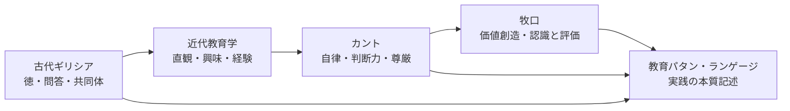

# 教育思想の系譜

教育パタン・ランゲージを、文献の時系列ではなく「問いの継承」として読むための地図。

## 全体像

## 古代ギリシアの教育観

| 文献 | 中心の問い | Wikiでの接続 |
|---|---|---|
| [[文献/ソクラテスの弁明（プラトン）]] | 吟味される生とは何か | [[パタン/無知の知]]、[[パタン/問いをもつ（クエスチョニング）]] |
| [[文献/メノン（プラトン）]] | 徳は教えられるか | [[パタン/アナムネーシス（想起としての学び）]]、[[パタン/アポリアの設計]] |
| [[文献/テアイテトス（プラトン）]] | 知識とは何か | [[パタン/産婆役としての教師]]、[[パタン/タウマゼイン（驚きから始まる探究）]] |
| [[文献/プロタゴラス（プラトン）]] | 徳・計量術・社会教育はどうつながるか | [[パタン/計量術（メトレーティケー）]]、[[パタン/複数の教育源]] |
| [[文献/国家（プラトン）]] | 正義・魂の教育・哲学者の本性とは何か | [[パタン/道徳的自律]]（ギュゲスの指輪）、[[パタン/審美的交渉]]（守護者の前教育）、[[パタン/ミメーシス（模倣による学び）]]（習慣化）、[[概念/魂の三区分]] |
| [[文献/政治学（上）（アリストテレス）]] | 人間はどのような共同体的存在か | [[パタン/ゾーン・ポリティコン（言葉による共同体形成）]]、[[パタン/フィリア（共同体の友愛）]] |

## 近代教育学の形成

| 文献 | 中心の問い | Wikiでの接続 |
|---|---|---|
| [[文献/ゲルトルート児童教育法（ペスタロッチ）]] | 直観・段階・生活からどう教えるか | [[パタン/具体から抽象へ]]、[[パタン/既知から未知へ]] |
| [[文献/教育学綱要（ヘルバルト）]] | 興味・観念連合・徳をどう組織するか | [[パタン/多方興味]]、[[パタン/先行オーガナイザー]] |
| [[文献/大学教育について（J.S.ミル）]] | 大学は何のためにあるか——人間形成か職業訓練か | [[パタン/専門以前の人間形成]]、[[概念/教養と人格形成]] |
| [[文献/Democracy and Education（Dewey）]] | 民主主義と成長はどう関係するか | [[パタン/教育＝成長]]、[[パタン/民主的教育]] |
| [[文献/Experience and Education（Dewey）]] | 経験はどう教育的になるか | [[パタン/経験の質を問う]]、[[パタン/副次的学習]] |

## カントから教育目的へ

| 文献 | 中心の問い | Wikiでの接続 |
|---|---|---|
| [[文献/純粋理性批判 1（カント、中山元訳）]] | 認識はどの枠組みで成立するか | [[パタン/コペルニクス的転回（認識論）]]、[[パタン/ア・プリオリな枠組み]] |
| [[文献/判断力批判（上）（カント、中山元訳）]] | 判断力・美・崇高は学びとどう関わるか | [[パタン/崇高なもの（感性を超える教育体験）]]、[[パタン/学習の美学]] |
| [[文献/道徳形而上学の基礎づけ（カント、中山元訳）]] | 人を目的として扱うとは何か | [[パタン/目的の国（互いを目的として扱う学びの共同体）]]、[[パタン/子どもの尊厳]] |
| [[文献/永遠平和のために・啓蒙とは何か 他３編（カント、中山元訳）]] | 啓蒙・世界市民性・公的理性とは何か | [[パタン/啓蒙（自分の理性を使う勇気）]]、[[概念/世界市民教育とパタン・ランゲージ]] |

## 牧口から教育パタンへ

| 文献 | 中心の問い | Wikiでの接続 |
|---|---|---|
| [[文献/創価教育学体系 1（牧口常三郎）]] | 教育目的としての幸福とは何か | [[パタン/幸福（教育目的としての幸福）]]、[[パタン/教育目的]] |
| [[文献/創価教育学体系 2（牧口常三郎）]] | 認識と評価、真理と価値はどう違うか | [[パタン/認識と評価の区別]]、[[パタン/趣意説明の原則\|価値のインストラクション]] |
| [[文献/創価教育学体系 3（牧口常三郎）]] | 教師は知識を伝達するのか、発見を助けるのか | [[パタン/産婆役としての教師]]、[[パタン/非可視の教師]] |
| [[文献/創価教育学体系 4（牧口常三郎）]] | 教育技術をどう依法化するか | [[パタン/学習指導の三方面]]、[[パタン/教師の三方面修養]] |
| [[文献/一つの教育のパタン・ランゲージ]] | 実践の本質をどうパタンとして記述するか | [[パタン名インデックス]]、[[全パタン一覧]] |

## 現代の哲学対話教育（P4C）

| 文献 | 中心の問い | Wikiでの接続 |
|---|---|---|
| [[文献/僕らの世界を作りかえる哲学の授業（土屋）]] | 子どもと一緒に「哲学する」ことは何を変えるか——探究の共同体・知的安全な空間・アジール機能 | [[パタン/哲学対話（P4C）]]、[[パタン/タウマゼイン（驚きから始まる探究）]]、[[パタン/心理的安全性（コンフォートゾーン）]] |

## 啓蒙・政治哲学と教育

| 文献 | 中心の問い | Wikiでの接続 |
|---|---|---|
| [[文献/法の精神（モンテスキュー）]] | 法・教育・政体はどの文脈で関係するか | [[パタン/政体の原理と教育目標]]、[[パタン/複数の教育源]] |
| [[文献/社会契約論／ジュネーヴ草稿（ルソー）]] | 正当な権威の根拠は何か——力でなく合意、自然的自由から道徳的自由へ | [[パタン/社会契約（合意による共同体）]]、[[パタン/一般意志（共通善への問い）]]、[[パタン/道徳的自律]]、[[パタン/民主的教育]] |
| [[文献/人間不平等起源論（ルソー）]] | 社会的不平等はどこから来るか——amour de soi vs amour propre・憐れみの情・可完成性・être vs paraître | [[パタン/利己愛の罠（比較が内発的動機を壊す）]]（新規）、[[パタン/内発的動機づけ]]（amour de soi 哲学的補強）、[[パタン/省察的評価]]（être vs paraître）、[[パタン/発見を委ねる（自分で見つけたものこそ盛り上がる）]]（子どもの善性） |
| [[文献/方法叙説（デカルト）]] | 理性（良識）はすべての人に平等に分配されているか——方法論・明証性・暫定的道徳は教育設計をどう変えるか | [[パタン/方法的懐疑（疑いながら問う）]]（新規）、[[パタン/暫定的道徳（行動しながら考える）]]（新規）、[[パタン/明証性と判明性（自分で確かめる知の習慣）]]（新規）、[[パタン/省察]]（枚挙・見直し）、[[パタン/啓蒙（自分の理性を使う勇気）]]（良識の平等性）、[[パタン/タウマゼイン（驚きから始まる探究）]]（方法的懐疑との接続） |
| [[文献/Spinoza on Free Will（Kisner）]] | 因果決定論と自由意志は両立するか——自由＝自己決定・コナトゥス・前向き責任は教育設計をどう変えるか | [[パタン/コナトゥス（自己保存と自己拡張の力）]]（新規）、[[パタン/自己選択自己決定]]（旧「自己決定としての学び（外からではなく内から）」を統合）、[[パタン/前向き責任（罰でなく未来のために）]]（新規）、[[パタン/内発的動機づけ]]（コナトゥスと能動的感情）、[[パタン/道徳的自律]]（カント vs スピノザ）、[[パタン/熟慮的動機づけ]]（コナトゥスによる診断軸） |

## 言語哲学と教育

| 文献 | 中心の問い | Wikiでの接続 |
|---|---|---|
| [[文献/論理哲学論考（ウィトゲンシュタイン）]] | 語ることと示すことはどう違うか——言語の限界が世界の限界である | [[パタン/語ることと示すこと（言語の限界）]]、[[パタン/産婆役としての教師]]（示す役割）、[[パタン/タウマゼイン（驚きから始まる探究）]]（Das Mystische）、[[パタン/語彙指導]]（5.6）、[[パタン/道徳的自律]]（倫理の超越論性） |
| [[文献/Wittgenstein and Skepticism（Kern）]] | 懐疑論はなぜ「否定できないものの否定」なのか——能力としての知識・instructionの場・アスペクト知覚と修復的教師論 | [[パタン/能力としての知識（知ることはできることだ）]]、[[パタン/アスペクトの気づき（もう見えていたのに見えていなかった）]]、[[パタン/語ることと示すこと（言語の限界）]]（OC/PIへの拡張）、[[パタン/産婆役としての教師]]（instructionの場）、[[パタン/タウマゼイン（驚きから始まる探究）]]（懐疑論的驚きとの区別）、[[パタン/無知の知]]（否定の不能との対比） |

## 批評・経験・歴史哲学と教育

| 文献 | 中心の問い | Wikiでの接続 |
|---|---|---|
| [[文献/闇を歩く批評（ベンヤミン・柿木伸之）]] | 語り得る経験（Erfahrung）と語り得ない体験（Erlebnis）はどう違うか——批評・沈黙・微視的まなざしはどう教育と交わるか | [[パタン/経験と語りの質（ErfahrungとErlebnis）]]（新規）、[[パタン/ナラティブ（物語）]]（物語作家）、[[パタン/ミメーシス（模倣による学び）]]（身体的ミメーシス）、[[パタン/沈黙の間の設計]]（言葉は沈黙から産まれる）、[[パタン/注意を向ける]]（Aufmerksamkeit）、[[パタン/タウマゼイン（驚きから始まる探究）]]（弁証法的像）、[[パタン/経験の質を問う]]（Erfahrung/Erlebnis） |

## 統計的因果推論と教育評価

| 文献 | 中心の問い | Wikiでの接続 |
|---|---|---|
| [[文献/はじめての統計的因果推論（林岳彦）]] | 「介入した子が伸びた」は因果か相関か——教育実践評価における選択バイアス・反事実・法則性と固有性の往復 | [[パタン/相関と因果の区別（教育評価の落とし穴）]]（新規）、[[メタパタン/反事実（因果推論）]]（Rubin潜在結果モデル追補）、[[パタン/省察的評価]]（因果的省察の視点）、[[パタン/形成的評価]] |

## 数学教育と概念理解

| 文献 | 中心の問い | Wikiでの接続 |
|---|---|---|
| [[文献/地力をつける微分と積分（小林俊行）]] | 公式暗記でなく「概念の芯」をつかむとはどういうことか——感覚→論理の順序・複数の入口・わからないことを育てる | [[パタン/概念の芯をつかむ（地力の学び方）]]（新規）、[[パタン/具体から抽象へ]]（4つの入口から芯へ）、[[パタン/Thin-Slicing設計（薄切り問題の作り方）]]（複数アプローチとの対比） |
| [[文献/難しい数式はまったくわかりませんが微分積分を教えてください（たくみ）]] | 数学が苦手な人への60分授業——「道具の限界」で必要性を体感させ・記号を日常語に翻訳して「数学脳を開花させる」 | [[パタン/道具の限界から新概念へ（既知の壁を学びの入口に）]]（新規）、[[パタン/記号接地（Symbol Grounding）]]（記号翻訳技法）、[[パタン/概念の芯をつかむ（地力の学び方）]]（小林との対比） |
| [[文献/数学ガールの秘密ノート式とグラフ（結城浩）]] | 複数人の対話で式とグラフを学ぶ——「言葉にしないのはずるい」という定義の厳密化・恒等式→暗算の往復・グラフのシルエットを読む | [[パタン/定義から始める（言葉を厳密にする）]]（新規）、[[パタン/具体から抽象へ]]（恒等式↔暗算の往復）、[[パタン/産婆役としての教師]]（複数人対話による分散型産婆役） |
| [[文献/美しい数学入門（伊藤由佳理）]] | 数学は混沌を秩序に変える「メガネ」——同値関係が分類の基礎・「好きな人で班分け」の数学的失敗・「問題をたくさん解くよりじっくり考える」・数覚 | [[パタン/分類の設計（「同じ」を決める力）]]（新規）、[[パタン/概念の芯をつかむ（地力の学び方）]]（数覚・深く考える）、[[パタン/具体から抽象へ]]（幾何学の「同じ」基準の連続的抽象化）、[[パタン/定義から始める（言葉を厳密にする）]]（同値関係の三条件） |
| [[文献/数学ガールの誕生（結城浩）]] | 「自分が見つけたものこそ、盛り上がる」——創作の舞台裏から教育の本質を語る。橋渡し（interpreter）・水を向ける・最大の報酬は『なるほど』・内在律・嘘はつかないが飛ばす | [[パタン/発見を委ねる（自分で見つけたものこそ盛り上がる）]]（新規）、[[パタン/産婆役としての教師]]（水を向ける・3点セット）、[[パタン/ナラティブ（物語）]]（橋渡し・たったひとりへの手紙）、[[パタン/書くように生きる]]（内在律） |
| [[文献/数学ガールの物理ノート・ニュートン力学（結城浩）]] | ミルカの「言葉が考える道具でもあり伝える道具でもあるのと同じだ」・テトラの「証明はできましたけど、発見はしていない」・ミルカが「テトラが好きな」と呼ぶ「知らないふりゲーム」・「僕」の「二つの世界」の橋を物語として描く。あとがきでニュートンの「驚異の年」、巻末の読書案内でポリアを参照 | [[パタン/数式は言葉（式を読む・式で語る）]]（新規）、[[パタン/知らないふりゲーム（既知を問い直す）]]（新規）、[[パタン/二つの世界の橋（現象と数式を往来する）]]（新規）、[[パタン/発見を委ねる（自分で見つけたものこそ盛り上がる）]]（「証明より発見」補強）、[[パタン/ポリアの問題解決法]]（ミルカの問い方）、[[パタン/記号接地（Symbol Grounding）]]（「収入と貯金」比喩） |
| [[文献/数学ガールの秘密ノート・丸い三角関数（結城浩）]] | 「できあがった数学」から「おもちゃとしての数学」へ——テトラが「空白のノートで再現する」という自己生成的学習法を知り・単位円定義からsinの性質を自発的に発見し・ポリアの問いを自問自答へ内面化するまでの成長軌跡 | [[パタン/空白のノートで再現する（知識をおもちゃにする）]]（新規）、[[パタン/発見を委ねる（自分で見つけたものこそ盛り上がる）]]（テトラのsin発見・ユーリのリサージュ探索）、[[パタン/定義から始める（言葉を厳密にする）]]（「三角関数は円関数」・円周率の定義と値）、[[パタン/ポリアの問題解決法]]（ポリアの問いを「自問自答の習慣」として内面化）、[[パタン/二つの世界の橋（現象と数式を往来する）]]（ミルカの単位円＋サインカーブ並置） |
| [[文献/新装版 数学読本 1（松坂和夫）]] | 「流れのある数学のストーリー」vs「技術や要領」——受験数学との決別・自分の力で解く実践・わからなければ先に進む迂回戦略・命題の「取りきめとして受け入れる」形式論理 | [[パタン/わからなければ先に進む（迂回と再訪）]]（新規）、[[パタン/概念の芯をつかむ（地力の学び方）]]（ストーリーvs技術補強）、[[パタン/空白のノートで再現する（知識をおもちゃにする）]]（自分の力で解く）、[[パタン/定義から始める（言葉を厳密にする）]]（取りきめとして受け入れる）|
| [[文献/数学ガールの秘密ノート・整数で遊ぼう（結城浩）]] | 「例示は理解の試金石」——具体例を作れることが抽象理解の証明・「バシッとわかる」vs「リクツがわかる」の区別・「こうだったらいいのになあ」という理想化の思考・「考えをシバらない」・メタ戦略キーワード群の明示化 | [[パタン/例示は理解の試金石（具体例で理解を確かめる）]]（新規）、[[パタン/明証性と判明性（自分で確かめる知の習慣）]]（「バシッとわかる」補強）、[[パタン/ポリアの問題解決法]]（「こうだったらいいのになあ」・メタ戦略キーワード）、[[パタン/発見を委ねる（自分で見つけたものこそ盛り上がる）]]（「考えをシバらない」）、[[パタン/具体から抽象へ]]（「文字の導入による一般化」）|

## 文脈を読む教育哲学

| 文献 | 中心の問い | Wikiでの接続 |
|---|---|---|
| [[文献/教育の哲学 人間形成の基礎理論（細谷恒夫）]] | 人間形成の様式をどう区別するか | [[パタン/人間形成の様式]]、[[パタン/教育目的]] |
| [[文献/質的研究法としてのパターン・ランゲージ（井庭崇）]] | 実践の本質をどう言語化するか | [[概念/パタン・ランゲージ概論]]、[[パタン・ランゲージの作り方]] |

## 日本の思想と教育批評

| 文献 | 中心の問い | Wikiでの接続 |
|---|---|---|
| [[文献/思い出袋（鶴見俊輔）]] | 「念写する優等生＝転向の常習犯」——自分で問題をつくる訓練がない学校・「定義のふちをあふれ出る」体験が思考を育てる・「落とした問題だけが心に残る」 | [[パタン/念写しない（自分の問いを守る）]]（新規）、[[パタン/タウマゼイン（驚きから始まる探究）]]（「定義のふちをあふれ出る」・「黒い丸の中の白い丸」）、[[パタン/産婆役としての教師]]（「黒い丸の中の白い丸」を感心する先生）、[[パタン/書くように生きる]]（「混同を消し去らなかった」文体） |

## 近いパタンとの見分け

上の表は文献（思想家）ごとに並べている。ここでは、思想から来たパタンを、先生が何に迷っているか——教育は何のためか、知るとはどういうことか、自分で考え自分で決めること、意欲と人格の土台、経験の質、教師の判断と構え、教師の立ち位置、授業とは何か、パタンについて考えること——で並べ直す。思想家の名前は、出どころの手がかりとして括弧に入れた。

| 迷いどころ | パタン | 見分けの問い |
| --- | --- | --- |
| 教育は何のためか | [[パタン/幸福（教育目的としての幸福）]] | 教育の目的を、子どもの幸福な生活（個人の価値創造と、社会の共存共栄）に置いているか（牧口） |
| 教育は何のためか | [[パタン/教育＝成長]] | 外の終点ではなく、「今この瞬間に成長しているか」を基準にしているか（デューイ） |
| 教育は何のためか | [[パタン/専門以前の人間形成]] | 技術の習得より先に（少なくとも並行して）、その技術を使いこなす人間を育てることを考えているか（ミル） |
| 教育は何のためか | [[パタン/意識的計画的生活への指導]] | 子どもが自分の生活と社会との関係を意識できるようになることを、設計の基準にしているか（牧口） |
| 教育は何のためか | [[パタン/個人の社会化]] | 学校での学習を、社会の一員として要る力を育てるという視点で意味づけ直しているか |
| 教育は何のためか | [[パタン/人間形成の様式]] | 人間形成の四つの様式を区別し、それぞれの条件を整えているか（細谷恒夫） |
| 教育は何のためか | [[パタン/政体の原理と教育目標]] | 自分の教室がどの政体の原理で動いているかを診断し、目指す教育目標と合わせているか（モンテスキュー） |
| 教育は何のためか | [[パタン/複数の教育源]] | 家庭・学校・デジタル環境など、子どもが受け取る複数の教育源の矛盾と一致を、授業で扱っているか（モンテスキュー） |
| 教育は何のためか | [[パタン/思想の種まき（長期変革論）]] | 今日わかることと、将来芽吹く種を蒔くことを区別し、すぐ答えの出ない問いを残しているか（中江兆民） |
| 教育は何のためか | [[パタン/「何者であるか」の優位]] | 外からの評価より、好奇心・粘り強さ・関わり方など「何者であるか」を見て育てているか（ショーペンハウアー） |
| 知るとはどういうことか | [[パタン/ア・プリオリな枠組み]] | 学ぶ前に、子どもがすでに持っている枠組みを引き出し、それを足場に新しい内容を置いているか（カント） |
| 知るとはどういうことか | [[パタン/コペルニクス的転回（認識論）]] | 教材に子どもを合わせるのではなく、子どもの認識の状態を先に把握して、教材の示し方を決めているか（カント） |
| 知るとはどういうことか | [[パタン/感性と悟性の協働]] | 直観の体験で始まり、概念で閉じ、その概念が次の直観を導く循環になっているか（カント） |
| 知るとはどういうことか | [[パタン/エピステーメーとドクサ（知識と正しい考え）]] | 正しい答えのあとに「なぜそうなるか」を問い、正しい考えを知識へ結び直しているか（プラトン） |
| 知るとはどういうことか | [[パタン/能力としての知識（知ることはできることだ）]] | 知識を持っているかではなく、能力が発動しているかを見て、できないことを阻害として捉えているか（ウィトゲンシュタイン） |
| 知るとはどういうことか | [[パタン/アスペクトの気づき（もう見えていたのに見えていなかった）]] | すでに持っている理解に新しい見え方が現れる条件を、説明より使う中で設計し、見えるまでの時間を守っているか（ウィトゲンシュタイン） |
| 知るとはどういうことか | [[パタン/認識と評価の区別]] | 事実をとらえる認識を先に行い、良い悪いの評価をあとにしているか（牧口） |
| 知るとはどういうことか | [[パタン/学習指導の三方面]] | 認識・評価・価値創造の三つの作用のうち、今どれに向き合っているかを、教師も子どもも意識しているか（牧口） |
| 知るとはどういうことか | [[パタン/方法的懐疑（疑いながら問う）]] | 権威や思い込みに「本当にそうか」と一手間かける姿を、教師が見せているか（デカルト） |
| 知るとはどういうことか | [[パタン/明証性と判明性（自分で確かめる知の習慣）]] | 「分かった」と「はっきり確かめた」を区別し、自分の言葉と根拠で説明できるかを基準にしているか（デカルト） |
| 知るとはどういうことか | [[パタン/美の梯子（エロスの道）]] | 一つの具体への没入から始め、言葉にしながら段階的に抽象へ上がっているか（プラトン） |
| 知るとはどういうことか | [[パタン/ミメーシス（模倣による学び）]] | 模倣を手本の再現ではなく、「これは○○だ」とパターンに気づく喜びとして設計しているか（アリストテレス） |
| 自分で考え、自分で決める | [[パタン/啓蒙（自分の理性を使う勇気）]] | 自分の理性で問い、それを公の場で表明して、対話で試しているか（カント） |
| 自分で考え、自分で決める | [[パタン/自分の頭で考える（Selbstdenken）]] | 読む前・調べる前に「今の自分はどう考えるか」を問う時間を、構造として取っているか（ショーペンハウアー） |
| 自分で考え、自分で決める | [[パタン/念写しない（自分の問いを守る）]] | 解けなかった問いや納得できなかった問いを記録してかかえ続け、自分で問題をつくる時間があるか（鶴見俊輔） |
| 自分で考え、自分で決める | [[パタン/道徳的自律]] | 規則を問い直す機会と、問い直したうえで自分で引き受ける機会を、両方つくっているか（カント） |
| 自分で考え、自分で決める | [[パタン/善意志（義務に基づいた行動）]] | 誰も見ていなくても、結果が出なくても、その行動をするかを考える体験があるか（カント） |
| 自分で考え、自分で決める | [[パタン/ミソロゴス（言論嫌い）]] | 考えが崩れた経験を、言論一般への不信ではなく、自分の評価の技術が育つ機会として受け止めているか（プラトン） |
| 意欲と人格の土台 | [[パタン/コナトゥス（自己保存と自己拡張の力）]] | 力が増すと感じられる体験を設計し、受け身にする条件を取り除いているか（スピノザ） |
| 意欲と人格の土台 | [[パタン/前へ進む力（不完全さを推進力に）]] | 困難や不完全さを取り除くのではなく、前へ進む力にしているか |
| 意欲と人格の土台 | [[パタン/遅咲きの一歩（perfectibilité - いつからでも）]] | 年齢や過去で「今始める」を制限せず、変わりうることを前提にしているか（ルソー） |
| 意欲と人格の土台 | [[パタン/エンクラテイア（自制の鍛錬）]] | 身近な欲への自制から始め、段階的に自己管理の力を積み上げているか（クセノフォン） |
| 意欲と人格の土台 | [[パタン/ヘラクレスの岐路]] | 二つの生き方を対照的な物語として示し、どちらを選ぶかを、強いずに問いとして開いているか（クセノフォン） |
| 意欲と人格の土台 | [[パタン/孤独の豊かさ]] | 一人でいる時間を、内側の豊かさと出会う時間として位置づけているか（ショーペンハウアー） |
| 意欲と人格の土台 | [[パタン/精神の平穏]] | 外の評価や刺激に揺さぶられない内的な安定を、子どもと教師の両方で育てているか（ショーペンハウアー） |
| 意欲と人格の土台 | [[パタン/非社交的社交性（学びを駆動する創造的摩擦）]] | 純粋な協調でも競争でもなく、考えが互いに抵抗し合いながら進む場をつくっているか（カント） |
| 意欲と人格の土台 | [[パタン/欲動の昇華]] | そのエネルギーがどこへ向かえば建設的かを問い、向かう先を授業や活動に用意しているか（フロイト） |
| 経験の質 | [[パタン/経験の質を問う]] | 「それが学び手にとってどんな経験になるか」を、最後の判断基準にしているか（デューイ） |
| 経験の質 | [[パタン/副次的学習]] | この経験がどんな態度を形づくるかを、内容と並ぶ第2の問いとして設計しているか（デューイ） |
| 経験の質 | [[パタン/経験と語りの質（ErfahrungとErlebnis）]] | 体験を、語れる経験に変える時間（語る・書く・伝える）を、経験の完成として組み込んでいるか（ベンヤミン） |
| 経験の質 | [[パタン/崇高なもの（感性を超える教育体験）]] | 把握しきれない大きさや深さに出会う体験を、失敗ではなく学びの核として置いているか（カント） |
| 教師の判断と構え | [[パタン/タクト（教育的機転）]] | その瞬間の判断を後から言葉にし、理論・経験・省察の往復で機転を育てているか（ヘルバルト） |
| 教師の判断と構え | [[パタン/フロネーシス（実践的知恵）]] | 規則から答えを引き出すのではなく、この状況でのちょうどよさを判断する知恵を、経験と振り返りで育てているか（アリストテレス） |
| 教師の判断と構え | [[パタン/メソン（中庸）]] | 今・ここ・この子にとっての中間を、観察から判断しているか（アリストテレス） |
| 教師の判断と構え | [[パタン/暫定的道徳（行動しながら考える）]] | 確実な答えを待たず、更新されうる暫定の判断で全力で動き、探り続けているか（デカルト） |
| 教師の判断と構え | [[パタン/漸進主義（時と地の読み）]] | 今この時と場所でできる、理想の方向への最小の確実な一歩を選んでいるか（中江兆民） |
| 教師の判断と構え | [[パタン/教師の三方面修養]] | 教材の知識・教え方・人格の三つを並行して磨き、今日はどれを磨いたかを振り返っているか（牧口） |
| 教師の判断と構え | [[パタン/研究の中の堪能者を読む（だれに・どんな条件で効いたか）]] | 論文の中の「とくに効いた相手と条件」を拾い、教室で確かめる仮説にしているか |
| 教師の判断と構え | [[パタン/パレーシア（真実を語る勇気）]] | 相手が不快に感じるかもしれない真実を、配慮しながらも誠実に伝えているか（フーコー） |
| 教師の判断と構え | [[パタン/コラケイア（おべっか）]] | その授業が、子どもの快楽ではなく、子どもの善（力の獲得・自律）を目的にしているか（プラトン） |
| 教師の判断と構え | [[パタン/欲望の倫理]] | 自分の欲望に忠実でありつつ、それを行為に移すとき、他者を単なる手段にしていないか（ラカン） |
| 教師の立ち位置 | [[パタン/産婆役としての教師]] | 知識を供給するのではなく、子どもが知識を産むのを、環境と問いの設計と最小限の介入で助けているか |
| 教師の立ち位置 | [[パタン/非可視の教師]] | 子どもを中心に置き、困ったら仲間に助けを求めるようにし、教師は巡回と観察に回っているか（牧口） |
| 教師の立ち位置 | [[パタン/語ることと示すこと（言語の限界）]] | 語って伝えられる知識は語り、語れない徳や学ぶ喜びは、教師自身が体現して示しているか（ウィトゲンシュタイン） |
| 教師の立ち位置 | [[パタン/四つのディスクール]] | 場面に応じて立ち位置を選び、とくに知を渡す語り方から、子どもの問いを引き出す語り方へ移っているか（ラカン） |
| 教師の立ち位置 | [[パタン/仲介者（メディエーター）]] | 教師以外の仲介者（仲間・異分野のテキスト・実物・芸術作品）を授業に置いているか（ドゥルーズ） |
| 授業とは何か | [[パタン/授業と情報の区別]] | 誰も事前には知らなかったことが現れる問い・素材・逆説を設計しているか（ドゥルーズ） |
| 授業とは何か | [[パタン/概念の創造（哲学）]] | その概念を必要とする問いを先に置き、名前や定義は探索のあとに現れるようにしているか（ドゥルーズ） |
| 授業とは何か | [[パタン/論理的時間]] | 注視の瞬間・理解の時間・結論の時、の三つの時を、授業に組み込んでいるか（ラカン） |
| 授業とは何か | [[パタン/学習と勤労の並行]] | 学ぶことと生産的な仕事を分けず、並行させているか（牧口） |
| パタンについて考える | [[パタン/パタンとアンチパタンの相対性]] | そのパタンが今この状況でパタンかアンチパタンかを問い、切り替えているか |
| パタンについて考える | [[パタン/パタンは、フッサールの言う本質と言えるのだろうか。]] | 状況・問題・解決の三項を、本質を記述する器として扱っているか |
| パタンについて考える | [[パタン/修復の原理（まち直し）]] | 今あるものを診断し、良いところを守って悪いところを小さく直しているか（アレグザンダー） |
| パタンについて考える | [[パタン/ラッキー　幸運　偶然　福運]] | 視点を育て、受け止める技術を磨き、偶然を飼い慣らしているか |

**混同しやすい組**：
- [[パタン/フロネーシス（実践的知恵）]]・[[パタン/メソン（中庸）]]・[[パタン/タクト（教育的機転）]]：フロネーシスは判断する知恵そのもの、メソンはその知恵が目指す「ちょうどよさ」、タクトはその場の判断を、あとの言語化と省察で育てる教師の機転。
- [[パタン/暫定的道徳（行動しながら考える）]] と [[パタン/漸進主義（時と地の読み）]]：前者は答えが出る前に暫定の判断で動くこと、後者は理想に向かう最小の確実な一歩を選ぶこと。
- [[パタン/啓蒙（自分の理性を使う勇気）]]・[[パタン/自分の頭で考える（Selbstdenken）]]・[[パタン/念写しない（自分の問いを守る）]]：啓蒙は考えを公に表明して試す。自分の頭で考えるは、読む前に自分の考えを持つ時間。念写しないは、自分の問いを手放さずにかかえ続ける。
- [[パタン/道徳的自律]] と [[パタン/善意志（義務に基づいた行動）]]：道徳的自律は規則を問い直して自分で引き受けること、善意志は見られていなくても結果が出なくても行うこと。
- [[パタン/経験の質を問う]]・[[パタン/副次的学習]]・[[パタン/経験と語りの質（ErfahrungとErlebnis）]]：経験の質を問うは判断の最終基準、副次的学習は経験が形づくる態度、経験と語りの質は体験を語れる経験に変えること。
- [[パタン/認識と評価の区別]] と [[パタン/学習指導の三方面]]：前者は認識を先に、評価をあとにする順序。後者は、認識・評価・価値創造の三つの作用をそろえる学習の全体。
- [[パタン/方法的懐疑（疑いながら問う）]] と [[パタン/明証性と判明性（自分で確かめる知の習慣）]]：前者は疑って一度括弧に入れる。後者は、自分の言葉と根拠で確かめられたかを基準にする。
- [[パタン/産婆役としての教師]]・[[パタン/非可視の教師]]・[[パタン/仲介者（メディエーター）]]：産婆役は問いと最小限の介入で子どもが知識を産むのを助ける。非可視の教師は、子ども同士の助け合いを中心にして教師が前に出ない。仲介者は、教師以外の人やものに思考の仲立ちをしてもらう。
- [[パタン/パレーシア（真実を語る勇気）]] と [[パタン/コラケイア（おべっか）]]：対になる。パレーシアは不快でも真実を語る、コラケイアは快いだけで善をもたらさない語り（授業）への警告。
- [[パタン/コナトゥス（自己保存と自己拡張の力）]] と [[パタン/内発的動機づけ]]：コナトゥスは、力の増大を感じることを意欲の根に置く哲学的な基盤。内発的動機づけは、その心理学の理論の地図。
- [[パタン/前へ進む力（不完全さを推進力に）]] と [[パタン/遅咲きの一歩（perfectibilité - いつからでも）]]：前者は不完全さを推進力にする、後者は年齢や過去で始めることを制限しない。どちらも可完成性（perfectibilité）を前提にする。
- [[パタン/専門以前の人間形成]] と [[パタン/幸福（教育目的としての幸福）]]・[[パタン/教育＝成長]]：教育の目的を、人間形成（ミル）、幸福（牧口）、成長そのもの（デューイ）のどこに置くか。三つは排他ではなく、どれを判断の基準にするかの違い。

## このページの使い方

- 文献を読む順番に迷ったら、まず系譜ごとの「中心の問い」を選ぶ。
- パタンを作るときは、ひとつの文献だけでなく、同じ問いを共有する複数文献を横断して読む。
- 文献ページを更新したら、このページの接続先も必要に応じて見直す。

関連: [[文献/index]]、[[メンテナンス/文献からパタンを作る]]
